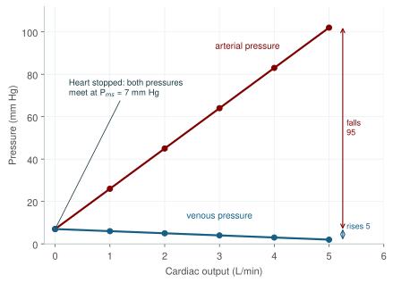
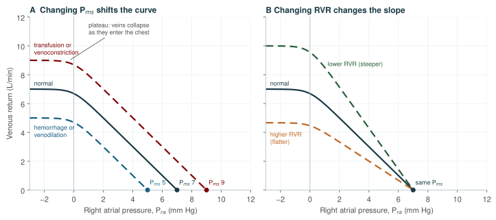

::: {.callout-note title="Goals for this chapter"}
- Explain how the elastic aorta works as a hydraulic filter (the Windkessel effect).
- Name the determinants of arterial blood volume and relate them to blood pressure.
- Explain what pulse pressure tells you, and why it is narrow in low-output shock and wide in high-output shock.
- Define mean systemic filling pressure (P~ms~) and stressed and unstressed volume.
- Name the determinants of venous return and draw the vascular function curve.
- Find the operating point where the cardiac and vascular function curves meet, and work out from the way it moves which curve shifted.

Names, dates and the exact values in figure captions are context, not things to memorize.
:::

So far the heart and the blood vessels have had their own chapters. This lecture puts them back together by asking what sets the arterial blood pressure and what sets the cardiac output. The first answer turns on the arteries: how much blood is in them and how stiff they are. The second turns on the veins, because the heart can only pump out what comes back to it. The last part of the chapter draws the heart and the vessels on one graph and uses it to predict what happens when either one changes. The [ANS and Extrinsic Control](ans-extrinsic-control.qmd) chapter, next, covers the nerves that move these curves.

## Systolic, diastolic and pulse pressure

A blood pressure of 120/80 mm Hg gives two numbers. The **systolic** pressure (SBP), 120, is the peak in the arteries during ejection. The **diastolic** pressure (DBP), 80, is the lowest pressure, reached just before the next ejection. The difference is the **pulse pressure**:

$$\text{PP} = \text{SBP} - \text{DBP}$$

Here PP is 40 mm Hg. Mean arterial pressure (MAP) is the time average of the waveform. At a normal heart rate it is about DBP + ⅓(SBP − DBP), about 93 mm Hg here ([Peripheral Circulation and Hemodynamics](hemodynamics.qmd)).

## The elastic aorta: a hydraulic filter

The left ventricle ejects only during systole, about a third of each cycle at rest, yet blood flows through the capillaries all the time. During ejection the aorta and large arteries stretch and take up part of the stroke volume. During diastole the aortic valve is closed, and the stretched walls recoil and push the stored blood on toward the arterioles. The compliant arteries, together with the resistance of the arterioles downstream, smooth a pulsatile inflow into a nearly steady outflow. The course calls this a **hydraulic filter**. It is also called the **Windkessel effect**, after the German word for the air chamber that old fire engines used to turn the strokes of a hand pump into a steady jet.

If the arteries were rigid pipes, flow to the tissues would stop in diastole. A stiffer aorta stores less, so outflow and pressure swing more. The [Peripheral Circulation and Hemodynamics](hemodynamics.qmd) chapter models this as an RC filter and draws the flows and pressures.

The filter has these benefits:

- **It allows perfusion during diastole.** This matters most for the heart. Contraction squeezes the vessels inside the left ventricular wall, so most left coronary flow happens in diastole, driven by the diastolic pressure the aorta maintains ([Coronary Circulation](coronary.qmd)).
- **It converts intermittent flow into continuous flow.**
- **It protects the microcirculation.** By the time blood reaches the capillaries, the pressure swings are gone and the mean pressure is low.

In the lecture's thought experiment, a valve lets pulses of water into an elastic tube. If twice as much water passed with each opening, the peak ("systolic") pressure and the pulse pressure would both rise: stroke volume is a major determinant of both.

## Pressure along the circulation

From the aorta to the capillaries, pulsations shrink and mean pressure falls, most steeply across the small arteries and arterioles, where the resistance is. The pulsations are damped by the hydraulic filter: the compliance of the arteries working against the resistance of the small arteries and arterioles. The large aggregate cross-sectional area of the capillaries slows the blood, but it is not what causes the drop in pressure ([Peripheral Circulation and Hemodynamics](hemodynamics.qmd)).

Among the large arteries, though, systolic pressure and pulse pressure *rise* from the aorta toward the periphery, so a cuff on the arm reads a higher systolic pressure than the aortic root. The pressure wave travels along the arterial wall much faster than the blood itself moves, reflects back from branch points and narrowing vessels, and adds to the forward (incident) wave. Recorded pressure is incident wave plus reflected wave. This is a real change in the waveform, not a cuff artifact.

Both statements are true. Pulse pressure is amplified along the large conduit arteries, from the aorta out to the arm and leg, and damped across the arterioles and capillaries.

## Compliance: not just a property of the relaxed ventricle

Compliance is the change in volume for a given change in pressure. Its reciprocal, elastance, describes stiffness:

$$C = \frac{\Delta V}{\Delta P} \qquad\qquad E = \frac{\Delta P}{\Delta V}$$

Arteries have compliance too. With age, elastin in the aortic wall fragments and collagen and calcium accumulate (the slides call it age-related medial degeneration with elastocalcinosis), so the same added volume raises the pressure more in older aortas.

That gives the course's rule for pulse pressure (@fig-control-of-co-pulse-pressure). At a given stroke volume, a stiffer aorta produces a wider pulse pressure, and at a given compliance, a larger stroke volume does:

$$\text{PP} \approx \frac{\text{SV}}{C_{\text{arterial}}}$$

{#fig-control-of-co-pulse-pressure}

The approximation leaves out runoff during ejection and wave reflection, but it gets the direction right. With age, pulse wave velocity rises, so the reflected wave comes back sooner, during systole instead of diastole, and adds to the systolic peak. The aorta behaves more like a stiff pipe than a rubber hose, and systolic and pulse pressure rise with age: age-related hypertension. The slides note that the rise in arterial stiffness with age is greater in women, with elastin and collagen changes after menopause.

| Pulse pressure rises with | Pulse pressure falls with |
|---|---|
| ↑ stroke volume | ↓ stroke volume |
| ↓ arterial compliance (stiffer arteries) | ↑ arterial compliance |

## Control of blood pressure

You can raise the pressure in a water balloon by adding water or by making the balloon stiffer. Arterial pressure works the same way: it depends on the **arterial blood volume** and the **arterial compliance**. Compliance changes over years. Minute to minute, the body controls blood pressure by changing arterial blood volume.

Arterial blood volume is set by blood in (cardiac output) and blood out, which runs off through the arterioles at a rate set by their resistance, SVR. If inflow briefly exceeds outflow, arterial volume and pressure rise until runoff catches up. So:

- ↑ CO → ↑ arterial blood volume → ↑ BP (if SVR is unchanged)
- ↑ SVR → ↑ arterial blood volume → ↑ BP (if CO is unchanged): constricted arterioles hold blood in the arteries longer

At steady state, inflow and outflow are equal, and the relation between them is Ohm's law for the systemic circulation, as the course writes it:

$$\text{CO} = \frac{\text{MAP} - \text{CVP}}{\text{SVR}} \qquad\qquad \text{MAP} \approx \text{CO} \times \text{SVR}$$

CVP is the measured central venous pressure, which is about equal to right atrial pressure, P~ra~, the pressure the curves below use. The shortcut on the right works when CVP is small; when it is high, leave it in ([Peripheral Circulation and Hemodynamics](hemodynamics.qmd) has worked examples).

### Pulse pressure in shock

Low blood pressure has more than one pattern, and pulse pressure helps tell them apart (@fig-control-of-co-shock).

{#fig-control-of-co-shock}

- **Low-output hypotension.** After hemorrhage, or when the heart pumps weakly, stroke volume is small and pulse pressure is narrow. Arterioles constrict (a sympathetic reflex covered in the next chapter, [ANS and Extrinsic Control](ans-extrinsic-control.qmd)), so SVR rises and partly compensates for the low CO.
- **High-output hypotension.** In the pattern of septic shock the lecture shows, the arterioles are dilated and SVR is low. Blood runs off the arteries quickly, so diastolic pressure falls, and the heart, facing a low afterload, ejects a large stroke volume. Pulse pressure is wide even though MAP is low. A high CO partly compensates for the low SVR. Sepsis can also be a low-output state when volume is depleted or the heart is depressed.

The lesson on the slide is CO ≠ BP: a low pressure can come with a high output. The slide also writes PP ∝ SV ∝ CO. Read it as: at a given arterial compliance and heart rate, pulse pressure tracks stroke volume, and so gives a clue to cardiac output, not a measurement of it. The full shock pictures are in [Cardiovascular Integration and Adaptation](cv-integration.qmd).

## What controls cardiac output?

Cardiac output is heart rate times stroke volume:

$$\text{CO} = \text{HR} \times \text{SV}$$

Stroke volume depends on preload, afterload and contractility. Preload is the stretch of the ventricle before it contracts (end-diastolic volume). Afterload is the load it ejects against, roughly arterial pressure. Contractility is the force the muscle can develop at a given preload and afterload (course errata entry 2). Very fast heart rates can lower stroke volume by cutting filling time.

The rest of the chapter is about preload. The heart cannot set its own preload: how much blood returns to it depends on the vessels, so the vessels share control of cardiac output with the heart. Guyton and his colleagues showed this in the 1950s by replacing the heart of an animal with a pump and changing the vessels [@w6-guyton1955].

### A simple model of the circulation

The lecture's model:

| Part | Compliance | Resistance | Role |
|---|---|---|---|
| Arterial system | Low | High | Stores pressure |
| Veins | About 20 times arterial | Low | Store volume |
| Heart | | | A sump pump that moves blood from the veins to the arteries |

About two thirds of the blood volume sits in the veins. The rest is spread among the arteries, capillaries, heart and lungs. The course's short version: arteries control pressure, veins control volume.

## Mean systemic filling pressure (P~ms~)

Start with the heart pumping 5 L/min. Mean arterial pressure is about 102 mm Hg and venous pressure about 2 mm Hg. Now stop the heart. Blood keeps running off from the arteries into the veins, but nothing moves it back. Arterial pressure falls and venous pressure rises until they are equal and flow stops. In the lecture's numbers they meet at **7 mm Hg** (@fig-control-of-co-equilibration).

{#fig-control-of-co-equilibration}

That pressure is the **mean systemic filling pressure, P~ms~**: the pressure throughout the systemic circulation when cardiac output is zero. The slides also call it P~mc~ (mean circulatory pressure) or MCFP (mean circulatory filling pressure). Strictly, those terms include the pulmonary circulation and P~ms~ refers to the systemic circulation, but the lecture treats them as the same. This book uses P~ms~.

Why does arterial pressure fall 95 mm Hg while venous pressure rises only 5? The same volume of blood leaves the arteries and enters the veins, and by C = ΔV/ΔP the pressure change for that volume is ΔV/C. The veins are about 20 times as compliant, so their pressure changes about one twentieth as much.

P~ms~ cannot be measured in a routine clinical setting. A CVP line measures right atrial pressure, not P~ms~.

### Stressed and unstressed volume

What sets P~ms~? Pour blood into an empty, floppy vein, and at first the pressure stays near zero. The blood just rounds out the vessel. Only once the vessel is full does more blood stretch the wall, and then pressure rises with each added milliliter (@fig-control-of-co-stressed).

- **Unstressed volume** is the volume needed to round out the vessels before any pressure is generated.
- **Stressed volume** is everything above that. It stretches the walls, and the walls' recoil makes the pressure.

These terms describe how blood volume relates to the capacity of the vessels. They are not two separate pools of blood. Applying C = ΔV/ΔP to the whole systemic circulation, with no flow:

$$P_{ms} \approx \frac{\text{stressed volume}}{\text{compliance}}$$

{#fig-control-of-co-stressed}

So P~ms~ depends on the volume of blood and on the capacity and compliance of the vessels, chiefly the veins:

- **↑ blood volume** (transfusion, fluid retention by the kidneys) → ↑ stressed volume → ↑ P~ms~.
- **↓ blood volume** (hemorrhage) → ↓ stressed volume → ↓ P~ms~.
- **Venoconstriction** → smaller unstressed volume → ↑ stressed volume at the same total volume → ↑ P~ms~.
- **Venodilation** does the reverse.

The lecture's analogy is a tube of toothpaste. Squeezing the tube, or rolling it up from the bottom, raises the pressure inside without adding any toothpaste. Sympathetic venoconstriction can mobilize about 30% of the venous volume this way.

## The vascular function curve

Now restart the heart and turn it up a step at a time. Each liter per minute of cardiac output moves blood from the veins into the arteries, so venous pressure falls 1 mm Hg and arterial pressure rises 19. At 5 L/min, venous pressure is 2 mm Hg and arterial pressure 102. Plotting the pressure at the right atrium against the flow gives the **vascular function curve**, also called the venous return curve.

Flow back to the heart obeys Ohm's law. The upstream pressure is P~ms~, the downstream pressure is P~ra~, and the resistance is the **resistance to venous return (RVR)**:

$$\text{VR} = \frac{P_{ms} - P_{ra}}{\text{RVR}}$$

In the lecture's numbers, RVR = (7 − 2)/5 = 1 mm Hg·min/L. RVR is not the same as SVR. SVR is the resistance between the aorta and the right atrium. RVR is the effective resistance between the upstream pressure P~ms~ and the right atrium, and most of it lies in the veins.

@fig-control-of-co-vascular-curves A draws the curve the way the course does, with P~ra~ on the x-axis and venous return on the y-axis.

- **The x-intercept is P~ms~.** When P~ra~ equals P~ms~, there is no pressure gradient and venous return is zero.
- **Lower P~ra~ means more venous return.** P~ra~ is the back pressure. On the straight part of the curve, the slope is −1/RVR.
- **The curve flattens at low P~ra~.** When P~ra~ falls below about 0, the large veins collapse where they enter the chest, so lowering P~ra~ further adds no flow.

{#fig-control-of-co-vascular-curves}

**Changing P~ms~ shifts the curve** (panel A). Transfusion or venoconstriction raises P~ms~ and shifts the curve to the right: more venous return at every P~ra~. Hemorrhage or venodilation shifts it to the left. In the lecture's words, the regulation of venomotor tone, and thus P~ms~, is one of the principal mechanisms by which cardiac output is controlled.

**Changing RVR changes the slope** (panel B). A higher RVR flattens the curve around the same P~ms~; a lower RVR steepens it. Panel B holds P~ms~ fixed to isolate the slope. In this course, slope changes are small next to changes in P~ms~ and can be ignored until exercise. In exercise, metabolic dilation of the arterioles in the working muscles lowers RVR and steepens the curve, and the course also treats the rhythmic squeeze of the skeletal muscle pump, working with the venous valves, as lowering the effective RVR ([Cardiovascular Adaptation to Exercise](cv-exercise.qmd)).

::: {.callout-note title="If you are comparing with the slides"}
The lecture's first vascular function curves (from Berne and Levy's *Physiology*) put central venous pressure on the y-axis and cardiac output on the x-axis. Later slides, and this book, flip them so P~ra~ is on the x-axis and the curve can share axes with the cardiac function curve. The flip changes how a slope change looks: the slide's "clockwise rotation" with more resistance is, with P~ra~ on the x-axis, a flatter curve around P~ms~. Think "flatter" and "steeper," not clockwise and counterclockwise.
:::

## The cardiac function curve

The cardiac function curve plots cardiac output against P~ra~ (slide 45 labels it the ventricular function curve). It is the Frank-Starling relationship for the whole heart. More filling pressure fills the ventricle to a larger end-diastolic volume, the stretched muscle contracts with more force, and stroke volume and cardiac output rise. At high filling pressures, more filling adds less and less, and the curve flattens.

A change in filling moves the heart **along** the curve. A change in pump performance **shifts** the curve:

- **Up:** more contractility; a faster heart rate, up to a point.
- **Down:** less contractility; more afterload; a heart rate so fast that filling time is cut short.

P~ra~ is used here as the filling pressure. It is not the same as end-diastolic volume. How much volume a given pressure produces depends on the ventricle's filling curve (the EDPVR in [The Cardiac Pump](cardiac-pump.qmd)).

::: {.callout-warning title="A common mistake"}
Moving up a cardiac function curve does not change contractility. Extra stretch raises the *force* of contraction; that is the Frank-Starling mechanism. A change in contractility moves the heart to a different cardiac function curve.
:::

## Ventricular-vascular coupling: the operating point

Now put both curves on the same axes (@fig-control-of-co-operating-shifts). The cardiac function curve says how much the heart will pump at each P~ra~. The vascular function curve says how much will return at each P~ra~. At steady state the two flows must match, because blood cannot pile up forever in one part of a closed circuit:

$$\text{CO} = \text{VR}$$

The only P~ra~ where both are true is where the curves cross. That intersection is the **operating point**, and its coordinates are the steady-state cardiac output and P~ra~. The slides call it the equilibrium point.

The same P~ra~ plays opposite roles on the two curves: a higher P~ra~ helps the heart fill but opposes venous return. If P~ra~ rose above the operating point for a moment, the heart would pump out more than came back, and P~ra~ would fall back; below it, the reverse. A stronger pump lowers its own filling pressure.

{#fig-control-of-co-operating-shifts}

| Initial change | Curve that moves | New operating point |
|---|---|---|
| Transfusion or more venous tone | Vascular curve shifts right (P~ms~ up) | CO up, P~ra~ up |
| Hemorrhage or venodilation | Vascular curve shifts left (P~ms~ down) | CO down, P~ra~ down |
| More contractility | Cardiac curve shifts up | CO up, P~ra~ down |
| Less contractility, or more afterload | Cardiac curve shifts down | CO down, P~ra~ up |

These predictions assume the other curve does not change, RVR is constant, and the heart is on the rising part of its curve.

The [Circulation Lab](https://beiser-lab.github.io/circulation-lab/) plots the cardiac function and venous return curves while a model circulation runs [@circlab2026]. Remove blood or infuse volume and watch the operating point move.

Hemorrhage shows the whole sequence. Blood loss lowers P~ms~, and CO falls (panel C). The baroreflex then responds. Sympathetic venoconstriction recruits unstressed volume into stressed volume and raises P~ms~ part of the way back, while a faster, stronger heart raises the cardiac function curve (panel D). Arteriolar constriction raises SVR and helps hold MAP. A young person with these reflexes intact can lose a good deal of blood before the pressure falls. P~ms~ acts on filling through venous return and filling pressure; the ventricle does not equilibrate with P~ms~ ([The Cardiac Pump](cardiac-pump.qmd); course errata entry 16). The integration chapter follows hemorrhage, heart failure and sepsis in detail ([Cardiovascular Integration and Adaptation](cv-integration.qmd)).

## Finding the cause

Locating the new operating point is half the problem. The other half is saying why it moved. A common error is to find the new intersection correctly and then name the wrong change as its cause. The way the operating point moves tells you which curve moved (@fig-control-of-co-find-cause):

- **If only the vascular function curve moves,** the new point lies on the old cardiac function curve. The point slides along the cardiac curve, so **CO and P~ra~ move in the same direction**: both up when P~ms~ rises, both down when it falls.
- **If only the cardiac function curve moves,** the new point lies on the old vascular function curve. The point slides along the vascular curve, so **CO and P~ra~ move in opposite directions**: CO up and P~ra~ down for a stronger heart, CO down and P~ra~ up for a weaker one.

{#fig-control-of-co-find-cause}

::: {.callout-warning title="A common mistake"}
"The operating point moved right" does not mean "P~ms~ rose." A weaker heart also moves the operating point to a higher P~ra~, with P~ms~ unchanged. Before you name a cause, ask which curve the new point still sits on.
:::

Work any problem in this order:

1. Identify the initial disturbance. Is it in the heart (contractility, rate, afterload) or in the vessels (blood volume, venous tone, RVR)?
2. Shift that curve, and only that curve, and find the new intersection.
3. Add the compensation, which usually moves the *other* curve. A failing heart triggers venoconstriction and fluid retention that raise P~ms~; a hemorrhage triggers sympathetic stimulation of the heart.
4. Think through the consequences upstream and downstream: arterial pressure (from CO and SVR) and where blood is accumulating.

When both curves move, P~ra~ may be clear while CO depends on the sizes of the two changes. More venous tone with less contractility raises P~ra~ for both reasons, but one raises CO and the other lowers it.

## Two pumps in series

The single-pump model treats the heart and lungs as one pump filled from the right atrium. The real circulation has two pumps in series, and at steady state their outputs must be equal. The lecture's rule applies: when something changes, think through what happens upstream and downstream.

**An acute fall in left ventricular contractility**, as with ischemia. Left ventricular output falls while the right ventricle keeps pumping, so blood accumulates in the lungs. Left atrial pressure (P~la~) rises, which restores part of the left ventricle's output by Frank-Starling. Less venous return reaches the right heart, so P~ra~ falls, and the higher pulmonary pressures raise the right ventricle's afterload. At the new steady state, both ventricles pump the same, reduced cardiac output, with a higher pulmonary venous pressure. The slide traces what follows: ↓ CO → ↑ LVEDP → ↑ P~pv~ → ↑ P~capillary~ → ↑ hydrostatic pressure, which drives filtration into the lung (the Starling forces in [Microcirculation and Local Control](microcirculation.qmd)) and can cause pulmonary edema and respiratory failure ([Pulmonary Circulation](pulmonary-circulation.qmd)).

::: {.callout-note title="If you are comparing with the slides"}
The two-pump slide writes "↑ P~LA~ → ↑ P~PV~ → ↑ P~PA~ → ↑ PVR (↑ afterload)." Pulmonary artery pressure rises because the pressure downstream of the lungs has risen, so the right ventricle faces a higher afterload. Pulmonary vascular resistance need not change. PVR = (mPAP − PCWP)/CO, where the wedge pressure (PCWP) estimates P~la~, and here both pressures rise together. Read the last step as "↑ right ventricular afterload."
:::

**An acute fall in right ventricular output**, as with tension pneumothorax. Air trapped under pressure raises intrathoracic pressure, so P~ra~ rises even though the right heart is filling poorly. The higher P~ra~ cuts venous return and right ventricular output. Less blood reaches the left heart, so left ventricular output falls too, though the left ventricle is normal.

## A puzzle: orthostatic hypotension with a normal heart

Some neurologic disorders, Parkinson's disease among them, can cause orthostatic hypotension: blood pressure falls on standing, and the person may faint. Most of these patients have normal cardiac function. How?

Standing pools blood in the veins of the legs and abdomen. Normally the baroreflex, covered in the next chapter ([ANS and Extrinsic Control](ans-extrinsic-control.qmd)), answers within seconds with sympathetic venoconstriction, which recruits that pooled blood back into the stressed volume, along with arteriolar constriction and a faster heart. If the autonomic nerves that control venomotor tone are damaged, the veins cannot constrict. The stressed volume available to drive venous return falls, the vascular function curve shifts left, and venous return, stroke volume, cardiac output and arterial pressure all fall. The heart is fine. The vessels have lost their control.

::: {.callout-note collapse="true" title="Background: why morphine can unmask blood loss"}
A hidden slide in the lecture asks why a young patient who has lost blood, with a normal blood pressure, may become hypotensive after a dose of morphine. The answer is the compensation in @fig-control-of-co-operating-shifts D. Young people with strong reflexes can hold P~ms~ near normal after substantial blood loss by sympathetic venoconstriction. Morphine dilates the veins, which removes part of that compensation, so P~ms~, venous return and pressure fall.
:::

## Check your understanding

1. A 75-year-old has a blood pressure of 160/70 mm Hg. A 25-year-old with the same stroke volume has 120/80. What explains the difference in pulse pressure?

    

Answer

    Pulse pressure is about SV divided by arterial compliance. The older aorta is stiffer, so the same stroke volume produces a larger rise in pressure, and the faster pulse wave returns the reflected wave during systole. Pulse pressure is 90 mm Hg instead of 40.

    

2. Two patients both have a MAP of 60 mm Hg. One has a pressure of 72/54, the other 90/45. Which is more likely to have a low cardiac output, and why?

    

Answer

    The patient at 72/54 has a narrow pulse pressure (18 mm Hg), which suggests a small stroke volume and a low cardiac output, with SVR raised to compensate, as after hemorrhage. The patient at 90/45 has a wide pulse pressure (45 mm Hg): low SVR lets the arteries run off fast in diastole, and a large stroke volume, as in high-output sepsis. Same MAP, different cardiac outputs: CO ≠ BP.

    

3. The heart stops. Arterial pressure falls from 102 to 7 mm Hg while venous pressure rises from 2 to 7 mm Hg. Why are the changes so unequal, and what is the 7 called?

    

Answer

    The same volume of blood leaves the arteries and enters the veins. The pressure change for a given volume is ΔV/C, and the veins are about 20 times as compliant as the arteries, so their pressure changes about one twentieth as much. The common pressure, with no flow, is the mean systemic filling pressure, P~ms~.

    

4. Sympathetic stimulation constricts the veins with no change in blood volume. Which curve moves, which way, and what happens to CO and P~ra~?

    

Answer

    Venoconstriction shrinks the unstressed volume, so stressed volume and P~ms~ rise. The vascular function curve shifts right. The new operating point lies on the unchanged cardiac function curve, up and to the right: CO rises and P~ra~ rises. (In real life sympathetic stimulation also raises the cardiac function curve, which pulls P~ra~ back down.)

    

5. After an intervention, a patient's CO falls from 5 to 3.6 L/min and P~ra~ rises from 2 to 3.4 mm Hg. A classmate says P~ms~ must have risen, because the operating point moved to the right. What actually changed?

    

Answer

    CO and P~ra~ moved in opposite directions, so the operating point slid along the vascular function curve, and the vascular curve did not move. The cardiac function curve shifted down: contractility fell, or afterload rose. A rise in P~ms~ would have raised both CO and P~ra~.

    

6. A patient's left ventricle suddenly loses much of its contractility. Predict what happens to left atrial pressure, right atrial pressure, and the outputs of the two ventricles once a new steady state is reached.

    

Answer

    Left atrial pressure rises as blood accumulates in the lungs, which restores some left ventricular output by Frank-Starling. Right atrial pressure falls, because less blood returns to the right heart. At the new steady state, both ventricles pump the same, reduced output.

    

## Key equations

| Equation | Use |
|---|---|
| PP = SBP − DBP | Pulse pressure |
| PP ≈ SV / C~arterial~ | Pulse pressure from stroke volume and arterial compliance |
| C = ΔV/ΔP; E = ΔP/ΔV | Compliance and elastance |
| CO = (MAP − CVP)/SVR (CVP ≈ P~ra~); MAP ≈ CO × SVR | Arterial pressure from flow and resistance |
| CO = HR × SV | Cardiac output |
| P~ms~ ≈ stressed volume / compliance | What sets P~ms~ (concept) |
| VR = (P~ms~ − P~ra~)/RVR | Venous return |
| CO = VR at steady state | The operating point |

## Sources

This chapter follows the 2026 Control of Cardiac Output and Ventricular-Vascular Coupling lecture for MEDC 30504 and draws on the 2026 lecture notes, the peer-educator notes, the course's venous return graphs and the course's 2018 notes, corrected and updated. All figures were drawn for this book.

::: {#refs}
:::
