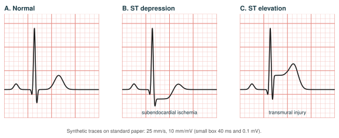

::: {.callout-note title="Goals for this chapter"}
- Name the main coronary arteries, the regions each supplies, and what coronary dominance means.
- Explain why the left ventricle is perfused mainly in diastole and the right ventricle in systole and diastole.
- Calculate left coronary perfusion pressure from aortic diastolic pressure and LVEDP, and say what lowers it.
- Explain why a rise in myocardial O~2~ demand has to be met by a rise in coronary flow.
- Compare systemic (autonomic) and local control of coronary flow, and say which wins.
- List the supply and demand causes of ischemia, and explain why the subendocardium is injured first.
- Say what an ECG, an echocardiogram and a nuclear study each show about coronary perfusion and function.

Names, dates and the exact values in figure captions are context, not things to memorize.
:::

The heart pumps for everyone else, and it has to be perfused like everyone else. It is a special case for two reasons. Its muscle uses a great deal of O~2~ and already takes most of the O~2~ out of the blood it receives, so it has almost no reserve except more flow. And the muscle that needs the flow squeezes its own vessels shut every time it contracts. Heart disease is the leading cause of death in the United States, and most of it is coronary heart disease: a mismatch between what the myocardium needs and what the coronary arteries can deliver. This chapter is about that balance of supply and demand.

## Anatomy

Both coronary arteries arise from the root of the aorta, just above the aortic valve. Their openings sit behind the valve cusps, in the sinuses of the aortic root. When the ventricle relaxes and the valve closes, the column of blood falling back toward the ventricle fills the sinuses and the coronary arteries with it.

**The left main coronary artery** is short. It divides into two branches that together supply most of the left ventricle and the septum:

- the **left anterior descending (LAD)** artery, running down the front of the heart in the interventricular groove, with **diagonal** branches over the anterior wall and septal branches into the front of the septum;
- the **left circumflex** artery, running around the left side in the atrioventricular groove, with **left marginal** branches to the lateral wall.

**The right coronary artery (RCA)** runs in the right atrioventricular groove. Its **right marginal** branch supplies the right ventricle. Near the back of the heart it usually gives off the **posterior descending artery (PDA)**, which runs toward the apex in the posterior interventricular groove. The RCA largely serves the right ventricle, but it also serves part of the left: the inferior (posterior) wall and the back of the septum, about a quarter of the left ventricle. The left ventricle is so much larger than the right that the artery serving the right heart ends up supplying some of it too.

**Dominance** is named for the artery that gives off the PDA. In most people (roughly two-thirds to four-fifths, depending on the source the lecture uses) the PDA comes from the RCA: a right-dominant heart. In a smaller group it comes from the circumflex (left dominant), and in the rest both contribute (codominant). Small branches from the dominant artery supply the AV node, so in a right-dominant heart an RCA blockage can impair AV conduction as well as the inferior wall. @fig-coronary-territories summarizes the territories.

{#fig-coronary-territories}

### Into the wall

The large coronary arteries are **epicardial**: they run on the surface of the heart. From them, intramural arteries dive straight through the muscle toward the inside of the wall and branch as they go, ending in a dense network just under the endocardium, the **subendocardial plexus** (@fig-coronary-driving-pressure A). Every vessel inside the wall is surrounded by muscle that contracts with each beat. The deepest vessels, at the end of the line, sit where the squeeze is strongest. That geometry explains most of what follows.

## Perfusion

### A high-demand organ

At 70 beats per minute and 5 L/min, the heart beats about 100,000 times a day and pumps about 7,200 L a day, about 2.8 billion beats over 75 years. It never rests, and it runs almost entirely on aerobic metabolism.

At rest the heart extracts about 70 to 80% of the O~2~ delivered to it. The body as a whole extracts about 25%. Coronary venous blood is therefore much more desaturated than mixed venous blood, and the heart cannot take much more O~2~ out of each milliliter of blood when its needs rise. O~2~ delivery to the myocardium is **flow dependent**: when the heart needs more O~2~, coronary blood flow has to rise, and flow, not extraction, is the step that limits how much O~2~ the myocardium can use (@fig-coronary-demand).

{#fig-coronary-demand}

::: {.callout-note title="If you are comparing with the slides"}
The speaker notes for the slide comparing organs say the heart "consumes almost 100% of the oxygen delivered." The heart extracts about 70 to 80% at rest (course errata entry 20). Some O~2~ always remains in coronary venous blood. The point to keep is the one the slide makes: extraction is already high, so more O~2~ has to come from more flow.
:::

### The pressure gradient changes through the cardiac cycle

Flow into the wall needs a pressure difference: the pressure in the epicardial arteries (aortic pressure) minus the pressure the vessels inside the wall are exposed to.

**In diastole**, the ventricle is relaxed. Aortic pressure is about 80 to 90 mm Hg, and the pressure around the intramural vessels and the subendocardial plexus is close to ventricular diastolic pressure, about 5 to 10 mm Hg. Blood flows readily from the aortic root into the wall.

**In systole**, the left ventricle generates about 120 mm Hg, as much as the aorta. The contracting muscle compresses the intramural vessels, most of all in the inner layers next to the high-pressure cavity. The pressure difference driving flow into the inner wall falls to about zero, and left coronary flow nearly stops.

**The right ventricle** generates only about 25 mm Hg in systole. Aortic pressure is higher than RV pressure in systole as well as diastole, so the right coronary circulation keeps flowing through the whole cycle (in health).

![(A) The coronary vessels of the left ventricular wall. Epicardial arteries on the surface send intramural arteries through the muscle to the subendocardial plexus. In systole the contracting muscle compresses them, most strongly near the endocardium. (B) The pressure difference driving flow into the inner wall (aortic minus ventricular pressure), using the lecture's values (aortic pressure 80 to 90 mm Hg in diastole and 120 in systole; LV 5 to 10 in diastole and about 120 in systole; RV 5 to 10 in diastole and about 25 in systole). The inner left ventricular wall is perfused in diastole; the right ventricle in both phases. Course figure, after the lecture's slides.](figures/coronary/driving-pressure.svg){#fig-coronary-driving-pressure}

@fig-coronary-phasic-flow shows what this does to flow. Aortic pressure is highest in systole, yet left coronary flow is lowest then. It falls to nearly zero during isovolumic contraction, when the ventricle squeezes hardest on a closed chamber, recovers only partly during ejection, and is greatest in diastole, peaking early in diastole as the muscle relaxes while aortic pressure is still high. Right coronary flow follows aortic pressure and is, if anything, a little higher in systole.

{#fig-coronary-phasic-flow}

The point to carry forward is the one the course states: **the left ventricle is perfused only in diastole; the right ventricle is perfused in systole and diastole.** Strictly, the outer layers of the left ventricular wall get some flow during ejection, as @fig-coronary-phasic-flow shows; the inner layer gets essentially none. That is why the [Control of Cardiac Output](control-of-co.qmd) chapter cares about diastolic pressure: the elastic aorta keeps pressure up after the valve closes, and that diastolic pressure is what fills the left coronary arteries.

### Left coronary perfusion pressure

Because the left ventricle fills its coronary bed in diastole, its perfusion pressure is the diastolic pressure difference:

$$\text{Left coronary perfusion pressure} = \text{aortic DBP} - \text{LVEDP}$$

Aortic diastolic pressure (DBP) pushes blood in. Left ventricular end-diastolic pressure (LVEDP), the pressure inside the relaxed chamber at the end of filling, is the back pressure that the inner wall and its vessels sit against. With a DBP of 80 and an LVEDP of 8 mm Hg, the perfusion pressure is 72 mm Hg.

Anything that lowers DBP (hemorrhage, vasodilation, a leaky aortic valve) or raises LVEDP (a failing or stiff ventricle, too much filling) lowers left coronary perfusion pressure. A third factor is not in the equation but matters as much: **time**. The left ventricle is perfused only while it is in diastole, so a fast heart rate, which shortens diastole far more than systole, cuts the time available for flow.

::: {.callout-note title="If you are comparing with the slides"}
The peer-educator notes add "R side coronary perfusion pressure = aortic diastolic pressure − RV pressure." The course equation is for the left side only. The right ventricle is perfused in both systole and diastole, so its driving pressure is aortic pressure minus RV pressure through the whole cycle (about 120 − 25 in systole and 85 − 7.5 in diastole, using the lecture's 5 to 10 mm Hg for both ventricles in diastole), not a diastolic value alone.
:::

## Regulation

Coronary flow is set the way flow is set anywhere: by arteriolar radius. The question is which signals control the radius. As in every special circulation in this block, there are two sets of controls, systemic (autonomic and hormonal) and local, and the useful question is which one wins.

### Systemic regulation

The autonomic nervous system acts on the heart in several places at once (the [ANS and Extrinsic Control](ans-extrinsic-control.qmd) chapter has the detail):

| Effector | Sympathetic (NE, epinephrine) | Parasympathetic (ACh) |
|---|---|---|
| SA node | β~1~: faster rate | M~2~: slower rate |
| AV node | β~1~: faster conduction | M~2~: slower conduction |
| Myocardium | β~1~: more contractility | M~2~: slightly less contractility |
| Coronary vessels | α~1~: constriction; β~2~: dilation | little direct effect |

Taken alone, the vascular row predicts that sympathetic activation should lower coronary flow. α~1~ receptors on coronary smooth muscle constrict the vessels, and the faster heart rate shortens diastole. Yet during exercise or stress, when sympathetic activity is high, coronary flow rises, often several-fold. The rest of the table explains why. Sympathetic stimulation makes the heart beat faster and harder, which raises myocardial O~2~ demand, and the metabolic dilators that demand produces overwhelm the direct α~1~ constriction. The net effect of sympathetic activation on the coronary arteries is dilation, through local control.

### Local regulation: mechanical (myogenic)

Like other arterioles, coronary arterioles respond to stretch. When perfusion pressure rises, the arteriolar wall is stretched, mechanosensitive channels in the smooth muscle let in Ca^2+^, and the arteriole constricts. When perfusion pressure falls, there is less stretch and it dilates. Flow is held nearly constant across a range of perfusion pressures (@fig-coronary-autoregulation), which the lecture shows as roughly 60 to 120 mm Hg in its coronary example. Below the range the arterioles are already maximally dilated, and flow falls with pressure. The mechanism is the same myogenic response described in [Microcirculation and Local Control](microcirculation.qmd), where the course's general autoregulatory range is 20 to 150 mm Hg. Limits differ between beds and sources; what matters is that flow stays steady across normal pressures and falls once pressure drops below the range.

{#fig-coronary-autoregulation}

The myogenic response protects the heart when arterial pressure changes. It does not match flow to the heart's work. That is the job of metabolic control.

### Local regulation: metabolic, the dominant control

When the myocardium works harder, or its O~2~ supply falls short, local dilators build up and widen the coronary arterioles. The lecture names two: **adenosine**, from the breakdown of ATP in the myocytes, and **nitric oxide (NO)**, from the endothelium (the [Microcirculation](microcirculation.qmd) chapter calls this endothelial control). The slides call these mechanisms "myogenic autoregulation" and "metabolic autoregulation"; the course keeps "autoregulation" for the overall result. NO activates guanylyl cyclase in the smooth muscle, cGMP rises, and the muscle relaxes (the [Smooth Muscle](../muscle/smooth-muscle.qmd) chapter has the pathway). Resistance falls, flow rises, and the extra flow brings O~2~ and washes the metabolites out. Production of the dilators rises with metabolic rate and their removal rises with flow, so flow settles where supply matches demand.

This is the dominant control of coronary flow. **Local metabolic control outweighs autonomic control** in the heart, which is why coronary flow rises in proportion to myocardial O~2~ use (@fig-coronary-demand B) even when sympathetic activity is high. The same is true of the brain ([Other Special Circulations](special-circulations.qmd)). It makes sense: the brain and heart cannot afford to have their supply turned down by a reflex that is defending blood pressure for the rest of the body.

## Cardiac ischemia: supply versus demand

*Ischemia* is O~2~ delivery that falls short of O~2~ demand. Severe or prolonged ischemia kills muscle (infarction). Any cause of ischemia either lowers supply or raises demand.

### Decreased supply

- **Coronary artery obstruction.** An atherosclerotic plaque narrows the artery. If its fibrous cap ruptures, a clot forms on it and can block the artery completely, and the muscle beyond the blockage dies. A narrowed artery may supply enough flow at rest but not enough when demand rises, because its downstream arterioles are already partly dilated to make up for the narrowing.
- **Decreased systemic pressure.** Hemorrhage or shock lowers aortic diastolic pressure and with it coronary perfusion pressure.
- **Decreased O~2~-carrying capacity.** Flow can be normal and delivery still low if each milliliter of blood carries less O~2~. Arterial O~2~ content is CaO~2~ = (1.39 × Hb × SaO~2~) + (0.003 × PaO~2~), in mL O~2~/dL with Hb in g/dL, as the [Transport of O~2~ and CO~2~](../pulmonary/o2-co2-transport.qmd) chapter teaches it, so anemia or low saturation lowers delivery at any flow. The coronary slide writes the constants as 1.34 and 0.0031; sources round them differently, and the difference is less than 1 mL/dL.

### Increased demand

Four things raise myocardial O~2~ demand, and each also works against supply:

| Increased | Raises demand because | Also affects supply because |
|---|---|---|
| Heart rate (tachycardia) | More beats per minute | Diastole shortens, so the left ventricle has less time to be perfused |
| Contractility | Harder contraction uses more ATP | Greater pressure on the intramural arteries and subendocardial plexus during systole |
| Preload | More stretch means higher wall tension (Laplace) | Higher LVEDP raises the pressure around the inner wall and lowers perfusion pressure |
| Afterload | The ventricle must generate more pressure to eject | It is met by more contractility, with the compression that brings |

Even so, the healthy heart copes. Higher contractility and afterload raise aortic pressure, which raises coronary perfusion pressure, and metabolic dilation of the arterioles makes up the rest. Ischemia appears when compensation is limited, usually by coronary artery disease: the narrowed artery cannot deliver the extra flow, so a demand the healthy heart would meet easily, such as climbing stairs, outruns supply. The third CV small group (Applied Physiology Cases 3) works through the same reasoning after a myocardial infarction: the occluded vessel lowers flow regionally, a falling DBP lowers perfusion pressure, a faster heart rate shortens perfusion time, and a rising LVEDP raises wall tension and squeezes the subendocardial branches.

### The subendocardium is injured first

Ischemia appears first in the inner layer of the left ventricular wall, the **subendocardium**. Three facts from earlier in the chapter combine:

- Systolic compression is strongest next to the cavity, so the inner layer gets essentially no flow in systole and depends entirely on diastole.
- In diastole, LVEDP presses on the inner layer from the cavity side. When LVEDP rises, the inner layer's perfusion pressure falls first.
- The subendocardial vessels are at the end of the intramural arteries, the farthest point from the epicardial supply, while wall stress and O~2~ demand are highest in the inner layers.

So when supply falls or demand rises across the whole heart, as in hemorrhage, severe anemia or a fast tachycardia, the injury is subendocardial. Only when an epicardial artery is blocked completely does the injury extend through the full thickness of the wall (*transmural*) in that artery's territory.

::: {.callout-tip title="What you need from this"}
Be able to sort any cause of ischemia into supply or demand, and to say how heart rate, contractility, preload and afterload each change both sides. For the left ventricle, think of three things: aortic diastolic pressure, LVEDP and time in diastole.
:::

## Assessing perfusion and function

The lecture closes with how ischemia is detected in the clinic. These are previews; later courses teach them as clinical skills.

**The ECG.** Ischemic and injured muscle changes the ECG: the ST segment, the T wave and, after an infarction, pathological Q waves. The details are below as background; the [EKG III](ecg-interpretation.qmd) chapter explains why the ST segment is normally flat.

::: {.callout-note collapse="true" title="Background: ST changes and coronary territories"}
Ischemia confined to the subendocardium tends to depress the ST segment. Transmural injury tends to elevate it (@fig-coronary-st). The lecture previews how the leads that show ST elevation point to the injured territory, and so to the artery. ST depression is often diffuse and does not localize this way. Reading ST changes is a second-year skill and is not examined in this course.

| Leads | Region of the left ventricle | Usual artery |
|---|---|---|
| II, III, aVF | Inferior | RCA (in right-dominant hearts), sometimes circumflex |
| V~1~, V~2~ | Septal | LAD |
| V~3~, V~4~ | Anterior | LAD |
| I, aVL, V~5~, V~6~ | Lateral | Circumflex or a diagonal of the LAD |

{#fig-coronary-st}
:::

**Echocardiography.** Ultrasound shows the walls moving. Ischemic or infarcted muscle contracts weakly or not at all, so a region that moves poorly points to the artery that supplies it.

**Nuclear studies and stress testing.** A radioactive tracer that is taken up in proportion to blood flow shows which regions are underperfused. Studies are often done at rest and after exercise on a treadmill, or after a drug that mimics exercise, because a narrowed artery may supply enough at rest and fall short only when demand rises: the supply-and-demand problem of this chapter.

## Check your understanding

1. A patient has a right-dominant heart. Which artery supplies the inferior wall of the left ventricle, and why might a blockage there slow AV conduction?

    

Answer

    The right coronary artery, through the posterior descending artery. The AV node is supplied by small branches of the dominant artery, so in a right-dominant heart an RCA blockage can make the AV node ischemic as well.

    

2. In chronic pulmonary hypertension the right ventricle thickens and develops much higher systolic pressures than normal. Right coronary flow now falls in systole and arrives mostly in diastole, the pattern of the left ventricle. Which layer of the right ventricular wall is now most at risk of ischemia, and why has the right ventricle's O~2~ demand risen?

    

Answer

    The subendocardium. Systolic compression is strongest next to the cavity, so once RV pressure is high the inner layer gets little flow in systole and depends on diastole, as the inner layer of the left ventricle does. Its vessels are also at the far end of the intramural arteries. Demand has risen because afterload is up: the right ventricle must generate a much higher pressure to eject into the pulmonary artery. It meets that load with more contractility and with a thicker wall, more muscle that uses O~2~.

    

3. Norepinephrine acting on α~1~ receptors constricts coronary arteries. Why, then, does coronary blood flow rise when sympathetic activity rises during exercise?

    

Answer

    Sympathetic stimulation also raises heart rate and contractility (β~1~), which raises myocardial O~2~ demand. The myocardium releases adenosine and NO, and this metabolic dilation is much stronger than the direct α~1~ constriction. Local metabolic control outweighs autonomic control in the heart, so the net effect is dilation and higher flow.

    

4. A failing left ventricle fills at an LVEDP of 25 mm Hg instead of 8. Why does the subendocardium become ischemic before the outer layers of the wall?

    

Answer

    LVEDP is the pressure in the relaxed cavity, and it presses directly on the inner layer and the subendocardial plexus. The inner layer gets almost no flow in systole, so it depends on diastole, and in diastole its vessels now sit against a back pressure of 25 instead of 8. Its perfusion pressure falls first and most. The outer layers lie farther from the cavity and also get some flow during ejection. At the same time the stretched ventricle has a higher wall tension (Laplace), so demand rises, and wall stress and O~2~ demand are highest in the inner layers. The subendocardial vessels are also the farthest point from the epicardial supply.

    

5. A patient loses a large volume of blood, and her losses are replaced with saline. Her blood pressure and heart rate return to normal, but her hemoglobin is now half its usual value. Is her heart at risk from a supply problem or a demand problem, and why can't her heart simply extract more O~2~?

    

Answer

    Supply: each milliliter of blood carries about half as much O~2~ (CaO~2~ depends on [Hb]), so delivery falls at any flow. The heart already extracts 70 to 80% of the O~2~ it receives, so extraction has little room to rise. The only way to restore delivery is more coronary flow, which metabolic dilation provides until the arterioles are fully dilated. If demand rises beyond that, as with exercise or a tachycardia, the subendocardium becomes ischemic first.

    

6. Why is a fast heart rate more dangerous to the left ventricle than to the right?

    

Answer

    The left ventricle is perfused only in diastole, and a faster heart rate shortens diastole much more than systole. The right ventricle is also perfused in systole, because aortic pressure stays well above RV pressure, so losing diastolic time costs it less.

    

## Key equations

| Equation | Use |
|---|---|
| Left coronary perfusion pressure = aortic DBP − LVEDP | Driving pressure for left ventricular perfusion, which happens in diastole |
| CaO~2~ = (1.39 × Hb × SaO~2~) + (0.003 × PaO~2~) | O~2~ carried in arterial blood (mL O~2~/dL, Hb in g/dL) |

## Sources

This chapter follows the 2025 Coronary Circulation lecture for MEDC 30504, the version in use in 2026, and draws on the peer-educator notes, the third CV small group key (Applied Physiology Cases 3) and the course's 2018 notes, corrected and updated. All figures were drawn for this book.
