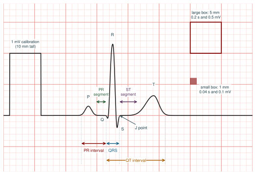
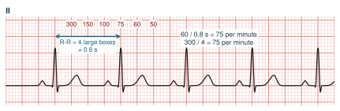
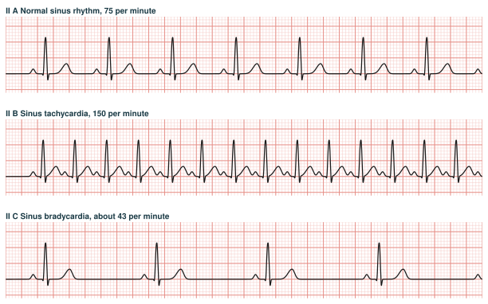
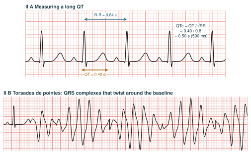

::: {.callout-note title="Goals for this chapter"}
- Label the waves, intervals and segments of the ECG and say what electrical event each one represents.
- Read time and voltage from standard ECG paper, and measure the heart rate three ways.
- Give the course's normal values for the PR interval, QRS duration and QTc, and say what a long or short value means.
- Recognize normal sinus rhythm, sinus tachycardia and bradycardia, ectopic beats and rhythms, and explain why a PVC is wide.
- Recognize first-degree, second-degree (Mobitz I and Mobitz II) and third-degree AV block, and say where in the conduction system each one usually is.
- Explain why the T wave points the same way as the QRS, and why a long QT matters.
- Work through an ECG in a fixed order, and compare it with a previous tracing.

Names, dates and the exact values in figure captions are context, not things to memorize.
:::

The first two chapters built the ECG from the bottom up: [ion channels and action potentials](ecg-ionic-basis.qmd), then [vectors, leads and the mean electrical axis](ecg-vectors-axis.qmd). This one reads the result, in the lecture's six steps: measurement, rhythm analysis, conduction analysis, waveform (morphology) analysis, interpretation, and comparison with a previous ECG. Each abnormality comes back to the earlier physiology: which pacemaker is firing, where conduction is slow or blocked, and how the wave of depolarization crosses the ventricles.

You will practice all of this in the ECG Reading Room session. The course titles spell the recording both ways, EKG and ECG. This book writes ECG.

## The waves and intervals

Einthoven named the waves of one beat P, Q, R, S and T (@fig-ecg-interpretation-paper-beat).

- **P wave**: atrial depolarization.
- **QRS complex**: ventricular depolarization. A *Q wave* is any negative deflection before the first positive one, the *R wave* is the first positive deflection, and the *S wave* is a negative deflection after the R. Not every lead has all three.
- **T wave**: ventricular repolarization. Atrial repolarization happens during the QRS and is hidden by it.

Intervals include at least one wave; segments are the flat stretches between waves.

- **PR interval**: from the start of the P wave to the start of the QRS. It covers atrial conduction, the AV node delay, and conduction through the His bundle, bundle branches and Purkinje fibers.
- **PR segment**: from the end of the P wave to the start of the QRS.
- **QRS duration**: from the start to the end of the QRS.
- **ST segment**: from the end of the QRS to the start of the T wave, when the whole ventricle is depolarized (phase 2 everywhere). The point where the QRS ends and the ST segment begins is the *J point*.
- **QT interval**: from the start of the QRS to the end of the T wave, measured whether or not there is a Q wave. It covers ventricular depolarization and repolarization.

{#fig-ecg-interpretation-paper-beat}

## Measurement

### The paper

An ECG is a graph of voltage against time. Standard paper runs at 25 mm/s, with 10 mm for each millivolt.

| Box | Size | Time (horizontal) | Voltage (vertical) |
|---|---|---|---|
| Small box | 1 mm | 0.04 s (40 ms) | 0.1 mV |
| Large box | 5 mm, five small boxes | 0.2 s (200 ms) | 0.5 mV |

Check the calibration pulse at the start of every tracing: 10 mm tall (1 mV) and usually 0.2 s wide. A standard printout shows 10 seconds of rhythm.

### Heart rate

The lecture gives three ways to measure the ventricular rate (@fig-ecg-interpretation-rate):

- **From the R-R interval.** Rate = 60 / (R-R interval in seconds). An R-R of 0.8 s (4 large boxes) is 75 per minute. (In milliseconds, rate = 60,000 / R-R.)
- **The 300 rule.** Find an R wave on a heavy line and count the large boxes to the next R wave. Rate ≈ 300 / (number of large boxes): 1 box is 300, 2 boxes 150, 3 boxes 100, 4 boxes 75, 5 boxes 60, 6 boxes 50, 7 boxes about 43. The slides call this the ER-Doc method. This book keeps that name for the lead I and lead II axis method in [ECG II](ecg-vectors-axis.qmd), so here it is the 300 rule.
- **The 10-second rule.** Count the QRS complexes on the 10-second rhythm strip and multiply by 6. The slides call this the pulmonologist method. It is the one to use when the rhythm is irregular, as in atrial fibrillation, because the other two depend on a single R-R interval.

{#fig-ecg-interpretation-rate}

A rate of 60 to 100 per minute is normal, under 60 is *bradycardia*, and over 100 is *tachycardia*. These are definitions, not diagnoses: an athlete at rest may run at 50 and anyone exercising runs over 100.

### Normal values

The course uses these normal values:

| Measurement | Normal | Small boxes |
|---|---|---|
| PR interval | 120 to 200 ms | 3 to 5 |
| QRS duration | under 120 ms (most normal QRS complexes are 80 to 100 ms) | under 3 |
| QTc | 460 ms or less; above 460 ms is prolonged | |
| P wave | under 120 ms, under 0.2 mV | under 3 wide, under 2 tall |

**PR interval.** A quick check: the normal PR fits inside one large box. A PR over 200 ms means conduction is delayed between the atria and the ventricles, most often in the AV node (first-degree AV block, below). A PR under 120 ms means the impulse reached the ventricles without the usual AV node delay, either through an accessory pathway that bypasses the AV node (pre-excitation) or because the impulse started in or near the AV node (a junctional rhythm).

**QRS duration.** A QRS of 120 ms or more is *wide*. It means the ventricles are being activated, at least in part, by slow cell-to-cell conduction through muscle instead of through the His-Purkinje system: a bundle branch block, an impulse that starts in the ventricle (a PVC or ventricular rhythm), an accessory pathway, or slowed conduction from hyperkalemia or a Na⁺ channel blocker.

**QT interval and QTc.** The QT interval mostly reflects how long ventricular action potentials last. Action potentials shorten as the heart rate rises, so the QT does too. To compare QT intervals at different rates, correct it for rate. The course uses Bazett's formula, with the R-R interval in seconds:

$$\text{QTc} = \frac{\text{QT}}{\sqrt{\text{RR}}}$$

At a rate of 60 the R-R is 1 s, so QTc equals QT. A quick visual check is that the measured QT should be less than half the R-R interval. That check works for the uncorrected QT and only at normal heart rates.

::: {.callout-note title="If you are comparing with the slides"}
The QRS slide says "< 100 – 110 ms / < 2.5 small boxes," its speaker note "<100-120 msec," and the peer-educator notes both "<120 ms" and "Normal (100-120)." The course uses **QRS under 120 ms**, with most normal QRS complexes 80 to 100 ms. When a question depends on a normal range, it gives you the range.

For the QTc, the slide says normal is under 460 ms, the peer-educator notes give 440 ms for men and 460 ms for women, and the Reading Room quick guide gives "<470 good, 470-500 borderline, >500 concerning." The course value is a **single cutoff: a QTc above 460 ms is prolonged**. The Reading Room's 470 and 500 ms are thresholds for the risk of arrhythmia, not normal limits.

The Reading Room quick guide gives the PR interval as "< 200 ms or 1 big box," with no lower limit. The normal PR is 120 to 200 ms; a PR under 120 ms is abnormal too.

The QT speaker note says that "as the heart rate increases the QTc decreases inversely." It is the measured QT that shortens as the rate rises. The QTc is the QT corrected for rate, so that the rate effect is removed.
:::

## Rhythm analysis

Rhythm is read from the *rhythm strip*, usually lead II, which runs the full width of the printout. Lead II looks along the direction the atria normally depolarize, so it shows the P waves best.

**Normal sinus rhythm** meets all of these:

- A P wave before every QRS, and a QRS after every P wave (P:QRS 1:1).
- P waves upright in lead II (and lead I), and all the same shape. This says the impulse starts in the SA node, in the high right atrium.
- A constant PR interval, within 120 to 200 ms.
- A rate of 60 to 100 per minute.
- A regular R-R interval.

Normal sinus rhythm describes the rhythm only. An ECG in sinus rhythm can still show a wide QRS, an abnormal axis or ischemia.

### Changes in SA node automaticity

When the SA node fires faster or slower than normal but every other criterion holds, the rhythm is sinus tachycardia or sinus bradycardia (@fig-ecg-interpretation-sinus).

{#fig-ecg-interpretation-sinus}

**Sinus tachycardia** (over 100 per minute) comes from increased SA node automaticity:

- Sympathetic stimulation, fight or flight: β~1~-adrenergic stimulation increases I~f~ and lowers the firing threshold, so phase 4 reaches threshold sooner.
- Fever (hyperthermia).
- Metabolic and endocrine causes, such as an overactive thyroid.

Sinus tachycardia is usually a normal response to stress, pain, fever or exercise, not a disease in itself.

**Sinus bradycardia** (under 60 per minute) comes from decreased SA node automaticity:

- Parasympathetic (cholinergic) stimulation, as in a vasovagal faint.
- Intrinsic SA node disease (sick sinus syndrome, ischemia).
- Drugs such as β-blockers.
- Hyperkalemia.
- Hypothermia.
- Physical training: trained athletes have a slow resting rate.
- Raised intracranial pressure.

The Reading Room's first case runs through both: a patient afraid of needles goes into sinus tachycardia, then faints at the sight of blood with sinus bradycardia. The [ionic basis chapter](ecg-ionic-basis.qmd) explains both mechanisms.

### Abnormal and ectopic impulse formation

Any cardiac cell can, under the wrong conditions, fire on its own. When a cell outside the SA node fires before the next sinus beat, it produces an *ectopic* (out-of-place) beat (@fig-ecg-interpretation-ectopy).

{#fig-ecg-interpretation-ectopy}

**Premature ventricular contractions (PVCs).** A cell in the ventricle fires early. There is no P wave before it, because the impulse did not come from the atria, and the QRS is wide. Why wide? Ask instead why a normal QRS is narrow: the His-Purkinje system, at about 4 m/s, delivers the impulse to the inner surface of both ventricles almost at once. A PVC spreads cell to cell through muscle, outside the conduction system, at under 1 m/s, so the QRS is wide and abnormally shaped, and the T wave usually points the opposite way. In the Reading Room, the same patient's palpitations turn out to be sinus rhythm with PVCs.

**Premature atrial contractions (PACs).** An atrial cell outside the SA node fires early. The P wave comes early and has an unusual shape, but the impulse reaches the ventricles through the AV node and His-Purkinje system as usual, so the QRS is narrow.

**Ectopic atrial rhythm.** A site lower in the atria takes over for many beats in a row, because it now fires faster than the SA node. A sinus impulse travels from the high right atrium toward lead II's positive electrode on the left leg, so the sinus P wave is upright in lead II. An impulse from low in the atria travels upward, away from that electrode, so its P wave is negative in lead II.

**Multifocal atrial tachycardia.** Several atrial sites each fire on their own: at least three P wave shapes, varying PR intervals, an irregular rhythm and a rate over 100. The Reading Room's patient has a flare of COPD.

**Escape rhythms.** These are the opposite case: the SA node fails or its impulses are blocked, and a slower latent pacemaker takes over because nothing faster is firing. An escape from the AV junction runs at 40 to 60 per minute with a narrow QRS; one from the Purkinje fibers or ventricle runs at about 30 to 40 per minute with a wide QRS. An escape rhythm is a backup, not the problem.

## Conduction analysis

When the P waves come from the SA node and look normal but something is wrong with how the impulse gets through, the problem is conduction. Conduction can fail at the SA node, the AV node, or anywhere in the His-Purkinje system, including one bundle branch or fascicle.

### AV block

AV blocks are graded by how many atrial impulses get through to the ventricles (@fig-ecg-interpretation-av-blocks).

![Lead II strips of AV block. (A) First degree: every P conducts, but the PR is 0.30 s. (B) Mobitz I (Wenckebach): the PR grows longer each beat until one P is not conducted (arrow), then the cycle repeats with a short PR. (C) Mobitz II: the PR is the same before and after a P that suddenly is not conducted (arrows); the QRS is wide here, as it often is. (D) 2:1 block: every second P is not conducted, so there are never two conducted beats in a row to compare. (E) Third-degree block: P waves (triangles) at 90 per minute and QRS complexes at 42 per minute march independently. Course figure.](figures/ecg-interpretation/av-blocks.svg){#fig-ecg-interpretation-av-blocks}

**First-degree AV block.** Every P wave is conducted, but slowly: the PR interval is over 200 ms (more than one large box) and constant. It is usually in the AV node, usually causes no symptoms, and does not need a pacemaker.

**Second-degree AV block, Mobitz type I (Wenckebach).** The PR interval gets longer with each beat until a P wave is not conducted and a QRS is dropped; after the pause the PR is short again. Progressive slowing is typical of AV node tissue, so the block is usually in the AV node. It is usually benign, often from high vagal tone (athletes, sleep), and rarely needs treatment. In the Reading Room, a patient whose smartwatch flagged an abnormal rhythm turns out to have Mobitz I.

**Second-degree AV block, Mobitz type II.** Most P waves are conducted with a **constant** PR interval, and then, without warning, one is not. The PR is the same before and after the dropped beat. This all-or-none failure is typical of the His bundle and bundle branches, so Mobitz II is usually *below* the AV node, and the QRS is often wide because the bundle branches are diseased too. Mobitz II is dangerous: it can progress suddenly to complete heart block, and it is treated with a pacemaker even in patients who have no symptoms.

**2:1 AV block.** When every second P wave is not conducted, there are never two conducted beats in a row, so you cannot tell whether the PR would have lengthened (Mobitz I) or stayed fixed (Mobitz II). 2:1 block is its own category and cannot be typed from the strip.

**Third-degree (complete) AV block.** No atrial impulses reach the ventricles. The atria follow the SA node and the ventricles follow an escape pacemaker below the block. P waves and QRS complexes are both regular but unrelated, the faster P waves marching through the QRS complexes (*AV dissociation*). The QRS depends on where the escape pacemaker is. If the block is in the AV node, a junctional escape below it fires at 40 to 60 per minute with a narrow QRS. If the block is lower, a ventricular escape fires at about 30 to 40 per minute with a wide QRS. Either way the rate is slow and the escape pacemaker can fail, so complete heart block can cause fainting or cardiac arrest and is treated with a pacemaker. Acquired AV block of any degree most often comes from ischemic heart disease or from drugs, among them β-blockers, digitalis and the L-type Ca²⁺ channel blockers.

| Block | PR interval | P waves conducted | Usual level | Can it progress? Life-threatening? |
|---|---|---|---|---|
| First degree | over 200 ms, constant | all | AV node | No; no |
| Mobitz I (Wenckebach) | lengthens until a beat drops | most | AV node | Rarely; no |
| Mobitz II | constant, then a sudden drop | most | His bundle or bundle branches | Yes, to complete block; yes |
| 2:1 | constant in conducted beats | half | cannot tell from the strip | Cannot tell from the strip |
| Third degree | no relation between P and QRS | none | AV node or below | It is complete block; yes |

::: {.callout-note title="If you are comparing with the slides"}
The ECG Reading Room key gives the site of the Mobitz II case (the man who fainted at home) as the AV node. Mobitz II is usually below the AV node, in the His bundle or bundle branches, and the case's wide QRS points that way. The peer-educator notes put it correctly: "Not an AV node problem."
:::

### Bundle branch block

When one bundle branch fails, the ventricle it serves is activated late, by cell-to-cell spread from the other side of the septum, so the QRS is wide (120 ms or more) and its shape and axis change. The Reading Room's syncope case has a left bundle branch block. Recognize that the QRS is wide and why; naming the pattern is a later topic.

## Waveform analysis

### The P wave

A normal P wave lasts under 120 ms and is under 0.2 mV tall. Its direction in different leads tells you where the impulse started. Its size and shape can suggest atrial enlargement, which is beyond what this course asks.

### The QRS complex and ST segment

The QRS is the place to judge width (above), axis (the [ECG II chapter](ecg-vectors-axis.qmd)), and R wave progression across the precordial leads. Very large QRS voltages can mean ventricular hypertrophy; the Reading Room notes this but does not ask you to diagnose it.

During the ST segment the whole ventricle is depolarized, so in a healthy heart the segment is flat, level with the PR segment. Injured or ischemic muscle makes it rise or fall from the J point onward. ST *elevation* is the sign of an acute myocardial infarction (a STEMI), which is why patients with chest pain have an ECG within minutes of arrival. ST *depression* can mean ischemia or hypokalemia. ST changes are a second-year topic; the lecture previews them and the Reading Room does not cover them.

### The T wave

The T wave is ventricular repolarization. A normal T wave has a shape and direction much like the P wave's: rounded, and upright in most leads where the QRS is upright. Disease can flatten it, invert it or peak it.

Why is it upright? A wave of *re*polarization moving toward the positive electrode writes a *down*ward deflection ([ECG II](ecg-vectors-axis.qmd)), so if the ventricles repolarized in the order they depolarized, the T wave would point opposite to the QRS. It does not, because repolarization runs in roughly the reverse order. Epicardial cells have shorter action potentials than endocardial cells, so although the epicardium depolarizes last, it repolarizes first. Repolarization moves from epicardium to endocardium, opposite to depolarization, and a reversed wave of the opposite sign writes a deflection in the same direction (@fig-ecg-interpretation-t-wave).

{#fig-ecg-interpretation-t-wave}

The T wave is also smaller and broader than the QRS. Repolarization is spread out over time and less organized than depolarization, so its dipoles are smaller and less aligned.

## The long QT and torsades de pointes

The QT interval matters because a long one sets up a dangerous arrhythmia. In @fig-ecg-interpretation-qt-torsades A the QT is 0.40 s, which looks normal, but the heart rate is about 94. The R-R interval is 0.64 s, and √0.64 = 0.8, so QTc = 0.40 / 0.8 = 0.50 s, or 500 ms, well above 460 ms. The QT is too long for this heart rate.

{#fig-ecg-interpretation-qt-torsades}

A long QT means the ventricular action potentials are long, and long action potentials, especially if some regions repolarize later than others, can trigger extra beats during repolarization. The result can be **torsades de pointes**, a polymorphic ventricular tachycardia whose QRS complexes change in size and direction as if twisting around the baseline. It can degenerate into ventricular fibrillation and cardiac arrest.

**Ventricular fibrillation (VF)** is chaotic ventricular activity with no organized QRS complexes (@fig-ecg-interpretation-tachyarrhythmias D). The ventricles quiver instead of contracting, and cardiac output stops: VF is cardiac arrest. VF, and VT without a pulse, are treated by defibrillation.

**Asystole** is the other rhythm of cardiac arrest: no electrical activity at all, with no sinus node activity and no escape rhythm. It is not treated by defibrillation; treatment targets the cause.

The course names these causes of a long QT: many drugs (some anti-nausea drugs among them), hypokalemia, hypocalcemia and congenital long QT syndrome. Hypercalcemia and digoxin shorten the QT.

Sympathetic stimulation shortens both the PR and the QT intervals. A QT that does not shorten as the rate rises is a clue that it is prolonged.

## Electrolytes and drugs on the ECG

The course connects a few electrolyte changes and drugs to the ECG through the currents in the [ionic basis chapter](ecg-ionic-basis.qmd):

| Change | Cellular effect | ECG |
|---|---|---|
| Hyperkalemia | Partial depolarization of the resting membrane; fewer Na⁺ channels available; slower upstroke and conduction | Wide QRS; sinus bradycardia; can shift the axis |
| Hypokalemia | Slower repolarization | Long QT; ST depression |
| Hypocalcemia | (the course gives only the ECG effect) | Long QT |
| Hypercalcemia | (the course gives only the ECG effect) | Short QT |
| Na⁺ channel blocker | Slower phase 0 in fast-response tissue | Wide QRS |
| L-type Ca²⁺ channel blocker, β-blocker | Slower conduction through the AV node, and a slower SA node | Long PR; slower rate |
| Digoxin | (mention only) | Short QT |

## The ECG and the cardiac cycle

The ECG shows electrical events, not contraction. The P wave and the QRS each come just before the contraction they trigger, by about 20 to 50 ms: the P wave before atrial contraction (the atrial kick, about 10% of end-diastolic volume at rest), and the QRS before ventricular contraction and the isovolumic contraction phase. The T wave comes during the end of ejection. The ventricle relaxes as it repolarizes, and filling begins after isovolumic relaxation. The [Cardiac Pump](cardiac-pump.qmd) chapter lines these up on the Wiggers diagram.

## Reentry rhythms: atrial fibrillation, atrial flutter and ventricular tachycardia

The end of the deck, marked optional, covers the fast rhythms that come from reentry. The Reading Room asks you to recognize two of them, atrial fibrillation and ventricular tachycardia, and to reason about where the impulse comes from (@fig-ecg-interpretation-tachyarrhythmias; panel D, VF, is described with torsades above).

{#fig-ecg-interpretation-tachyarrhythmias}

**Atrial fibrillation.** The slide attributes it to micro-reentrant circuits in the atria, usually in the left atrium around the pulmonary veins. The atria are activated chaotically and do not contract. There are no P waves, only a wavy, irregular baseline, and the AV node lets impulses through at random, so the ventricular rhythm is *irregularly irregular*. The QRS is narrow, because the impulses that do get through use the normal conduction system. Use the 10-second rule for the rate. Losing the atrial kick costs about 10% of end-diastolic volume at rest. The bigger problem is a fast ventricular rate. In the Reading Room's case it shortens diastole, so the ventricle fills less and stroke volume, cardiac output and mean arterial pressure fall.

**Atrial flutter.** A single large reentrant circuit, usually around the tricuspid valve ring in the right atrium, activates the atria about 300 times a minute. The ECG shows regular sawtooth flutter waves, best seen in lead II. The AV node cannot conduct every one, so the ventricles usually respond to every second or every fourth (2:1 or 4:1 conduction). With a fixed ratio the ventricular rhythm is regular; when the ratio varies, it is regularly irregular, as the slide says.

**Ventricular tachycardia (VT).** A regular, wide-complex tachycardia that starts in the ventricle, with no P waves before the QRS complexes. The complexes are wide for the same reason a PVC is. Fast VT leaves little time for filling and can quickly lead to cardiac arrest.

::: {.callout-note title="If you are comparing with the slides"}
The atrial flutter slide calls the circuit "micro-reentrant." Typical atrial flutter is a single *macro*-reentrant circuit around the tricuspid valve ring.
:::

::: {.callout-note collapse="true" title="Background: reentry and accessory pathways (optional slides)"}
**Reentry.** An impulse that splits into two paths and meets itself on the far side normally dies out, because each wavefront runs into tissue the other has just made refractory. Reentry needs *unidirectional block* (usually injured tissue that blocks the impulse in one direction only) and a conduction time around the loop long enough that the tissue at the start has recovered when the impulse returns. Large, dilated hearts and slow, diseased tissue make that easier. The impulse then circles, firing the heart at the loop's rate. Reentry underlies atrial flutter, many cases of atrial fibrillation and most ventricular tachycardia.

**Accessory pathways (pre-excitation).** In Wolff-Parkinson-White (WPW) syndrome, an extra band of muscle (the bundle of Kent) connects atrium and ventricle across the AV ring and bypasses the AV node. Part of the ventricle is activated early through the pathway, so the PR is short, and that early activation spreads slowly through muscle, so the QRS starts with a slurred *delta wave*. The QRS is a fusion of the early and the normal activation. The pathway can also form a reentrant loop with the AV node, or let a very fast atrial rhythm reach the ventricles unfiltered.
:::

## Putting it together

Read every ECG in the same order:

1. **Rate.** Fast, slow or normal?
2. **Rhythm.** Regular or irregular?
3. **P waves.** Present? Upright in lead II and all the same shape? One before every QRS?
4. **PR interval.** Within 120 to 200 ms? Constant?
5. **QRS.** Narrow or wide? What is the axis?
6. **ST segment and T wave.** Flat ST? T waves upright where the QRS is upright?
7. **QT.** Is the QTc over 460 ms?
8. **Compare** with a previous ECG. A change over time, such as a new block or new ST changes, is often more important than any single finding.

Then synthesize: say where the impulse starts, whether it is conducted normally, and how the ventricles are activated.

## Check your understanding

1. On a strip the R-R interval is 3 large boxes and 2 small boxes. What is the heart rate?

    

Answer

    3 × 0.2 + 2 × 0.04 = 0.68 s, and 60 / 0.68 ≈ 88 per minute, between the 300 rule's 100 and 75.

    

2. Lead II shows a negative P wave before every QRS, with a PR interval of 100 ms. Where does the impulse start, and why is the PR short?

    

Answer

    Low in the atria, near the AV junction. A negative P in lead II means atrial depolarization is moving up, away from lead II's positive electrode, so it did not start in the SA node. Starting close to the AV node, the impulse spends less time crossing the atria before it reaches the node, so the PR is short.

    

3. A patient has left bundle branch block. Every beat starts in the SA node, every QRS has a normal P wave before it, and the PR interval is normal. Why is the PR normal while every QRS is wide?

    

Answer

    Conduction is normal from the SA node through the atria, the AV node and the His bundle, so the P wave and the PR interval are normal. Below the His bundle, the right bundle still delivers the impulse quickly to the right ventricle and the right side of the septum. The left bundle carries nothing, so the left ventricle is activated late, by cell-to-cell spread through muscle from the right side of the septum, at under 1 m/s instead of the 4 m/s of the His-Purkinje system. Depolarizing both ventricles takes 120 ms or more, so the QRS is wide.

    

4. In Mobitz I the PR interval lengthens before the dropped beat; in Mobitz II it does not. What does that difference tell you about the tissue that is failing in each?

    

Answer

    Progressive slowing is how AV node tissue fails: its slow-response cells recover slowly, so each impulse is conducted a little more slowly than the last until one fails. The His bundle and bundle branches are fast-response tissue that conducts normally right up to the beat it cannot conduct at all, so the PR stays fixed and the block is sudden. So Mobitz I points to the AV node and Mobitz II to the system below it, the level from which block can progress to complete block.

    

5. During exercise a person's heart rate rises from 60 to 120 per minute. What should happen to the QT interval, and what would it mean if the QT stayed the same as at rest?

    

Answer

    The QT should shorten, because ventricular action potentials shorten at faster rates and with sympathetic input. At 120 per minute the R-R is 0.5 s and √0.5 is about 0.7, so an unchanged QT would give a QTc about 40% higher than at rest (where QTc equals QT). A QT that fails to shorten as the rate rises is relatively prolonged.

    

6. In complete heart block, the QRS complexes are narrow and come at 45 per minute. Where is the escape pacemaker, and where is the block?

    

Answer

    A narrow QRS means the ventricles are activated through the His-Purkinje system, so the escape pacemaker is in the AV junction, above the bundle branches, at its usual 40 to 60. The block is above it, in the AV node. A block below the His bundle would leave a slower ventricular escape with a wide QRS.

    

## Key equations

| Equation | Use |
|---|---|
| HR = 60 / RR interval (s) | Heart rate from one R-R interval |
| HR ≈ 300 / (large boxes between R waves) | Quick rate (300 rule) |
| HR = (QRS complexes in 10 s) × 6 | Rate of an irregular rhythm |
| QTc = QT / √RR (RR in s) | QT corrected for heart rate |

## Sources

This chapter follows the 2026 EKG III: Clinical Interpretation lecture for MEDC 30504 (the 2024 deck with speaker notes) and draws on the peer-educator notes, the ECG Reading Room session and key, and the course's 2018 electrophysiology notes, corrected and updated. All figures were drawn for this book.
