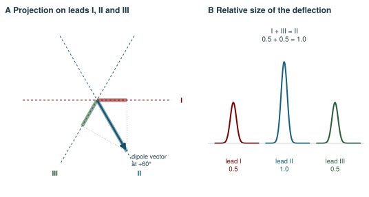
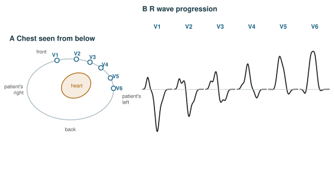

::: {.callout-note title="Goals for this chapter"}
- Explain how current flowing between depolarized and resting cells produces a voltage outside the heart, and why a wave moving toward a positive electrode writes an upward deflection.
- Describe the heart's electrical activity as a dipole vector, and name what sets its size.
- Trace the normal sequence of activation, from the SA node to the last part of the ventricles, with the conduction speed of each part and the piece of the ECG it produces.
- Build Einthoven's triangle and the hexaxial reference system, and explain how each lead records a projection of the heart's vector.
- Define the mean electrical axis (MEA), give its normal range, and recognize physiologic leftward axis, left axis deviation, right axis deviation and extreme axis.
- Find the axis with lead I and lead II (the "ER Doc" method), and explain why lead II, not aVF, is the second lead.

Names, dates and the exact values in figure captions are context, not things to memorize.
:::

The [first chapter](ecg-ionic-basis.qmd) followed single cells. This one moves to the whole heart. Action potentials spread from cell to cell, and while some of the heart is depolarized and some is still at rest, current flows between the two regions. That current flows through the tissues of the body, and a small part of it reaches the skin, where a pair of electrodes can measure it. The question for this chapter is how the heart's electrical activity becomes the shape on the paper, and what the shape tells you about which way the activity was going.

A 12-lead ECG is a cheap, non-invasive measure of several things at once: autonomic state (through the heart rate), the size, thickness and orientation of the heart, the conduction system, ischemia, and some non-cardiac disease. Einthoven built the first string galvanometer sensitive enough to record it from the body surface in 1903, with the patient's limbs in buckets of salt water, work that later won him the Nobel Prize.

## How charge moves from cell to cell

Cardiac cells are joined end to end at intercalated disks, and the disks are studded with *gap junctions*: channels made of connexin proteins that connect the cytoplasm of one cell to the next. They are not selective, and they conduct well. When one cell depolarizes, positive charge flows through the gap junctions into its resting neighbor. Part of that current discharges the neighbor's membrane capacitance and depolarizes it toward threshold; part flows on to the next cell. Once the neighbor reaches threshold it fires its own action potential, and the process repeats down the line. This is electrotonic (passive) spread followed by regeneration, and it makes the heart act as one electrical unit. How fast it goes depends on the resistance and capacitance of the membranes, gap junctions and cytoplasm, and on how fast each cell's upstroke is.

## What an electrode outside the cells sees

The lecture uses a model of two cells, A and B, to show how a voltage recorded outside cells differs from one recorded inside.

- **Inside.** With one electrode inside each cell, depolarizing cell A makes it positive relative to resting cell B. The recording swings up, then fades as cell B depolarizes too. When A repolarizes first, the recording swings down.
- **Outside.** On the outer surface, the signs are reversed. A depolarized cell has lost positive charge from its outer surface, so the outside of depolarized tissue is *negative* compared with the outside of resting tissue. The surface of the heart has a moving boundary, negative behind the wavefront and positive ahead of it.

That gives the three rules every ECG lead follows (@fig-ecg-vectors-axis-two-cell):

1. A wave of depolarization moving **toward** the positive electrode writes an **upward** (positive) deflection.
2. A wave of depolarization moving **away** from the positive electrode writes a **downward** (negative) deflection.
3. A wave moving **perpendicular** to the line between the electrodes writes **no** deflection. The lead is "blind" to it.

![Extracellular recording from a strip of cells. Behind the wave of depolarization the outer surface is negative, ahead of it positive. (A) With the positive electrode ahead of the wave, the recording goes up. (B) Swap the electrodes and it goes down. (C) With the electrodes on a line perpendicular to the wave's direction, both see the same voltage and nothing is recorded. Adapted from Boron and Boulpaep [@w4-boronupd], as used in the 2026 lecture.](figures/ecg-vectors-axis/two-cell.svg){#fig-ecg-vectors-axis-two-cell}

A wave of *repolarization* reverses the signs. Repolarized tissue is positive outside again, so a wave of repolarization moving toward the positive electrode writes a downward deflection. This is why the upright T wave is a puzzle, which the [next chapter](ecg-interpretation.qmd) solves.

When the whole heart is at the same state, all depolarized (phase 2 everywhere) or all at rest (phase 4), there is no boundary, no current between regions, and the ECG is flat. These flat stretches are the *isoelectric* segments.

## The heart as a dipole

A *dipole* is a pair of equal and opposite charges a short distance apart. Its *dipole moment* is a vector: it points from the negative charge to the positive one, and its size is the charge times the separation. The boundary between depolarized and resting tissue is a sheet of tiny dipoles, each pointing from the negative, depolarized side to the positive, resting side, which is the direction the wave is moving. At any instant the ECG records the sum of all these dipoles, the heart's net *dipole vector*.

The size of that vector depends on three things:

- **Balance between depolarized and resting tissue.** If equal regions are depolarizing in opposite directions, their dipoles cancel.
- **How consistently the dipoles point the same way.** Disorganized activation produces a small net vector.
- **How much tissue is depolarizing at once.** A small structure such as the SA node makes a dipole too small to see on the surface ECG. The thick left ventricle makes the largest one.

::: {.callout-note title="If you are comparing with the slides"}
The speaker notes describe a dipole as creating "an electromagnetic force known as a dipole moment vector." A dipole moment is not a force. It is charge times separation, a vector, and it produces an electric field. The ECG measures that field's voltage at the skin.
:::

The surface ECG is a graph of the projection of this vector, over time, on the line between two electrodes. The *height* of a deflection depends on the vector's size and direction, on the tissue between the heart and the skin, and on how the lead is oriented. The *duration* depends on how long the action potentials last and how fast they are conducted.

## The path of activation

Now follow one beat through the heart (@fig-ecg-vectors-axis-conduction-timing).

**SA node** (about 0.05 m/s). The beat starts in the SA node, high in the right atrium near where the superior vena cava enters. It fires on its own, with slow-response action potentials, and conducts slowly. The normal sinus rate is 60 to 100 per minute. The SA node is too small to show on the surface ECG.

**Atria** (about 1 m/s). The wave spreads radially from cell to cell through atrial muscle, and along faster bands: the interatrial band (Bachmann's bundle) to the left atrium and internodal bands to the AV node. Atrial depolarization is the **P wave**. It travels from the high right atrium down and to the left, roughly along lead II, so the normal P wave is upright in lead II. The fibrous AV ring insulates the ventricles from the atria, so the only way through is the AV node.

**AV node** (about 0.05 m/s). The AV node sits in the right side of the interatrial septum, just above the AV ring near the tricuspid valve and the opening of the coronary sinus. Its cells are slow-response cells with small fibers, so the wave crosses it slowly. That delay lets the atria finish contracting (the "atrial kick") before the ventricles start. The AV node makes no deflection of its own; its delay is most of the **PR interval**. Without the SA node, the AV node's own rate would be 40 to 60 per minute.

**His bundle and bundle branches** (about 1 m/s). The His bundle emerges from the AV node on the right side of the interventricular septum. The right bundle branch runs down the right side of the septum to the right ventricle. The left bundle branch crosses to the left side of the septum and divides into the left anterior and left posterior fascicles. None of these is large enough to show on the surface ECG.

**Purkinje fibers** (about 4 m/s). Large-diameter fibers with fast-response action potentials spread the wave over the inner (endocardial) surface of both ventricles. They are the fastest tissue in the heart, and they are the main site of ventricular escape pacemakers.

**Ventricular muscle** (about 0.3 to 1 m/s). The wave then crosses the ventricular wall from endocardium to epicardium, cell to cell. Ventricular depolarization is the **QRS complex**. Ventricular repolarization is the **T wave**. Atrial repolarization happens during the QRS and is hidden by it.

{#fig-ecg-vectors-axis-conduction-timing}

The ECG is not the sum of these action potentials. Each tissue has its own action potential shape, but the ECG records only the voltage gradients that large masses of tissue produce as the wave crosses them.

::: {.callout-note collapse="true" title="Background: the conduction speeds in the 2018 course notes"}
The 2018 notes give slow-response conduction as 0.02 to 0.1 m/s, ordinary atrial and ventricular muscle as 0.3 to 1 m/s, and the Purkinje system as 1 to 4 m/s. The 2026 slides round these to 0.05 m/s for the nodes, about 1 m/s for the atria, His bundle and bundle branches, and about 4 m/s for the Purkinje fibers. The 2018 notes also say the wave reaches the AV node about 0.01 s after it leaves the SA node; the usual figure is about 0.03 s, and crossing the AV node then takes about 0.1 s. Neither time is a course number.
:::

### The ventricular sequence

Inside the ventricles, the order of activation sets the shape of the QRS:

1. **The septum, left to right.** The left bundle branch activates the left side of the septum first, so the first vector points to the right (and forward). Leads that look at the heart from the left, I, aVL, V5 and V6, see this small wave moving away and write a small negative *q* wave.
2. **The apex and the free walls of both ventricles,** from endocardium to epicardium. The left ventricle is far thicker than the right, so the net vector points down and to the left. This is the big **R** wave in most leads.
3. **The base of the left ventricle and the upper septum, last.** The final vector points up and back, and writes a small terminal **S** wave in some leads.

The vector's tip traces a loop during the QRS, and each lead sees the loop from its own angle (@fig-ecg-vectors-axis-qrs-loop).

## Leads

A *lead* is a pair of recording points, one treated as positive and one as negative. Each lead records the projection of the heart's vector on the line between them: positive when the vector points toward the positive end, negative when it points away.

### The limb leads and Einthoven's triangle

Three limb electrodes, on the right arm (RA), left arm (LA) and left leg (LL), make three *standard limb leads* (@fig-ecg-vectors-axis-leads A):

$$\text{I} = V_{LA} - V_{RA} \qquad \text{II} = V_{LL} - V_{RA} \qquad \text{III} = V_{LL} - V_{LA}$$

Einthoven treated the three electrodes as the corners of an equilateral triangle with the heart in the middle. The triangle is insensitive to where on the limb the electrodes go: wrists or shoulders give the same picture, which is why a smartwatch can record lead I from your wrist and the finger of your other hand. Because the three leads are made from the same three electrodes, they are not independent. From the definitions, lead II equals lead I plus lead III at every instant (*Einthoven's law*).

{#fig-ecg-vectors-axis-leads}

### Each lead records a projection

@fig-ecg-vectors-axis-projection shows a vector pointing at +60°, straight along lead II. Lead II sees all of it. Leads I and III, each 60° away, see half of it. Half plus half equals one, as Einthoven's law requires.

{#fig-ecg-vectors-axis-projection}

@fig-ecg-vectors-axis-qrs-loop applies the same rule through a whole QRS. Lead I sees the septal vector moving away (a small q), the main vector at about 60° to its axis (a modest R), and the terminal vector moving away (a small s). Lead II looks almost straight down the main vector and writes the tallest R. aVR looks from the upper right, so almost everything moves away from it and its QRS is negative.

{#fig-ecg-vectors-axis-qrs-loop}

### Augmented leads and the hexaxial system

Three more frontal-plane leads come from the same three electrodes, with no extra stickers, just arithmetic. Each *augmented lead* compares one limb electrode with the average of the other two: aVR (right arm positive), aVL (left arm positive) and aVF (left foot positive). Together the six limb leads look at the frontal plane every 30° (@fig-ecg-vectors-axis-leads B). By convention, lead I is 0°, angles below it are positive (clockwise), and angles above it are negative.

| Lead | Negative pole | Positive pole | Angle |
|---|---|---|---|
| I | RA | LA | 0° |
| II | RA | LL | +60° |
| III | LA | LL | +120° |
| aVR | LA + LL | RA | −150° |
| aVL | RA + LL | LA | −30° |
| aVF | RA + LA | LL | +90° |

Leads I and aVL look at the lateral wall of the left ventricle (the *lateral* leads). Leads II, III and aVF look at the inferior wall (the *inferior* leads).

::: {.callout-note title="If you are comparing with the slides"}
The speaker notes say the augmented leads are measured against "Wilson's central terminal." The augmented leads use the average of the *other two* limb electrodes, as the same note goes on to describe for aVR. Wilson's central terminal, the average of all three limb electrodes, is the reference for the precordial leads.
:::

## The mean electrical axis

The *mean electrical axis* (MEA) is the average direction of ventricular depolarization in the frontal plane: the mean of all the instantaneous QRS vectors, shown as the dashed arrow in @fig-ecg-vectors-axis-qrs-loop. In a normal heart it points down and to the left, usually near +60°, because the left ventricle is thick and lies to the left and the apex points down.

::: {.callout-note title="If you are comparing with the slides"}
The speaker note on the MEA slide defines it as "the direction of the dipole vector during the peak of ventricular depolarization (peak of R wave)." The MEA is the *mean* of all the QRS vectors, not the vector at one instant. In a normal heart the two point in nearly the same direction, so either definition gives about the same angle, but in a conduction delay or hypertrophy they can differ. The peer-educator notes give the correct definition, "average direction of ventricular depolarization."
:::

### Normal and abnormal ranges

@fig-ecg-vectors-axis-axis-ranges shows the ranges the course uses.

{#fig-ecg-vectors-axis-axis-ranges}

| Axis | Range |
|---|---|
| Normal | −30° to +90° |
| Physiologic leftward axis (part of normal) | −30° to 0° |
| Left axis deviation (LAD) | beyond −30° (to −90°) |
| Right axis deviation (RAD) | +90° to 180° |
| Extreme axis | −90° to 180° |

**Physiologic leftward axis.** An axis between 0° and −30° is normal. It is common when the heart lies more horizontally, as in pregnancy or obesity, and in some older or LV-dominant hearts without disease. The course calls this the physiologic leftward axis; some sources call it borderline left axis deviation. It is not left axis deviation.

The axis moves toward extra muscle and away from tissue that depolarizes late or not at all. The lecture's causes, at a recognition level:

| Axis | Causes named in the lecture |
|---|---|
| Left axis deviation | Left ventricular hypertrophy, left anterior fascicular block, inferior myocardial infarction |
| Right axis deviation | Right ventricular hypertrophy, lung disease (COPD, acute pulmonary embolism), left posterior fascicular block, anterolateral myocardial infarction |
| Extreme axis | Ventricular rhythms (ventricular tachycardia, ventricular pacing), hyperkalemia, emphysema, swapped limb leads |

The slide lists a few more (atrial septal defects, pre-excitation, dextrocardia). You do not need them. The left anterior fascicle is thinner than the left posterior one, so left anterior fascicular block is the more common of the two.

## Finding the axis

The lecture teaches three methods. For each one, judge a lead by its **net** QRS deflection, the height of the positive part minus the depth of the negative part, not by the R wave alone. A lead with a small R and a deep S is net negative.

**Vector addition.** Take the net QRS deflection in two leads, mark each along its lead's direction on the hexaxial diagram, draw perpendiculars from the two marks, and the line from the center to where they cross is the axis. With two perpendicular leads the arithmetic is easy. If lead I is net +5 mm and aVF is net +5 mm, the vector points halfway between 0° and +90°, at +45°. This is the most precise method and the slowest, and the ECG machine does it for you.

**Inspection.** Two shortcuts:

- The lead with the **tallest** net positive QRS is closest to the axis.
- The lead with the most **isoelectric** QRS (net deflection near zero) is perpendicular to the axis. The axis is then 90° from that lead, on the side of whichever perpendicular lead is positive.

A third version, the equal-R-wave method, uses two leads with R waves of the same size and direction: the axis lies midway between them. Equal R waves in II and III, for example, put the axis at +90°, along aVF.

**The "ER Doc" method (lead I, then lead II).** This is the quickest bedside method and the one the course prefers. It answers the clinical question, normal or not, without computing an angle.

1. **Look at lead I.** If its QRS is net negative, the vector points to the patient's right, beyond +90° or −90°: right axis deviation (or extreme axis). If lead I is positive, the axis is somewhere from −90° to +90°.
2. **Look at lead II.** If lead I and lead II are both positive, the axis is normal, from −30° to +90°, including the physiologic leftward axis. If lead I is positive and lead II is negative, the axis is beyond −30°: left axis deviation.

| Lead I | Lead II | Axis |
|---|---|---|
| Negative | (either) | Right axis deviation (or extreme axis) |
| Positive | Positive | Normal, −30° to +90° (includes physiologic leftward axis) |
| Positive | Negative | Left axis deviation, beyond −30° |

Why lead II? Lead II is at +60°, so it turns negative only when the axis passes −30°, exactly the edge of normal. aVF is at +90°, so it turns negative as soon as the axis passes 0°. An axis of −15° is normal, with lead II positive, but aVF is already slightly negative (@fig-ecg-vectors-axis-axis-method).

{#fig-ecg-vectors-axis-axis-method}

::: {.callout-warning title="A common mistake"}
Some ECG guides use lead I and **aVF**. That method calls every axis between 0° and −30° abnormal, so it labels a healthy pregnant patient, or anyone with a horizontal heart, as having left axis deviation. Use lead I and **lead II**. If lead II is positive, the axis is normal.
:::

::: {.callout-note title="If you are comparing with the slides"}
The ECG Reading Room quick guide lists three axis options. Option 2, "R wave upright in lead I and lead II means normal axis," is the ER Doc method; check the *net* QRS rather than the R wave alone. Option 3, "I, II, aVF (thumb rule)," brings aVF back in. If you use it, a negative aVF with a positive lead II is still a normal axis. The answer key's "borderline left" axis is what this course calls the physiologic leftward axis.
:::

## The precordial leads

The six limb leads see only the frontal plane. Six *precordial* (chest) leads, V1 to V6, look at the horizontal plane. Each compares one chest electrode with a central reference made by averaging the three limb electrodes (Wilson's central terminal), so again there is no extra electrode for the negative end. Unlike the limb leads, where an electrode goes on the chest matters, because the chest electrodes sit close to the heart. V1 and V2 sit on either side of the sternum, over the right ventricle and septum; V3 and V4 are over the anterior wall; V5 and V6 are on the left side of the chest over the lateral wall. The lecture's map of the heart's surfaces helps here: the right atrium forms the right border, the left ventricle the left border, the right ventricle most of the front (anterior) surface, and the left ventricle most of the diaphragmatic surface.

As in the limb leads, activation moving toward a chest electrode writes an upward deflection. In V1, the septal vector moves toward the electrode (a small r), and then the large left ventricular forces move away (a deep S). In V6 the order reverses: a small q from the septum, then a tall R. Between them, the R wave grows and the S wave shrinks from V1 to V6. This is *R wave progression* (@fig-ecg-vectors-axis-precordial). It reflects the change from looking across the thin right ventricle to looking straight at the thick left ventricle.

{#fig-ecg-vectors-axis-precordial}

### Contiguous leads

Leads that look at the same region of the heart are grouped. When the waveform changes in one lead, look for the same change in its neighbors. This grouping matters most when you diagnose ischemia, which is a second-year topic.

| Region | Leads |
|---|---|
| Inferior | II, III, aVF |
| Lateral | I, aVL, V5, V6 |
| Septal | V1, V2 |
| Anterior | V3, V4 |

aVR looks at the heart from the upper right and is read on its own.

## Is the ECG a picture of the heart?

Not quite. The ECG is a set of projections of one moving vector, recorded from twelve directions, and it tells you about timing, direction and the amount of muscle being activated. Imaging gives anatomy. The lecture ends with body-surface maps made from dozens of electrodes, which come closer to a picture but are not used in routine care.

## Check your understanding

1. A wave of depolarization travels from the left arm toward the right arm. What does lead I record, and why?

    

Answer

    A downward (negative) deflection. Lead I's positive electrode is on the left arm, so a wave moving from left to right is moving away from the positive electrode.

    

2. At one instant lead I reads +0.3 mV and lead III reads +0.6 mV. What does lead II read?

    

Answer

    +0.9 mV. By Einthoven's law, lead II equals lead I plus lead III.

    

3. In a patient's ECG, aVL has the most nearly isoelectric QRS and lead II is strongly positive. Estimate the axis.

    

Answer

    aVL is at −30°, so the axis is perpendicular to it, at +60° or −120°. Lead II (+60°) is positive, so the axis is about +60°. Normal.

    

4. On the hexaxial diagram, which limb lead is perpendicular to −30°, and which is perpendicular to 0°? Use your answers to explain why, once lead I is positive, the sign of lead II and not of aVF marks the boundary between a normal axis and left axis deviation.

    

Answer

    Lead II, at +60°, is perpendicular to −30°, and aVF, at +90°, is perpendicular to 0°. A lead's QRS changes sign when the axis crosses the line perpendicular to that lead. So lead II turns from positive to negative as the axis moves past −30°, the edge of the normal range. aVF turns negative as the axis moves above 0°, which is still inside the normal range (0° to −30° is the physiologic leftward axis). A negative aVF cannot tell normal from abnormal, and a negative lead II can.

    

5. Long-standing hypertension thickens a patient's left ventricle. Which way does the mean electrical axis move, and what would the ER Doc method show if it moved far enough?

    

Answer

    To the left, toward the extra muscle, because the thicker left ventricle adds more leftward dipole. If it moves past −30°, lead I stays positive and lead II turns negative: left axis deviation.

    

6. Why does the SA node produce no wave on the ECG, while the atria produce the P wave?

    

Answer

    The size of the dipole depends on how much tissue is depolarizing at once. The SA node is tiny, so its dipole is too small to detect at the skin. The atria are a much larger mass of muscle depolarizing together.

    

## Sources

This chapter follows the 2026 ECG II: Vectors and Mean Electrical Axis lecture for MEDC 30504 (the 2024 deck with speaker notes) and draws on the peer-educator notes, the ECG Reading Room key, and the course's 2018 electrophysiology notes, corrected and updated. All figures were drawn for this book.

::: {#refs}
:::
