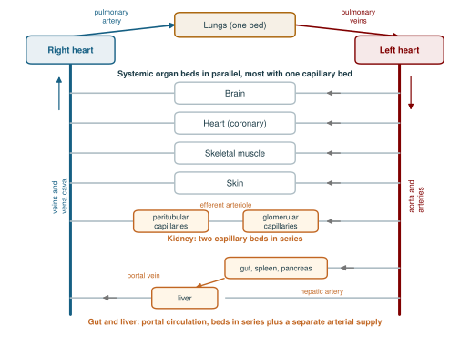
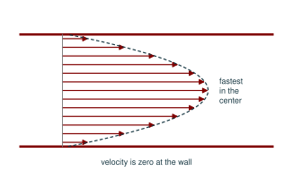

::: {.callout-note title="Goals for this chapter"}
- Match each type of vessel to its job: distribution, resistance, exchange or storage.
- Explain how the systemic circulation is arranged, with most organ beds in parallel and the kidney and liver as exceptions.
- Use Ohm's law, and CO = (MAP − CVP)/SVR, to reason about pressure, flow and resistance, and tell perfusion pressure from transmural pressure.
- Estimate MAP from a blood pressure cuff reading, and explain why the one-third rule works.
- Predict how radius, length, viscosity, and series or parallel arrangement change resistance.
- Explain how flow rate, velocity and pressure change from the aorta to the vena cava.
- Define compliance and explain how arterial compliance and arteriolar resistance smooth the heart's output.

The exact numbers in tables and figure captions are there to show trends. Apart from a resting cardiac output of about 5 L/min, you do not need to memorize them.
:::

The circulation exists for exchange. Oxygen, nutrients, wastes and heat move between blood and tissue across the walls of the capillaries, and everything upstream of the capillaries is there to get blood to them. The course describes the system as two pumps and two exchangers: the right heart pumps blood through the lungs, where it exchanges gas with air, and the left heart pumps it through the body's tissues, where it exchanges with cells. The [Cardiovascular Physiology Overview](cv-overview.qmd) introduces that plan. This chapter supplies the physics: what makes blood flow, what resists it, how fast it moves, and how the elastic walls of the vessels change the picture. The next chapter, [Microcirculation and Local Control](microcirculation.qmd), takes the same ideas down to the capillary, and answers the question this lecture ends on: why a capillary one cell thick does not burst.

## How the circulation is arranged

The right and left hearts are in series: all the blood that leaves the right ventricle passes through the lungs and returns to the left heart. The lung is a single bed on that path, although inside the lung the vessels branch into an enormous parallel network of capillaries. The [Pulmonary Circulation](pulmonary-circulation.qmd) chapter covers it.

The systemic circulation is different. The aorta gives off branches to the brain, the heart muscle, skeletal muscle, skin and the other organs, and those beds sit side by side, in parallel, between the arterial and venous systems (@fig-hemodynamics-circuit). In most of them, arterial blood passes through a single capillary bed before it enters the veins. Within one organ the vessels are in series: artery, arteriole, capillary, venule, vein. The parallel layout lets each organ adjust its own flow by changing its own resistance, and if one branch is blocked the others still receive blood.

{#fig-hemodynamics-circuit}

The course calls the kidney and liver the "rule breakers":

- **Kidney.** Blood passes through the glomerular capillaries, the efferent arteriole, and then the peritubular capillaries. The efferent arteriole's resistance makes peritubular pressure much lower than glomerular pressure, which lets those capillaries reabsorb what the glomerulus filtered.
- **Gut and liver.** Blood from the gut passes through its capillaries, collects in the portal vein, and passes through the liver's capillaries before reaching the vena cava. The liver also has arterial blood from the hepatic artery. The [Other Special Circulations](special-circulations.qmd) chapter returns to the splanchnic bed.

**Posture.** Lying flat, most organ beds receive about the same arterial pressure. Standing adds the weight of a column of blood: pressures below the heart rise and pressures above it fall, in arteries and veins alike, and the leg veins distend and hold more blood. The [ANS and Extrinsic Control](ans-extrinsic-control.qmd) chapter covers the reflex response.

## Vessel structure and function

Three materials set what a vessel wall can do. Elastin lets the wall stretch and recoil. Collagen gives it tensile strength and limits how far it can stretch. Smooth muscle changes the vessel's caliber. How much of each a vessel has matches its job.

| Vessel | Wall | Job |
|---|---|---|
| Aorta and large arteries | Thick, elastic | Distribution. Their walls stretch as the heart ejects and recoil in diastole (the hydraulic filter, below). |
| Small, muscular arteries | More smooth muscle | Distribute blood to organs, with some role in regulating flow |
| Arterioles | Mostly smooth muscle around an endothelium, with sympathetic innervation | Resistance. By changing radius they set how much blood enters each capillary bed. The course calls them the circulation's stopcocks. |
| Capillaries | One layer of endothelium on a basement membrane; no smooth muscle | Exchange. Density follows metabolic rate: heart muscle has a far denser network than subcutaneous tissue. |
| Venules | Thin layer of smooth muscle, sparse innervation | Collect capillary blood; also exchange fluid and solutes, and are where white cells leave the blood |
| Veins | Thin, very compliant walls with some smooth muscle; valves in the limbs | Storage. They hold most of the blood volume at low pressure. Venoconstriction shifts stored blood toward the heart. |

Capillaries have no smooth muscle and cannot constrict, but their endothelial cells can change shape through actin and myosin, opening larger, leakier gaps between them. In inflammation this happens mostly in the postcapillary venules.

The dimensions in the table below tell the same story. A single capillary is tiny, but there are about 10^10^ of them, and their combined, or *aggregate*, cross-sectional area is about 700 times that of the aorta.

| | Aorta | Small arteries | Arterioles | Capillaries | Vena cava |
|---|---|---|---|---|---|
| Number | 1 | 8,000 | 2 × 10^7^ | 1 × 10^10^ | 1 |
| Internal radius (cm) | 1.13 | 0.05 | 0.0015 | 0.0003 | 1.38 |
| Aggregate cross-sectional area (cm²) | 4 | 63 | 141 | 2,827 | 6 |
| Mean velocity (cm/s) | 21 | 1.3 | 0.6 | 0.03 | 14 |

: Vascular dimensions, from the 2026 lecture (adapted there from Boron and Boulpaep [@boron2017]). Aggregate flow is 83 mL/s, a cardiac output of 5 L/min, at every level.

### Where the blood is

Of about 5 L of blood, roughly 84% is in the systemic circulation, 9% in the pulmonary circulation and 7% in the heart. The systemic veins hold about two-thirds of the total, the arteries about 14% and the systemic capillaries only about 6%. So a modest change in venous tone moves a large volume toward or away from the heart. The [Control of Cardiac Output](control-of-co.qmd) chapter builds on this with stressed and unstressed volume.

::: {.callout-note title="If you are comparing with the slides"}
The vessel-wall slide's notes put more than 65% of the blood in the large capacitance veins. The volume table two slides later gives 46% in the small veins and 18% in the large veins, so the two-thirds belongs to the systemic veins as a whole.
:::

## Pressure gradients drive flow

*Hemodynamics* is the study of blood flow. The course uses these symbols:

| Symbol | Meaning | Usual units |
|---|---|---|
| P | Pressure | mm Hg |
| Q | Flow rate: volume per unit time | mL/min or L/min |
| v | Mean velocity: distance per unit time (the slides write v̄) | cm/s |
| A | Cross-sectional area | cm² |
| R | Hydraulic resistance | mm Hg·min/L |

Blood flows only when there is a pressure difference along a vessel. For steady flow,

$$Q = \frac{\Delta P}{R} = \frac{P_1 - P_2}{R}$$

This is the fluid version of Ohm's law (I = ΔV/R): pressure difference plays the role of voltage, flow of current, and hydraulic resistance of electrical resistance. Friction between layers of blood turns some of its pressure energy into heat, which is why pressure falls along the way.

### Ohm's law for the whole systemic circulation

Apply the same law to the systemic circuit as a whole. The flow is the cardiac output. The pressure at the start is the mean arterial pressure (MAP). The pressure at the end is the pressure in the great veins as they enter the right atrium, the central venous pressure (CVP), which approximates right atrial pressure (Pra). The resistance of all the systemic vessels together, from the aortic valve to the right atrium, is the systemic vascular resistance (SVR).

$$\text{CO} = \frac{\text{MAP} - \text{CVP}}{\text{SVR}} \qquad\text{so}\qquad \text{SVR} = \frac{\text{MAP} - \text{CVP}}{\text{CO}}$$

SVR cannot be measured directly. It is calculated from MAP, CVP and cardiac output. With pressure in mm Hg and output in L/min, its unit is mm Hg·min/L. Rearranged,

$$\text{MAP} = \text{CO} \times \text{SVR} + \text{CVP}$$

Because CVP is normally only a few mm Hg, the course often writes the shorthand MAP ≈ CO × SVR. Widespread arteriolar constriction raises SVR, and if cardiac output and CVP stay the same, MAP rises. In a patient the variables often change together.

The slides note that SVR is also called total peripheral resistance (TPR). This book uses SVR.

::: {.callout-warning title="A common mistake: leaving CVP out of SVR"}
SVR is the driving pressure across the systemic circuit divided by the flow through it, and the driving pressure is MAP **minus CVP**, not MAP. In a healthy person at rest the difference is small: with MAP 93, CVP 3 and CO 5 L/min, SVR = (93 − 3)/5 = 18 mm Hg·min/L, and dividing MAP alone by CO gives 18.6.

When CVP is high, as in heart failure or fluid overload, leaving it out gives a wrong answer and can point you the wrong way. Take MAP 90, CVP 18 and CO 4. SVR = (90 − 18)/4 = 18, the same as the healthy value. Dividing MAP alone by CO gives 22.5 and suggests that resistance has risen by a quarter when it has not changed. Whenever CVP is given, subtract it.
:::

## Perfusion pressure and transmural pressure

Two different pressure differences act on every vessel, and they do different things (@fig-hemodynamics-perfusion-transmural).

- **Perfusion pressure** is the difference *along* the vessel: upstream intravascular pressure minus downstream intravascular pressure. It drives flow along the vessel and through a tissue bed, Q = ΔP/R.
- **Transmural pressure** is the difference *across* the wall at one point: pressure inside minus pressure outside, P~tm~ = P~inside~ − P~outside~. A positive transmural pressure tends to distend the vessel. A negative one favors compression or collapse, depending on how stiff the wall is and how well the surrounding tissue supports it. Transmural pressure does not push blood along the vessel.

{#fig-hemodynamics-perfusion-transmural}

Panel C is the check: a high pressure inside a vessel does not by itself mean that blood is flowing. Flow needs a pressure *difference* from one end to the other.

Transmural pressure is what stretches a vessel, so it is the pressure in the definition of compliance later in this chapter and the stimulus for the myogenic response in the next. (The lung's transmural pressure is the transpulmonary pressure of [Respiratory Statics](../pulmonary/statics.qmd).) External compression lowers transmural pressure and narrows a vessel, which raises its resistance even if upstream pressure does not change.

## Mean arterial pressure

Arterial pressure is not steady. It rises to the systolic pressure as the ventricle ejects and falls to the diastolic pressure just before the next beat. The difference between them is the *pulse pressure*:

$$\text{PP} = \text{SBP} - \text{DBP}$$

Ohm's law needs one number for the pressure driving flow over the whole cycle: the *mean arterial pressure*, the time-average of the waveform (the area under the pressure-time curve divided by the cycle length). On a graph, MAP is the level at which the area of the waveform above the line equals the area below it (@fig-hemodynamics-map). Measuring it needs an arterial catheter, so in clinic we estimate it from a cuff reading:

$$\text{MAP} \approx \text{DBP} + \tfrac{1}{3}(\text{SBP} - \text{DBP})$$

The summary slide writes the same thing as P~dia~ + ⅓ PP. For 120/80 mm Hg, the pulse pressure is 40 and MAP ≈ 80 + 40/3 ≈ 93 mm Hg.

{#fig-hemodynamics-map}

Why one-third, and not halfway? The waveform rises fast, falls fast, and then spends the long diastolic runoff, about two-thirds of each beat at rest, close to diastolic pressure, so the average sits below the midpoint. (It is not the center of mass of a triangle: a triangular pulse averages halfway up.) At fast heart rates diastole shortens, the true mean moves toward halfway, and the one-third formula underestimates MAP.

## What sets resistance: Poiseuille's law

For steady, laminar flow of a simple fluid through a rigid cylindrical tube, Poiseuille's law gives the flow:

$$Q = \frac{\Delta P \, \pi r^4}{8 \eta L}$$

Comparing with Q = ΔP/R gives the resistance:

$$R = \frac{8 \eta L}{\pi r^4}$$

Here r is the tube's radius, L its length and η the viscosity of the fluid. Resistance rises in direct proportion to length and viscosity and falls with the fourth power of the radius.

The fourth power is why radius matters so much. Halve a vessel's radius and its resistance rises 2^4^ = 16-fold. What that does depends on what is held constant:

- If the pressure difference stays the same, flow falls to one-sixteenth.
- If the flow has to stay the same, the pressure difference needed to drive it rises 16-fold.

Always identify what is being held constant before you predict a result.

Length hardly changes and viscosity changes only slowly. Radius is what the body adjusts, and the arterioles, with their thick smooth muscle, change it quickly, which is why they control flow. Blood and vessels do not meet all of Poiseuille's assumptions (blood is a suspension of cells, vessels are elastic, flow is pulsatile), but the equation still explains why a small change in caliber has a large effect.

## Resistances in series and in parallel

The circulation combines both arrangements (@fig-hemodynamics-series-parallel).

**In series,** the same flow passes through each segment in turn, and the resistances add:

$$R_t = R_1 + R_2 + R_3$$

Along a single tissue pathway, the artery, arteriole, capillaries and vein are in series. Because ΔP = Q × R and Q is the same through each, the largest pressure drop occurs across the segment with the largest resistance. Along most pathways that is the small arteries and arterioles.

**In parallel,** the branches share the same inlet and outlet pressure. Each branch takes flow according to its own resistance, and the branch flows add up to the total:

$$Q_t = Q_1 + Q_2 + Q_3 \qquad \frac{1}{R_t} = \frac{1}{R_1} + \frac{1}{R_2} + \frac{1}{R_3}$$

Total resistance is lower than the resistance of any single branch. Adding an open pathway in parallel always lowers total resistance. The reciprocal of resistance is called *conductance*, and in parallel the conductances simply add. You will not be asked to calculate a parallel resistance on the exam, but you should understand what the equations imply.

{#fig-hemodynamics-series-parallel}

Two consequences of the parallel layout matter clinically:

- **One branch changes its own flow, not the whole circulation's.** A large rise in the resistance of one branch, such as cross-clamping a femoral artery during surgery, cuts that branch's flow sharply but barely changes SVR or arterial pressure. Constricting arterioles in many beds at once, as a sympathetic reflex does, raises SVR and MAP.
- **Many small vessels together can have a low resistance.** A single capillary has a very high resistance; billions in parallel have a much lower combined resistance. The resistance of the network depends on the number, radius and length of the individual vessels, not on aggregate area alone: ten thousand thin straws in parallel resist flow more than one wide pipe with the same total area. Capillaries are not negligible: in @fig-hemodynamics-profiles mean pressure falls from about 35 to about 15 mm Hg across them. But the arterioles carry the largest drop, and they are the vessels that can change.

## Flow rate and velocity

Flow rate and velocity are different quantities, and mixing them up is one of the most common errors in this part of the course.

- **Flow rate (Q)** is how much blood passes a point per unit time: a volume per time, such as mL/min or L/min. Cardiac output, about 5 L/min (83 mL/s), is a flow rate.
- **Velocity (v)** is how fast the blood itself is moving: a distance per time, such as cm/s. Mean velocity is about 21 cm/s in the aorta and about 0.03 cm/s in the capillaries.

In a time t, the blood that crosses a plane in a vessel of area A fills a cylinder of area A and length d = v × t, so the volume per unit time is

$$Q = A \times v \qquad v = \frac{Q}{A}$$

### Conservation of mass

Blood is essentially incompressible, so in a steady state the same volume passes every cross-section of an unbranched tube each second (Q~in~ = Q~out~), the *continuity equation*. Where the tube narrows the blood moves faster; where it widens it slows (@fig-hemodynamics-continuity), like a river through a wide, slow stretch and a narrow, fast rapid. At a branch point, the incoming flow equals the sum of the outgoing flows. Compliant vessels can store or release blood during a beat, but averaged over whole cycles inflow and outflow balance.

{#fig-hemodynamics-continuity}

### Why blood is slow in the capillaries

Is blood velocity higher in the aorta or in the capillaries? Many students guess the capillaries, because each is so narrow. But the aorta does not empty into one capillary. Its flow divides among about 10^10^ capillaries, and what matters for velocity is their aggregate cross-sectional area, about 2,800 cm². That is roughly the area of a 24-inch pizza, which the course calls the Big Benito.

With the course's round numbers, 83 mL/s divided by the aorta's 4 cm² gives about 21 cm/s, and divided by about 2,800 cm² gives about 0.03 cm/s, roughly 700 times slower. On the venous side aggregate area falls and velocity rises again. The slow transit through the capillaries gives time for exchange.

::: {.callout-warning title="A common mistake"}
"Narrow means fast" is true for one tube with the same flow through it. It is not true for a bed of many narrow tubes in parallel. Each capillary is narrow, but together they offer a huge area, and that is what sets the mean velocity. Ask which area the whole flow has to pass through.
:::

## Area, velocity and pressure across the circulation

@fig-hemodynamics-profiles puts the pieces together.

- **Aggregate cross-sectional area** rises with each generation of branching, peaks in the capillaries, and falls again as the veins converge.
- **Mean velocity** is the mirror image, because v = Q/A and Q is the same at every level.
- **Pressure** falls continuously from the aorta to the right atrium, because resistance dissipates it, but not evenly. The large arteries are good conduits with little resistance, so mean pressure falls only a little along them. The steepest fall is across the small arteries and arterioles, the resistance vessels. Mean pressure continues to fall through the capillaries (a representative capillary pressure is about 25 mm Hg) and the veins, reaching a few mm Hg in the vena cava. The pulsations are damped across the small arteries and arterioles and have almost disappeared by the capillaries.

![Aggregate cross-sectional area, mean velocity and pressure from the aorta to the vena cava. (A, B) Values from the vascular dimensions table above, plotted on logarithmic scales. Velocity is lowest where aggregate area is greatest. (C) Representative pressures: mean pressure falls little in the large arteries and most steeply across the small arteries and arterioles. The pulsatile range (shaded) is damped across the small arteries and arterioles and has nearly vanished by the capillaries. Area and velocity data adapted from Boron and Boulpaep [@boron2017], as used in the 2026 lecture. Course figure.](figures/hemodynamics/area-velocity-pressure.svg){#fig-hemodynamics-profiles}

Do not read velocity into the pressure curve. Low velocity follows from large aggregate area; a pressure drop reflects resistance to flow.

## Compliance

Vessels are elastic. *Compliance* is the change in volume for a given change in transmural pressure:

$$C = \frac{\Delta V}{\Delta P}$$

On a graph with volume on the vertical axis and transmural pressure on the horizontal axis, compliance is the slope (@fig-hemodynamics-compliance). A steep curve means a large change in volume for a small change in pressure: high compliance.

{#fig-hemodynamics-compliance}

Veins are far more compliant than arteries, which is why they hold about two-thirds of the blood volume at low pressure, and why a large change in blood volume changes venous pressure comparatively little. Both become stiffer as they fill, as collagen takes up the load.

::: {.callout-tip title="Check the axes"}
In the Cardiac Pump lecture, the ventricle's filling curve had pressure on the vertical axis and volume on the horizontal axis, so its slope was stiffness (ΔP/ΔV). In this lecture the axes are swapped, so the slope is compliance (ΔV/ΔP). Same idea, opposite slope. Check the axes before you read a slope. Compliance is also a different property from contractility; see the [Cardiac Pump](cardiac-pump.qmd) chapter.
:::

### The hydraulic filter

The left ventricle ejects only during systole, yet blood flows through the capillaries almost steadily. During systole the ventricle ejects faster than blood can drain through the arterioles, so part of the stroke volume is stored by stretching the aorta and large arteries. After the aortic valve closes, those walls recoil passively and keep pushing blood through the arteriolar resistance all through diastole, so pressure falls slowly and flow continues between beats (@fig-hemodynamics-filter).

The electrical analogy is an RC filter: a capacitor (the compliance) stores charge, and a resistor (the arterioles) limits how fast it discharges. The pair passes the average and strips out the fast fluctuations. The course calls this arrangement the hydraulic filter, also called the Windkessel effect. The [Control of Cardiac Output](control-of-co.qmd) chapter uses it to explain systolic and pulse pressure.

![The hydraulic filter: a ventricle ejecting into a compliant aorta that drains through a fixed arteriolar resistance. (A) Flow leaves the ventricle in bursts. (B) With a compliant aorta (solid), pressure rises less in systole and falls less in diastole than with a stiff aorta (dashed); mean pressure is the same in both. (C) Flow through the arterioles follows pressure, so it is smoother with the compliant aorta. With no compliance it would copy the bursts in panel A. The model leaves out pressure waves that travel along the arteries. Course figure.](figures/hemodynamics/hydraulic-filter.svg){#fig-hemodynamics-filter}

Arteries stiffen with age; the [Control of Cardiac Output](control-of-co.qmd) chapter works out what that does to systolic and pulse pressure, and how the pressure pulse changes as it travels along the large arteries.

## Blood viscosity

Viscosity (η) is a fluid's internal resistance to deformation. In Poiseuille's law resistance is proportional to viscosity, so more viscous blood needs a larger pressure difference to keep the same flow, and the heart works harder. Water and plasma are *Newtonian*: their viscosity is the same however fast they flow. Blood, a suspension of cells, is *non-Newtonian*: its apparent viscosity depends on how it is flowing.

- **Hematocrit.** More red cells mean more viscous blood. In polycythemia (a high hematocrit), viscosity and resistance rise; in anemia they fall.
- **Flow rate.** Blood is *shear thinning*: as flow slows, its apparent viscosity rises. (Strictly, viscosity depends on the shear rate, how quickly velocity changes from one layer of fluid to the next, which falls as flow slows.) In slow flow, red cells stack into rouleaux; faster flow breaks the stacks up. The lecture's oobleck is non-Newtonian too, but it thickens under shear, the opposite of blood.
- **Red cell deformability and shape.** Red cells normally fold to pass through small vessels. Cells that deform poorly, such as sickled cells, raise resistance.
- **Temperature.** Cold raises blood viscosity, as in hypothermia.

## Laminar and turbulent flow

Normally blood flows in smooth layers, *laminar flow*: the layer touching the wall does not move and the central layer moves fastest, so the velocity profile is a parabola (@fig-hemodynamics-laminar). Poiseuille's law describes laminar flow. High velocity and abrupt narrowing, as at a stenotic valve or a plaque in a carotid artery, break the layers into chaotic eddies, *turbulent flow*, which wastes pressure. Turbulence makes the vessel wall vibrate: over the heart the sound is a murmur, over an artery a bruit. The normal heart sounds S~1~ and S~2~ come from valve closure, not turbulence. You will not be asked about laminar versus turbulent flow.

{#fig-hemodynamics-laminar}

::: {.callout-note collapse="true" title="Background: the pressure cost of turbulence"}
In laminar flow the resistance is constant, so flow rises in a straight line with perfusion pressure. Once turbulence begins, flow keeps rising with pressure but more slowly, roughly with the square root of the pressure difference, so more pressure is needed for a given flow. It does not level off at a maximum, as the lecture notes' phrase "reaching an upper asymptote" suggests.
:::

## Check your understanding

1. Along one tissue pathway, an artery, its arterioles, the capillaries and a vein are in series. Across which segment is the largest pressure drop, and why? If the arterioles' resistance doubled, with arterial and venous pressures unchanged, what would happen to flow through the pathway and to pressure in the capillaries?

    

Answer

    The same flow passes through every segment in series, so each segment's pressure drop is Q × R, and the largest drop is across the largest resistance: the arterioles (with the small arteries). Doubling arteriolar resistance raises the pathway's total resistance, so flow falls. A larger share of the pressure is now used up across the arterioles, so capillary pressure falls. The next chapter uses this to explain how arterioles set capillary filtration.

    

2. Why is the driving pressure for flow through the systemic circulation MAP minus CVP, and not MAP alone? What would happen to systemic flow if CVP rose all the way to MAP?

    

Answer

    Flow depends on the pressure difference between the two ends of the circuit. Blood leaves the aorta at MAP and returns to the right atrium at CVP, so the difference that drives it through SVR is MAP − CVP. Using MAP alone assumes the far end is at zero. If CVP equaled MAP there would be no pressure difference and no flow, however high the pressures were (compare @fig-hemodynamics-perfusion-transmural C).

    

3. A classmate says MAP is halfway between systolic and diastolic pressure. What is wrong with that? What is the MAP for 150/90, and would the one-third rule over- or underestimate it at a heart rate of 160?

    

Answer

    MAP is a time-average, and at a normal resting rate the pressure spends most of the cycle near diastolic, so the average sits about a third of the way up. For 150/90, MAP ≈ 90 + 60/3 = 110 mm Hg. At 160 beats/min diastole is shortened, the true mean moves toward halfway, and the one-third rule underestimates it.

    

4. Blood flows at 5 L/min. Why is it slower in the capillaries than in the aorta, even though each capillary is much narrower than the aorta? Why is slow capillary flow useful?

    

Answer

    Velocity is flow divided by the area the whole flow passes through. The whole cardiac output passes through the aorta's 4 cm², but in the capillaries it is spread over about 10^10^ vessels with an aggregate area of about 2,800 cm², so the blood moves about 700 times more slowly. The slow transit gives time for exchange between blood and tissue.

    

5. What is the functional advantage of veins being so much more compliant than arteries?

    

Answer

    High compliance lets the veins hold about two-thirds of the blood volume at low pressure, and take up or give up a large volume with only a small change in venous pressure. That makes them a reservoir: venoconstriction can shift stored blood toward the heart when it is needed.

    

6. A tight cast raises the tissue pressure around the calf veins. Without using numbers, say which pressure difference decides whether the veins collapse and which decides how much blood flows through them. How can the cast reduce flow even if it does not change the pressure difference along the veins?

    

Answer

    Collapse depends on transmural pressure, the pressure inside the vein minus the tissue pressure outside it. The cast raises the outside pressure, so transmural pressure falls, and if it falls below zero the thin-walled veins tend to collapse. Flow depends on the perfusion pressure, the difference in pressure from one end of the vein to the other, divided by the vein's resistance. Transmural pressure does not push blood along. But a narrowed or partly collapsed vein has a smaller radius and a much higher resistance, so flow falls for the same pressure difference along it.

    

## Key equations

| Equation | Use |
|---|---|
| Q = ΔP / R | Ohm's law for any vessel or bed |
| CO = (MAP − CVP) / SVR; MAP ≈ CO × SVR | Ohm's law for the systemic circulation |
| MAP = DBP + ⅓(SBP − DBP) | Estimating MAP from a cuff reading |
| PP = SBP − DBP | Pulse pressure |
| P~tm~ = P~inside~ − P~outside~ | Transmural pressure |
| R = 8ηL / πr^4^ | Poiseuille: what sets resistance |
| R~t~ = R~1~ + R~2~ + R~3~ | Resistances in series |
| 1/R~t~ = 1/R~1~ + 1/R~2~ + 1/R~3~ | Resistances in parallel (concept only, no calculation) |
| Q = A × v | Flow, area and velocity (continuity) |
| C = ΔV / ΔP | Compliance |

## Sources

This chapter follows the 2026 Peripheral Circulation and Hemodynamics lecture for MEDC 30504, including its perfusion versus transmural pressure slide, and draws on the 2026 lecture notes and the course's 2018 hemodynamics notes, corrected and updated. All figures were drawn for this book.

::: {#refs}
:::
