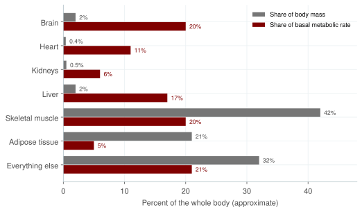

::: {.callout-note title="Goals for this chapter"}
- For the cerebral, skeletal muscle, splanchnic and cutaneous circulations, say why each matters and whether systemic (autonomic) or local control predominates.
- Explain cerebral autoregulation, cerebral perfusion pressure, and why chronic hypertension shifts the autoregulatory range.
- Explain how α~1~ and β~2~ receptors, norepinephrine, epinephrine and metabolites together set skeletal muscle flow at rest and during exercise.
- Describe the splanchnic circulation's capillary beds in series and its role as a blood reservoir, and say which autonomic division controls it.
- Explain how skin blood flow carries heat away, the difference between apical and non-apical skin, and the sympathetic cholinergic exception.

Names, dates and the exact values in figure captions are context, not things to memorize.
:::

Every organ is perfused from the same arterial pressure, so the share of the cardiac output each one gets is set by the resistance of its own arterioles. Two sets of signals compete to set that resistance. **Systemic** control (sympathetic nerves and circulating hormones) serves the whole body: it defends arterial pressure and moves blood where the body as a whole needs it. **Local** control (myogenic, metabolic and endothelial mechanisms, from [Microcirculation and Local Control](microcirculation.qmd)) serves the tissue itself. In each bed, one of them usually wins, and which one wins depends on what the organ is for. This chapter takes four beds in turn, asking the same questions of each: why does it matter, how is it built, and who is in charge? The heart and the lungs have their own chapters ([Coronary Circulation](coronary.qmd) and [Pulmonary Circulation](pulmonary-circulation.qmd)).

## Cerebral circulation

### Why it matters

The brain is about 2% of body mass but accounts for about 20% of the body's basal metabolic rate (@fig-special-circulations-mass). It stores almost no O~2~ or glucose, so it depends minute by minute on its blood supply, and it is extremely sensitive to ischemia. Neurons start to fail within minutes of losing flow, well before endothelial cells, glia and the other cells around them. The anatomy (the circle of Willis and its branches) is not tested in this lecture.

{#fig-special-circulations-mass}

### Systemic regulation

Two reflexes from the [ANS and Extrinsic Control](ans-extrinsic-control.qmd) chapter protect the brain's supply, but they do it by acting on the rest of the circulation:

- **The baroreceptor reflex.** Stretch receptors in the carotid sinus and aortic arch sense arterial pressure. A fall in pressure raises sympathetic output to the heart and vessels and restores arterial pressure, the pressure the brain is perfused from.
- **The chemoreceptor reflex.** Central chemoreceptors in the medulla detect CO~2~ and pH. Peripheral chemoreceptors detect O~2~ and CO~2~ (aortic bodies) or O~2~, CO~2~ and pH (carotid bodies). They drive ventilation and sympathetic output.

The cerebral arterioles themselves get little effective sympathetic control. Their tone is set locally.

### Local regulation

**Myogenic control.** Cerebral arterioles constrict when perfusion pressure rises and dilate when it falls, holding cerebral blood flow near 50 mL/100 g/min across perfusion pressures from about 50 to 150 mm Hg (@fig-special-circulations-cerebral). Below the range, the arterioles are fully dilated and cannot dilate further, flow falls with pressure, and the brain becomes ischemic. Above it, pressure forces the arterioles open, flow rises, and fluid is pushed out of the vessels into the brain (vasogenic edema). The brain's range, as the lecture gives it, has a higher lower limit than the course's general statement that local control holds flow steady from about 20 to 150 mm Hg ([Microcirculation and Local Control](microcirculation.qmd)); the limits differ between beds, and the point in each is that flow stays steady across normal pressures. The brain sits inside a rigid skull, so holding flow and volume steady also protects it from a dangerous rise in pressure inside the cranium.

The pressure that perfuses the brain is arterial pressure minus the pressure inside the skull, the intracranial pressure (ICP):

$$\text{Cerebral perfusion pressure} = \text{MAP} - \text{ICP}$$

With ICP fixed, cerebral perfusion pressure follows blood pressure.

**Chronic hypertension shifts the range.** In someone who has lived with high blood pressure for years, the cerebral arteries remodel and the whole autoregulatory curve shifts to the right. Higher pressures are tolerated without forced dilation, but the lower limit rises too. The lecture asks why this matters when hypertension is treated as an emergency: lowering such a patient's pressure quickly to a "normal" value can put it below their lower limit, and the brain becomes ischemic at a pressure a normotensive person would tolerate.

{#fig-special-circulations-cerebral}

**Metabolic control.** Flow follows activity region by region. Clenching a hand raises flow in the motor area for that hand, and reading, talking or reasoning each raises flow in a different set of regions. Active neurons release metabolic signals that dilate the arterioles nearby. The strongest chemical regulator of cerebral flow, though, is CO~2~: a rise in arterial PCO~2~ lowers the pH around the cerebral arterioles and dilates them, and a fall (as with hyperventilation) constricts them.

**Cerebral blood flow is largely locally mediated: local > systemic.** The brain sets its own flow, and the systemic reflexes help by keeping arterial pressure within the range the brain can autoregulate across.

## Skeletal muscle circulation

### Why it matters

Skeletal muscle is about 42% of body mass and about 20% of the resting metabolic rate. At rest its flow is modest, but in exercise its metabolic rate rises many-fold and its blood flow can rise about 20-fold. Because the bed is so large, its arterioles are also a big part of SVR: tightening or loosening them changes arterial pressure for the whole body. The anatomy of the muscle microcirculation is not tested.

### Systemic regulation

Skeletal muscle arterioles carry two kinds of adrenergic receptor (@fig-special-circulations-muscle):

- **α~1~ receptors**, which constrict. Norepinephrine (NE) acts mainly on α~1~ receptors and has little effect on β~2~.
- **β~2~ receptors**, which dilate. Epinephrine acts on both, and β~2~ receptors respond to it at lower concentrations.

NE is the transmitter that sympathetic nerves release onto the arterioles, so sympathetic nerve activity constricts muscle arterioles. Epinephrine reaches them through the blood from the adrenal medulla and dilates them through β~2~. The [ANS and Extrinsic Control](ans-extrinsic-control.qmd) chapter explains why neural NE does not dilate muscle vessels.

As exercise starts, sympathetic outflow rises, and NE constricts the arterioles of inactive muscle and of the gut and skin. In the muscle that is working, metabolic dilation begins at once and overrides the NE constriction there, which the course calls *functional sympatholysis* ([Cardiovascular Adaptation to Exercise](cv-exercise.qmd)). Circulating epinephrine adds some β~2~ dilation as exercise continues.

::: {.callout-note title="If you are comparing with the slides"}
The muscle slides say that because NE is the primary neurotransmitter, "vasoconstriction dominates in early exercise," and the peer-educator notes say the same. That holds for muscle that is not working, and in anticipation of exercise before metabolites have built up. In the working muscle itself, metabolites blunt the α~1~ constriction from the start, and flow rises with the first contractions. Both versions agree on the overall result the slides emphasize: during exercise, working muscle is vasodilated.
:::

### Local regulation

Working muscle produces CO~2~ and H^+^, uses O~2~, and releases adenosine, and its endothelium releases NO. All of these dilate the arterioles. Metabolic dilation predominates during exercise, and the overall result is **vasodilation** of the arterioles in working muscle, against a sympathetic drive that is high. The same sympathetic drive keeps arterioles constricted in muscle that is not working and in the gut and skin, so flow is directed to the muscles doing the work. The [Cardiovascular Adaptation to Exercise](cv-exercise.qmd) chapter puts this together for the whole body.

{#fig-special-circulations-muscle}

**Skeletal muscle: local > systemic** during exercise. At rest, when metabolic signals are low, sympathetic tone sets muscle arteriolar resistance, which is how the baroreflex uses this large bed to adjust SVR.

::: {.callout-warning title="A common mistake"}
"Sympathetic activation dilates muscle vessels" mixes up the two catecholamines. Sympathetic nerves release NE, which constricts through α~1~. Dilation in exercising muscle comes from metabolites, helped by circulating epinephrine on β~2~ receptors.
:::

## Splanchnic circulation

### Why it matters

The splanchnic circulation supplies the stomach, intestines, spleen, pancreas and liver. It carries absorbed nutrients to the liver and on to the rest of the body ("you are what you eat"). It is also the body's **largest reservoir of blood at rest**, more than 25% of the blood volume, most of it in compliant veins. That reservoir can be moved into the central circulation when the body needs it.

### Anatomy

Two features are unusual (@fig-special-circulations-splanchnic):

- **Multiple organs**, each with its own arteries, and each can be regulated separately.
- **Capillary beds in series.** Blood from the gut, spleen and pancreas passes through their capillaries, collects in the portal vein, and then passes through a second capillary bed, the sinusoids of the liver, before reaching the vena cava. The liver also receives arterial blood from the hepatic artery. The detailed anatomy is not tested.

{#fig-special-circulations-splanchnic}

### Regulation

The splanchnic bed is under strong **sympathetic** control. Sympathetic fibers from the prevertebral ganglia release NE onto α~1~ receptors on the splanchnic arterioles and veins:

- **Arteriolar constriction** reduces gut blood flow and raises SVR.
- **Venoconstriction** squeezes blood out of the splanchnic veins into the central circulation. That raises stressed volume and P~ms~ (mean systemic filling pressure), and with it venous return and cardiac output (the [Control of Cardiac Output](control-of-co.qmd) chapter explains P~ms~).

This is how the body borrows splanchnic blood in hemorrhage and exercise. Parasympathetic nerves increase gut motility and secretion but have little direct effect on the splanchnic vessels and do not control splanchnic venous tone.

Local control also operates. Exocrine and paracrine signals, metabolic control (the rise in metabolism when the gut is digesting), and a myogenic response all act on splanchnic arterioles. The rise in gut blood flow after a meal comes mostly from these local vasodilators, released by the active tissue. The lecture's list of individual splanchnic vasodilators and vasoconstrictors does not need to be memorized.

Even so, the splanchnic bed differs from the brain and heart. It is a major target of systemic reflexes, and sympathetic activation can cut its flow sharply when the rest of the body needs the blood. The course groups it with the skin as a predominantly autonomically controlled bed: **systemic > local**.

::: {.callout-note title="If you are comparing with the slides"}
The splanchnic slides list parasympathetic "Arterial Dilation / Venodilation" and say "*Predominantly Parasympathetically Mediated," the summary slide lists "Splanchnics (Parasympathetics)," and the peer-educator notes say parasympathetic signals are dominant in the gut at rest. The main autonomic control of the splanchnic circulation is sympathetic (course errata entry 14). Sympathetic α~1~ constriction of the arterioles and veins is what lets the body shift splanchnic blood to the central circulation. The slides are right that this bed, unlike the brain and heart, is under strong autonomic control; the controlling division is sympathetic.
:::

## Cutaneous circulation

### Why it matters

Skin is not very active metabolically, and its O~2~ needs are small. Yet it is highly vascular and its flow is highly dynamic: total skin blood flow can fall to nearly zero in the cold and rise to about 7 L/min in severe heat. The reason is **thermoregulation**. Skin blood flow is controlled mainly for the body's temperature, not for the skin's own needs.

### How skin blood carries heat away

Warm blood from the core brings heat to the surface, where it can leave the body:

- **Convection**: heat carried away by moving air (or water). It depends on air flow over the surface and on blood flow within the skin.
- **Conduction**: direct transfer of heat to whatever touches the skin. It depends on the temperature difference and on how well the neighboring material conducts and absorbs heat. Water does both far better than air, which is why cold water chills you faster than air at the same temperature.
- **Sweat** uses several routes at once. Water on the skin conducts heat well; evaporation (the change from liquid to gas) absorbs a great deal of heat; and the vapor carries it away by convection.

All of these depend on blood flow to the skin. Sweat on a skin with no blood flow would cool only the skin.

### Anatomy: apical and non-apical skin

All skin has the usual arteriole, capillary bed and venule. **Apical skin** (the glabrous skin of the palms and soles, and the lips, nose, ears and face) has an extra pathway: **arteriovenous anastomoses** (@fig-special-circulations-skin A). These are direct connections from arteriole to venule with no capillary bed, so they deliver no O~2~ or nutrients to the tissue. They exist for thermoregulation. When they open, a large flow of warm blood passes just under the surface, which is why the face, ears, nose and hands look red and flushed when you are hot. **Non-apical (hairy) skin**, covering most of the body, has no anastomoses. The anatomy itself is not tested; what the anastomoses do is.

![Apical and non-apical skin. (A) Apical skin has arteriovenous anastomoses that bypass the capillaries. Sympathetic adrenergic fibers constrict its arterioles and anastomoses through α~1~ receptors. (B) Non-apical skin has no anastomoses. Its arterioles get the same constrictor fibers, plus sympathetic cholinergic fibers to the sweat glands, whose activity also produces active vasodilation. Adapted from Boron and Boulpaep, *Medical Physiology* [@w8-boron2012], as used in the lecture.](figures/special-circulations/skin-apical-nonapical.svg){#fig-special-circulations-skin}

### Regulation

**Sympathetic constriction.** Sympathetic adrenergic fibers release NE onto α~1~ receptors on the arterioles of all skin and on the anastomoses of apical skin. At rest these fibers are tonically active. More sympathetic activity, as in a "fight or flight" response, the start of exercise, cold, or hemorrhage, constricts skin vessels and lowers skin blood flow, moving blood away from the metabolically slow skin toward organs that need it.

**Thermoregulation.** Temperature is sensed in two places. Local skin temperature is sensed by C fibers that carry the signal up the spinothalamic tract. Core temperature is sensed in the brain, by the hypothalamus, and in the spinal cord. The hypothalamus integrates both and sends its commands out through sympathetic nerves.

When the body is too warm, two things happen:

- Sympathetic constrictor tone falls. In apical skin, this withdrawal of tone is how the anastomoses open.
- In non-apical skin, a second set of sympathetic fibers comes into play. These are the one notable exception to the rule that postganglionic sympathetic neurons release NE: **sympathetic cholinergic** fibers release acetylcholine onto sweat glands. Sweating starts, and the skin arterioles actively dilate, far more than withdrawal of constrictor tone alone could produce. The lecture suggests the dilation is mediated by bradykinin; the mediator is not settled, and you do not need it.

When a sympathetic response and a heat load arrive together, as in sustained exercise on a hot day, both signals are present. α~1~ constriction tries to lower skin flow while the cholinergic vasodilator system tries to raise it, and **the vasodilation is dominant**. Skin blood flow rises and heat is shed, at the cost of a lower SVR and less blood in the central circulation. Near maximal exercise the balance tips back, and skin vessels constrict again to defend blood pressure and muscle flow. The [Cardiovascular Adaptation to Exercise](cv-exercise.qmd) chapter follows that tradeoff.

Overall, the skin is a predominantly autonomically controlled bed: **systemic > local**, and the control is sympathetic.

**Local control exists too.** Skin shows reactive hyperemia: the flush after pressure on the skin is released. It has C-fiber mediated responses: local warming or injury makes sensory nerve endings release vasodilators into the nearby skin. And NO from the endothelium contributes to local dilation.

### People who struggle with thermoregulation

People with a spinal cord injury lose sympathetic control of the skin below the level of the injury, so they can neither sweat nor redirect skin blood flow there, and they overheat or chill easily. Older adults have weaker skin vasodilator and sweating responses. Young children depend on adults to control their surroundings and can overheat quickly.

## Summary: who is in charge?

| Predominantly locally controlled | Predominantly autonomically controlled |
|---|---|
| Brain | Splanchnic bed (sympathetic) |
| Heart | Skin (sympathetic) |
| Lungs | |
| Kidneys | |
| Skeletal muscle (during exercise) | |

The pattern makes sense. The brain and heart cannot let a reflex that is defending blood pressure for the rest of the body turn down their own supply, so their own metabolism sets their flow. The gut and skin can tolerate a temporary cut in flow, so they are where the sympathetic system finds blood to move: the gut gives up its large venous reservoir, and the skin gives up flow it was using mostly for heat. The kidney appears in the lecture's summary as locally controlled; this lecture does not cover the renal circulation.

## Check your understanding

1. A man with long-standing hypertension arrives with a blood pressure of 220/120 mm Hg. His blood pressure is lowered within minutes to 120/80. He becomes confused. Explain, using his autoregulation curve.

    

Answer

    Chronic hypertension has shifted his cerebral autoregulation curve to the right, so the lower limit of his range is higher than normal. A mean pressure that a normotensive person would tolerate falls below his lower limit, his cerebral arterioles are already fully dilated, and cerebral blood flow falls with pressure. The brain becomes ischemic.

    

2. During a hemorrhage, which of the four beds in this chapter have their flow cut by the sympathetic response, and which are spared? How does the splanchnic bed help beyond reducing its own flow?

    

Answer

    The skin and the splanchnic bed are cut sharply by α~1~ constriction (so is resting skeletal muscle). The brain and heart are spared because local control predominates there. The splanchnic veins also constrict and push blood from this large reservoir into the central circulation. That raises stressed volume and P~ms~, which supports venous return and cardiac output.

    

3. An hour after a large meal, blood flow to the small intestine has risen substantially. What causes the rise, and what would a burst of sympathetic activity (say, a sprint for the bus) do to it?

    

Answer

    Local metabolic and paracrine vasodilators released by the digesting tissue. Parasympathetic nerves raise motility and secretion, but they are not what dilates the vessels. A burst of sympathetic activity constricts splanchnic arterioles through α~1~ and cuts gut flow, because systemic control predominates in this bed.

    

4. You sit in a hot room at rest. How does blood flow rise in your fingertips, and how does it rise in the skin of your forearm?

    

Answer

    Fingertips are apical skin. Their arteriovenous anastomoses open mainly because sympathetic adrenergic constrictor tone is withdrawn. The forearm is non-apical skin. Withdrawal of constrictor tone helps, but most of the rise comes from active vasodilation through sympathetic cholinergic fibers, the same fibers that make you sweat.

    

5. A person takes a drug that blocks both β~1~ and β~2~ receptors and then exercises. Does blood flow to the working leg muscles still rise? Which signal is lost and which remains?

    

Answer

    It still rises. The drug removes the β~2~ dilation from circulating epinephrine (and limits the rise in heart rate and contractility, so cardiac output rises less). Metabolic dilation in the working muscle does not depend on β receptors, and it is the predominant signal during exercise, so the arterioles still dilate.

    

6. A head injury raises intracranial pressure while mean arterial pressure is unchanged. What happens to cerebral perfusion pressure, and how do the cerebral arterioles respond at first?

    

Answer

    Cerebral perfusion pressure (MAP − ICP) falls. As long as it stays within the autoregulatory range, the arterioles dilate (less stretch, myogenic response) and flow is held near normal. If ICP rises far enough that perfusion pressure falls below the lower limit, the arterioles are fully dilated and flow falls.

    

## Key equations

| Equation | Use |
|---|---|
| Cerebral perfusion pressure = MAP − ICP | Pressure driving flow through the brain |

## Sources

This chapter follows the Other Special Circulations lecture for MEDC 30504 (2025 deck, the version in use in 2026) and draws on the peer-educator notes and the course's 2018 notes, corrected and updated. All figures were drawn for this book.

::: {#refs}
:::
