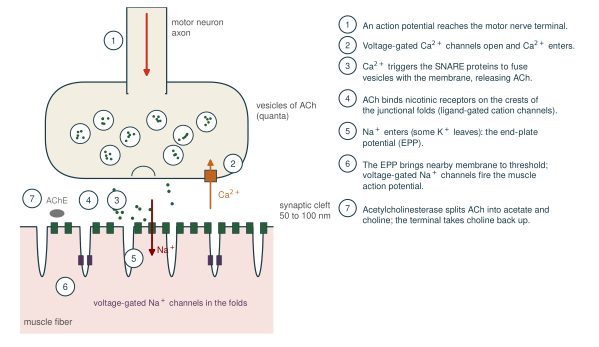

::: {.callout-note title="Goals for this chapter"}
- Tell skeletal, cardiac and smooth muscle apart by structure and control.
- Describe the organization from whole muscle to sarcomere, and say which bands of the sarcomere shorten in contraction.
- Follow the steps from a motor neuron action potential through the neuromuscular junction to the muscle action potential.
- Explain excitation-contraction coupling at the triad, where the DHP receptor is mechanically coupled to the ryanodine receptor.
- Walk through the cross-bridge cycle and say where ATP is used.
- Explain how force is graded: motor unit recruitment, summation and tetanus, and the length-tension relationship.
- Compare the fiber types, and explain how the skeletal muscle pump helps venous return.
:::

This lecture is the first of three on muscle, and the other two ([Cardiac Muscle](cardiac-muscle.qmd) and [Smooth Muscle](smooth-muscle.qmd)) are built as comparisons with it. It uses the ideas from [Membrane Potentials and Excitable Cells](excitable-cells.qmd): a skeletal muscle fiber is an excitable cell that rests near −90 mV and fires an action potential when its motor neuron tells it to. The question is how that action potential turns into force, and how the nervous system makes the force bigger or smaller.

## What skeletal muscle does

Skeletal muscle moves the skeleton, but the lecture's examples go well beyond the limbs: the extraocular muscles that point the eyes, the muscles of facial expression, the diaphragm and intercostal muscles that drive breathing (see [Respiratory Statics](../pulmonary/statics.qmd)), the muscles of the tongue and pharynx that swallow, and the pelvic floor. It holds posture. It makes heat, most obviously when you shiver. And it helps the circulation: contracting muscle squeezes the veins inside it and pushes blood back toward the heart.

The lecture ties the three muscle types to the three things that set cardiac output and blood pressure. Skeletal muscle helps venous return, which fills the heart (end-diastolic volume). Cardiac muscle sets contractility. Smooth muscle sets vascular tone, and so systemic vascular resistance (SVR).

::: {.callout-note title="If you are comparing with the slides"}
The introductory slide writes "Contractility (Rate, contractility)." Heart rate is not part of contractility. Contractility is the intrinsic ability of the heart muscle to develop force at a given preload and afterload. Heart rate and contractility are separate determinants of cardiac output.
:::

| | Skeletal | Cardiac | Smooth |
|---|---|---|---|
| Striated | yes | yes | no |
| Cells | long, unbranched, multinucleated (fused) | branched, one or two nuclei, joined by intercalated discs | spindle-shaped, one nucleus |
| Started by | a motor neuron, every time | its own pacemaker cells | many inputs: nerves, hormones, stretch |
| Coupled by gap junctions | no | yes | in single-unit smooth muscle |

Skeletal muscle has no pacemakers. A fiber contracts only when its motor neuron fires.

## Structure

### From muscle to fiber

A whole muscle is wrapped in connective tissue at every level (@fig-skeletal-muscle-sarcomere shows the innermost level):

- **Epimysium**, the outermost sheath, which fuses with the tendon.
- **Perimysium**, around each *fascicle*, a bundle of muscle fibers.
- **Endomysium**, around each *muscle fiber*, which is one muscle cell.
- Inside each fiber are many **myofibrils**, and each myofibril is a string of **sarcomeres**, the contractile units.

The connective tissue anchors the fibers to each other and to the tendon, so the force they make reaches the bone.

A skeletal muscle fiber forms when many precursor cells (myoblasts) fuse during development. The result is a long, cylindrical, unbranched cell with many nuclei. The cell is so full of actin and myosin that the nuclei are pushed to the edge, just under the membrane. That peripheral position is one way to recognize skeletal muscle under the microscope.

### The membranes of the fiber

The fiber's plasma membrane is the **sarcolemma**. At regular intervals it dives into the cell as **transverse tubules (T tubules)**, which carry the action potential deep into the fiber. Around every myofibril is the **sarcoplasmic reticulum (SR)**, the cell's Ca^2+^ store. Where the SR meets a T tubule it swells into a **terminal cisterna**. One T tubule with a terminal cisterna on each side is a **triad**. In mammalian skeletal muscle the triads sit where the A and I bands meet (the bands are defined below), so each sarcomere has two.

Cardiac muscle has a T tubule paired with one cisterna, a *dyad*. Skeletal muscle has fewer mitochondria than cardiac muscle, which never rests.

### Fiber types

Not all fibers are the same. The lecture's table, with the third column corrected:

| | Type I (slow) | Type IIa (fast) | Type IIb, called IIx in humans (fast) |
|---|---|---|---|
| Diameter | small | intermediate | large |
| Mitochondria | many | many | few |
| Blood supply | extensive | extensive | less extensive |
| Primary metabolism | oxidative | oxidative | glycolytic |
| Stored energy (glycogen) | low | moderate | high |
| Fatigability | lowest | lower | high |

Type I fibers are slow, oxidative and resistant to fatigue: think of postural muscles and a marathon. Type IIb (IIx) fibers are fast, glycolytic, strong, and tire quickly: think of a sprint. Type IIa fibers sit between them. "Fast" and "slow" refer to the myosin each fiber makes. The fast myosin heavy chain cycles faster. Fiber types are usually identified by staining for the myosin heavy chain, or for oxidative enzymes, which are mostly in the mitochondria.

Fatigue is not running out of ATP. ATP stays near normal in a tired fiber, and fatigue comes from ionic and metabolic changes in the working fiber.

::: {.callout-note title="If you are comparing with the slides"}
The fiber-type table heads its columns "Type I (Slow) / Type IIa (Fast) / Type IIa or IIx (Fast)," listing IIa twice. The third column is type IIb (called IIx in humans). The next slide and the notes use I, IIa and IIb.
:::

Most muscles contain a mixture of all three types, and the types may be more of a continuum than three boxes. Fiber type is also *plastic*: it depends on the motor neuron and on what the muscle is asked to do.

- **Reinnervation.** All the fibers supplied by one motor neuron are the same type (see motor units, below), and in a normal muscle the units are interspersed, so types form a checkerboard. If a motor neuron dies, its fibers are denervated and shrink. Sprouts from a surviving neighbor can reinnervate them, and the reinnervated fibers change to the type of their new neuron. The checkerboard gives way to patches of a single type, called fiber-type grouping.
- **Training.** Endurance training increases mitochondria and capillaries in the trained fibers. Resistance training increases fiber diameter and maximal force. Training can shift fibers between the fast subtypes.

### The myofibril and the sarcomere

A myofibril is a chain of sarcomeres, each about 2 µm long, so there are about 5,000 per centimeter of fiber (the slide's 10,000 per myofibril fits a fiber about 2 cm long). Each sarcomere runs from one **Z line** to the next and is built from two sets of overlapping filaments (@fig-skeletal-muscle-sarcomere):

- **Thin filaments** (actin) are anchored at the Z lines and point toward the middle.
- **Thick filaments** (myosin) are anchored at the **M line** in the middle and point toward the Z lines. Their heads point away from the M line on both sides.

{#fig-skeletal-muscle-sarcomere}

The repeating pattern of overlap makes the bands that give striated muscle its stripes:

- **A band:** the full length of the thick filaments. Its length is constant.
- **I band:** the region of thin filament with no thick filament, on both sides of a Z line. It shortens during contraction.
- **H zone:** the middle of the A band, where there is thick filament but no thin filament. It shortens and nearly disappears at full contraction.

The slides label it both H band and H zone. This book uses H zone.

In contraction the filaments do not shorten. The thin filaments slide along the thick filaments toward the M line, so each sarcomere shortens, and with it the myofibril, the fiber and the whole muscle. This is the sliding-filament mechanism.

**Myosin.** Each myosin molecule has two heavy chains and four light chains. The heavy chains wind together to form the long rod (tail), and each heavy chain ends in a globular **head**. The head carries the site that binds actin and the ATPase site that splits ATP. The light chains sit at the neck of each head, where they stabilize it and regulate its activity. Hundreds of myosin molecules bundle tail to tail into a thick filament.

::: {.callout-note title="If you are comparing with the slides"}
The myosin slide says the light chain "forms heads responsible for binding actin." The heavy chains form both the rod and the heads. Actin binding and ATP splitting are properties of the heavy-chain head. The light chains sit at the neck.
:::

**Actin and its regulatory proteins.** Globular actin (G actin) monomers, each with a myosin-binding site, link into two strands twisted into a double helix. Lying in the groove of that helix is **tropomyosin**, a long rod that at rest covers the myosin-binding sites. Attached to tropomyosin at intervals is **troponin**, a complex of three proteins:

- **Troponin I** binds actin strongly and helps hold tropomyosin in its blocking position.
- **Troponin T** binds tropomyosin.
- **Troponin C** binds Ca^2+^.

When Ca^2+^ binds troponin C, the complex changes shape and rolls tropomyosin deeper into the groove, uncovering the myosin-binding sites. That is the on switch. Skeletal and cardiac troponins have the same names and jobs, but they are molecularly distinct proteins.

A giant elastic protein, titin, runs from the Z line along each thick filament to the M line. It keeps the thick filaments centered, and it is the main source of the passive tension a stretched sarcomere develops (see length-tension, below).

## Innervation

### The motor pathway

Voluntary movement starts with *upper motor neurons* in the motor cortex. Their axons descend in the corticospinal tracts, most of them crossing to the other side in the medulla, and synapse on *lower motor neurons* in the ventral horn of the spinal cord (or in brainstem nuclei, for the head). The lower motor neuron's axon leaves the spinal cord in a peripheral nerve and ends on muscle fibers. That is as much neuroanatomy as this course needs.

### The motor unit

One lower motor neuron and all the muscle fibers it supplies make a **motor unit**. Each fiber is supplied by only one motor neuron, but one neuron branches to many fibers: a few in a muscle that moves the eye, hundreds or more in a large limb muscle. All the fibers in one motor unit are the same fiber type, and when the neuron fires, every fiber in the unit contracts.

The nervous system grades force partly by **recruitment**: calling in more motor units. Units are recruited in a fixed order, from small to large, which is called the *size principle*. The smallest motor neurons are the easiest to fire, and they supply small numbers of type I fibers, so light, sustained tasks (posture, gentle movement) use fatigue-resistant units. As more force is needed, type IIa units join, and the largest units, with many type IIb (IIx) fibers, come in last, for brief maximal efforts. The other way to grade force is to fire each unit faster (summation and tetanus, below).

### The neuromuscular junction

The synapse between a motor neuron and a muscle fiber is the **neuromuscular junction (NMJ)** (@fig-skeletal-muscle-nmj). It has three parts:

1. The **presynaptic terminal**, the end of the motor neuron, filled with vesicles of acetylcholine (ACh). Each vesicle's contents is one *quantum* of transmitter.
2. The **synaptic cleft**, 50 to 100 nm wide and filled with extracellular fluid. It contains **acetylcholinesterase (AChE)**, the enzyme that breaks down ACh.
3. The **postsynaptic membrane** of the muscle fiber, the *end plate*, folded into junctional folds that increase its surface area. The crests of the folds are packed with **nicotinic ACh receptors**, 15 to 40 million per end plate. These receptors are **ligand-gated cation channels**: ACh opens them.

::: {.callout-note title="If you are comparing with the slides"}
One slide calls the ACh receptors "voltage gated Na channels" and the next calls them "ligand gated Na+ channels." Nicotinic ACh receptors are ligand-gated cation channels. ACh binding opens them, Na^+^ enters and some K^+^ leaves, and the net inward current is the end-plate potential. The voltage-gated Na^+^ channels nearby, deeper in the folds, are what then fire the muscle action potential.
:::

## Excitation-contraction coupling

*Excitation-contraction (E-C) coupling* is the chain of events that links the action potential to contraction. It has two halves: getting an action potential into the muscle fiber at the NMJ, and getting Ca^2+^ out of the SR at the triad.

### At the neuromuscular junction

{#fig-skeletal-muscle-nmj}

1. An action potential travels down the lower motor neuron to the presynaptic terminal.
2. Depolarization of the terminal opens voltage-gated Ca^2+^ channels, and Ca^2+^ enters.
3. Ca^2+^ triggers the SNARE proteins to fuse vesicles with the terminal membrane, releasing ACh into the cleft.
4. ACh diffuses across the cleft and binds nicotinic receptors on the end plate.
5. The receptors open. Na^+^ enters (and some K^+^ leaves), depolarizing the end plate. This local depolarization is the **end-plate potential (EPP)**.
6. The EPP spreads to the neighboring membrane and brings it to threshold. Voltage-gated Na^+^ channels open and fire a muscle action potential, which spreads along the whole fiber.
7. Meanwhile AChE splits ACh into acetate and choline, ending the signal within a few milliseconds. The terminal takes choline back up to make more ACh.

The NMJ is built so that it does not fail. One motor neuron action potential releases enough ACh to make an EPP far larger than is needed to reach threshold: in a healthy junction every nerve impulse fires the muscle fiber. This margin is called the *safety factor*.

::: {.callout-note title="If you are comparing with the slides"}
The NMJ slide says "End plate potentials can summate to reach muscle cell threshold." At a healthy neuromuscular junction a single EPP is large enough to reach threshold by itself, so summation of EPPs is not needed. What does add up is the quanta: the ACh from each vesicle gives a tiny depolarization, and the hundred or so vesicles released by one nerve impulse together make one EPP well above threshold.
:::

### At the triad

The muscle action potential runs along the sarcolemma and down the T tubules, so it reaches the middle of the fiber almost as fast as the surface (@fig-skeletal-muscle-triad).

{#fig-skeletal-muscle-triad}

1. The action potential depolarizes the T tubule membrane.
2. In the T tubule membrane are **dihydropyridine (DHP) receptors**, voltage sensors that change shape when the membrane depolarizes. Each one is physically linked to a **ryanodine receptor (RyR1)**, a Ca^2+^ channel in the membrane of the terminal cisterna across a narrow gap. The DHP receptor's change in shape pulls the ryanodine receptor open. This is *mechanical coupling*.
3. Ca^2+^ flows out of the SR, down its steep gradient, and floods the cytosol around the myofibrils.
4. Ca^2+^ binds troponin C. Tropomyosin moves off the myosin-binding sites on actin, and cross-bridges start to cycle.
5. As long as action potentials keep coming, Ca^2+^ keeps being released. When they stop, **SERCA** (the sarco/endoplasmic reticulum Ca^2+^ ATPase) pumps Ca^2+^ back into the SR. Ca^2+^ comes off troponin, tropomyosin covers the binding sites again, and the muscle relaxes. SERCA uses ATP, so relaxation costs energy too.

Because the DHP receptor opens RyR1 directly, skeletal muscle does not need any Ca^2+^ to enter from outside the cell to contract. It keeps contracting for some time even with no extracellular Ca^2+^. Cardiac muscle is different. There the DHP receptor works as a channel: Ca^2+^ entering through this L-type Ca^2+^ channel triggers RyR2, and contraction stops without extracellular Ca^2+^. That is Ca^2+^-induced Ca^2+^ release ([Cardiac Muscle](cardiac-muscle.qmd)). The skeletal DHP receptor is an L-type channel too, but contraction does not need its small Ca^2+^ current.

::: {.callout-note title="If you are comparing with the slides"}
The summary slide lists "Ca+2 dependent Ca+2 release" as the skeletal muscle step. In skeletal muscle, release is by mechanical coupling of the DHP receptor to RyR1, as described above and in the notes. Ca^2+^-dependent (Ca^2+^-induced) Ca^2+^ release is the cardiac mechanism.
:::

Mutations in the proteins of the triad, most often RyR1 and sometimes the DHP receptor, cause **malignant hyperthermia**. In a susceptible person, certain anesthetic drugs make the abnormal ryanodine receptor release Ca^2+^ without stopping. The muscles contract and burn ATP, partly to pump the Ca^2+^ back, and body temperature rises dangerously.

## Cross-bridge cycling

Once the binding sites are uncovered, myosin heads attach to actin and pull. Each attach-pull-detach sequence is one turn of the **cross-bridge cycle** (@fig-skeletal-muscle-crossbridge).

![The cross-bridge cycle. Actin (top of each panel) and the thick filament (bottom), with the M line to the left. (A) Attached: the head is bound to actin with no nucleotide, the rigor state. (B) ATP binds and the head lets go. (C) The head splits ATP and re-cocks, still holding ADP and P~i~. (D) If Ca^2+^ has moved tropomyosin, the cocked head binds actin. (E) P~i~ is released and the head tilts (the power stroke), pulling the thin filament toward the M line; ADP is released, leaving the head bound as in A. Adapted from Boron and Boulpaep, *Medical Physiology* [@boron2017], as used in the 2026 lecture.](figures/skeletal-muscle/crossbridge.svg){#fig-skeletal-muscle-crossbridge}

A. **Attached.** At the end of a stroke the myosin head is bound tightly to actin, with nothing in its nucleotide site.

B. **Released.** ATP binds the head. Myosin with ATP bound has a low affinity for actin, so the head lets go.

C. **Cocked.** The head splits ATP into ADP and P~i~, which stay bound. The energy released re-cocks the head into its high-energy position, pointing toward the Z line.

D. **Cross-bridge.** If tropomyosin has been moved, the cocked head binds a new site on actin, a little farther along.

E. **Power stroke.** Binding releases P~i~, and the head tilts back toward its resting angle, pulling the thin filament a few nanometers toward the M line. ADP is released and the head is back at A, bound to actin and waiting for the next ATP.

ATP is used twice in a contraction: to detach and re-cock each myosin head, and to pump Ca^2+^ back into the SR. While Ca^2+^ is present and ATP keeps arriving, each head goes around this cycle many times a second, and the many heads working out of step slide the filaments smoothly. And without ATP the cycle stops at A, with every head stuck to actin. That is why muscles become rigid after death (rigor mortis).

## Muscle contraction: twitch, summation and tetanus

A single action potential in a muscle fiber produces a single brief contraction, a **twitch**. The action potential lasts a few milliseconds. After a short latent period, while Ca^2+^ is released and cross-bridges attach, force rises to a peak in a few tens of milliseconds and then falls as SERCA clears the Ca^2+^ (@fig-skeletal-muscle-twitch A). The twitch outlasts the action potential many times over.

That mismatch is what lets the force add up (@fig-skeletal-muscle-twitch).

![Force in a skeletal muscle fiber (top) driven by muscle action potentials (bottom ticks). (A) One action potential gives a twitch, here about a third of the maximal force. (B) A second action potential before the first twitch has ended gives summation: a larger second contraction. (C) At a moderate firing rate the twitches fuse partly, an unfused tetanus. (D) At a high rate force rises to a smooth plateau, a fused tetanus. Schematic model: each action potential adds a brief pulse of activation, and force builds fully only when activation is sustained. Course figure, after the lecture's comparison.](figures/skeletal-muscle/twitch-tetanus.svg){#fig-skeletal-muscle-twitch}

- **Summation.** If a second action potential arrives before the muscle has relaxed, the second contraction builds on the first and reaches a higher force.
- **Unfused tetanus.** At a moderate firing rate, the muscle partly relaxes between action potentials, so force rises with a ripple.
- **Fused tetanus.** At a high rate there is no time to relax at all, and force rises to a smooth plateau several times larger than a single twitch.

Each action potential is still a separate, complete event. The fiber repolarizes and recovers its excitability within a few milliseconds, which is why it can fire again so soon. What adds up is the Ca^2+^ in the cytosol and the force. A single twitch is weak because the Ca^2+^ transient from one action potential is brief. SERCA clears it before the cross-bridges have had time to stretch the elastic parts of the fiber and tendon and pass their full force to the ends of the muscle. Repeated action potentials keep Ca^2+^ high long enough for force to build. Normal movements use unfused and fused tetani, graded by how fast the motor neurons fire, together with recruitment of more motor units.

::: {.callout-warning title="A common mistake"}
"In tetanus the action potentials summate." They do not. A skeletal muscle action potential is all-or-none and over in a few milliseconds, and the next one is a separate spike from the same resting potential. What summates is the contraction: Ca^2+^ release and force. This is also why heart muscle cannot be tetanized. Its long action potential keeps it refractory until its contraction is nearly over.
:::

### Types of contraction

A contracting muscle does not always shorten.

- **Concentric:** the muscle shortens while it contracts, because its force exceeds the load. Lifting a weight.
- **Isometric:** the muscle contracts with no change in length, because its force equals the load. Holding a weight still.
- **Eccentric:** the muscle lengthens while it contracts, because the load exceeds its force. Lowering a weight slowly to the ground.

## Unique properties

### Length-tension

The force a sarcomere can make depends on how much its filaments overlap, because force is proportional to the number of cross-bridges that can form. @fig-skeletal-muscle-length-tension shows the relationship.

![Tension against sarcomere length. Skeletal muscle (maroon): active tension, from cross-bridges, is greatest at 2.0 to 2.2 µm (shaded), where every myosin head can reach actin. It falls at longer lengths because overlap shrinks, and at shorter lengths because thin filaments overlap each other and thick filaments press against the Z lines. Passive tension (dashed), from stretching titin and connective tissue, appears only well beyond the optimum. Cardiac muscle (blue): passive tension rises steeply at lengths where skeletal muscle's is still near zero, which keeps the heart on the rising limb of its active curve. Course figure.](figures/skeletal-muscle/length-tension.svg){#fig-skeletal-muscle-length-tension}

- **At about 2.0 to 2.2 µm**, overlap is optimal: every myosin head is opposite actin, and active tension is greatest.
- **Stretched beyond that**, the thin filaments are pulled out from between the thick filaments, fewer heads can reach actin, and active tension falls. Stretched far enough, the filaments no longer overlap at all and there is no active tension.
- **Shorter than that**, thin filaments from the two ends cross each other and get in the way, and the thick filaments eventually butt against the Z lines, so active tension falls again.
- **Passive tension** is the force a relaxed muscle resists stretch with. In skeletal muscle it only becomes large well beyond the optimal length.

In the body, most skeletal muscles work near the top of the curve, and skeletal muscle keeps much of its force over a broad range of lengths. Cardiac muscle works over a narrower range. Its passive tension rises steeply at lengths where skeletal muscle's is still near zero, so its sarcomeres are hard to stretch much past 2.2 to 2.3 µm, and it normally operates on the rising limb of its curve, where more stretch means more force. That is part of the cellular basis of the Frank-Starling mechanism, which the Cardiac Muscle chapter develops.

::: {.callout-note title="If you are comparing with the slides"}
The slide's skeletal curve reaches zero near 2.8 to 2.9 µm, while the figure here, drawn from filament overlap, reaches zero nearer 3.6 µm. You do not need either number. What matters is the shape: force peaks at 2.0 to 2.2 µm and falls on either side.

The slide also draws a cardiac active curve that falls steeply after about 2.4 µm. In the intact heart the stiff passive structures keep sarcomeres from being stretched much past 2.2 to 2.3 µm, so that falling limb is rarely reached. @fig-skeletal-muscle-length-tension draws the cardiac curves only over the range the heart uses. Both pictures make the slide's point: skeletal muscle works over a broader range of lengths than cardiac muscle.
:::

::: {.callout-warning title="A common mistake"}
"Stretching the muscle increases its compliance." On the rising limb of the length-tension curve, stretch increases the *force of contraction*, because more cross-bridges can form or work more effectively. Compliance describes the passive curve: how much a relaxed muscle lengthens for a given stretching force. A stretched muscle is, if anything, less compliant, because passive tension rises more steeply the more it is stretched.
:::

### The skeletal muscle pump

The veins of the legs run between and through muscles, and they have one-way valves that let blood move only toward the heart (@fig-skeletal-muscle-pump).

{#fig-skeletal-muscle-pump}

When the muscle contracts, it compresses the vein and drives blood up through the upper valve, and the lower valve shuts so blood cannot fall back. When the muscle relaxes, the emptied segment refills from below. Rhythmic contraction, as in walking, works like a pump in series with the heart. It increases venous return and helps fill the heart, which increases stroke volume and cardiac output. In this course, the muscle pump is treated as lowering the resistance to venous return (RVR) on the vascular function curve; [Control of Cardiac Output](../cardiovascular/control-of-co.qmd) shows how that shifts the operating point.

Standing still for a long time shows what happens without it. With no contraction to push it up, blood pools in the leg veins, venous return falls, and capillary pressure in the feet rises, which favors edema.

## Check your understanding

1. In a muscle fiber shortening from 2.5 µm to 2.1 µm per sarcomere, which of these change length: the A band, the I band, the H zone, the thin filaments?

    

Answer

    The I band and the H zone shorten. The A band (the length of the thick filaments) and the filaments themselves do not change. The thin filaments slide toward the M line.

    

2. A toxin blocks the ryanodine receptor. The motor nerve is stimulated. Which of these still happen: ACh release, an end-plate potential, a muscle action potential, a twitch?

    

Answer

    ACh release, the end-plate potential and the muscle action potential are all upstream of the SR and still happen. The action potential still reaches the T tubules and still moves the DHP receptors, but Ca^2+^ cannot leave the SR, so troponin C is never activated and there is no twitch.

    

3. The Ca^2+^ in the bath around a nerve-muscle preparation is lowered to about a third of normal, not to zero. What happens to ACh release with each nerve impulse, to the size of the EPP, and to whether each impulse still fires the muscle fiber?

    

Answer

    Less Ca^2+^ enters the nerve terminal through its voltage-gated Ca^2+^ channels with each impulse, so fewer vesicles fuse and fewer quanta of ACh are released. The EPP is smaller. Whether the fiber still fires depends on the safety factor. A normal EPP is far larger than it needs to be to reach threshold, so a somewhat smaller one can still fire the fiber on every impulse. The margin has shrunk, though. If Ca^2+^ falls further, the EPP in some fibers drops below threshold and those fibers stop responding to the nerve.

    

4. A drug makes SERCA pump faster, so after each action potential cytosolic Ca^2+^ falls back sooner than normal. What happens to the force of a single twitch, and to the firing rate needed to reach a fused tetanus? Why?

    

Answer

    The twitch is weaker and briefer. Its Ca^2+^ transient is shorter, so the cross-bridges have less time to stretch the elastic parts of the fiber and tendon before the Ca^2+^ is gone. A fused tetanus needs cytosolic Ca^2+^ to stay high from one action potential to the next. With Ca^2+^ cleared faster, it falls further between spikes at any given rate, so the action potentials have to come closer together to keep it up. The rate needed for a fused tetanus rises.

    

5. A muscle is stretched until its sarcomeres are 2.6 µm long and then stimulated to a fused tetanus. Compared with stimulation at 2.1 µm, is the active force larger or smaller, and why? What happens to passive tension?

    

Answer

    Active force is smaller. At 2.6 µm the thin filaments have been pulled partway out from between the thick filaments, so they overlap less of the region that carries myosin heads and fewer cross-bridges can form. The slide's curve and the one in this chapter agree on that. Passive tension, from stretched titin and connective tissue, is just beginning to rise at 2.6 µm. At 2.1 µm it is near zero.

    

6. A patient has lost many motor neurons in one muscle and the survivors have reinnervated the orphaned fibers. What will a fiber-type stain show, and why?

    

Answer

    Instead of the normal checkerboard of types, the stain shows large patches of fibers of a single type. Each surviving motor neuron now supplies many more fibers, and every fiber it supplies takes on the type set by that neuron.

    

## Sources

This chapter follows the 2026 Skeletal Muscle lecture for MEDC 30504 and draws on the peer-educator notes and the 2018 course notes, corrected and updated. All figures were drawn for this book.

::: {#refs}
:::
