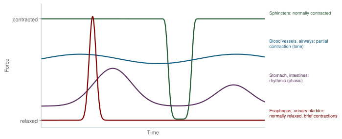

::: {.callout-note title="Goals for this chapter"}
- Describe the structure of a smooth muscle cell and how it differs from skeletal and cardiac muscle: no sarcomeres, dense bodies, intermediate filaments, caveolae, sparse SR.
- Explain the contractile mechanism: side-polar myosin, no troponin, and regulation by phosphorylation of the myosin light chain.
- Outline excitation-contraction coupling, from the rise in cytosolic Ca^2+^ through calmodulin and MLCK to cross-bridge cycling, and relaxation by MLCP.
- Explain the four routes that regulate smooth muscle: neuronal, neurohormonal (receptor-dependent, α~1~ versus β~2~), mechanical (stretch) and nitric oxide.
- Contrast single-unit and multi-unit smooth muscle.
- Explain the latch state, length adaptation, and why smooth muscle can divide as well as hypertrophy.

Names, dates and the exact values in figure captions are context, not things to memorize.
:::

Smooth muscle lines the walls of the hollow organs: arteries and veins, bronchioles, the gut, the bladder, the uterus and the ducts of the reproductive tract. It does not move bones. It changes the diameter of a tube or the volume of a bag, and it often has to hold that change for minutes, hours or a lifetime. An arteriole that sets your blood pressure is partly contracted all day. A bladder has to stay relaxed while it fills and then empty completely.

In the cardiovascular block this matters because vascular smooth muscle sets vascular tone, and vascular tone sets systemic vascular resistance (SVR), one of the three things that decide cardiac output and blood pressure. The [Cardiovascular Physiology Overview](../cardiovascular/cv-overview.qmd) and [Peripheral Circulation and Hemodynamics](../cardiovascular/hemodynamics.qmd) chapters build on that. This chapter answers a cell-level question: how does a cell with no sarcomeres and no troponin generate force, and how do nerves, hormones, stretch and nitric oxide turn that force up and down?

The chapter assumes the sarcomere, the cross-bridge cycle and troponin regulation from [Skeletal Muscle](skeletal-muscle.qmd), and the membrane potential and G-protein signaling from [Membrane Potentials and Excitable Cells](excitable-cells.qmd).

## Structure

### Why "smooth"

Under the light microscope skeletal and cardiac muscle are striated: their actin and myosin are lined up in sarcomeres, so the bands of every myofibril sit in register. Smooth muscle has the same two proteins but no sarcomeres, so it has no bands. That is the whole meaning of "smooth."

A smooth muscle cell is:

- **fusiform** (spindle-shaped), thick in the middle and tapered at both ends;
- a **single cell** with a **single, central nucleus**. Smooth muscle cells do not fuse, unlike skeletal muscle fibers, which are made by fusion of many cells;
- **unstriated**;
- **capable of mitosis**. Of the three muscle types, only smooth muscle cells can divide. That comes back at the end of the chapter.

::: {.callout-note collapse="true" title="Background: embryonic origin"}
Vascular smooth muscle does not come from a single embryonic source. Depending on the vessel, it comes from neural crest, somites, the second heart field, the proepicardium, splanchnic mesoderm, or the mesothelial cells lining the pleural and peritoneal cavities. The lecture showed this to make one point: smooth muscle in different places has different ancestry, which is one reason it varies so much from organ to organ. You do not need to memorize the origins.
:::

### Sarcolemma and SR

The cell membrane (sarcolemma) has no T-tubules. Instead it has *caveolae*, small flask-shaped dips in the membrane. They play a part like T-tubules, bringing the membrane close to the sarcoplasmic reticulum (SR) and collecting channels and signaling proteins, but they are far less developed. The SR itself is sparse. There are **no dyads and no triads**.

A smooth muscle cell can get away with this because it is small and thin, a few micrometers across, so Ca^2+^ entering through the membrane does not have far to diffuse. It also does not need to switch on in milliseconds. A skeletal muscle fiber, by contrast, is up to 100 µm across and has to activate its whole cross-section at once, which is what the T-tubule and triad system is for.

### The cytoskeleton

@fig-smooth-muscle-cell-structure shows the parts.

- **Dense bodies** anchor the thin filaments. Some sit in the cytoplasm and some are attached to the membrane (where they are often called attachment plaques). They do the job of the Z line in a sarcomere, and like the Z line they contain α-actinin.
- **Thin filaments** are actin, with tropomyosin. They are part of the contractile machinery and are anchored in the dense bodies.
- **Thick filaments** are myosin. They are part of the contractile machinery. There are many fewer of them than in striated muscle.
- **Intermediate filaments** (vimentin and desmin) link the dense bodies into a network. They are structural and not part of the contractile mechanism, but they carry force across the cell.

Bundles of actin and myosin run between dense bodies at an angle to the cell's long axis, in a crisscross lattice. When the bundles shorten they pull the dense bodies toward each other in many directions at once, and the cell gets shorter and fatter. Because the membrane is tied down at its attachment plaques, it puckers between them.

![Smooth muscle cell structure. (A) A relaxed cell. Actin-myosin bundles (maroon) run diagonally between dense bodies in the cytoplasm and on the membrane. Intermediate filaments (dotted) link the dense bodies. (B) The same cell contracted: shorter and wider. (C) Skeletal thick filaments are bipolar, with heads that reverse at a central bare zone. Smooth muscle myosin is side-polar: along the whole filament, the heads on one side face one way and the heads on the other side face the other way. Course figure.](figures/smooth-muscle/cell-structure.svg){#fig-smooth-muscle-cell-structure}

### Connections between cells

Two kinds of junction join neighboring smooth muscle cells:

- **Gap junctions** are channels made of connexin proteins that connect the cytoplasm of two cells. Ions and small molecules pass through them, so electrical activity in one cell spreads to the next.
- **Mechanical junctions** (adherens junctions) hold cells together so that force generated in one cell is passed to its neighbors and to the surrounding connective tissue.

How many gap junctions a tissue has decides whether it behaves as one coordinated sheet or as separate cells. That distinction, single-unit versus multi-unit, comes up under neuronal regulation below.

## The contractile unit

The basic contractile unit of smooth muscle is a bundle of thin filaments anchored in a dense body at each end, with thick filaments between them. Myosin pulls the actin, and the dense bodies move toward each other. That much is like a sarcomere with dense bodies in place of Z lines, but two things differ.

**Smooth muscle myosin is side-polar** (@fig-smooth-muscle-cell-structure C). In a skeletal thick filament the heads point one way on one half and the opposite way on the other half, with a bare zone in the middle. In smooth muscle the heads on one face of the filament all point one way along its full length, and those on the opposite face all point the other way. The thin filaments on the two sides slide in opposite directions, and since there is no bare zone, overlap can stay good over a much wider range of lengths. This is one reason smooth muscle can still generate force after being stretched far beyond the length at which a skeletal sarcomere would have lost all overlap.

**There is no troponin in smooth muscle.** In striated muscle, Ca^2+^ binds troponin C and moves tropomyosin off the myosin-binding sites on actin. Smooth muscle has tropomyosin but no troponin, so Ca^2+^ has to act some other way. It acts on the myosin, as the next section shows. The thin filament also carries caldesmon, a protein that lies along actin and tropomyosin. It modulates contraction but is not the main switch.

::: {.callout-note title="If you are comparing with the slides"}
The figure on the contractile-unit slide labels the actin-myosin units "Sarcomeres." Smooth muscle has no sarcomeres. The label refers to the contractile unit between two dense bodies, which works like a sarcomere but is not lined up in register with its neighbors, so it produces no striations.

The same figure calls the mechanical junction a desmosome, while the cytoskeleton slide calls it an adherens junction. The anchoring junctions between smooth muscle cells are mainly adherens-type junctions. For this course, "mechanical junction" is enough.
:::

## Excitation-contraction coupling

Every muscle contracts when cytosolic Ca^2+^ rises. What differs between muscle types is where the Ca^2+^ comes from and what it binds to. @fig-smooth-muscle-ec-coupling summarizes smooth muscle.

{#fig-smooth-muscle-ec-coupling}

### Where the Ca^2+^ comes from

Cytosolic Ca^2+^ rises from two sources, and in smooth muscle both matter.

- **Across the sarcolemma.** Depolarization opens voltage-gated (L-type) Ca^2+^ channels. Some agonists open receptor-operated channels directly, and stretch opens stretch-activated channels. Extracellular Ca^2+^ is about 10,000 times the resting cytosolic level, so it flows in fast once a channel opens. The lecture's Ca^2+^ slide also shows nonselective cation channels, which let Na^+^ and Ca^2+^ in.
- **From the SR.** Ca^2+^ that enters can bind ryanodine receptors on the SR and release more (Ca^2+^-induced Ca^2+^ release, as in cardiac muscle). Agonists acting through Gq-coupled receptors make IP~3~, which opens IP~3~ receptors on the SR. Both routes operate. Which one is larger varies from tissue to tissue, and agonists acting through α~1~ receptors use the IP~3~ route.

Because extracellular Ca^2+^ entry is a major source, L-type Ca^2+^ channel blockers relax vascular smooth muscle and lower vascular tone.

### Ca^2+^, calmodulin and MLCK

In order:

1. The action potential, or a smaller depolarization, opens voltage-gated Ca^2+^ channels in the sarcolemma.
2. Ca^2+^ binds ryanodine receptors on the SR, which release more Ca^2+^ into the cytosol. (IP~3~ does the same through its own receptor.)
3. Ca^2+^ binds *calmodulin*, a small protein with four Ca^2+^-binding sites, which changes to its active shape.
4. The Ca^2+^-calmodulin complex (CaCM) binds and activates *myosin light chain kinase* (MLCK).
5. MLCK uses ATP to phosphorylate the regulatory light chain of myosin. That phosphorylation switches on the myosin head's ATPase.
6. Phosphorylated myosin binds actin and cross-bridge cycling begins. The cycle itself is the one you learned in [Skeletal Muscle](skeletal-muscle.qmd).
7. *Myosin light chain phosphatase* (MLCP) removes the phosphate, and the cell relaxes.

::: {.callout-note title="If you are comparing with the slides"}
Step 5 on the excitation-contraction coupling slide reads "MLCK Phosphorylates / activates myosin light chain kinase." MLCK does not phosphorylate itself. It phosphorylates the regulatory light chain of myosin, which activates the myosin head's ATPase and starts cross-bridge cycling. The peer-educator notes describe the step correctly. This is errata entry 11.
:::

So smooth muscle is regulated on the **thick filament**: Ca^2+^ switches on the myosin. Striated muscle is regulated on the **thin filament**: Ca^2+^ binds troponin on the actin filament and uncovers the binding sites. In skeletal muscle, Ca^2+^ acts directly and within milliseconds. In smooth muscle it acts through an enzyme cascade, which is one reason smooth muscle contracts and relaxes so slowly, over seconds rather than milliseconds.

It also means that force depends on the balance between two enzymes. MLCK adds phosphate and MLCP removes it. Anything that speeds MLCK or slows MLCP shifts the balance toward contraction, and anything that does the reverse shifts it toward relaxation. Most of the regulation in the next section works by tipping that balance.

### Ca^2+^ removal

To relax, the cell has to bring cytosolic Ca^2+^ back down. SERCA, the Ca^2+^ pump in the SR membrane, pumps Ca^2+^ back into the SR. A Ca^2+^ pump in the sarcolemma (the plasma membrane Ca^2+^-ATPase) and the Na^+^/Ca^2+^ exchanger (NCX) move Ca^2+^ out of the cell. NCX uses the energy of Na^+^ flowing in (three Na^+^ in for each Ca^2+^ out). NCX depends on the Na^+^ gradient that the Na^+^/K^+^-ATPase maintains (three Na^+^ out, two K^+^ in). When Ca^2+^ falls, Ca^2+^ leaves calmodulin, MLCK switches off, MLCP dephosphorylates the myosin, and the cell relaxes.

## Regulation of smooth muscle activity

Skeletal muscle has one input: the motor neuron. Smooth muscle has four, and a single cell may respond to all of them:

1. **Neuronal**: sympathetic and parasympathetic nerves.
2. **Neurohormonal and pharmacological**: hormones, transmitters and drugs acting on receptors.
3. **Mechanical**: stretch.
4. **Nitric oxide**, mostly from the endothelium.

### 1. Neuronal: varicosities, single-unit and multi-unit

Autonomic nerves do not form neuromuscular junctions on smooth muscle. The axon runs along or between the cells and swells every few micrometers into *varicosities*, which release transmitter into the space around them. Transmitter diffuses to whatever cells are near, so one varicosity can reach several cells and one cell can be reached by several varicosities. Sympathetic nerves mostly release norepinephrine and parasympathetic nerves acetylcholine. Their effects on particular organs are in [Autonomic and Extrinsic Control](../cardiovascular/ans-extrinsic-control.qmd).

How a tissue responds to its nerves depends on how its cells are connected (@fig-smooth-muscle-multi-single-unit).

| | Single-unit | Multi-unit |
|---|---|---|
| Electrical coupling | Yes, through many gap junctions | No, no gap junctions between cells |
| Behavior | The tissue contracts as one coordinated unit, a functional syncytium | Each cell contracts on its own nerve input |
| Gives | Coordinated waves of contraction | Fine, graded control |
| Examples | Gut (peristalsis), small arteries and arterioles (the slides: arterial smooth muscle) | Vas deferens, iris |

{#fig-smooth-muscle-multi-single-unit}

The peer-educator notes call single-unit smooth muscle *unitary* or *visceral*. The terms mean the same thing.

Single-unit tissue can also contract without any nerve input. Stretch, hormones and spontaneous electrical activity can start a contraction in one cell, and gap junctions carry it across the sheet. Nerves change how strong and how frequent those contractions are, rather than starting each one.

### 2. Neurohormonal and pharmacological: same signal, different receptor

Most chemical signals reach smooth muscle through G protein-coupled receptors (GPCRs). A ligand binds the receptor, the G protein's α subunit swaps GDP for GTP and separates from βγ, and the subunits act on enzymes and channels inside the cell. The background is in [Membrane Potentials and Excitable Cells](excitable-cells.qmd).

The same ligand can have opposite effects, depending on which receptor it meets. Norepinephrine and epinephrine are the lecture's examples:

| Receptor | G protein | Second messenger | Effect on smooth muscle | Lecture example |
|---|---|---|---|---|
| α~1~ | Gq | Phospholipase C makes IP~3~ and DAG. IP~3~ releases SR Ca^2+^ | Contraction | Blood vessels: vasoconstriction |
| α~2~ | Gi | Inhibits adenylyl cyclase: less cAMP | Opposes β~2~ relaxation | Brain (the lecture's picture) |
| β~2~ | Gs | Activates adenylyl cyclase: more cAMP, which activates protein kinase A (PKA) | Relaxation | Airways: bronchodilation |

The α~1~ pathway raises Ca^2+^, so it drives contraction through calmodulin and MLCK. The β~2~ pathway works the other way. PKA phosphorylates MLCK and makes it less active, and it also lowers cytosolic Ca^2+^, so the balance tips toward MLCP and the muscle relaxes. In vessels that carry both receptors, such as those in skeletal muscle, the net effect depends on which receptor dominates and on how much epinephrine versus norepinephrine arrives. [Autonomic and Extrinsic Control](../cardiovascular/ans-extrinsic-control.qmd) and [Other Special Circulations](../cardiovascular/special-circulations.qmd) follow that through.

::: {.callout-note title="If you are comparing with the slides"}
The peer-educator notes give the receptor examples as "α~1~, α~2~, β~1~." The smooth muscle β receptor that relaxes vessels and airways is β~2~. β~1~ receptors are the heart's: they raise heart rate and contractility, as the [Cardiac Muscle](cardiac-muscle.qmd) chapter explains.
:::

**Electromechanical and pharmacomechanical coupling.** There are two ways a signal can raise Ca^2+^. In *electromechanical coupling* the membrane depolarizes and voltage-gated Ca^2+^ channels open. In *pharmacomechanical coupling* an agonist raises Ca^2+^ without needing a change in membrane potential, by opening receptor-operated channels or by making IP~3~ that releases SR Ca^2+^. Many smooth muscles contract with no action potential at all. That is one more way smooth muscle differs from skeletal muscle, which contracts only when its motor neuron fires it.

**Changing sensitivity to Ca^2+^.** Some agonists also change how much force a given Ca^2+^ level produces. The same contractile receptors also activate *Rho kinase*, which inhibits MLCP. With less phosphatase activity, more myosin stays phosphorylated at the same Ca^2+^, and force rises. @fig-smooth-muscle-regulation pulls all these routes together. Each one ends at the same two enzymes.

{#fig-smooth-muscle-regulation}

### 3. Mechanical: stretch

Smooth muscle responds to being stretched. The membrane carries two kinds of stretch-sensitive channel. *Mechano-gated* cation channels let Na^+^ and Ca^2+^ in when the cell is stretched. The cell depolarizes, voltage-gated Ca^2+^ channels open, and the cell contracts. *Mechano-sensitive* K^+^ channels do the opposite: they let K^+^ out, which hyperpolarizes the cell and relaxes it.

In arterioles, stretch-induced contraction is the basis of the *myogenic response*: when perfusion pressure rises and stretches the vessel wall, the smooth muscle contracts and the vessel narrows, which holds flow nearly constant. The [Microcirculation and Local Control](../cardiovascular/microcirculation.qmd) chapter covers how this contributes to autoregulation. In the gut and bladder, stretch from filling triggers contraction of single-unit muscle.

### 4. Nitric oxide

Endothelial cells make nitric oxide (NO) from L-arginine with the enzyme NO synthase. Shear stress from flowing blood is a main stimulus. Some medications release NO directly. NO is a small gas and diffuses straight across membranes into the neighboring smooth muscle cells, where it:

1. activates soluble guanylyl cyclase (sGC), which makes cGMP from GTP;
2. cGMP activates protein kinase G (PKG, also called cGMP-dependent protein kinase);
3. PKG lowers cytosolic Ca^2+^. It reduces Ca^2+^ entry and SR release and opens K^+^ channels, so the membrane hyperpolarizes and voltage-gated Ca^2+^ channels close. PKG also activates MLCP.

Less Ca^2+^ means less active MLCK, and more MLCP means myosin is dephosphorylated faster. Both relax the muscle and dilate the vessel.

::: {.callout-note title="If you are comparing with the slides"}
The nitric oxide figure labels the cGMP-dependent kinase "PGK," and the speaker notes spell it out as "phosphoglycerate kinase." The enzyme is protein kinase G (PKG), the cGMP-dependent protein kinase. Phosphoglycerate kinase is a glycolytic enzyme and has no role here. The arrows in the figure are right: the cGMP-activated kinase opens K^+^ channels, reduces Ca^2+^ entry and release, and so relaxes the cell.
:::

## Unique properties and functions

### Patterns of contraction

Different organs use their smooth muscle in different ways (@fig-smooth-muscle-contraction-patterns). Sphincters stay contracted most of the time and relax briefly, as when the lower esophageal sphincter opens to let a swallow through. Blood vessels and airways are partly contracted all the time: this baseline is *tone*, and the body adjusts it up and down. The stomach and intestines contract rhythmically (phasic contraction). The esophagus and the urinary bladder are normally relaxed and contract in brief bursts, to swallow or to void.

{#fig-smooth-muscle-contraction-patterns}

Holding tone all day would be expensive if every cross-bridge used ATP at the rate skeletal muscle does. Smooth muscle has a way around that.

### The latch state

Here *phasic* means a single brief contraction, the opposite of *tonic*; the rhythmic gut contractions above are a series of phasic contractions. In a phasic contraction (@fig-smooth-muscle-latch A), a brief stimulus raises Ca^2+^, MLCK phosphorylates myosin, cross-bridges cycle, force rises, and everything falls back as Ca^2+^ is removed. In a *tonic* contraction (@fig-smooth-muscle-latch B), the stimulus is sustained. Ca^2+^ and myosin phosphorylation peak early and then fall to a lower steady level. Force does not fall. It stays high, while only 20 to 30% of cross-bridges (that is, of myosin regulatory light chains) are phosphorylated. That is the *latch state*: smooth muscle can hold a contraction with minimal ATP use.

The standard explanation is that when MLCP dephosphorylates a myosin head that is still attached to actin, the head does not let go right away. It stays bound and detaches very slowly. These dephosphorylated heads, called latch bridges, keep bearing force and detach only slowly. Once one does detach, it cannot bind again until MLCK rephosphorylates it. Fewer heads are cycling, and each attached head holds on longer, so force is held for much less ATP. The muscle trades speed for economy: it holds force, but it cannot shorten quickly while in latch.

{#fig-smooth-muscle-latch}

### Length adaptation

A skeletal muscle has one optimal length, set by filament overlap in the sarcomere, and force falls away on either side of it (@fig-smooth-muscle-length-adaptation A). Smooth muscle can work over a much wider range of lengths. Part of the reason is side-polar myosin. The other part is *length adaptation*: if a smooth muscle is held at a new length for a while, the cell rearranges its contractile units, adding or removing them in series, so that its length-tension curve moves and its optimal length becomes the new length (@fig-smooth-muscle-length-adaptation B).

That is what a bladder or a stomach needs. A full bladder can be several times its empty size and must still be able to contract strongly enough to empty.

 chapter, with L~0~ taken as 2.1 µm). (B) Smooth muscle held at a new length adapts: its curve shifts so that peak force occurs near that length, shown here for 0.7 L~0~ and 1.3 L~0~. Schematic. Course figure, after the lecture's slide.](figures/smooth-muscle/length-adaptation.svg){#fig-smooth-muscle-length-adaptation}

### Smooth muscle can divide as well as hypertrophy

Skeletal and cardiac muscle cells grow larger in response to load (hypertrophy), but they rarely or never divide. Smooth muscle cells can do both. They can *proliferate* (divide by mitosis). They can *hypertrophy*, growing larger, and in some vessels the nuclei become tetraploid or octaploid as the cell grows. They also *synthesize and secrete* connective tissue proteins, collagen and elastic fibers, into the wall around them.

## Comparing smooth and skeletal muscle

| Feature | Skeletal muscle | Smooth muscle |
|---|---|---|
| Cells | Long, multinucleated fibers made by cell fusion | Small, fusiform cells with one central nucleus |
| Striations | Yes (sarcomeres) | No (dense bodies) |
| Membrane system | T-tubules, triads, extensive SR | Caveolae, sparse SR, no dyads or triads |
| Source of activating Ca^2+^ | SR, released through RyR1 mechanically coupled to the DHP receptor | Extracellular entry plus SR (IP~3~ receptor and RyR) |
| Ca^2+^ sensor | Troponin C on the thin filament | Calmodulin, which activates MLCK |
| Regulated filament | Thin (actin) | Thick (myosin) |
| Thick filament | Bipolar | Side-polar |
| Activation | Somatic motor neuron at a neuromuscular junction; every contraction needs an action potential | Autonomic varicosities, hormones, stretch, NO; may contract without an action potential |
| Speed and energy | Fast, high ATP use | Slow; holds force cheaply in latch |
| Length range | One fixed optimum, set by filament overlap | Wide; the optimum moves with adaptation |
| Can divide | No | Yes |

The [Cardiac Muscle](cardiac-muscle.qmd) chapter adds the third column.

::: {.callout-warning title="A common mistake"}
"Smooth muscle needs an action potential to contract." Many smooth muscles contract with graded depolarization or with no change in membrane potential at all, through pharmacomechanical coupling (IP~3~ release of SR Ca^2+^) or stretch. "All smooth muscle acts as a syncytium" is the other one. Only single-unit smooth muscle does. Multi-unit cells, as in the iris and vas deferens, are controlled one by one.
:::

## Check your understanding

1. A drug blocks MLCK completely. Can the smooth muscle contract if cytosolic Ca^2+^ rises? Would the answer be the same for skeletal muscle?

    

Answer

    No. In smooth muscle, Ca^2+^ works only through calmodulin and MLCK: without phosphorylation of the regulatory light chain, myosin cannot cycle. Skeletal muscle would still contract, because Ca^2+^ there binds troponin C on the thin filament, and light chain phosphorylation only modulates force.

    

2. A strip of artery is made to contract in two ways: once by depolarizing it with a high-K^+^ solution, and once with an α~1~ agonist. An L-type Ca^2+^ channel blocker is then added. Which contraction is reduced more, and why?

    

Answer

    The high-K^+^ contraction. It is electromechanical coupling: depolarization opens voltage-gated (L-type) Ca^2+^ channels, and that Ca^2+^ entry is almost the whole signal, so blocking the channels removes it. The α~1~ contraction is pharmacomechanical. Part of it also depends on Ca^2+^ entry, but IP~3~ still releases SR Ca^2+^ and Rho kinase still inhibits MLCP, so some force remains.

    

3. Epinephrine constricts one vessel and dilates another. How can the same hormone do both?

    

Answer

    The response depends on the receptor. At α~1~ receptors (Gq), epinephrine raises IP~3~ and Ca^2+^, which activates MLCK and contracts the muscle. At β~2~ receptors (Gs), it raises cAMP; PKA inhibits MLCK and lowers Ca^2+^, so the muscle relaxes. The net effect in a vessel depends on which receptor dominates there.

    

4. A drug inhibits the enzyme that breaks down cGMP in vascular smooth muscle. Which way does vascular tone move, and through which enzymes?

    

Answer

    Tone falls. cGMP stays high, so PKG stays active. PKG lowers cytosolic Ca^2+^ (less MLCK activity) and activates MLCP, so myosin is dephosphorylated and the muscle relaxes. The drug amplifies the effect of NO.

    

5. During a sustained contraction, measured myosin light chain phosphorylation falls to a quarter of its peak, but force stays near maximal. What is happening, and what does it cost the cell?

    

Answer

    This is the latch state. Myosin heads that are dephosphorylated while attached to actin stay attached and detach very slowly, so they keep bearing force. Fewer heads are cycling and each holds on longer, so the cell uses little ATP. The price is speed: the muscle can hold force but cannot shorten quickly.

    

6. Why can a peristaltic wave travel along the intestine while each smooth muscle cell in the iris can be controlled separately?

    

Answer

    Intestinal smooth muscle is single-unit: its cells are joined by many gap junctions, so excitation in one cell spreads to its neighbors as a wave. The iris is multi-unit: its cells have no gap junctions between them and each receives its own nerve supply, so contraction can be graded cell by cell.

    

## Sources

This chapter follows the 2026 Smooth Muscle lecture (Parts I and II) for MEDC 30504 and draws on the peer-educator notes and the 2018 course notes, corrected and updated. All figures were drawn for this book.
