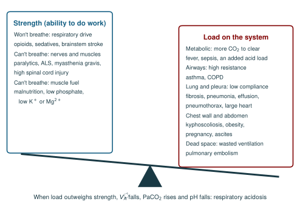
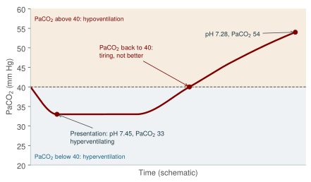

::: {.callout-note title="Goals for this chapter"}
- Read an arterial blood gas in the course order: pH, PaCO~2~, PaO~2~, saturation.
- Explain how the CO~2~ and bicarbonate buffer links the lung and the kidney, without calculating pH.
- Name the "emia", the primary "osis", and what the body does to compensate.
- Describe how the lung compensates for a metabolic acidosis and a metabolic alkalosis, and why the second response is small.
- Explain respiratory acidosis as an imbalance between strength and load, and list causes on each side.
- List the causes of respiratory alkalosis, starting with hypoxemia.

Names, dates and the exact values in figure captions are context, not things to memorize.
:::

The earlier chapters followed air into the alveoli and gas across the barrier. This one looks at a consequence in the blood. CO~2~ is an acid, and the lung sets how much of it stays in the body, so every change in ventilation changes the blood's pH. Clinicians look at blood gases constantly: in an emergency on any ward, someone will hand you one and ask whether to worry. The goal here is narrow and practical. You should be able to look at a blood gas with one disorder, say what the primary problem is, and say what the body is doing about it. The kidney's side is treated as a black box here; the renal block opens it.

## A blood gas

The lecture opens with a 27-year-old woman found unresponsive after heroin use. She does not wake to a sternal rub and her pupils are pinpoint. While she is being treated with naloxone, an arterial blood gas comes back:

> pH 7.08 / PaCO~2~ 85 / PaO~2~ 42 / SaO~2~ 75%

A blood gas is always reported in that order. Blood is usually drawn from the radial artery, because arterial blood has just left the lungs and heart; venous blood has had acid added and O~2~ removed by whatever tissue it drained, so it says less about gas exchange. All the values are arterial ("little a"), because the alveolus cannot be sampled.

Memorize the normal values now. You will use them for the rest of the block.

| Value | Normal |
|---|---|
| pH | 7.40 |
| PaCO~2~ | 40 mm Hg |
| HCO~3~^−^ | 24 mEq/L (reported with the gas or alongside it) |
| PaO~2~ | about 80 to 100 mm Hg, lower with age |
| SaO~2~ | close to 100% |

Laboratories differ on how wide the normal pH range is. The lecture slides call a pH below 7.37 low and above 7.42 high; the course notes use 7.35 and 7.45. Both center on 7.40, and for the gases in this chapter the direction away from 7.40 is what you read.

PaCO~2~ and alveolar PCO~2~ are essentially equal, so a blood gas gives you PACO~2~ directly. PaO~2~ is not always equal to alveolar PO~2~. You calculate PAO~2~ with the alveolar gas equation and compare the two: the difference is the A–a gradient. In a healthy lung both gases equilibrate across the barrier, and PaO~2~ still ends up a few mm Hg below PAO~2~ because a small share of the blood bypasses gas exchange and V/Q varies across the lung. Those lower PaO~2~ far more than they raise PaCO~2~. The [Ventilation and Perfusion](ventilation-perfusion.qmd) chapter explains why.

### Hypoventilation causes hypoxemia with normal lungs

Work through her oxygen first. In Chicago, with PB 747 mm Hg, R 0.8 and room air:

$$P_{AO_2} = (P_B - P_{H_2O})\,F_{IO_2} - \frac{P_{aCO_2}}{R} = 0.21\,(747 - 47) - \frac{85}{0.8} \approx 147 - 106 = 41 \text{ mm Hg}$$

Her PaO~2~ is 42. The A–a gradient is essentially zero (the PaO~2~ sitting a hair above PAO~2~ comes from assuming R is exactly 0.8). Her chest X-ray is clear. Nothing is wrong with her lungs. She is breathing so little that CO~2~ has built up in her alveoli, and at a fixed total pressure, more alveolar CO~2~ leaves less room for O~2~ (@fig-acid-base-opioid-gas).

{#fig-acid-base-opioid-gas}

The low saturation is what gets attention. Put O~2~ on her and her saturation rises to normal, because raising FiO~2~ raises PAO~2~. Her PaCO~2~ has not changed, and the acidemia that comes with it can kill her. The fix for her is to make her breathe: naloxone reverses the opioid. With every blood gas, ask three things: what is the oxygen, what is the CO~2~, and does the patient look able to keep this up?

## Why pH matters

Proteins work over a narrow pH range, and receptors, enzymes and channels all change shape when it moves.

- **Too acidemic (pH too low):** cardiac function is depressed, tissues stop responding to catecholamines (the body's own and those given as drugs), and the patient can die. Critical acidemia is a common final pathway in the ICU.
- **Too alkalemic (pH too high):** muscle tightening (tetany), seizures, arrhythmias and death. This is less common.

In health the pH stays very close to 7.40.

## The CO~2~ and bicarbonate buffer

An acid is a molecule that can give up a proton:

$$\text{HA} \rightleftharpoons \text{H}^+ + \text{A}^-$$

The Henderson-Hasselbalch equation relates pH to the ratio of the base form to the acid form: pH = pK + log([A^−^]/[HA]). (The course notes print this ratio upside down; the base form goes on top, as in the bicarbonate form below.) A buffer resists changes in pH when acid or base is added. It does that best within about one pH unit of its pK (@fig-acid-base-buffer).

![The bicarbonate buffer: pH against the share of the buffer present as HCO~3~^−^, from the Henderson-Hasselbalch equation with pK 6.1. Adding acid moves the point left; adding base moves it right. Normal blood sits at 7.4, high on the curve, where HCO~3~^−^ outnumbers dissolved CO~2~ by 20 to 1. Adapted from Ward, Ward and Leach, *The Respiratory System at a Glance* [@w11-ward], as used in the 2026 lecture.](figures/acid-base/buffer-curve.svg){#fig-acid-base-buffer}

The buffer that matters for the lung is CO~2~ and bicarbonate:

$$\text{CO}_2 + \text{H}_2\text{O} \;\overset{\text{CA}}{\rightleftharpoons}\; \text{H}_2\text{CO}_3 \rightleftharpoons \text{H}^+ + \text{HCO}_3^-$$

Carbonic anhydrase (CA) speeds the first step. Plasma has almost none, so the reaction runs mostly inside red cells (see [Transport of O~2~ and CO~2~](o2-co2-transport.qmd)). Say "bicarb" for bicarbonate; everyone does.

Written for this buffer, with 0.03 the solubility of CO~2~ in blood (mmol/L per mm Hg):

$$\text{pH} = 6.1 + \log\frac{[\text{HCO}_3^-]}{0.03 \times P_{aCO_2}} = 6.1 + \log\frac{24}{0.03 \times 40} = 6.1 + \log 20 = 7.40$$

The arithmetic checks out, and that is all it is here: a check. Clinicians who read thirty blood gases a day never calculate it, and you will not have to either. Read the equation for its directions:

- HCO~3~^−^ is on top. Raise it and pH rises; lower it and pH falls.
- PaCO~2~ is on the bottom. Raise it and pH falls; lower it and pH rises. CO~2~ behaves as an acid.
- pH depends on the *ratio*. If both rise or both fall, pH moves back toward 7.40.

The pK of 6.1 is far below 7.40, so blood sits near the top of the buffer curve, outside the range where a buffer works best (@fig-acid-base-buffer). On its own the pair would be a weak buffer at 7.40. It works because the body controls both halves of the ratio, with two controllers. The lungs set PaCO~2~ and can change it within seconds to minutes by breathing faster or deeper. The kidneys set HCO~3~^−^, using transporters you will meet in the renal block, and they need hours to days. Strictly, the lungs stand for the whole respiratory system (lungs, chest wall and the muscles that move them) and the kidneys for the whole metabolic side, including the tissues that make acid. So the disorders are called *respiratory* and *metabolic*, not "lung" and "kidney".

## The four primary disorders

Each disorder is named for the variable that moved first.

| Disorder | pH | Primary problem | Compensation |
|---|---|---|---|
| Respiratory acidosis | low | high PaCO~2~ | kidney raises HCO~3~^−^ |
| Metabolic acidosis | low | low HCO~3~^−^ | lung lowers PaCO~2~ |
| Respiratory alkalosis | high | low PaCO~2~ | kidney lowers HCO~3~^−^ |
| Metabolic alkalosis | high | high HCO~3~^−^ | lung raises PaCO~2~ |

Compensation always acts on the *other* variable and moves it in the *same* direction as the primary change, because that restores the ratio. If PaCO~2~ is high, the kidney raises HCO~3~^−^; if HCO~3~^−^ is low, the lung lowers PaCO~2~. @fig-acid-base-four shows all four as paths on a plot of HCO~3~^−^ against PaCO~2~.

{#fig-acid-base-four}

**Compensation never restores a normal pH.** It moves the pH toward 7.40 and stops short. That makes blood gases easier to read, because compensation never overshoots. If a patient with a primary acidosis turns up alkalemic, a second process is present. A patient with diabetic ketoacidosis who is breathing as hard as she can will still be acidemic; if her gas shows an alkalemia, look for something else, such as vomiting (a metabolic alkalosis) or an ingestion that drives breathing.

Respiratory compensation is fast. Renal compensation takes hours to days, so the size of the HCO~3~^−^ change tells you how long a respiratory problem has been going on. A patient with a PaCO~2~ of 80 and a very low pH has a new problem and needs the ICU. A patient with the same PaCO~2~ and a pH near normal has had time to compensate and may not need immediate action. There are formulas for the expected compensation. They belong to the renal block and are not part of this lecture.

The lung's two responses are not equal. It can blow off a great deal of CO~2~ to compensate for a metabolic acidosis. Its compensation for a metabolic alkalosis is small. The high pH does lower the chemoreceptor drive, ventilation falls and PaCO~2~ rises, but hypoventilation also lowers PaO~2~, and the falling PaO~2~ drives ventilation back up through the peripheral chemoreceptors. The [Control of Ventilation](control-of-ventilation.qmd) chapter covers those receptors.

::: {.callout-note title="If you are comparing with the lecture"}
In the recording, the small compensation for a metabolic alkalosis is explained as breathing less being "unnatural", something you have to do consciously. The response is automatic: the chemoreceptors sense the higher pH and drive falls. It stays small because hypoventilation lowers PaO~2~, and hypoxemia limits it, as the course notes say.
:::

## Emia, osis, and what the body does

Read every blood gas with three questions.

1. **What is the emia?** Is the pH low (acidemia) or high (alkalemia)? This is the net result of everything going on.
2. **What is the primary osis?** A low pH means either a high PaCO~2~ (respiratory acidosis) or a low HCO~3~^−^ (metabolic acidosis). A high pH means either a low PaCO~2~ or a high HCO~3~^−^. Look at the PaCO~2~ first and see whether it matches the pH, then use the HCO~3~^−^ as the check. You can also do it the other way round; both work.
3. **What is the body doing to compensate?** Has the other variable moved away from normal in the same direction?

A patient can have several processes at once: ketoacidosis, a pneumonia that limits CO~2~ clearance, and dehydration adding a metabolic alkalosis, all pulling the pH in different directions. Mixed disorders wait for the renal block. Each gas in this lecture has one primary disorder.

The lecture's four practice gases, worked through:

| Gas (pH, PaCO~2~, HCO~3~^−^) | Emia | Primary osis | Compensation |
|---|---|---|---|
| 7.08, 85, 26 | acidemia | PaCO~2~ high: respiratory acidosis | HCO~3~^−^ barely above 24: little compensation yet, which fits a problem hours old (the kidney needs days) |
| 7.20, 26, 11 | acidemia | HCO~3~^−^ low: metabolic acidosis | PaCO~2~ below 40: the lung is blowing off CO~2~ |
| 7.47, 45, 35 | alkalemia | HCO~3~^−^ high: metabolic alkalosis | PaCO~2~ a little above 40: a small rise |
| 7.50, 28, 20 | alkalemia | PaCO~2~ low: respiratory alkalosis | HCO~3~^−^ below 24: some renal compensation |

These are the lecture's values, rounded; if you check them with Henderson-Hasselbalch, each pH comes out a few hundredths different, which changes no reading.

The first gas is the opioid patient. A metabolic acidosis comes from an added acid, such as lactic acid when tissues are poorly perfused or ketoacids in diabetic ketoacidosis. A metabolic alkalosis comes from loss of H^+^, as in vomiting, or from volume loss.

A PaCO~2~ of 45, as in the third gas, may be flagged as normal by some laboratories. The body controls pH so tightly that the small rise is still a real compensation: a healthy person who holds their breath until PaCO~2~ reaches 45 feels short of breath.

Practice these until the reading is automatic. This is a topic many students learn for the test, forget, and then need on the first day of the wards.

## How the lungs change PaCO~2~

The lungs have two levers: breathe faster or breathe deeper. Together they make the minute ventilation:

$$\dot V_E = \text{RR} \times V_T$$

A normal tidal volume is about 500 mL. A true resting rate is 10 to 12 breaths per minute (hospital charts often record 18), which gives a V̇E of about 6 L/min; other lectures use 15 breaths per minute and 7.5 L/min. In distress, V~T~ can pass 1 L and the rate can reach the 30s or 40s, so V̇E can rise from 6 to 30 L/min or more. That wide range is why the lung can compensate so strongly for a metabolic acidosis. (When you climb stairs fast, notice that you breathe deeper before you breathe faster.)

More ventilation lowers PaCO~2~. Breathing more washes CO~2~ out of the alveoli, which steepens the gradient from blood to alveolus, so more CO~2~ leaves the blood. Strictly, PaCO~2~ depends on the part of each breath that reaches the alveoli, the alveolar ventilation: PaCO~2~ ∝ V̇CO~2~/V̇A ([Alveolar Ventilation](ventilation.qmd)). The chemoreceptors sense the change and adjust breathing: the peripheral chemoreceptors respond to pH and PCO~2~, and the central chemoreceptors mainly to PCO~2~ ([Control of Ventilation](control-of-ventilation.qmd)).

The classic example is diabetic ketoacidosis. Patients take giant, effortful breaths (Kussmaul breathing), sometimes without feeling short of breath. If their breathing later looks much more comfortable, that is either very good (the acidosis has been treated) or very bad (they are too tired to keep compensating). The blood gas and the patient's appearance together tell you which.

## Respiratory acidosis: strength and load

Respiratory acidosis is a low pH from a high PaCO~2~, and the high PaCO~2~ means alveolar ventilation is too low for the CO~2~ the body makes. The lecture's rule: if you say a respiratory acidosis is due to a *strength-load imbalance*, you will always be right. The work is then to say which strength and which load. Strength is the ability to do the work of breathing. Load is everything that work has to overcome (@fig-acid-base-strength-load).

{#fig-acid-base-strength-load}

### Strength

People divide strength in different ways. One common split is *won't breathe* and *can't breathe*.

**Won't breathe** means the drive to breathe is too low, so breaths come too seldom or too small. Opioids are the most common cause; an overdose may breathe 4 to 6 times a minute. Sedatives, including those given for surgery, do the same. Strokes in the brainstem can lower drive, though they are uncommon and usually bring other serious problems. CO~2~ is normally a potent stimulus to breathe, so a high PaCO~2~ without faster breathing tells you the drive itself is depressed.

**Can't breathe** means the drive is there but the pump cannot produce a normal tidal volume.

- *Nerves and muscles.* Paralytic drugs (given during surgery so the patient does not move), amyotrophic lateral sclerosis, myasthenia gravis, high spinal cord injury and diaphragm weakness. Recall from [Respiratory Statics](statics.qmd) that the muscles set how far up and down the pressure-volume curve the system can go. Weak muscles cannot pull as large a breath. Many patients with ALS eventually need a machine that helps push each breath in, and later a ventilator.
- *Fuel for the muscles.* Malnutrition weakens muscle. Electrolytes matter too: muscles need phosphate to make ATP, so severe hypophosphatemia can cause respiratory failure (and arrhythmias). Low potassium and magnesium also weaken muscle.

### Load

- **Metabolic load.** More CO~2~ to clear: fever, sepsis, a hypermetabolic state, or an added acid load. A metabolic acidosis is not a primary respiratory problem, but it is still a load. A patient with normal lungs compensates by blowing off CO~2~. A patient who already has a respiratory acidosis cannot, and the extra acid makes the respiratory acidosis worse.
- **Airways.** High airway resistance, as in asthma and COPD, makes it hard to move air in and out. CO~2~ retention is usually more marked in emphysema than in asthma: the airways collapse more easily, the patients breathe from already overfull lungs, and long illness often leaves their muscles weak.
- **Lung and pleura.** Anything that makes the respiratory system stiffer adds load, and the lecture builds the list from the inside out. In the lung: scar (pulmonary fibrosis), pneumonia, fluid. In the pleural space: fluid (an effusion) or air (a pneumothorax). A large, dilated heart in chronic heart failure takes up space in the chest.
- **Chest wall and abdomen.** Kyphoscoliosis, a sternotomy or other chest surgery, and obesity, the most common chest wall problem in the United States. Below the diaphragm: pregnancy, ascites, a distended bowel, even severe constipation. Anything that fills the abdomen makes it harder for the diaphragm to descend.
- **Dead space.** Ventilated lung that has no blood flow, as in a pulmonary embolism. Air moved through it carries off no CO~2~, so the same work clears less. The [Ventilation and Perfusion](ventilation-perfusion.qmd) chapter covers it.

Real patients often have several factors at once. A patient with lung cancer might be malnourished after chemotherapy, have low phosphate, a starvation ketosis (another acid load), a malignant pleural effusion and a pneumonia. Each one is small; together they tip the balance, a pattern ICU teams call "death by a thousand paper cuts". Fixing one factor may not be enough, and fixing all of them may be what gets the patient out of the ICU. The [Think Like a Respiratory Consultant](respiratory-consultant.qmd) chapter uses the same framework.

::: {.callout-note collapse="true" title="Background: cystic fibrosis and bronchiectasis"}
A student asked where these fit. Thick secretions and inflamed airways raise airway resistance, and lung tissue scarred by repeated infection can lower compliance. Neither is usually enough on its own to raise PaCO~2~ chronically, and many patients have normal blood gases, but either can add to other loads.
:::

### Asthma: the normal PaCO~2~ that should worry you

Asthma narrows airways unevenly. Some close down and others stay open, and a patient in an attack breathes harder, so the open airways overventilate their alveoli. Early in an asthma attack PaCO~2~ is therefore usually *low*: a respiratory alkalosis. Small Group 3 follows a woman who presents at pH 7.45 with a PaCO~2~ of 33 (alkalemic by the slides' cutoff of 7.42; wider normal ranges are also used) and later, as she tires, has pH 7.28 with a PaCO~2~ of 54 (@fig-acid-base-asthma).

{#fig-acid-base-asthma}

On the way from alkalosis to acidosis the PaCO~2~ passes through 40. A patient with asthma who is working hard to breathe and has a normal PaCO~2~ should be hyperventilating. If she is not, she may be tiring and close to failing. A normal gas in a patient who looks better is good news; the same gas in a patient who looks worse is not.

## Respiratory alkalosis

Respiratory alkalosis is a high pH from a low PaCO~2~: ventilation is more than the body's CO~2~ production requires. The causes are more of a grab bag.

- **Hypoxemia.** A low PaO~2~ (below about 60 mm Hg) stimulates the peripheral chemoreceptors, ventilation rises, and PaCO~2~ falls. The alveolar gas equation shows why that helps: with less CO~2~ subtracted, PAO~2~ is higher. At the top of Everest, PB is low, hypoxemia drives her carotid bodies, and she hyperventilates; PaCO~2~ is the one term she can change, and lowering it raises her PAO~2~.
- **Pain and anxiety.** A healthy person having an arterial blood gas drawn usually shows a slight respiratory alkalosis, because a needle is coming.
- **Ingestions,** salicylates in particular, which stimulate the respiratory center.
- **Some central nervous system injuries.**
- **Pregnancy.** Progesterone stimulates breathing. The enlarged abdomen is also a load, so a pregnant patient with another cause of respiratory acidosis has less reserve.
- **Compensation for a metabolic acidosis.** The PaCO~2~ is low, but the pH is still acidemic, because compensation stops short.

::: {.callout-note title="If you are comparing with the lecture"}
In the recording, salicylate toxicity is once called a cause of metabolic alkalosis. Salicylates cause a respiratory alkalosis, as the slide lists, and often a metabolic acidosis at the same time; they do not cause a metabolic alkalosis. The recording also says hypoxia causes alkalosis "via the alveolar gas equation". The trigger is the peripheral chemoreceptors; the equation shows why the lower PaCO~2~ raises PAO~2~. Early in the recording, the gap between PaO~2~ and PAO~2~ is put down to O~2~ binding Hb. Both gases equilibrate in a normal lung, and the small gap comes from the normal shunt and V/Q scatter.
:::

## Oxygenation and ventilation come together

The block began by separating oxygenation from ventilation. Here they meet in both directions. In the opioid patient the primary problem was ventilation, and it caused hypoxemia with normal lungs. In the climber the primary problem was hypoxemia, and the response to it caused a respiratory alkalosis. They interact because O~2~ and CO~2~ share the same alveolar gas: when PACO~2~ rises, PAO~2~ falls, and the reverse.

## Check your understanding

1. Why does compensation never carry the pH past 7.40? What would you conclude if a patient in diabetic ketoacidosis had an alkalemic blood gas?

    

Answer

    The compensating system responds to the pH error, and the response shrinks as the error shrinks, so it never gets the pH all the way back, let alone past normal. An alkalemic gas in a primary metabolic acidosis means a second process is pushing the pH up, such as a metabolic alkalosis from vomiting or a respiratory alkalosis from an ingestion.

    

2. Sort each of these into strength or load, and say which kind: a sedative overdose, myasthenia gravis, severe hypophosphatemia, high fever, morbid obesity, a large pleural effusion, a pulmonary embolism.

    

Answer

    Strength: sedative overdose (drive, "won't breathe"), myasthenia gravis (neuromuscular, "can't breathe"), hypophosphatemia (muscle fuel, "can't breathe"). Load: high fever (metabolic, more CO~2~ to clear), obesity (chest wall), pleural effusion (pleura, lower compliance), pulmonary embolism (dead space).

    

3. The opioid patient is given O~2~ by face mask and her saturation rises to 98%. What has not been fixed, and why does the O~2~ not fix it?

    

Answer

    Her PaCO~2~ is still high and her pH still low. Raising FiO~2~ raises PAO~2~ (the first term of the alveolar gas equation), which fixes the oxygen. CO~2~ leaves only with ventilation, and her ventilation has not changed. Only more breathing, here by reversing the opioid, lowers PaCO~2~.

    

4. Early in an asthma attack, the airways are narrowed, yet PaCO~2~ is usually below 40. How can that be?

    

Answer

    The narrowing is uneven. The patient breathes harder, and the airways that are still open carry extra air, so their alveoli are overventilated and lose extra CO~2~. Total alveolar ventilation is high, so PaCO~2~ falls. Only when the open units can no longer make up the difference, usually because the muscles tire, does PaCO~2~ rise.

    

5. Why is the lung's compensation for a metabolic alkalosis so much smaller than its compensation for a metabolic acidosis?

    

Answer

    Compensating for an alkalosis means breathing less. As ventilation falls, PaCO~2~ rises, but PAO~2~ and PaO~2~ fall too, and hypoxemia stimulates the peripheral chemoreceptors, which drives breathing back up. Nothing like that limits hyperventilation, and V̇E can rise about fivefold, so compensation for an acidosis can be large.

    

6. A climber spends a week at high altitude, and her kidneys lower her HCO~3~^−^ to compensate for the respiratory alkalosis. She flies home, and on her first day at sea level her PaCO~2~ is back to 40 mm Hg. Is her pH above, at or below 7.40, and why? What does the kidney do next?

    

Answer

    Below 7.40. The kidney took days to lower her HCO~3~^−^ and needs days to raise it again, so on the first day her HCO~3~^−^ is still low. With a normal PaCO~2~ and a low HCO~3~^−^, the ratio is below 20 to 1 and she is acidemic. Her gas looks like a metabolic acidosis, although it is the leftover of a compensation and not a new disease. Over the next few days the kidney raises HCO~3~^−^ and the pH returns to 7.40.

    

## Key equations

| Equation | Use |
|---|---|
| CO~2~ + H~2~O ⇌ H~2~CO~3~ ⇌ H^+^ + HCO~3~^−^ | The buffer that links lung and kidney |
| pH = 6.1 + log [HCO~3~^−^ / (0.03 × PaCO~2~)] | Henderson-Hasselbalch as a concept: pH follows the ratio (not calculated) |
| V̇E = RR × V~T~ | Minute ventilation |
| PaCO~2~ ∝ V̇CO~2~ / V̇A | More alveolar ventilation, lower PaCO~2~ |
| PAO~2~ = (PB − PH~2~O) FiO~2~ − PaCO~2~/R | Why high PaCO~2~ lowers PAO~2~ |

## Sources

This chapter follows the 2026 Pulmonary Acid Base lecture for MEDC 30504 and draws on the course's acid-base notes and Small Group 3, corrected and updated. All figures were drawn for this book.

::: {#refs}
:::
