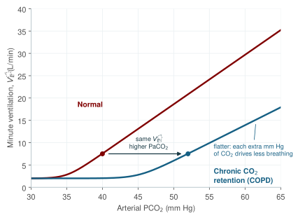
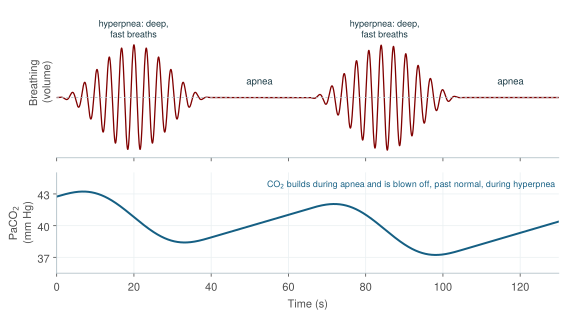

::: {.callout-note title="Goals for this chapter"}
- Name the six brainstem centers that generate and shape the breathing rhythm, and say what each one does.
- Match the primary and secondary muscles of breathing to the medullary groups that drive them.
- Describe the four kinds of lung receptors, what stimulates each, how their signals reach the brainstem, and how breathing changes when they fire.
- Compare central and peripheral chemoreceptors: where they are, what they sense, and why the central ones respond to blood CO~2~ but hardly to blood H^+^.
- Read the ventilation response curves to O~2~ and CO~2~, explain why CO~2~ is the main stimulus in health, and explain how hypoxemia changes the response to CO~2~.
- Use those curves to explain the blunted CO~2~ response of chronic CO~2~ retention and the waxing and waning of Cheyne-Stokes breathing.
- Explain how baroreceptors and higher brain centers act on breathing, and how the competing inputs are settled.

The lecturer calls this lecture "more on the memorization end." The movie and TV references on the slides are memory aids, not things to learn. You do not need the individual chemosensitive zones on the surface of the medulla (the slide notes say so).
:::

This is the last lecture of new material in the block. The earlier chapters followed the gas from the air to the alveolus ([statics](statics.qmd), [dynamics](dynamics-1.qmd), [ventilation](ventilation.qmd)), across the barrier ([diffusion](diffusion.qmd)), into the blood ([transport](o2-co2-transport.qmd)), through the matching of air and blood ([ventilation and perfusion](ventilation-perfusion.qmd)), and on to the tissues as O~2~ delivery, cardiac output times O~2~ content. All of that runs without conscious effort, and it has to change from moment to moment as we sleep, talk, eat and exercise. This chapter is about the control system. The lecture builds it in four parts around one diagram (@fig-control-of-ventilation-control-loop, at the end of the chapter):

1. **Rhythm generation** in the brainstem, which produces each breath.
2. **The muscles of respiration and the sensory receptors** in the respiratory system, which carry out the breath and report on it.
3. **Central and peripheral chemoreceptors**, which report how gas exchange is going (with the baroreceptors).
4. **Higher brain centers and integration**, including how the system settles competing demands.

## Rhythm generation: the medulla

The basic drive to breathe comes from the brainstem: the medulla, which sits on top of the spinal cord, and the pons above it. Six structures matter for this course (@fig-control-of-ventilation-centers). Four are in the medulla, and they generate the rhythm. Two are in the pons, and they shape it.

{#fig-control-of-ventilation-centers}

**Pre-Bötzinger complex (pre-BC): the "go" button.** Its neurons are autorhythmic. Like the cells of the sinus node in the heart, they depolarize on their own at a regular rate, and each burst of firing starts a breath. That is why you breathe all day, and all night, without thinking about it. Recording electrodes moved through the brainstem pick up these rhythmic bursts most strongly at the pre-BC. Different groups of its neurons produce different patterns: ordinary tidal breaths (eupnea), sighs (a longer, deeper inspiration), and gasps (a sudden, abrupt inspiration). Other inputs shift which pattern dominates. Profound hypoxia, for example, shifts the pre-BC toward gasping, which is the gasp of someone who has been held underwater too long.

**Bötzinger complex (BC): the "stop" button.** It sits right next to the pre-BC and sends mostly inhibitory signals to it. The cycle has phases: pre-inspiration, when the inspiratory neurons begin to ramp up at the end of expiration; inspiration; a brief post-inspiration transition; and expiration. Toward the end of inspiration the BC fires and shuts off the inspiratory drive, so the inspiratory muscles relax and you breathe out. Go, stop, go, stop: the pair sets the rhythm.

**Dorsal respiratory group (DRG): tidal breathing.** The DRG carries out the rhythm for quiet breathing. It signals the primary muscles of inspiration, the diaphragm and the external intercostals. It sits beside the nucleus tractus solitarius (NTS), where much of the sensory feedback arrives (below), so that feedback acts on it directly.

**Ventral respiratory group (VRG): augmented breathing.** The VRG recruits the secondary muscles of inspiration and expiration. It is most active when breathing has to be augmented: deeper, fuller inspirations, or forced expirations.

## Rhythm modulation: the pons

The two pontine centers do not start breaths. They shape the breath that the medulla starts: how deep it is, and how the cycle divides between inspiration and expiration. Their output is graded, set by the feedback they receive.

**Apneustic center (AC).** It sits at the junction of the pons and the medulla, caudal to the pneumotaxic center. It augments inspiration: it takes the signal from the pre-BC and ramps it up. Left to itself it would drive every inspiration as long and as deep as possible.

**Pneumotaxic center (PC).** It sits higher in the pons and inhibits the apneustic center, which ends inspiration on time and prevents overdistension. It receives the sensory feedback from the stretch receptors in the lungs, so it is the center that says "that's enough stretch." With both working, breaths are smooth and of normal size. (The slide notes give the PC's anatomical names, the Kölliker-Fuse and parabrachial nuclei. You do not need them.)

### What the transection experiments showed

The functions of these centers were worked out in animals by cutting the brainstem at different levels and watching the breathing pattern, with the vagus nerves left intact or cut. The vagi matter because they carry the stretch-receptor signals from the lungs (next section), which also help end inspiration. @fig-control-of-ventilation-transections shows the results.

{#fig-control-of-ventilation-transections}

- **Level I (above the pons).** Breathing stays close to normal, perhaps a little slower without the higher inputs. Cutting the vagi as well makes breaths slower and deeper, because the stretch signal that helps end inspiration is gone.
- **Level II (below the pneumotaxic center).** The apneustic center now runs without its brake. Breaths are slower and deeper, and if the vagi are also cut, inspiration is held for a long time before a brief expiration: *apneustic breathing*, or apneusis.
- **Level III (between the pons and the medulla).** Only the medullary centers are left. The pre-BC and BC still switch breathing on and off, but the breaths are irregular gasps, with or without the vagi. The pons is what turns that on-off signal into a smooth tidal breath.
- **Level IV (below the medulla).** No breathing at all. The rhythm generator has been cut off from the spinal cord.

The gasping pattern comes from the firing of the medullary neurons, not from the mechanics of the lung or chest wall. You will see it at the bedside as *agonal breathing*, in patients who are dying or in cardiac arrest, when the higher centers have failed and the medulla is the last thing still working. It can look like breathing, which is why bystander CPR teaching now asks "is the person breathing *normally*?" rather than "is the person breathing?" A gasping person found collapsed needs CPR. Gasps can also continue for a time after death, which is distressing for families and staff, and knowing where they come from helps you explain them.

::: {.callout-note title="If you are comparing with the slides"}
The lecture notes (section I.C) and the recording describe losing the pneumotaxic center as producing apneustic breathing, with breaths "held at inhalation." The transection figure (slides 23 to 27) shows that apneusis appears only when the vagi are cut as well. With the vagi intact, the stretch-receptor signal still ends each inspiration, and breathing after a level II cut is slower and deeper. The figure is the version to learn. The course errata make the same correction.
:::

## Muscles of respiration

The rhythm centers act through the respiratory muscles, which are skeletal muscle, so they can also be driven voluntarily (see "Higher brain centers," below).

| | Inspiration | Expiration |
|---|---|---|
| Primary muscles (eupneic breathing), driven by the DRG | Diaphragm, external intercostals | None. The lung's elastic recoil returns the system to FRC. |
| Secondary muscles (forced or augmented breathing), driven by the VRG | Upper airway muscles (nares, tongue, pharynx, larynx), which hold the airway open and lower its resistance; neck muscles (sternocleidomastoids, scalenes); chest muscles (pectoralis minor and major) | Internal intercostals, abdominal muscles |

The ribs move like bucket handles, hinged at each end. The external intercostals pull them up and out, which enlarges the chest and lowers pleural pressure. The internal intercostals pull them down and in, which is only needed when expiration has to be forced. Quiet expiration uses no muscle at all, as the [statics chapter](statics.qmd) explained: the inspiratory muscles relax and recoil does the rest. A person working hard to breathe, sitting forward with hands on knees and the neck muscles standing out with each breath, is using the secondary muscles that the VRG recruits. The skin pulling in above the collarbones and between the ribs shows how negative the pleural pressure has become.

::: {.callout-note collapse="true" title="Background: the motor nerves"}
The diaphragm is supplied by the phrenic nerve, whose motor neurons sit in the spinal cord at C3 to C5. That is why an injury to the cervical cord above that level stops breathing, while an injury below it spares the diaphragm. The pathways from the brainstem groups to the spinal motor neurons belong to the neurobiology course.
:::

## Sensory receptors in the respiratory system

As you breathe, the respiratory tract reports back. Its receptors lie throughout the system, from the nose and pharynx down to the alveoli and pleura.

| Receptor | Where | Stimulus | Effect |
|---|---|---|---|
| Irritant receptors (rapidly adapting receptors, RARs) | Nerve endings between epithelial cells of the upper and lower airways | Smoke, dust, noxious gases, cold air | Airway constriction (bronchospasm), cough, sighs. In asthma this response is exaggerated. |
| Pulmonary stretch receptors (slowly adapting receptors, SARs) | Airway smooth muscle, lung parenchyma, pleura | Stretch as the lung inflates | Inspiration cut short to prevent overinflation: the Hering-Breuer reflex |
| Bronchopulmonary C fibers | Throughout the airways and lungs | Pain; temperature, including cold; very large stretch | Rapid, shallow breathing; part of the sensation of dyspnea |
| Juxtacapillary (J) receptors | Alveolar walls, next to the capillaries | Capillary distension and interstitial edema | Rapid, shallow breathing; the discomfort of pulmonary edema, as in heart failure |

**Rapidly adapting** means the response fades if the stimulus continues. The first cigarette makes a person cough hard; a regular smoker hardly coughs at all, because the irritant receptors have adapted.

**Slowly adapting** means the opposite. The stretch receptors keep firing as long as the lung is overstretched; we never really get used to overdistension. The Hering-Breuer reflex is strong in infants, whose breathing it largely sets; in adults it acts only when tidal volume is several times normal. That is the vagal signal that the transection experiments removed.

The C fibers are unmyelinated, slow-conducting fibers, like the pain and temperature fibers elsewhere in the body. The C fibers and J receptors both produce rapid, shallow breathing: faster breaths that avoid stretching the lung further. Their signals reach the cortex too, which is part of why a patient with pulmonary edema feels short of breath.

**The route.** Almost all of these signals travel up the vagus nerve (CN X) to the **nucleus tractus solitarius (NTS)** in the medulla, beside the DRG. From the NTS the feedback acts on the DRG and on the rhythm and pattern centers: the pre-BC and BC, which set rate and rhythm, and the pneumotaxic center, which restrains the apneustic center and so sets the depth of each breath.

## Central and peripheral chemoreceptors

The lung receptors report on mechanics. The chemoreceptors report on gas exchange: the O~2~, CO~2~ and H^+^ of the blood. You met them in the cardiovascular block, where the chemoreceptor reflex acted on the heart with breathing held fixed ([ANS and Extrinsic Control](../cardiovascular/ans-extrinsic-control.qmd)). Here their main job, driving ventilation, takes center stage.

### Central chemoreceptors

The central chemoreceptors lie near the ventral surface of the medulla (the slide names the medullary raphe, the ventrolateral medulla and the retrotrapezoid nucleus). They sit right next to the respiratory centers, which makes sense for a sensor whose job is to tell those centers how breathing is going.

They detect H^+^ and CO~2~, and the blood-brain barrier decides what reaches them. The capillaries of the brain have tight junctions between their endothelial cells, plus extra supporting cells, so much less crosses than elsewhere in the body. Water and small uncharged molecules such as CO~2~ cross freely. Charged ions such as H^+^ cross poorly. So the central chemoreceptors cannot sense the blood's H^+^ directly. Instead, CO~2~ diffuses into the brain, and carbonic anhydrase in the brain tissue converts it, by the reaction you saw in the [acid-base chapter](acid-base.qmd):

$$\text{CO}_2 + \text{H}_2\text{O} \rightleftharpoons \text{H}_2\text{CO}_3 \rightleftharpoons \text{H}^+ + \text{HCO}_3^-$$

A rise in arterial PCO~2~ therefore raises the H^+^ around the chemoreceptors within moments. Bicarbonate reaches the brain fluid more slowly, through the choroid plexus and transporters, and it sets how much H^+^ a given CO~2~ makes. That is why a person whose bicarbonate has risen over time, as in chronic CO~2~ retention, can tolerate a higher PaCO~2~ without much extra drive (below). It also means a change in the blood's H^+^ alone, as in a metabolic acidosis, is sensed first by the carotid bodies, which sit in the arterial blood.

### Peripheral chemoreceptors

The peripheral chemoreceptors are the **carotid bodies**, at the bifurcation of each common carotid artery, and the **aortic bodies**, on the aortic arch. The cells that do the sensing are the **glomus cells**. These are small organs next to the baroreceptors, but they are not the same thing: the baroreceptors are in the wall of the carotid sinus and the aortic arch.

- **Carotid bodies** signal through the glossopharyngeal nerve (CN IX). They sense O~2~ more than CO~2~, and they also sense pH. They are more sensitive than the aortic bodies.
- **Aortic bodies** signal through the vagus (CN X). They also sense O~2~ more than CO~2~, and they are less sensitive.

The peripheral chemoreceptor afferents reach the NTS, the same relay as the lung receptors, and act from there on the DRG and the rhythm centers. The carotid bodies carry the fast ventilatory response to an acute metabolic acidosis, because H^+^ in the blood reaches them directly and reaches the central chemoreceptors poorly. The peripheral chemoreceptors respond to the PO~2~ of arterial blood, not to its O~2~ content. A patient with anemia or carbon monoxide poisoning can have a normal PaO~2~ and so gets little ventilatory drive from these receptors, even though the tissues are short of O~2~ ([Transport of O~2~ and CO~2~](o2-co2-transport.qmd)).

::: {.callout-note title="If you are comparing with the recording"}
At one point the recording places the peripheral chemoreceptors "in the carotid sinus." They are in the carotid bodies; the carotid sinus holds baroreceptors. The recording also says the peripheral chemoreceptors are "not going to be sensitive to pH" and then, a few sentences later, that the carotid body does detect pH. The slide is right: the carotid bodies respond to arterial H^+^, and the aortic bodies respond little to it.
:::

## How ventilation responds to O~2~ and CO~2~

Hold your breath as long as you can. O~2~ falls and CO~2~ rises. Which one finally forces you to breathe? CO~2~. @fig-control-of-ventilation-chemoreceptor-curves shows why.

![Minute ventilation as arterial PO~2~ (A) or arterial PCO~2~ (B) changes while the other gas is held constant. (A) Ventilation barely changes until PaO~2~ falls to about 60 mm Hg, then rises steeply, and the rise is larger when PaCO~2~ is higher. (B) Ventilation climbs steeply as PaCO~2~ rises through the normal range, and hypoxemia makes the climb steeper. Curves from a simple model scaled so that a person at PaO~2~ 100 and PaCO~2~ 40 mm Hg breathes 7.5 L/min. Course figure, after the response curves in the lecture and the course notes.](figures/control-of-ventilation/chemoreceptor-curves.svg){#fig-control-of-ventilation-chemoreceptor-curves}

**The response to O~2~ (panel A) is flat over a wide range.** With PaCO~2~ held constant, PaO~2~ can fall from 100 to about 60 mm Hg with little change in ventilation. Below 60 the curve turns sharply upward. Recall the [O~2~ dissociation curve](o2-co2-transport.qmd): a PaO~2~ of 60 still gives a saturation of about 90%. So PaO~2~ can fall a long way, while saturation barely changes, before minute ventilation picks up much. The body tolerates a broad range of PaO~2~.

**The response to CO~2~ (panel B) is steep.** Normal PaCO~2~ is 40 mm Hg. Even 41 or 42 mm Hg raises minute ventilation sharply, and the breaking point of a breath-hold comes only a few mm Hg above normal. PaCO~2~ is held in a narrow window because it is tied to pH.

So in a healthy person, **CO~2~ is the primary stimulus for breathing**, sensed mainly by the central chemoreceptors and in part by the carotid bodies. O~2~ becomes a large stimulus only when PaO~2~ falls below about 60 mm Hg.

### Congenital central hypoventilation syndrome

In congenital central hypoventilation syndrome ("Ondine's curse"), the chemosensitivity to CO~2~ and H^+^ is impaired from birth. The cause is developmental, sometimes in the CO~2~ sensors and sometimes in the brainstem centers. Without the CO~2~ drive, these children breathe shallowly or stop breathing when voluntary control lapses, most dangerously during sleep. Unless it is recognized early it can be fatal, and many of these children need breathing support, often through a tracheostomy with a ventilator. The name comes from a folk tale in which a water nymph cursed her unfaithful husband to stop breathing if he ever fell asleep.

### Chronic CO~2~ retention: a blunted response

The CO~2~ response is not fixed. In people who retain CO~2~ chronically, most often from chronic obstructive pulmonary disease (COPD), it adapts over time. The response line shifts to the right and flattens (@fig-control-of-ventilation-blunted-co2-response): they need a higher PaCO~2~ before ventilation rises, and each extra mm Hg drives less breathing.

{#fig-control-of-ventilation-blunted-co2-response}

A person who has retained CO~2~ for years can sit comfortably with an arterial blood gas of about pH 7.37, PaCO~2~ 52 mm Hg and HCO~3~^−^ 29 mEq/L (an illustrative gas). At a PaCO~2~ of 52 most of us would be very short of breath. The bicarbonate is high, the mark of CO~2~ retained for a long time, so the pH is near normal and the central chemoreceptors are not strongly stimulated. Part of the blunting is this compensation. Part is mechanical: the drive to breathe may rise, but obstructed, overinflated lungs cannot turn it into ventilation ([Think Like a Respiratory Consultant](respiratory-consultant.qmd)). In some patients the CO~2~ sensitivity itself is lower.

When the CO~2~ window widens like this, O~2~ becomes a larger part of what drives breathing. In some patients with advanced COPD, a falling PaO~2~ may be what finally raises ventilation.

::: {.callout-note collapse="true" title="Background: what this does and does not mean for oxygen therapy"}
You may hear that giving O~2~ to a CO~2~ retainer is dangerous because it "removes the hypoxic drive." The blunted CO~2~ response is real, and it does make O~2~ a larger share of the drive. But when supplemental O~2~ raises PaCO~2~ in these patients, most of the rise comes from other effects: O~2~ relaxes hypoxic pulmonary vasoconstriction, so blood flows back to poorly ventilated units and V/Q matching gets worse, and well-oxygenated hemoglobin holds less CO~2~ (the Haldane effect; see [Transport of O~2~ and CO~2~](o2-co2-transport.qmd)). Loss of hypoxic drive is a small part of it.
:::

### The two signals interact

In real life O~2~ and CO~2~ change together, and each one changes the response to the other. When rising CO~2~ drives ventilation up, tidal volume rises first and then the rate. In panel B, the CO~2~ response line gets steeper as PaO~2~ falls: at a PaO~2~ of 47, and even more at 37, a small rise in PaCO~2~ drives a large rise in ventilation. In panel A, the hypoxic response is larger when PaCO~2~ is higher. Hypoxemia and hypercapnia together drive ventilation far harder than either alone.

The same interaction shapes the response to altitude. Low inspired PO~2~ lowers PaO~2~ below 60, and the carotid bodies drive ventilation up. The extra ventilation lowers PaCO~2~, which raises alveolar PO~2~ by the alveolar gas equation ([Alveolar Ventilation](ventilation.qmd)). It also causes a respiratory alkalosis, and the low PaCO~2~ and high pH damp the central drive, which limits how far ventilation rises ([Pulmonary Acid Base](acid-base.qmd)).

## Cheyne-Stokes breathing

When the CO~2~ response is very steep (hypoxemia is one cause, @fig-control-of-ventilation-chemoreceptor-curves B; heart failure is another), a person can overreact to small changes in CO~2~. The result is *Cheyne-Stokes breathing* (@fig-control-of-ventilation-cheyne-stokes):

1. PaCO~2~ rises a little.
2. The exaggerated response produces deep, fast breaths that wax and then wane.
3. The overbreathing drives PaCO~2~ below normal.
4. With PaCO~2~ low, the drive to breathe disappears and the person stops breathing (apnea).
5. During the apnea CO~2~ builds up again, and the cycle repeats.

The cycle needs two things: a steep response, and a delay between the lungs and the chemoreceptors. Blood whose CO~2~ the lungs have just changed takes several seconds to reach the carotid bodies and the brainstem, so the controller is always acting on old information and each correction overshoots. In heart failure the slow circulation lengthens that delay, which is why heart failure is the classic setting.

{#fig-control-of-ventilation-cheyne-stokes}

The usual settings are chronic heart failure, prematurity, sleeping at altitude, and other states of prolonged hypoxia. A stroke can also cause it, and it is common near the end of life. You will see it on the wards. Hypoxia is one setting, not the common thread: many patients with heart failure and Cheyne-Stokes breathing are not hypoxemic. What they share is a chemoreflex that overresponds and, in heart failure, the long delay.

::: {.callout-note title="If you are comparing with the slides"}
Slide 67's first line, and the recording, present prolonged hypoxia as the usual setting. It is one setting, as at altitude, but many heart failure patients with Cheyne-Stokes breathing are not hypoxemic; what they share is the overresponding chemoreflex and the delay described above.

The slide and the notes also list "Drug use (Opiates)." Opioids work the other way: they blunt the drive to breathe. The usual result is slow, irregular breathing with central apneas, which clinicians classify separately, rather than the smooth crescendo and decrescendo of Cheyne-Stokes breathing. The rest of the slide, including its mechanism (an exaggerated response, then low CO~2~ and apnea), matches this chapter. The course errata make the same corrections.
:::

## Baroreceptors

The baroreceptors also feed into breathing. The carotid sinus baroreceptors send their afferents in the glossopharyngeal nerve (CN IX), and the aortic arch baroreceptors in the vagus (CN X), as in the [baroreceptor reflex](../cardiovascular/ans-extrinsic-control.qmd). Besides reaching the cardiovascular centers, these afferents reach the medullary respiratory centers. A sudden rise in arterial pressure can briefly reduce ventilation, and a fall can increase it. The lecture showed an experiment in which raising the pressure in the carotid sinus slowed the respiratory rate a little.

::: {.callout-note title="If you are comparing with the slides"}
Slides 69 to 71 label the baroreceptor input "Vagal (X) Afferents," the recording says the baroreceptors feed back "through vagus afferents," and the notes describe it as a parasympathetic response. The carotid sinus baroreceptors travel in CN IX and the aortic arch baroreceptors in CN X, the same split as the carotid and aortic bodies on slides 50 to 52. The effect on breathing is a connection within the brainstem to the respiratory centers, not a parasympathetic efferent effect.
:::

## Higher brain centers and integration

So far the system runs on its own: the medulla and pons generate the rhythm, and feedback from the lungs, chemoreceptors and baroreceptors adjusts it. But we also need to take control of breathing. Higher brain centers can override the rhythm center:

- **Motor cortex:** voluntary breathing. You can take a deep breath, hold your breath, or blow out candles.
- **Prefrontal cortex:** planning. Breathing can rise in anticipation of exercise, before any CO~2~ has been produced.
- **Hypothalamus and amygdala:** emotion. Fear, excitement and pain change the rate, depth and pattern of breathing, much as they act on the autonomic nervous system.

These inputs let us pause or reshape breathing to speak, give lectures, sing, go underwater, and hold the breath while swallowing so that food is not aspirated. In sleep they fall away and the automatic system runs alone.

All of these inputs compete for one rhythm center and one set of lungs. In exercise, the drive to breathe more says "bigger breaths," and the stretch receptors say "enough." Which wins depends on which signal is stronger: tidal volume rises a long way, and near its ceiling the rate takes over ([Physiology of Exercise](exercise.qmd)). In a breath-hold, the chemoreceptors say "breathe" and the cortex says "not yet." The cortex wins, but only to a point: hold your breath long enough and the rising CO~2~ wins, or you pass out.

@fig-control-of-ventilation-control-loop puts all four parts together.

{#fig-control-of-ventilation-control-loop}

The next chapter, [Physiology of Exercise](exercise.qmd), puts this system under the largest load a healthy person faces.

## Check your understanding

1. Experimenters cut the brainstem just below the pneumotaxic center and then cut both vagus nerves. What breathing pattern do they see, and why does cutting the vagi make the difference?

    

Answer

    Apneusis: long, held inspirations with brief expirations. The cut removes the pneumotaxic center, which normally restrains the apneustic center. With the vagi intact, the stretch receptors still help end each inspiration, so breaths are only slower and deeper. Cutting the vagi removes that second brake, and the apneustic center holds inspiration on.

    

2. A patient develops an acute metabolic acidosis: the blood's H^+^ rises while PaCO~2~ is at first normal. Which chemoreceptors raise ventilation first, and why do the central chemoreceptors respond less at first?

    

Answer

    The carotid bodies, which sit in the arterial blood and respond to its H^+^. The central chemoreceptors are behind the blood-brain barrier, which H^+^ crosses poorly; they respond to the H^+^ that CO~2~ makes in the brain fluid. Once the extra ventilation lowers PaCO~2~, the brain fluid becomes less acidic, which damps the central drive.

    

3. Why does a fall in PaO~2~ from 100 to 70 mm Hg change ventilation very little, when a rise in PaCO~2~ from 40 to 45 mm Hg makes a person breathe much harder?

    

Answer

    The ventilatory response to O~2~ is nearly flat until PaO~2~ falls to about 60 mm Hg, and at 70 the saturation is still above 90%. The response to CO~2~ is steep near 40, because PaCO~2~ is tied directly to pH, which the body holds in a narrow range. CO~2~ is the main stimulus to breathe in health.

    

4. After surgery that removes both carotid bodies, a patient breathes 12% O~2~ for a few minutes, and on another day 5% CO~2~. Compared with before the surgery, what happens to the rise in ventilation with each gas, and why?

    

Answer

    The response to 12% O~2~ is nearly lost. The carotid bodies are the main O~2~ sensors. The aortic bodies also sense O~2~ but are less sensitive, and the central chemoreceptors do not sense O~2~. So a PaO~2~ well below 60, which would normally drive ventilation up steeply, now raises it very little. The response to 5% CO~2~ is mostly kept. CO~2~ is sensed mainly by the central chemoreceptors in the medulla, which are intact, so ventilation still rises steeply with PaCO~2~. It rises somewhat less than before, because the carotid bodies supplied part of the CO~2~ response.

    

5. Two people breathe the same 7.5 L/min. One has a PaCO~2~ of 40 mm Hg, the other a PaCO~2~ of 52 mm Hg with a high bicarbonate. On @fig-control-of-ventilation-blunted-co2-response, which line is each on, and what happens to each one's ventilation if PaCO~2~ rises by 5 mm Hg?

    

Answer

    The first is on the normal line, the second on the blunted line of chronic CO~2~ retention, shifted right and flatter. A 5 mm Hg rise raises ventilation a lot in the first person and much less in the second. The high bicarbonate keeps the second person's pH near normal, which is part of why the CO~2~ drive is blunted.

    

6. During Cheyne-Stokes breathing, is PaCO~2~ highest during the deep breaths or during the apnea? Explain the order of events.

    

Answer

    It is highest at the end of the apnea, just as breathing restarts. CO~2~ builds during the apnea; the exaggerated response then produces deep, fast breaths that drive PaCO~2~ below normal; once it is low, the drive disappears and the next apnea begins.

    

## Sources

This chapter follows the 2026 Control of Pulmonary Ventilation lecture for MEDC 30504 and its 2026 recording, and draws on the course's lecture notes and the 2018 course notes, corrected and updated. All figures were drawn for this book.
