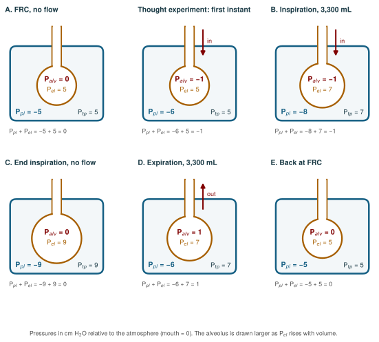

::: {.callout-note title="Goals for this chapter"}
- Use the single-alveolus model to give P~pl~, P~alv~, P~tp~ and P~el~ at each point of a quiet breath: at FRC, during inspiration, at end inspiration, during expiration, and back at FRC.
- Explain why inspiration is active and quiet expiration is passive.
- Draw the volume, pleural pressure, flow and alveolar pressure traces of a tidal breath and line them up in time.
- Explain why alveoli at the base of the upright lung are smaller than those at the apex but expand more with each breath.
- Explain why airway resistance makes pleural pressure swing further for the same flow.
:::

[Respiratory Statics](statics.qmd) held the respiratory system still. The lungs want to be small, the chest wall wants to be big, and the pleural space links them, so they settle at FRC, which the course calls the P~ms~ of the respiratory system. This chapter makes the system move. It follows the single alveolus through one quiet breath with numbers at every step, then adds two wrinkles that the single alveolus leaves out: the lung is not the same from top to bottom, and air has to travel through airways that resist its flow. [Respiratory Dynamics II](dynamics-2.qmd) takes the airways further.

## The single-alveolus model

The model is the one from statics: one alveolus (the whole lung) in a box (the chest wall), open to the mouth through one airway. Mouth pressure, which is atmospheric, is set to 0, so every pressure is relative to the atmosphere. Air flows into the alveolus when alveolar pressure is below 0 and out when it is above 0.

| Symbol | Name | Meaning |
|---|---|---|
| P~alv~ | Alveolar pressure | Pressure of the gas in the alveolus (P~A~ on the slides) |
| P~pl~ | Pleural pressure | Pressure in the pleural space; the muscles change it |
| P~tp~ | Transpulmonary pressure | P~alv~ − P~pl~, the pressure across the lung wall |
| P~el~ | Elastic recoil pressure | The lung's inward recoil; set by lung volume |

The rule from statics carries through every step:

$$P_{alv} = P_{pl} + P_{el}$$

The lung's recoil squeezes the gas inside it, so alveolar pressure sits P~el~ above pleural pressure. That makes P~tp~ = P~alv~ − P~pl~ = P~el~ at every moment, during flow as well as at rest.

Causes and effects run in one direction. **The muscles change P~pl~. P~pl~ and the lung's recoil set P~alv~. P~alv~ drives flow. Flow changes volume, and volume changes P~el~.** P~el~ depends only on how big the lung is, so at the instant a muscle contracts or relaxes, P~el~ has not had time to change.

## One quiet breath

@fig-dynamics-1-traces shows four traces through one tidal breath, lined up in time like the Wiggers diagram of the cardiac cycle: lung volume, pleural pressure, flow and alveolar pressure. The letters mark the same moments on every trace. @fig-dynamics-1-states draws the alveolus at each of them.

![One quiet breath of 500 mL from FRC. A, FRC; B, during inspiration, at 3,300 mL; C, end inspiration; D, during expiration, at 3,300 mL; E, back at FRC. Inspiration is shaded white and expiration gray. The pressures use the lecture's numbers (P~el~ 5 cm H~2~O at FRC and 9 at end inspiration), and airway resistance is set so that P~alv~ reaches about −1 and +1. Pleural pressure reaches its lowest point just before C, while a little air is still flowing in, and for the same reason it rises slightly above −5 just before E, while a little air is still flowing out. Course figure.](figures/dynamics-1/breath-traces.svg){#fig-dynamics-1-traces}

{#fig-dynamics-1-states}

The numbers, in order:

| Moment | Lung volume (mL) | P~pl~ | P~el~ | P~alv~ | P~tp~ | Flow |
|---|---|---|---|---|---|---|
| A. FRC | 3,000 | −5 | 5 | 0 | 5 | none |
| B. During inspiration | 3,300 | −8 | 7 | −1 | 7 | in |
| C. End inspiration | 3,500 | −9 | 9 | 0 | 9 | none |
| D. During expiration | 3,300 | −6 | 7 | +1 | 7 | out |
| E. Back at FRC | 3,000 | −5 | 5 | 0 | 5 | none |

Pressures are in cm H~2~O, rounded to whole numbers as on the slides. Walk through it.

**A. At FRC.** No air is moving, so P~alv~ equals mouth pressure, 0. The lung's recoil at FRC is 5, so P~pl~ = P~alv~ − P~el~ = −5, and P~tp~ = 0 − (−5) = 5.

**The first instant of inspiration: a thought experiment.** Imagine the diaphragm contracts and lowers P~pl~ in one step, here to −6 (slide 8). No air has entered yet, so lung volume and P~el~ are still at their FRC values. P~alv~ = P~pl~ + P~el~ = −6 + 5 = −1. That is below mouth pressure, so air begins to flow in. Nothing else has to happen for inspiration to begin; lowering P~pl~ is the whole act. The size of the step is arbitrary: statics and slide 3 use −7, which gives P~alv~ −2. In a real breath P~pl~ and P~alv~ fall smoothly together from the first moment, as in @fig-dynamics-1-traces, and flow builds as P~alv~ falls.

**B. During inspiration.** The muscles keep lowering P~pl~, and air keeps flowing in. As the lung fills, P~el~ rises. By 3,300 mL, P~pl~ is −8 and the lung's recoil has risen to 7, so P~alv~ is −1 and air is coming in near its fastest rate. The muscles have to keep pulling P~pl~ down just to stay ahead of the rising recoil.

**C. End inspiration.** At 3,500 mL the lung's recoil is 9. The inspiratory muscles have pulled P~pl~ to −9 and hold it there. P~alv~ = −9 + 9 = 0, so flow stops. This is the turnaround point: P~alv~ has to pass through 0 for flow to change direction.

**D. Expiration.** The inspiratory muscles relax. P~pl~ rises toward its relaxed value. In the instant they relax, the lung is still at 3,500 mL with P~el~ 9, so as soon as P~pl~ rises above −9, P~alv~ = P~pl~ + 9 rises above 0 and air flows out. At 3,300 mL on the way out, P~pl~ is −6 and P~el~ is 7, so P~alv~ is +1. No muscle is pushing. The recoil that the breath in stored in the stretched lung is what pushes the air out.

**E. Back at FRC.** Air flows out until volume is back to 3,000 mL, P~el~ is back to 5, P~pl~ is back to −5 and P~alv~ is back to 0. The system is where it started, with no muscle effort, ready for the next breath.

Notice three things on the traces. Pleural pressure is negative throughout a quiet breath: it falls from −5 to about −9 and comes back, and never becomes positive. Alveolar pressure is negative during inspiration, positive during expiration, and 0 at the turnarounds. And at the same lung volume, P~pl~ is more negative on the way in (−8 at B) than on the way out (−6 at D). The 2 cm H~2~O difference is the pressure needed to move air through the airways, first one way and then the other. The last section of this chapter comes back to it.

::: {.callout-tip title="Why we say inspiration is active and expiration passive"}
In quiet breathing, all the muscle work goes into inspiration: lowering P~pl~ against the lung's rising recoil. Expiration is relaxation. The lung's recoil, larger at the higher volume, pushes the air out. Expiratory muscles come in only when you need to breathe out faster than recoil allows or below FRC. Then, in a forceful expiration, P~pl~ becomes positive. [Respiratory Dynamics II](dynamics-2.qmd) follows that case.
:::

::: {.callout-note title="If you are comparing with the slides"}
Dynamics I slide 3, like the statics slides, computes P~tp~ as 0 − (−7) = 7 at the start of inspiration, says "P~tp~ exceeds P~el~", and writes P~A~ = P~el~ − P~tp~. That 7 is calculated with P~alv~ still at 0, so it is the pressure from the mouth to the pleural space. Once P~alv~ has fallen to −2, P~alv~ − P~pl~ is 5, equal to P~el~. Both methods give P~alv~ = −2 and the same answer: air flows in. In the lecture this was described as "the textbook way", with P~alv~ = P~pl~ + P~el~ as "the other way to think about it". This book and the course errata use P~alv~ = P~pl~ + P~el~, so P~tp~ always equals P~el~. The walk-through slides start the breath with a smaller step (−6 instead of −7); both give P~alv~ = P~pl~ + 5.

The slides that walk through the breath (slides 7 to 12) give P~tp~ = P~alv~ − P~pl~ directly, as this chapter does. Two of them do not fit the rest. Slide 9 gives P~tp~ 6 and slide 11 gives P~tp~ 8, both at 3,300 mL, but the lung has one recoil at one volume, so P~tp~ must be the same at the same volume going in and going out. The errata keep 3,300 mL and correct them to the values in the table above: P~pl~ −8 and P~alv~ −1 on the way in, P~pl~ −6 and P~alv~ +1 on the way out, P~tp~ 7 both times. The Dynamics I notes table has the same problem in its early- and mid-inspiration rows, and the errata correct it the same way.
:::

::: {.callout-note title="If you are comparing with the statics chapter: how stiff is the lung?"}
The lecture's numbers make P~el~ rise from 5 to 9 cm H~2~O as volume rises from 3,000 to 3,500 mL. That is a lung compliance of 0.5 L ÷ 4 cm H~2~O = 0.125 L/cm H~2~O. [Respiratory Statics](statics.qmd) gives 0.2 to 0.3 L/cm H~2~O near FRC, and the measured traces from Boron and Boulpaep [@w9-boron2012] shown in the same lecture use 0.2 (transpulmonary pressure from 5 to 7.5 for 0.5 L). The lecture's numbers are rounded to keep the arithmetic easy. A normal lung is closer to 0.2, the value statics and the measured traces use; 0.125 would be on the stiff side of normal. With 0.2, end-inspiratory P~pl~ would be −7.5 instead of −9. The logic of the breath is the same either way. Use whatever numbers a question gives you.
:::

::: {.callout-note collapse="true" title="Background: what the traces look like when they are measured"}
The lecture showed the same breath as it looks when the pressures are measured, from Boron and Boulpaep [@w9-boron2012]. The shapes are the same as @fig-dynamics-1-traces: pleural pressure falls during inspiration and rises during expiration, alveolar pressure dips below zero and then rises above it, and flow peaks early in each phase. The lecture said this one was "just for fun", not something to know. What you should be able to do is draw @fig-dynamics-1-traces yourself from the rule P~alv~ = P~pl~ + P~el~: the lecture suggested printing the blank traces as a worksheet and filling in each moment.
:::

::: {.callout-tip title="Try it"}
The [Respiratory Mechanics Lab](https://beiser-lab.github.io/respiratory-mechanics-lab/) takes a 0.5 L breath from FRC and updates P~pl~, P~alv~, P~tp~ and P~el~ as the breath runs.
:::

## Wrinkle 1: the lung is not the same from top to bottom

The single-alveolus model treats every alveolus alike. In an upright person they are not. Pleural pressure is more negative at the apex of the lung, about −10 cm H~2~O, than at the base, about −2.5 (@fig-dynamics-1-regional A). The reason is the weight of the lung. The lung hangs in the chest like a Slinky held from its top end. The coils near the top carry the weight of everything below them and are stretched wide apart. The coils near the bottom carry little and sit close together.

So at FRC the alveoli at the apex are held more open (larger P~tp~) than those at the base. The apical alveoli are bigger.

Bigger does not mean they ventilate more. What matters for ventilation is how much each alveolus *changes* during a breath. @fig-dynamics-1-regional B puts both regions on the lung's pressure-volume curve. A breath lowers pleural pressure by about the same amount everywhere. The apex starts high on the curve, where it is flat, so the same fall in P~pl~ adds little volume. The base starts low, on the steep part, so it adds more. Per unit of lung, **the base gets more of each breath than the apex.**

![Regional differences in the upright lung. (A) Pleural pressure is about −10 cm H~2~O at the apex and −2.5 at the base, so apical alveoli are larger at FRC. (B) On the lung's pressure-volume curve the base starts on the steep part. The same 4 cm H~2~O fall in pleural pressure raises the base by about 20% of its maximal volume and the apex by about 10%. Lung curve from the Respiratory Mechanics Lab statics model [@rml2026]. Course figure.](figures/dynamics-1/regional.svg){#fig-dynamics-1-regional}

That matches where the blood goes. Blood flow in the upright lung is also greatest at the base. Sending more air to the places that get more blood is the start of ventilation-perfusion matching, which the [Ventilation and Perfusion](ventilation-perfusion.qmd) chapter covers, along with what happens when the matching fails.

::: {.callout-note title="If you are comparing with the slides"}
In the 2026 lecture, the smaller basal alveoli were explained by interstitial fluid that settles toward the base with gravity. The standard explanation, and the one the Dynamics I notes give, is the weight of the lung itself: it makes pleural pressure less negative at the base (about −2.5 cm H~2~O) than at the apex (about −10), so the basal alveoli are held less open. The conclusion is the same either way: basal alveoli are smaller at FRC and expand more with each breath. You do not need to explain why pleural pressure differs from apex to base; know that it does and what it does to regional ventilation.
:::

## Wrinkle 2: airway resistance

So far the breath has been mostly about compliance: how much P~pl~ has to fall to stretch the lung by a tidal volume. That part of the pressure is set by the lung's recoil. But air also has to move through the airways, and the airways resist flow. The pressure needed for that follows Ohm's law, as blood flow did:

$$\dot{V} = \frac{\Delta P}{R_{aw}}$$

Here ΔP is the difference between mouth and alveolar pressure, and R~aw~ is airway resistance.

@fig-dynamics-1-resistance separates the two parts. The dashed line (B on the slides) is the pleural pressure the breath would need if the airways had no resistance: it just tracks the lung's recoil, −P~el~, and falls and rises with volume. The solid line (B′) is the real pleural pressure with normal airway resistance. During inspiration it is more negative than the dashed line, because P~pl~ also has to pull P~alv~ below zero to draw air through the airways. During expiration it is less negative than the dashed line, because P~alv~ must be above zero to push air out. The shaded gap between them is the resistive part of the pressure. It is largest when flow is fastest, and zero at the turnarounds, when there is no flow.

![Pleural pressure through one breath. Dashed (B): the pressure needed with no airway resistance, set by elastic recoil alone. Solid (B′): with normal airway resistance. Dotted: inspiration with airway resistance tripled, at the same flow. The shaded gap between B and B′ is the pressure that moves air through the airways. The slide draws the expiratory gap wider. In quiet breathing the two are close to equal; the gap on the way out grows when the airways are narrowed or expiration is forced, for the reasons in Respiratory Dynamics II. Course figure.](figures/dynamics-1/resistance-ppl.svg){#fig-dynamics-1-resistance}

**The greater the airway resistance, the further P~pl~ has to swing to keep the same flow.** The dotted line in @fig-dynamics-1-resistance shows inspiration with airway resistance tripled: to move the same 500 mL in the same time, P~pl~ has to fall to about −10.5 instead of −9. That is more work for the inspiratory muscles on every breath.

You can see this at the bedside. A patient in respiratory distress from an asthma exacerbation has narrowed airways. You see accessory muscles working: the neck muscles, tugging at the trachea, help lower pleural pressure further on the way in, because the diaphragm alone cannot overcome the resistance, and the abdominal muscles contract to push air out on the way out. Up to a point the patient keeps the same flow and volume by working harder. Beyond it, they cannot.

In asthma the wheeze is heard first in expiration, not inspiration. Pleural pressure is higher on the way out, so the airways are pushed open less, and they are narrowest late in expiration, when the lung is smallest. Resistance is a bigger problem on the way out. [Respiratory Dynamics II](dynamics-2.qmd) explains why.

## Check your understanding

1. At end inspiration in a quiet breath, P~pl~ is −8 cm H~2~O and no air is flowing. What are P~alv~, P~el~ and P~tp~?

    

Answer

    No flow means P~alv~ = 0. Then P~el~ = P~alv~ − P~pl~ = 0 − (−8) = 8, and P~tp~ = P~alv~ − P~pl~ = 8, equal to P~el~.

    

2. Partway through a quiet expiration, the lung's recoil is 6 cm H~2~O and P~alv~ is +0.5. What is P~pl~? Is any muscle pushing the air out?

    

Answer

    P~pl~ = P~alv~ − P~el~ = 0.5 − 6 = −5.5 cm H~2~O. No. P~pl~ is still negative, which means the chest is not squeezing the lung. The lung's own recoil is pushing the air out. A positive P~pl~ would mean expiratory muscles were working.

    

3. A tidal breath passes through the same lung volume twice, once on the way in and once on the way out. At that volume, which of P~el~, P~tp~, P~pl~ and P~alv~ are the same both times, and which differ?

    

Answer

    P~el~ is set by volume, so it is the same, and P~tp~ equals P~el~, so it is the same too. P~alv~ is negative on the way in and positive on the way out. P~pl~ = P~alv~ − P~el~, so it is more negative on the way in. The difference is the pressure that drives flow through the airways.

    

4. The difference in pleural pressure from the top of the lung to the bottom comes from the lung's weight. In an upright person it makes the base gain more volume per breath than the apex. Why does ventilation become more even from top to bottom when the same person lies supine?

    

Answer

    How large the pleural pressure difference is depends on how tall the lung is in the direction of gravity. Upright, that height runs from apex to base. Supine, it runs from front to back, a much shorter distance, so the difference in pleural pressure between the highest and lowest alveoli is smaller. Alveoli at the top and bottom then start at more similar places on the lung's pressure-volume curve, and the same fall in pleural pressure during a breath adds more similar volumes to each.

    

5. A drug relaxes airway smooth muscle and widens the airways. With the same tidal volume and the same inspiratory flow, what happens to the lowest pleural pressure reached during inspiration? What happens to P~el~ at end inspiration?

    

Answer

    Lower airway resistance needs a smaller pressure difference for the same flow, so P~alv~ dips less below zero and P~pl~ does not have to fall as far: its lowest value is less negative. P~el~ at end inspiration does not change. It depends on the lung's volume and stiffness, not on the airways.

    

6. During a quiet expiration, expiratory flow peaks early, soon after the inspiratory muscles relax, and then slows as the lung empties toward FRC. Use P~alv~ = P~pl~ + P~el~ and V̇ = P~alv~ / R~aw~ to explain that shape.

    

Answer

    When the inspiratory muscles relax, P~pl~ rises back from its most negative value while the lung is still near its largest volume, so P~el~ is still close to its peak of 9. P~alv~ = P~pl~ + P~el~ turns positive, and it is largest early in expiration, so flow, P~alv~ / R~aw~, peaks then. As air leaves, volume falls and P~el~ falls with it, back toward 5 at FRC, and P~alv~ shrinks toward zero. With a smaller pressure difference between the alveoli and the mouth, flow slows. The lung's own recoil supplies the push throughout.

    

## Key equations

| Equation | Use |
|---|---|
| P~alv~ = P~pl~ + P~el~ | Alveolar pressure at every point of the breath |
| P~tp~ = P~alv~ − P~pl~ (= P~el~) | Transpulmonary pressure |
| V̇ = ΔP / R~aw~ | Flow through the airways (Ohm's law) |
| C = ΔV / ΔP | Compliance, from the breath's volume and recoil |

## Sources

This chapter follows the 2026 Respiratory Dynamics I lecture for MEDC 30504 (given with the 2025 slides) and draws on the course's Dynamics I notes and the 2018 course notes, corrected and updated. All figures were drawn for this book.

::: {#refs}
:::
