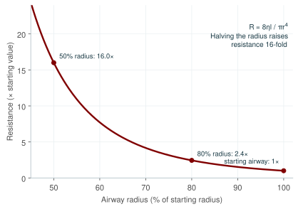

::: {.callout-note title="Goals for this chapter"}
- Name the anatomic determinants of airway resistance (R~aw~): radius, flow type, and the series and parallel arrangement of the airways.
- Trace R~aw~ from the trachea to the small airways, and say where most of it lies and why.
- Explain how R~aw~ changes with lung volume.
- Explain expiratory flow limitation: why, during a forced expiration, airway transmural pressure can become negative and why more effort then adds no flow.
- Read a flow-volume loop and a volume-time curve, define FEV~1~ and FVC, and recognize the normal, obstructive and restrictive patterns.
- Explain why the wheeze of asthma is heard first in expiration.
:::

[Respiratory Dynamics I](dynamics-1.qmd) ended with one airway and one number for its resistance: the more resistance, the further pleural pressure has to swing to move the same air. Real airways are not one tube. They branch about 23 times between the trachea and the alveoli, they change size as the lung fills and empties, and they are not rigid. This chapter takes the pieces of airway resistance one at a time, puts them together along the airway tree and across lung volumes, and then uses them to explain why everyone, healthy or not, has a limit on how fast they can breathe out. That limit is what spirometry measures.

Keep the volumes from [Respiratory Statics](statics.qmd) in front of you. You will need TLC, FRC, RV and vital capacity (VC = TLC − RV) throughout.

## Anatomic determinants of airway resistance

### Radius: Poiseuille's law

Poiseuille studied the flow of liquid through narrow rigid tubes. For smooth, laminar flow he found:

$$\dot{V} = \frac{(P_1 - P_2)\,\pi r^4}{8\eta l} \qquad\text{so}\qquad R = \frac{8\eta l}{\pi r^4}$$

where r is the radius, l the length of the tube, and η the viscosity of the gas. Longer tubes and more viscous gas raise resistance. Radius matters most, because it enters as the fourth power. Halve the radius and resistance rises 16-fold (@fig-dynamics-2-poiseuille). If you remember one thing from Poiseuille's law, make it radius, because a small change in airway caliber, from bronchospasm, mucus or swelling, makes a large change in resistance.

{#fig-dynamics-2-poiseuille}

The law assumes three things the airways only partly satisfy:

- **Laminar flow.** Not all airflow in the lung is laminar (next section).
- **A Newtonian fluid**, whose viscosity does not change with velocity. Air comes close enough.
- **Rigid, circular tubes.** The trachea is close to that. Smaller airways are floppy, and their size changes with the pressures around them, which is the root of expiratory flow limitation.

Poiseuille's law also predicts that resistance should be highest in the narrowest airways. It is not, for reasons that take the rest of this section.

### Flow type: laminar, turbulent and transitional

In **laminar** flow, the gas moves in smooth layers, like a calm river. The layer touching the wall does not move, and each layer slides past the next, so velocity is highest in the center and the profile is parabolic (@fig-dynamics-2-flow-types A). Laminar flow is quiet and is the most efficient way to move gas through a tube: flow is proportional to the driving pressure, as Poiseuille's law says.

In **turbulent** flow, the layers break up into eddies, like white water. Changing the direction of any bit of gas takes force, so turbulent flow needs more pressure for the same flow. Flow then rises only with the square root of the driving pressure (@fig-dynamics-2-flow-types B). Turbulent flow is noisy. The breath sounds you hear with a stethoscope come from turbulence in the large airways.

{#fig-dynamics-2-flow-types}

Whether flow is laminar or turbulent is predicted by the Reynolds number:

$$Re = \frac{D\,v\,\rho}{\eta}$$

where D is the tube diameter, v the average velocity, ρ the gas density and η its viscosity. Turbulence is likely when Re is above about 2,000. You do not need to calculate Re. You do need its variables: a wider tube, a faster velocity or a denser gas makes turbulence more likely. In the airways, density and viscosity barely change, so diameter and velocity decide. The lecture's example, a 3 cm tube at 150 cm/s, gives Re about 2,950. A real adult trachea is about 2 cm across, and the answer is similar, about 2,400: still turbulent. The same variables explain why a low-density gas, a helium-oxygen mixture (heliox), lowers resistance where flow is turbulent.

**Transitional** flow is a mixture, with eddies forming where an airway divides. Every branch point disturbs the flow a little. The airways branch in a repeating, self-similar pattern, like ferns and snowflakes.

### Cross-sectional area and velocity

Each airway is narrower than its parent, but each generation has twice as many airways as the one before. Their **total cross-sectional area**, all the airways of one generation added together, rises steeply toward the periphery; the [Alveolar Ventilation](ventilation.qmd) chapter plots it by generation. It is the same idea as the aggregate cross-sectional area of the capillaries in the cardiovascular block.

The airways are in series, so the same total flow passes through every generation. Velocity is flow divided by area, so as total area rises, velocity falls (@fig-dynamics-2-area-velocity). It is highest in the first few generations below the trachea (about generations 2 to 4), where the total area dips a little, and by the terminal bronchioles the gas is barely moving. A smaller diameter and a much lower velocity give the small airways a low Reynolds number, so flow in them is laminar.

{#fig-dynamics-2-area-velocity}

### Series and parallel

Resistances in series add. Resistances in parallel add as reciprocals, so every extra parallel path lowers the total:

$$R_T = R_1 + R_2 + R_3 + \dots \qquad \frac{1}{R_T} = \frac{1}{R_1} + \frac{1}{R_2} + \frac{1}{R_3} + \dots$$

The generations of the airway tree are in series, and the airways within each generation are in parallel. A single bronchiole has a high resistance, but there are so many of them side by side that the combined resistance of a whole generation of small airways is small.

### Where the resistance lies

Put the pieces together and you get @fig-dynamics-2-resistance A. Resistance is highest in the **medium-sized bronchi**, the first several generations beyond the trachea, where the airways are still few, flow is fast, and the flow is turbulent or transitional. It falls toward the periphery. The small airways, despite their size, contribute little, and the respiratory zone almost nothing.

That has a clinical cost. Disease in the small airways can be well advanced before it raises total airway resistance enough to measure, because the small airways contributed so little to begin with.

{#fig-dynamics-2-resistance}

### Measuring airway resistance

The pulmonary function lab measures airway resistance in the body box while the patient makes small, fast pants around FRC; resistance needs flow, so it is measured while air is moving. It is a single number for the whole lung, so it describes one lung volume and says nothing about how resistance changes across a breath. Normal R~aw~ is **less than 2 cm H~2~O/L/s**. You do not need to know how the measurement is made, or to calculate resistance at a particular place in the airways.

### Lung volume and tethering

Airways are not free-standing tubes. They run through the lung tissue, and the alveolar walls around them are attached to their outer walls. When the lung expands, that tissue pulls outward on every airway, which holds them open. This is **tethering**, or radial traction. So the larger the lung, the wider the airways and the lower the resistance; as the lung empties toward RV, the airways narrow and resistance climbs steeply (@fig-dynamics-2-resistance B). That is one reason R~aw~ is measured at a standard volume, FRC.

Breathing in and out differ too. At any given lung volume, pleural pressure is more negative during inspiration than during expiration, so airway transmural pressure is larger and the airways are wider on the way in. Late in expiration the lung is also smaller, so tethering holds the airways open less. That explains a bedside sign. In asthma, where the airways are narrowed, the wheeze (the sound of turbulent flow through narrowed airways) is heard first in **expiration**. As an exacerbation worsens, wheeze is heard in both phases. In a very severe attack the chest can fall nearly silent, because so little air is moving. So "no wheeze" in a patient short of breath is either very good news or very bad, and you have to listen for breath sounds to tell which.

::: {.callout-tip title="Where we are"}
- Poiseuille is a start: radius matters most for any single airway.
- Flow in the large airways is turbulent, and turbulent flow needs more pressure. Flow in the small airways is laminar.
- Total cross-sectional area rises toward the periphery, so velocity falls.
- The parallel arrangement keeps the combined resistance of the small airways low. Most resistance is in the medium bronchi.
- Resistance falls as lung volume rises, because the tissue tethers the airways open.

Airway resistance is not a fixed number. It changes with where you are in the tree, with lung volume, and between inspiration and expiration. So does the pressure inside the airway, which is the next topic.
:::

## Expiratory flow limitation

Most airflow limitation, in health and in disease, happens during expiration. On the way in, the muscles pull the lung open and the airways with it, so inspiration rarely limits flow. On the way out, everything runs the other way.

Quiet expiration is passive. The inspiratory muscles relax and the lung's recoil pushes air out. A forced expiration adds the expiratory muscles, chiefly the abdominal and internal intercostal muscles, which squeeze the chest and push pleural pressure above zero. This section follows a forced expiration from TLC, the maneuver spirometry uses.

### Pressure falls along the airway

Air has to flow from the alveolus to the mouth, so the pressure inside the airway must fall all along the way, from P~alv~ in the alveolus to 0 at the mouth. Two things produce that fall.

- **Friction.** Gas sliding along the airway wall loses energy as heat, so pressure falls along the length of every airway. The Darcy-Weisbach equation describes it; you do not need it.
- **Velocity (the Bernoulli effect).** As gas moves from the wide periphery into the narrow central airways, it speeds up. Its kinetic energy rises, so its pressure has to fall: energy is conserved, and what goes into speed comes out of pressure. The lecture showed the idea with a strip of paper that rises when you blow across the top of it. The slide notes say this velocity effect matters more than friction during a forced expiration, and in the large central airways at high flow it does. The two together produce the pressure gradient that moves the air.

### Airway transmural pressure

Statics defined the transmural pressure of any wall as inside minus outside. For an airway inside the chest, the outside is the pleural space:

$$P_{tm} = P_{aw} - P_{pl}$$

where P~aw~ is the pressure inside the airway at that point. When P~tm~ is positive, the airway is pushed open. When it is negative, because pleural pressure is higher than the pressure inside the airway, the airway is squeezed and narrows. Compare it with transpulmonary pressure, P~tp~ = P~alv~ − P~pl~, which is the same idea applied to the alveolus.

### A forced expiration in numbers

@fig-dynamics-2-forced follows the lecture's numbers.

**At TLC, before the effort (A).** No air is flowing, so P~alv~ = 0. Holding the lung at TLC takes a pleural pressure of about −30 cm H~2~O, so the lung's recoil is 30 (P~alv~ = P~pl~ + P~el~ = −30 + 30 = 0). Every airway has a P~tm~ of 0 − (−30) = +30 and is held wide open.

**The first instant of a forced expiration (B).** The expiratory muscles contract hard and push P~pl~ to about +60. The lung has not yet emptied, so P~el~ is still 30, and P~alv~ = 60 + 30 = 90. Pressure falls along the airway from 90 toward 0 at the mouth, but at this instant it stays at or above 60 inside the chest, so P~tm~ is not negative and the airways stay open. Flow is high. Within a moment, as flow builds, the point where airway pressure meets pleural pressure appears in the central airways, where cartilage resists the squeeze.

**Later in the breath, at a lower volume (C).** The lung has emptied some, so its recoil has fallen, say to 20. The muscles are still pushing, and P~pl~ is still +60. Now P~alv~ = 60 + 20 = 80, and as pressure falls along the airway it drops below 60 while the airway is still inside the chest. There P~tm~ is negative: pleural pressure is higher than the pressure inside the airway, and the airway is squeezed narrower. This is **dynamic airway compression**.

{#fig-dynamics-2-forced}

Now push harder. Raise P~pl~ from 60 to 80. P~alv~ rises by 20, but so does the pressure squeezing the airway. The extra effort narrows the compressed segment further and adds almost nothing to flow. **Past a certain effort, expiratory flow is limited, and more effort does not raise it.** Everyone, healthy or not, reaches this limit in a forced expiration. The narrowed region that sets the limit is called the **flow-limiting segment**.

::: {.callout-note title="If you are comparing with the notes"}
The Dynamics II notes call the point along the airway where P~aw~ equals P~pl~ the *equal pressure point*. The lecture slides do not use the term; they speak of the flow-limiting segment and dynamic airway compression. Both describe the same thing: downstream of the place where airway pressure falls to pleural pressure, P~tm~ is negative and the airway tends to narrow.
:::

### Which airways collapse

Whether an airway narrows when its P~tm~ goes negative depends on its wall (@fig-dynamics-2-ptm-area). The trachea and main bronchi have cartilage rings and narrow only a little. Further out, the bronchi have only scattered cartilage plates, and the bronchioles have none. They depend on tethering, and when P~tm~ is negative they narrow and can collapse.

{#fig-dynamics-2-ptm-area}

Lung volume decides where the flow-limiting segment sits. At high volume the lung's recoil is large, so P~alv~ is far above P~pl~, airway pressure stays above pleural pressure for much of the way out, and the place where it finally drops below pleural pressure is in the large central airways, near the trachea. The cartilage there resists compression. As the lung empties, recoil falls, airway pressure reaches pleural pressure sooner, and the flow-limiting segment moves out into smaller, more collapsible airways. Tethering weakens too, because the lung is smaller. So flow limitation tightens as the breath goes on. At high volume, flow is limited in the central airways mainly because their total cross-section is smallest and gas velocity is highest there, not because a single wide trachea has a high resistance.

At very low volumes some small airways close completely and trap gas behind them. In a young adult the chest wall stops a forced expiration before this matters much, but with age, and in obstructive disease, airway closure is what sets RV, as [Respiratory Statics](statics.qmd) explained.

### Effort independence

@fig-dynamics-2-effort shows the same idea as it is measured. In panel A, each curve is one lung volume, as the slide notes describe. Flow starts once P~pl~ rises far enough that P~alv~ = P~pl~ + P~el~ exceeds zero, which at a high volume, with a large P~el~, is while P~pl~ is still negative. At middle and low volumes flow then rises with effort and levels off: past a modest effort, pushing harder adds no flow. Near TLC it keeps rising, which is why peak flow depends on effort. In panel B, three forced expirations from TLC with different effort reach different peaks early in the breath, but after the first part they all follow the same descending line to RV.

![Expiratory flow limitation as it is measured. (A) Isovolume curves: each is one lung volume (percent of vital capacity). Flow begins where P~alv~ = P~pl~ + P~el~ reaches zero, so at P~pl~ = −P~el~. At middle and low volumes flow levels off with more effort; near TLC it keeps rising. (B) Forced expirations from TLC with different effort: a harder effort gives a higher peak, but later in the breath every effort follows the same curve. Schematics drawn to the shapes on the lecture slides. Course figure.](figures/dynamics-2/effort-independence.svg){#fig-dynamics-2-effort}

So the first part of a forced expiration, near TLC, depends on effort, which is why the technician shouts at the patient to blow as hard and fast as possible. The rest of the curve is **effort independent**. It is set by the lung's recoil and the airways' resistance and collapsibility, not by the muscles. That is what makes spirometry useful: the late part of the curve reports on the lungs and airways, whatever the patient's effort.

### Disease: early flow limitation

**Small and medium airways (asthma, emphysema).** In asthma, airway smooth muscle constricts and the airways are inflamed and narrowed. With narrower airways, flow limitation starts earlier in the breath and is more severe: the descending limb of the expiratory curve sags inward, a shape called **scooping** (@fig-dynamics-2-spirometry A). Emphysema reaches the same result by a different route. Lost elastic recoil lowers P~alv~ at every volume, and lost alveolar walls weaken the tethering that holds small airways open, so they collapse early. In mild disease, wheeze is heard first at the end of expiration, at low volume, where flow limitation is tightest. This is typical of asthma.

**A narrowed trachea.** A lesion in the trachea, for example a stenosis after a long intubation, behaves differently. The trachea is rigid, so its narrowing does not change with transmural pressure. Every bit of air leaving the lung must pass through it, so it sets a ceiling on flow. Early in a forced expiration, when the lungs could produce their highest flows, the ceiling cuts the peak off and the curve is flat-topped. Later, when flows fall below the ceiling anyway, the curve rejoins the normal one (@fig-dynamics-2-spirometry B). A fixed narrowing caps inspiratory flow too, so both limbs of the loop are flattened. The low, flat early part can look like a poor effort. [Think Like a Respiratory Consultant](respiratory-consultant.qmd) comes back to this pattern.

## Spirometry: the flow-volume loop and the volume-time curve

Spirometry records a forced vital capacity maneuver. The patient breathes quietly, takes the deepest possible breath to TLC, then blows out as hard and fast as possible, all the way to RV, and then breathes back in fully. The same data can be drawn two ways.

**The flow-volume loop** plots flow against volume, with no time axis. By the course's convention, expiratory flow is drawn upward and inspiratory flow downward, and volume runs with TLC on the left and RV on the right. The expiratory limb rises to a sharp peak just after the breath starts and then falls in a nearly straight line to zero at RV. The inspiratory limb is a smooth, rounded curve below the axis. The tidal breaths before the maneuver show as a small loop that starts and ends at FRC.

**The volume-time curve** plots volume exhaled against time for the forced expiration. Two numbers come from it:

- **FVC** (forced vital capacity): the total volume exhaled from TLC to RV.
- **FEV~1~** (forced expiratory volume in 1 second): the volume exhaled in the first second.

In health FEV~1~/FVC is 0.70 or more; a young adult is often near 0.8. A ratio below about 0.70 is obstruction ([Think Like a Respiratory Consultant](respiratory-consultant.qmd)). Spirometry cannot measure RV (statics again), so on its own it cannot place the loop on an absolute volume scale. Lung volumes from a body box let you draw the loops at their true volumes, as @fig-dynamics-2-spirometry A does.

{#fig-dynamics-2-spirometry}

### Normal, obstructive and restrictive patterns

**Obstructive** (asthma, emphysema). The patient has trouble getting air out. Flow limitation starts early, so the expiratory limb is scooped. On the volume-time curve, the curve rises slowly and may still be rising at 6 seconds. FEV~1~ falls, FVC usually falls less, and so the ratio FEV~1~/FVC is low. **A low FEV~1~/FVC is what defines obstruction.** Many obstructed patients also have large lungs, with a high RV and FRC and sometimes a high TLC, but lung size is not the definition.

**Restrictive** (interstitial lung disease and pulmonary fibrosis, as examples of a stiff lung). The lungs are small, so FVC is low. Scarring stiffens the lung and raises its elastic recoil, so the lung empties quickly: more recoil gives a higher P~alv~ at every volume. Flow at a given volume can be normal or high, and the expiratory limb is steep. FEV~1~ falls along with FVC, and FEV~1~/FVC is normal or high.

| | FEV~1~ | FVC | FEV~1~/FVC | Flow-volume loop |
|---|---|---|---|---|
| Normal | normal | normal | 0.70 or more | sharp peak, straight descent |
| Obstructive | ↓↓ | ↓ or normal | ↓ | scooped, low flows; often at high volume |
| Restrictive | ↓ | ↓ | normal or ↑ | small, steep, at low volume |

Telling a restrictive pattern from a small FVC caused by air trapping takes lung volumes, and telling one obstructive disease from another takes the diffusing capacity and the response to a bronchodilator. That full interpretation framework is taught in [Think Like a Respiratory Consultant](respiratory-consultant.qmd). The PFT lab and the [Respiratory Mechanics Lab](https://beiser-lab.github.io/respiratory-mechanics-lab/pft.html) let you draw these loops yourself.

::: {.callout-warning title="A common mistake"}
"Obstruction means big lungs" is not the definition. Obstruction is a low FEV~1~/FVC. Emphysema usually raises TLC, RV and FRC, but a patient with asthma can be clearly obstructed with a normal TLC. The Dynamics II notes list "↑ RV, ↑ FRC, ↑ TLC" for obstructive patterns. Those often go with obstruction, but the ratio decides it.
:::

## Summary: what changes airway resistance

| Factor | Effect on R~aw~ | Where it matters |
|---|---|---|
| Airway radius (Poiseuille) | ↓ radius, ↑↑ R (r^4^) | Every airway; bronchospasm, mucus, swelling |
| Turbulent flow | ↑ R | Trachea and large bronchi |
| Branching in parallel | ↓ total R | Small airways |
| Lung volume (tethering) | ↑ volume, ↓ R | Inspiration versus expiration; high versus low volume |
| Negative airway P~tm~ (dynamic compression) | ↑ R, flow limited | Forced expiration, worse at low volume |
| Collapsibility of the airway wall | more collapsible, earlier limitation | Small airways, emphysema |

The relative contribution of each factor depends on which airway you look at, the lung volume, whether the patient is breathing in or out, and how hard they push. Effort changes pleural pressure but cannot move the limit that dynamic compression sets. No one can model every airway under every condition, so the course asks you to know each mechanism and which way it pushes resistance, not to calculate a resistance at a particular place.

## Check your understanding

1. The trachea is the single widest airway, yet the medium bronchi a few generations below it carry more of the total airway resistance. Explain, using radius, the number of airways in parallel and the type of flow.

    

Answer

    Each medium bronchus is much narrower than the trachea, and resistance rises with the fourth power of falling radius, so each one has a far higher resistance on its own. Airways side by side share the flow and divide the resistance among them, but in these early generations there are still too few of them to make up for their narrowness. Gas velocity is also highest in these generations, where the total cross-sectional area dips a little, so flow is turbulent or transitional, with eddies at each branch point, and it needs more pressure for the same flow than laminar flow would.

    

2. During a forced expiration from TLC, where along the airways does the flow-limiting segment first form, and which way does it move as the lung empties toward RV? Why?

    

Answer

    Early in the breath, at high volume, the lung's recoil is large, so P~alv~ is far above P~pl~ and airway pressure stays above pleural pressure for most of the way out. It falls below pleural pressure only in the large central airways near the trachea, where cartilage resists compression. As the lung empties, recoil falls, P~alv~ starts closer to P~pl~, and airway pressure reaches pleural pressure a shorter distance from the alveoli. The flow-limiting segment moves out toward the periphery, into smaller, more collapsible airways, and tethering is weaker because the lung is smaller. Flow limitation tightens as the breath goes on.

    

3. A patient with mild asthma has a wheeze only at the end of expiration. Using lung volume and airway transmural pressure, explain why the wheeze appears there first.

    

Answer

    At the end of expiration the lung is at its smallest, so tethering holds the airways open least and the lung's recoil, which keeps airway pressure above pleural pressure, is lowest. Pleural pressure is also higher than at the same volume on the way in, so airway transmural pressure is smaller. The narrowed airways are therefore at their narrowest, and turbulent flow through them is the wheeze. In quiet breathing P~pl~ stays negative, so P~tm~ stays positive and nothing is flow limited; in a forced or labored expiration P~pl~ turns positive and compresses the airways further. During inspiration, the more negative pleural pressure holds the airways wider.

    

4. In emphysema the lung loses elastic recoil and the alveolar walls that tether the small airways. Predict what happens to the expiratory limb of the flow-volume loop and to FEV~1~/FVC, and give the two reasons.

    

Answer

    The expiratory limb is scooped and flows are low, and FEV~1~/FVC falls (obstruction). First, with less recoil, P~alv~ is lower at every volume, so airway pressure drops below pleural pressure sooner and the flow-limiting segment reaches the small airways early in the breath. Second, without tethering, those small airways collapse more easily when P~tm~ is negative.

    

5. Peak expiratory flow depends on how hard the patient blows, but the rest of a forced expiration does not. Why is the peak different? Name a patient whose peak flow would be low while the later part of the curve is normal.

    

Answer

    Near TLC the lung's recoil is large, so airway pressure stays above pleural pressure along most of the airways, and where it does fall below, in the central airways, cartilage resists compression. Flow there is not yet limited by dynamic compression, so a higher pleural pressure raises P~alv~ and flow together; the isovolume curves near TLC keep rising with effort. Lower in the vital capacity the flow-limiting segment forms and more effort adds no flow. Peak flow is low with a normal later curve after a poor effort or with weak expiratory muscles. A fixed narrowing of the trachea does the same: it caps the early high flows, and the curve rejoins the normal one once flows fall below the cap.

    

## Key equations

| Equation | Use |
|---|---|
| V̇ = ΔP / R~aw~ | Ohm's law for airflow |
| R = 8ηl / πr^4^ | Poiseuille's law (laminar flow, rigid tube) |
| Laminar: V̇ ∝ ΔP; turbulent: V̇ ∝ √ΔP | Turbulent flow needs more pressure |
| Re = D v ρ / η, turbulent above about 2,000 | Reynolds number (concept only) |
| Series: R~T~ = R~1~ + R~2~ + ...; parallel: 1/R~T~ = 1/R~1~ + 1/R~2~ + ... | Combining airway resistances |
| velocity = flow / total cross-sectional area | Why gas slows toward the periphery |
| P~tm~ = P~aw~ − P~pl~ | Airway transmural pressure |
| P~alv~ = P~pl~ + P~el~ | Alveolar pressure, forced or quiet |
| FEV~1~/FVC | Low in obstruction; normal or high in restriction |

## Sources

This chapter follows the 2026 Respiratory Dynamics II lecture for MEDC 30504 (given with the 2025 slides) and draws on the course's Dynamics II notes, the Small Group 1 key, the PFT lab slides and the 2018 course notes, corrected and updated. All figures were drawn for this book.
