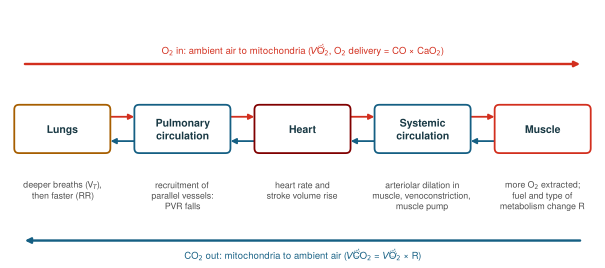

::: {.callout-note title="Goals for this chapter"}
- Trace O~2~ from the air to the mitochondria and CO~2~ back out, and name how each step of the chain is stepped up in exercise.
- Explain the trade-offs between fat, aerobic glucose and anaerobic glucose (O~2~ cost, R, CO~2~ load), and where the extra CO~2~ of anaerobic metabolism comes from.
- Explain why healthy people are cardiac limited and have respiratory reserve.
- Describe the respiratory response: alveolar ventilation that rises with CO~2~ output, and breathing that gets deeper first, then faster.
- Explain why the A–a gradient widens in exercise, including the effect of a low mixed venous O~2~ on shunted blood.
- Read a cardiopulmonary exercise test: V̇O~2~ and V̇O~2~max, the anaerobic threshold, isocapnic buffering, the respiratory compensation point, R, and the ventilatory equivalents.

The ATP yields and chemical equations are here to show the trade-offs between fuels. The lecture said not to "sweat the specifics of the biochemistry" and to focus on the comparison of CO~2~ per ATP; you will not be asked to reproduce the numbers. Detailed reading of exercise-test patterns is, in the lecture's words, "well beyond the scope of this class."
:::

If you want to know how a system works and where its limits are, push it to the extreme. The cardiovascular block did that for the circulation. [Cardiovascular Adaptation to Exercise](../cardiovascular/cv-exercise.qmd) covers the cardiovascular reflexes, the Guyton curves in exercise and the redistribution of blood flow, and this chapter does not repeat them. It adds the other ends of the chain: what the muscle burns, how much CO~2~ it makes, how breathing keeps up, what happens to gas exchange, and how a clinical exercise test measures all of it.

## The system, end to end

Start with the simplified model the lecture used. Air brings O~2~ into the lungs, the blood carries it away, and the tissues, mostly muscle during exercise, use it. Three relations describe the flows:

$$\text{O}_2 \text{ delivery} = \text{CO} \times \text{CaO}_2 \qquad \text{O}_2 \text{ returned} = \text{CO} \times \text{CvO}_2 \qquad \dot{V}\text{CO}_2 = \dot{V}\text{O}_2 \times R$$

The difference between what is delivered and what returns is what the tissues used, V̇O~2~ (the Fick principle from [Transport of O~2~ and CO~2~](o2-co2-transport.qmd)). The tissues send back CO~2~ in proportion to the O~2~ they use, scaled by R.

The ratio of CO~2~ produced to O~2~ consumed by the cells is the respiratory quotient (RQ), and it depends on the fuel they burn. Measured at the mouth for the whole body, the same ratio is the respiratory exchange ratio, R, the symbol used in the alveolar gas equation. In a steady state the two are equal.

@fig-exercise-drive-train lays out the "drive train" that moves O~2~ from the air to the mitochondria and CO~2~ back out. Exercise steps up every link.

{#fig-exercise-drive-train}

- **Lungs:** larger tidal volumes, then a faster rate.
- **Pulmonary circulation:** parallel vessels are recruited, so pulmonary vascular resistance falls and the lungs take a large rise in flow with little rise in pressure ([Pulmonary Circulation](../cardiovascular/pulmonary-circulation.qmd)).
- **Heart:** heart rate and stroke volume rise.
- **Systemic circulation:** arterioles in working muscle dilate, veins constrict, and the muscle pump pushes blood back to the heart.
- **Muscle:** more O~2~ is extracted from each milliliter of blood, and the fuel, and with it R, changes.

## Bioenergetics: the fuel sets the CO~2~ load

Muscle contraction runs on ATP. The muscle can make ATP aerobically from fat or glucose, or anaerobically from glucose alone, by converting pyruvate to lactate. Aerobic metabolism does most of the work. The anaerobic pathway is a backup, and the more of it you use, the closer you are to your limit.

| Fuel | Reaction (classic yields, as on the slide) | ATP per O~2~ | CO~2~ per O~2~ (R) | CO~2~ per ATP |
|---|---|---|---|---|
| Fat (palmitate) | 23 O~2~ + C~16~H~32~O~2~ → 16 CO~2~ + 16 H~2~O + 130 ATP | 5.65 | about 0.7 | 0.12 |
| Glucose, aerobic | 6 O~2~ + C~6~H~12~O~6~ → 6 CO~2~ + 6 H~2~O + 36 ATP | 6 | 1.0 | 0.17 |
| Glucose, anaerobic | C~6~H~12~O~6~ → 2 lactic acid + 2 ATP, then buffered by HCO~3~^−^ | no O~2~ used | not defined (no O~2~ term); "lots of CO~2~" | 1.0 |

Each row is a trade-off. Fat gives the most energy per gram but uses the most O~2~ per ATP, and it makes the least CO~2~ for the O~2~ it uses. Aerobic glucose gets slightly more ATP from each O~2~ but makes more CO~2~: one CO~2~ for every O~2~. Anaerobic glycolysis needs no O~2~ at all, which looks ideal until you see what it costs.

**Where the anaerobic CO~2~ comes from.** Lactic acid is a strong acid, and the bicarbonate in blood and tissue buffers it:

$$\text{lactic acid} + \text{NaHCO}_3 \rightarrow \text{sodium lactate} + \text{H}_2\text{CO}_3 \rightarrow \text{H}_2\text{O} + \text{CO}_2$$

Each lactic acid buffered releases one CO~2~, with no O~2~ consumed. One glucose makes two lactic acids and two ATP, so anaerobic metabolism releases about one CO~2~ for every ATP, against 0.12 to 0.17 for aerobic metabolism. The lungs have to clear all of it.

::: {.callout-note title="If you are comparing with the slides"}
The table on slides 8 and 9 lists anaerobic glucose as 1 CO~2~ and 2 ATP, a CO~2~ per ATP of 0.50. One glucose gives two lactic acids, and buffering each releases one CO~2~, so it is 2 CO~2~ for 2 ATP, a ratio of 1.0 (the lecture: anaerobic metabolism makes "a lot of CO~2~ per ATP"). Either way, anaerobic metabolism makes several times as much CO~2~ per ATP as aerobic metabolism, which is the point of the table. (The slides round aerobic glucose to 0.16; 6/36 is 0.17.)

The recording also describes the lactate itself being turned into water and CO~2~. The extra CO~2~ comes from the bicarbonate that buffers the acid, not from the lactate. The lactate anion is left in the blood, as sodium lactate on slide 8, and later the heart, other muscles and the liver use it, consuming O~2~ as they do.
:::

**What R tells you.** On a fat diet R is about 0.7, on pure carbohydrate 1.0, and on a mixed Western diet about 0.8, the value used in the alveolar gas equation (slide 22 draws 0.85). During steady aerobic exercise, R stays in that range. Once anaerobic metabolism adds CO~2~ without adding any O~2~ use, the numerator of R grows and R rises above 1, to 1.1, 1.2, 1.3 or more. An R above 1 during exercise is the sign that buffered acid is being blown off.

Endurance athletes work just below the point where this starts. A marathon runner holds a high, steady O~2~ delivery for hours. A 200 m sprinter goes past it and builds up lactic acid within seconds, which is why the sprint cannot be sustained.

::: {.callout-note collapse="true" title="Background: diet and the CO~2~ load"}
Because glucose makes more CO~2~ per O~2~ than fat, a carbohydrate diet means slightly more breathing for the same work. The difference is modest, and in health it does not matter: we have plenty of respiratory reserve, and marathon runners load carbohydrate because muscle glycogen runs out in a long race and because glucose gives more ATP per O~2~, not to change their CO~2~ load. In a patient with severe lung disease and no reserve, a continuous glucose infusion can occasionally add enough CO~2~ to worsen respiratory failure.
:::

## The cardiovascular response, briefly

The cardiovascular block covered this in full ([Cardiovascular Adaptation to Exercise](../cardiovascular/cv-exercise.qmd); for the Guyton curves, [Control of Cardiac Output](../cardiovascular/control-of-co.qmd)). In one paragraph: an autonomic surge constricts veins, which raises mean systemic filling pressure (P~ms~) and venous return; the heart beats faster and harder, which by itself would lower right atrial pressure (with venous return rising at the same time, P~ra~ ends about unchanged); deeper breaths make intrathoracic pressure more negative, which pulls blood back toward the heart (the respiratory pump); metabolic vasodilation in working muscle lowers SVR and resistance to venous return; and the muscle pump pushes blood back to the heart. The cardiac function and vascular function curves both shift, and cardiac output rises from about 5 or 6 L/min to 20 to 25 L/min, and to 35 or 40 L/min in a well-trained athlete. In the lungs, recruitment of parallel vessels keeps pulmonary arterial pressure low despite the huge rise in flow, which protects against pulmonary edema.

| | Effect of maximal exercise |
|---|---|
| Heart rate | About 3-fold increase |
| Stroke volume | About 2-fold increase |
| Cardiac output (HR × SV) | 6- to 8-fold increase |
| Blood pressure | Systolic rises, up to about 210 mm Hg; diastolic changes little, so pulse pressure widens |
| Skeletal muscle blood flow | From about 15% to about 80% of cardiac output |
| Brain blood flow | About constant |
| Renal blood flow | Falls (the slide says "constant"; see below the table) |
| Sympathetic activity | Increased: heart rate, venous return, stroke volume, cardiac output and blood pressure rise |
| Parasympathetic activity | Decreased; "non-essential" functions such as digestion wait |

The table's 6- to 8-fold rise in cardiac output is the top of the range. The same lecture's own numbers (about 6 L/min to 20 to 25 L/min, or 35 to 40 L/min in a well-trained athlete) and the cardiovascular lecture's healthy young adult (4.9 to 19.8 L/min) give about fourfold for a typical person, with 6- to 8-fold reached by trained athletes. Renal blood flow is the one place the slide needs correcting. The slide groups renal with CNS flow as "constant", but only brain flow stays about constant. As sympathetic activity rises with workload, renal and splanchnic arterioles constrict and their flow falls, which frees cardiac output for working muscle and skin, as the [cardiovascular exercise chapter](../cardiovascular/cv-exercise.qmd) shows.

### Delivery first, then extraction

The bottom line of the slide is "drastic increase in QO~2~ before increased O~2~ extraction." At rest, arterial blood is about 100% saturated and mixed venous blood about 75%, so the tissues take about a quarter of the O~2~ that passes them. In exercise, cardiac output rises first, so delivery rises steeply. Then extraction rises too, and working muscle takes most of the O~2~ that reaches it. The lecture describes extraction becoming limiting at a mixed venous saturation around 50%; at maximal exercise SvO~2~ can fall further, to about 25 to 30%. The arterial-venous O~2~ difference widens as work increases, and in the lecture's data, trained rowers reached a wider difference than average-fit subjects, extracting another 10 to 15% of the O~2~ delivered.

### In health we are cardiac limited

Everyone has heard of a maximum heart rate (roughly 220 minus age). Nobody worries about reaching a maximum respiratory rate or a maximum minute ventilation, because in health we never get there. A healthy person who exercises as hard as possible stops because the cardiovascular system has reached its limit, and still has breathing capacity left over. **In health we are cardiac limited, with plenty of respiratory reserve.** A person who stops exercising because the lungs ran out first has lost so much ventilatory capacity that the lungs, not the heart, have become the weakest link. Severe obstruction is the usual example. If narrowed airways limit how fast air can leave, a faster rate leaves no time to empty the lungs. Air is trapped, the lungs ride up toward TLC, and tidal volume cannot rise either. The ceiling on ventilation comes down, and the patient reaches it before the heart reaches its limit. The exercise test at the end of this chapter is built to tell those two apart.

## The respiratory response

### Alveolar ventilation follows CO~2~ output

The respiratory system's job in exercise is to keep PaCO~2~, and with it pH, near normal while CO~2~ output rises tenfold. From the alveolar ventilation equation in [Alveolar Ventilation](ventilation.qmd), PaCO~2~ ∝ V̇CO~2~ / V̇A, so holding PaCO~2~ at 40 mm Hg means raising V̇A in proportion to V̇CO~2~ (@fig-exercise-co2-and-ventilation A). At rest, V̇CO~2~ is about 200 mL/min and V̇A about 4 to 5 L/min. In heavy exercise, V̇CO~2~ reaches about 2000 mL/min, and V̇A has to rise about tenfold, to roughly 40 L/min. Total ventilation rises 10- to 20-fold.

{#fig-exercise-co2-and-ventilation}

The lines in panel A show what it means when PaCO~2~ changes during exercise. Breathing that holds PaCO~2~ at 40 stays on the middle line. If PaCO~2~ starts to fall (40, then 37, then 34, then 30), ventilation has moved onto a steeper line, and in exercise the usual reason is a metabolic acidosis: the person has reached the limit of O~2~ delivery, is making lactic acid, and is compensating by blowing off extra CO~2~. The opposite shift happens in a person with a metabolic alkalosis, say after days of vomiting: the compensating PaCO~2~ is higher, so that person breathes on the 50 line, with less ventilation for the same CO~2~ output. Panel B shows the other half of the CO~2~ load: for the same O~2~ consumption, a higher R means more CO~2~ to clear.

**What drives the rise in ventilation?** The full mechanism of exercise hyperpnea is not settled. In moderate exercise, PaO~2~ and PaCO~2~ stay near normal, so the arterial chemoreceptors are not seeing a large error signal. Most of the rise is attributed to neural drive, from the motor cortex (central command) and from receptors in working muscles and joints, and it is matched closely to the rising CO~2~ load, so V̇A rises in proportion to V̇CO~2~. Above the anaerobic threshold, the CO~2~ released by bicarbonate buffering adds to the load, and later the falling pH stimulates the carotid bodies and drives ventilation higher still ([Control of Pulmonary Ventilation](control-of-ventilation.qmd)).

::: {.callout-note title="If you are comparing with the slides"}
The exercise notes say "The fall in CvO~2~ drives the respiratory response." The fall in mixed venous O~2~ content reflects greater extraction by working muscle, but it does not drive ventilation. The chemoreceptors sense arterial blood, not venous blood. Low CvO~2~ matters to gas exchange instead, through the A–a gradient (below).
:::

### Breathe deeper, then faster

Minute ventilation is V̇E = V~T~ × RR, but what clears CO~2~ is alveolar ventilation, V̇A = (V~T~ − V~D~) × RR. Every breath first fills the anatomic dead space, so more breaths means more dead space ventilation. The slide compares two ways to breathe 15 L/min:

| Pattern | V~T~ | V~D~ | V~T~ − V~D~ | RR | V̇E | V̇A |
|---|---|---|---|---|---|---|
| Deep and slow | 1000 mL | 170 mL | 830 mL | 15/min | 15,000 mL/min | 830 × 15 = 12,450 mL/min |
| Shallow and fast | 500 mL | 150 mL | 350 mL | 30/min | 15,000 mL/min | 350 × 30 = 10,500 mL/min |

Same minute ventilation, but about 2 L/min (about 20%) more alveolar ventilation for the deep pattern. Deeper breaths stretch the airways a little, so the dead space volume rises slightly (150 to 170 mL here), but the dead space fraction V~D~/V~T~ falls from 0.30 to 0.17.

::: {.callout-note title="If you are comparing with the slides"}
Slide 23 writes "VA = VA x RR = 850 x 15 = 12,450 mL/min" and labels minute ventilation "VM." Alveolar ventilation is V̇A = (V~T~ − V~D~) × RR = 830 mL × 15/min = 12,450 mL/min, using the 830 mL the slide shows (850 × 15 would be 12,750). Minute ventilation is V̇E = V~T~ × RR. Dots mark rates (V̇A, V̇E); per-breath volumes have none.
:::

So in exercise we breathe deeper first, then faster (@fig-exercise-breathing-pattern). Tidal volume rises two- or threefold while the rate barely changes. Once tidal volume approaches its ceiling, near the top of the vital capacity where every extra liter takes a lot of pressure ([Respiratory Statics](statics.qmd)), the rate climbs. In a typical healthy adult, tidal volume rises from about 0.8 L at rest to about 1.7 L at the anaerobic threshold, while the rate goes only from about 12 to 18 breaths/min. At peak exercise tidal volume is about 2.4 L and the rate about 40.

{#fig-exercise-breathing-pattern}

### V/Q matching gets sloppier

At rest, ventilation and perfusion are closely matched across the lung. Now increase ventilation tenfold and blood flow fourfold or more. The matching gets less precise: some units get more ventilation than blood (high V/Q, toward dead space) and others more blood than ventilation (low V/Q). Higher pulmonary arterial pressure also recruits capillaries at the apex, so blood flow becomes more even from apex to base ([Ventilation and Perfusion](ventilation-perfusion.qmd)); the extra mismatch is in the fine-scale matching of units, not a larger apical dead space.

The cost is a small rise in dead space volume and a wider A–a gradient. The lecture's verdict: cardiac output just rose several times over, so a small loss in efficiency is a fair trade, "the cost of doing business." Even a fall in saturation from 98 to 95%, more than most healthy people show, costs only about 3% of the O~2~ content, against a rise in cardiac output of fourfold or more (the lecture's example uses eightfold).

::: {.callout-note title="If you are comparing with the slides"}
Slide 25 says exercise increases the A–a gradient and dead space, and the recording says big, deep breaths ventilate some areas that are not getting perfused. The dead space volume does rise a little (slide 23: 150 to 170 mL), but the dead space fraction of each breath falls. Those poorly perfused areas are scattered high V/Q units, not a larger zone 1 at the apex: exercise raises pulmonary arterial pressure, which recruits apical capillaries and lowers pulmonary vascular resistance, as the same lecture explains for the pulmonary circulation.
:::

### Low mixed venous O~2~ widens the A–a gradient

Exercise lowers mixed venous saturation, and that matters wherever blood passes the lung without full gas exchange. You saw this "garbage in, garbage out" effect in the [ventilation-perfusion chapter](ventilation-perfusion.qmd): blood that passes through a shunt leaves with the saturation it arrived with. The lower that saturation, the more the shunted blood drags down the mixed arterial saturation.

The slides show it with the two-alveolus model, one normal alveolus and one shunt unit with equal flow. With a mixed venous saturation of 75%, the arterial blood is (100 + 75)/2, about 88%. Exercise drops the mixed venous saturation to 50% in the same lungs, and the arterial saturation falls to (100 + 50)/2 = 75%. The lungs did not change; only the blood entering the shunt did.

Healthy lungs have a small shunt too: a few percent of the cardiac output (up to about 5%; the bronchial and thebesian veins) bypasses gas exchange. At rest, with venous blood at 75%, it costs almost nothing. In heavy exercise the same shunt is fed much more desaturated blood. In most healthy people PaO~2~ still stays near normal, because hyperventilation raises PAO~2~, so the A–a gradient widens without hypoxemia. In elite athletes, who extract the most O~2~ and drive mixed venous saturation lowest, PaO~2~ can fall a little.

![The A–a gradient as mixed venous PO~2~ falls, in a healthy lung with a small shunt and in a diseased lung with a larger shunt, at the same alveolar PO~2~. Calculated by mixing end-capillary and shunted blood by O~2~ content (1.39 × Hb × SO~2~ + 0.003 × PO~2~, Hb 15 g/dL) and reading PO~2~ off a dissociation curve fitted to the course's anchor points. PAO~2~ is held at 100 mm Hg to isolate the venous effect; in real exercise PAO~2~ rises, so PaO~2~ falls less than the gradient alone suggests. Course figure.](figures/exercise/shunt-and-venous-o2.svg){#fig-exercise-shunt-and-venous-o2}

@fig-exercise-shunt-and-venous-o2 shows the size of the effect. In a healthy lung the A–a gradient widens modestly in heavy exercise, into the range of about 20 mm Hg. Short capillary transit time (about 0.25 s instead of 0.75 s) adds a little diffusion limitation at the highest workloads ([Diffusion](diffusion.qmd)). In a lung that already has shunt or V/Q mismatch, the same fall in mixed venous PO~2~ widens the gradient much more, and the patient desaturates on exertion. That is why exercise unmasks lung disease that is silent at rest.

::: {.callout-note title="If you are comparing with the slides"}
Slide 26 plots the A–a gradient against mixed venous PO~2~ with two sets of points. In the course's 2018 notes, the same figure shows a lung with a normal V/Q distribution (circles near zero) and one with much more V/Q inequality (triangles, rising to about 55 mm Hg). Healthy exercisers widen less than that, as @fig-exercise-shunt-and-venous-o2 shows; gradients of 40 to 50 mm Hg in exercise point to lung disease or to some highly trained athletes. The mechanism in both lungs is the same: a low mixed venous O~2~ acting through shunt and low V/Q units.
:::

### Summary of the cardiopulmonary response

- **Cardiac limited.** Cardiac output rises through both the ventricular and vascular function curves, PVR falls so the pulmonary circulation stays out of the way, and the tissues extract O~2~ maximally.
- **The respiratory system keeps up.** It breathes deeper, then faster, clearing the CO~2~ made from O~2~ use and, near the limit, extra CO~2~ to compensate for metabolic acidosis.
- **A wider A–a gradient and a little more dead space** are the cost of doing business.

## Cardiopulmonary exercise testing

A cardiopulmonary exercise test (CPET) measures this whole response. The patient pedals a bicycle ergometer whose resistance is programmed to rise steadily, usually over about 10 to 15 minutes, while breathing through a mouthpiece with a nose clip, so that all the gas goes through the analyzers. A bicycle is used because its resistance sets the work exactly. The mouthpiece measures airflow, which gives tidal volume, respiratory rate and minute ventilation, and the O~2~ and CO~2~ concentrations of inspired and expired gas. From flow and concentrations the system calculates V̇O~2~ and V̇CO~2~. Blood pressure, heart rate and an ECG are recorded, so the test doubles as a stress test. Steady state is not reached at each step, but the test samples the response from rest to maximal exercise.

::: {.callout-note collapse="true" title="Background: invasive testing"}
An "invasive" CPET adds an arterial line for blood gases and, in some labs, a pulmonary artery catheter, so cardiac output can be measured by the Fick principle.
:::

The test is uncomfortable. Typical questions are whether a patient with both heart and lung disease is limited by the heart or the lungs, which matters when choosing between a heart transplant and a lung transplant, and how far a patient's capacity falls below predicted. It also helps when a patient reports poor exercise tolerance and the PFTs, chest film and stress test are normal: sometimes the test shows that the exercise capacity is in fact normal. It can track recovery after surgery or a transplant, and athletes use it to track training.

### Reading the test

@fig-exercise-cpet is an idealized test in a healthy person.

![An idealized cardiopulmonary exercise test in a healthy person. (Top) O~2~ consumption rises in a straight line with work until V̇O~2~max. CO~2~ output rises with it until the anaerobic threshold, then faster. Minute ventilation (dashed) tracks CO~2~ output until the respiratory compensation point, then rises faster still. (Middle) The ventilatory equivalents. V̇E/V̇O~2~ is lowest at the anaerobic threshold. Between the two thresholds V̇E/V̇O~2~ rises while V̇E/V̇CO~2~ stays flat: isocapnic buffering. (Bottom) R rises toward 1 and then above it. Schematic. Course figure, after the idealized test on the lecture and PFT lab slides.](figures/exercise/cpet.svg){#fig-exercise-cpet}

Work through it in order.

1. **V̇O~2~ rises linearly with work** for the whole test, until the patient stops. The highest V̇O~2~ reached is **V̇O~2~max**. Heart rate also rises linearly until it reaches its maximum. V̇O~2~ keeps rising after the anaerobic threshold; aerobic metabolism continues and grows.
2. **Below the anaerobic threshold,** V̇CO~2~ and V̇E rise in step with V̇O~2~. R drifts up a little (from about 0.85 toward 0.95) as the muscle burns more carbohydrate. V̇E/V̇O~2~ falls slightly, to its lowest value at the anaerobic threshold.
3. **The anaerobic threshold (AT).** Some muscle groups can no longer get enough O~2~ for the work asked of them, and they add anaerobic glycolysis. Lactic acid builds up in the blood, bicarbonate buffers it, and the extra CO~2~ released makes **V̇CO~2~ rise faster than V̇O~2~**. That first divergence of the V̇CO~2~ and V̇O~2~ lines is the anaerobic threshold. Arterial pH changes little at first.
4. **Isocapnic buffering.** Ventilation rises with the extra CO~2~, not with O~2~. So V̇E/V̇O~2~ rises, while V̇E/V̇CO~2~ stays flat and PaCO~2~ is unchanged. The extra breathing is not there to bring in O~2~; it removes the CO~2~ released by buffering and preserves the buffer system.
5. **The respiratory compensation point.** As lactic acid keeps accumulating, bicarbonate keeps falling (each lactic acid buffered uses up one HCO~3~^−^). With PaCO~2~ held constant, pH drifts down, and once it has fallen enough it stimulates the carotid bodies, and ventilation now rises more than CO~2~ output alone requires: V̇E/V̇CO~2~ rises and PaCO~2~ falls. This is respiratory compensation for the metabolic acidosis.
6. **R** reaches 1 a little after the anaerobic threshold and keeps rising toward the end, because more and more CO~2~ is coming from buffered acid rather than from O~2~ use.

Finding the anaerobic threshold on a real test takes judgment: the bend is gradual, the machine picks a point, and the physician reading the test often moves it. Another derived number is the **O~2~ pulse**, V̇O~2~ divided by heart rate: the O~2~ used per heartbeat, which tracks stroke volume.

::: {.callout-note collapse="true" title="Background: O~2~ pulse patterns (not examined)"}
In a normal test the O~2~ pulse rises through most of the test and flattens only near peak, as heart rate approaches its predicted maximum, and then the person stops. An O~2~ pulse that flattens early, while heart rate keeps climbing, points to a stroke volume problem. If instead the person stops while the O~2~ pulse is still rising, with PaCO~2~ climbing because the lungs cannot clear the CO~2~, that points to a respiratory limit.
:::

::: {.callout-warning title="A common mistake"}
The anaerobic threshold is *not* the point where lactic acid overwhelms the buffers and pH falls. At the anaerobic threshold bicarbonate is buffering the lactic acid, and PaCO~2~ is held. The sign is extra CO~2~ (V̇CO~2~ pulling away from V̇O~2~). The clear fall in pH, and the extra ventilation it drives, come later at the respiratory compensation point, where V̇E pulls away from V̇CO~2~. Even then the bicarbonate is not used up; it has fallen far enough that pH drops.
:::

::: {.callout-note title="If you are comparing with the slides"}
The speaker notes for the idealized test (Exercise slide 34 and PFT lab slide 27) say that when lactate "exceeds the blood's buffering capacity, the pH begins to fall marking the onset of anaerobic metabolism." That describes the second threshold, the respiratory compensation point. The corrected version of the exercise notes (the "AT-correction" file) gives the order used here: buffering and extra CO~2~ at the anaerobic threshold, then falling pH at the respiratory compensation point. The rest of the slide notes, including isocapnic buffering, match. The course errata make the same correction.

The recording calls the acidosis at the end of the test a "respiratory acidosis." It is a metabolic (lactic) acidosis, and the extra breathing that lowers PaCO~2~ is the compensating respiratory alkalosis, as the lecture says elsewhere. The recording also says "CO~2~ production is going down, but my ventilation is going up." PaCO~2~ falls because V̇E rises faster than V̇CO~2~; V̇CO~2~ itself does not have to fall, and in a ramp test it keeps rising.
:::

### A typical test in numbers

Illustrative values for a healthy adult show the same pattern:

| | Rest | Anaerobic threshold | V̇O~2~max |
|---|---|---|---|
| V̇O~2~ (mL/min) | 350 | 1200 | 2400 |
| V̇CO~2~ (mL/min) | 300 | 1140 | 3100 |
| R | 0.86 | 0.95 | 1.29 |
| V̇E (L/min) | 10 | 31 | 96 |
| V~T~ (L) | 0.8 | 1.7 | 2.4 |
| RR (breaths/min) | 12.5 | 18 | 40 |
| V̇E/V̇O~2~ | 29 | 26 | 40 |
| V̇E/V̇CO~2~ | 33 | 27 | 31 |

V̇E/V̇O~2~ is lowest at the anaerobic threshold, and V̇E/V̇CO~2~ rises only near the end. At peak exercise V̇E is only about 60% of the predicted maximal ventilation, so the person stops with more than a third of the breathing capacity unused: **cardiac limited**, as a healthy person should be.

If instead V̇O~2~max were low and the patient reached the predicted maximal ventilation before the heart reached its maximum, or could not mount the expected rise in ventilation, the test would point to a respiratory limit. The [Respiratory Consultant chapter](respiratory-consultant.qmd) puts this together with the rest of the respiratory workup.

## Check your understanding

1. During steady exercise on a carbohydrate-rich diet, R is close to 1.0. Near the end of a maximal test it is 1.3. Glucose cannot give an R above 1.0. Where does the extra CO~2~ come from?

    

Answer

    From bicarbonate buffering of lactic acid. Above the anaerobic threshold, muscle adds anaerobic glycolysis, and each lactic acid buffered by HCO~3~^−^ releases one CO~2~ without any O~2~ being used. That adds to the numerator of R (V̇CO~2~/V̇O~2~) but not the denominator, so R rises above 1.

    

2. From rest to heavy exercise, the dead space fraction V~D~/V~T~ falls by about half, even though the volume of the dead space rises a little. Which change in the pattern of breathing causes the fall? And why does the apex of the lung not add a large alveolar dead space when ventilation rises tenfold?

    

Answer

    Tidal volume rises two- to threefold, while the dead space volume rises only a little (about 150 to 170 mL), because deeper breaths stretch the airways slightly. A nearly fixed dead space divided by a much larger tidal volume gives a smaller fraction. At the apex, the rise in cardiac output raises pulmonary arterial pressure, which recruits apical capillaries and lowers pulmonary vascular resistance. The apex gets more blood, not less, so West zone 1 does not grow and alveolar dead space stays small.

    

3. On a CPET, between the anaerobic threshold and the respiratory compensation point, which way do V̇E/V̇O~2~, V̇E/V̇CO~2~, PaCO~2~ and arterial pH move? What changes after the respiratory compensation point?

    

Answer

    Between the two thresholds, V̇E/V̇O~2~ rises, V̇E/V̇CO~2~ stays flat, PaCO~2~ is unchanged and pH falls only a little (isocapnic buffering): ventilation is keeping pace with the extra CO~2~ released by buffering. After the respiratory compensation point, pH falls, the carotid bodies drive ventilation up faster than CO~2~ output, so V̇E/V̇CO~2~ rises and PaCO~2~ falls.

    

4. A trained athlete's lungs are healthy, but at peak exercise her arterial saturation falls a few points. Her mixed venous saturation is 35%. Give two reasons her A–a gradient widened, and say which one the low venous saturation acts through.

    

Answer

    V/Q matching gets less precise when ventilation and blood flow rise many times over, and the small normal shunt (bronchial and thebesian veins) is now fed very desaturated blood. Capillary transit time is also short, which can add some diffusion limitation. The low mixed venous saturation acts through the shunt and the low V/Q units: blood that passes them leaves with little more O~2~ than it brought, so the lower the venous saturation, the more it lowers the mixed arterial blood. Blood passing normal, well-ventilated alveoli is still almost fully loaded.

    

5. A man with heart and lung disease stops a CPET at a low V̇O~2~max. His minute ventilation at peak equals his predicted maximal ventilation, and his heart rate reached only 70% of its predicted maximum. What limited him, and how is that different from a healthy person?

    

Answer

    His breathing limited him: he used up his ventilatory reserve while his heart still had capacity left. A healthy person stops because the cardiovascular system reaches its limit, with heart rate near its maximum and a large part of the maximal ventilation unused (cardiac limited).

    

6. Why can the fall in mixed venous O~2~ content during exercise not be the signal that drives the rise in ventilation?

    

Answer

    The chemoreceptors sense arterial blood (and, centrally, brain fluid), not mixed venous blood. In moderate exercise PaO~2~ and PaCO~2~ stay near normal. The rise in ventilation comes mostly from neural drive matched to the CO~2~ load, and above the anaerobic threshold from the extra CO~2~ and then the falling pH.

    

## Key equations

| Equation | Use |
|---|---|
| O~2~ delivery = CO × CaO~2~ | O~2~ supplied to the tissues |
| V̇O~2~ = CO × (CaO~2~ − CvO~2~) | Fick principle: O~2~ used |
| V̇CO~2~ = V̇O~2~ × R | CO~2~ to be cleared |
| V̇E = V~T~ × RR; V̇A = (V~T~ − V~D~) × RR | Minute and alveolar ventilation |
| PaCO~2~ ∝ V̇CO~2~ / V̇A | Alveolar ventilation must rise with CO~2~ output |
| Lactic acid + HCO~3~^−^ → lactate + H~2~O + CO~2~ | Extra CO~2~ above the anaerobic threshold |

## Sources

This chapter follows the 2026 Physiology of Exercise lecture for MEDC 30504 and its 2026 recording, and draws on the corrected (AT-correction) exercise notes, the PFT lab slides and the 2018 course notes, corrected and updated. All figures were drawn for this book.
