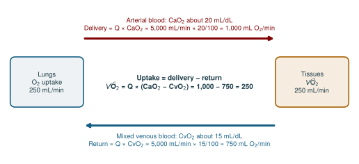

::: {.callout-note title="Goals for this chapter"}
- Explain why dissolved O~2~ cannot meet the body's demand.
- Read the HbO~2~ dissociation curve and know its anchor points.
- Calculate O~2~ content and O~2~ delivery.
- Predict what shifts the HbO~2~ curve, which way, and why it matters.
- Use the Fick principle to relate V̇O~2~, cardiac output and the arteriovenous O~2~ difference.
- Explain how CO~2~ is carried in blood and what the Haldane effect does.

Names, dates and the exact values in figure captions are context, not things to memorize. The anchor points and the O~2~ content equation are worth knowing cold.
:::

[Alveolar Ventilation](ventilation.qmd) brought O~2~ to the alveolus at a PO~2~ of about 100 mm Hg: 0.21 × (760 − 47) ≈ 150, minus 40/0.8 = 50. [Diffusion](diffusion.qmd) moved it into the pulmonary capillary blood. This chapter follows it in the blood to the tissues, then follows CO~2~ back from the tissues to the lungs.

Keep one question in mind. A patient with heart failure and normal lungs has a PaO~2~ of 100 mm Hg. We give O~2~ and the PaO~2~ rises to 200. How much more O~2~ reaches the tissues? The answer comes in the section on O~2~ content.

## The loop

Blood leaves the lungs with a PO~2~ of about 100, gives O~2~ to the tissues, and returns with a PO~2~ of about 40. Arterial blood has an O~2~ *content* CaO~2~, and mixed venous blood, returning to the lungs, has a content CvO~2~. Content is measured in mL of O~2~ per dL of blood, a volume of gas per volume of blood, which is awkward units but the ones everyone uses. The tissues take up O~2~ at a rate V̇O~2~ and give off CO~2~ at a rate V̇CO~2~, both in mL/min, and Q is the cardiac output. At steady state the lungs take up exactly as much O~2~ as the tissues use, and give off exactly as much CO~2~ as the tissues make.

Keep the sizes straight. At rest, cardiac output is about 5 L/min and minute ventilation about 6 to 7.5 L/min, flows of blood and of air. V̇O~2~ is much smaller, about 250 mL/min, and V̇CO~2~ about 200 mL/min. V̇O~2~ and V̇CO~2~ are gas exchange rates, not ventilation.

Arterial PO~2~ is a little lower than end-capillary PO~2~, about 95, because a small amount of blood bypasses gas exchange (bronchial and thebesian veins) and because ventilation and perfusion are not perfectly matched. That gap is the A–a gradient, and the [Ventilation and Perfusion](ventilation-perfusion.qmd) chapter covers it. In this chapter, round arterial PO~2~ to 100.

## Dissolved O~2~ is not enough

Henry's law says the concentration of a gas dissolved in a liquid is its solubility times its partial pressure:

$$[O_2]_{dissolved} = 0.003\ \frac{\text{mL O}_2}{\text{dL} \cdot \text{mm Hg}} \times P_{O_2}$$

At a PaO~2~ of 100 only 0.3 mL/dL is dissolved. (The small group keys use 0.0031. The difference does not matter.) The amount dissolved depends only on the partial pressure, not on how much gas the liquid touches. Dissolved O~2~ is also the only O~2~ that sets the PO~2~ and drives diffusion; O~2~ bound to hemoglobin does not count toward PO~2~.

Delivery of dissolved O~2~ is cardiac output times dissolved content:

- At rest: 5,000 mL/min × 0.3 mL/100 mL = 15 mL O~2~/min
- In heavy exercise, at a cardiac output of 25 L/min: 75 mL O~2~/min

A resting 70 kg person uses about 250 mL O~2~/min. One of the highest V̇O~2~max values ever reported, the cross-country skier Bjørn Dæhlie's 96 mL/kg/min, is about 6,700 mL/min at 70 kg. Dissolved O~2~ cannot cover even resting needs. We need a carrier.

## Hemoglobin

Adult hemoglobin (HbA) is a tetramer of two α and two β globin chains, each holding a heme group with a ferrous (Fe^2+^) iron. Each heme binds one O~2~, so one hemoglobin molecule carries up to four, loosely and reversibly. At a hemoglobin concentration of 15 g/dL, blood carries about 20 mL O~2~/dL bound to hemoglobin, roughly 65 times the dissolved amount.

### The HbO~2~ dissociation curve

The *O~2~-hemoglobin dissociation curve* plots the percentage of heme sites occupied by O~2~ (saturation) against PO~2~ (@fig-o2-co2-transport-hbo2). It is sigmoid because binding is *cooperative*. Hemoglobin with no O~2~ is in the tense (T) state, with a low affinity. Each O~2~ that binds moves the molecule toward the relaxed (R) state and raises the affinity of the hemes still empty.

{#fig-o2-co2-transport-hbo2}

Cooperativity shows most in the steep middle of the curve, about 10 to 40 mm Hg, where molecules are switching from T to R, so a small change in PO~2~ moves many molecules between nearly empty and nearly full. On the flat top almost every molecule is already full, so a big change in PO~2~ barely changes saturation. Compare the dashed curve, a protein with the same P~50~ and no cooperativity. At 100 mm Hg, hemoglobin is about 98% saturated and the non-cooperative protein only about 79%. From 100 down to 20 mm Hg (exercising muscle), hemoglobin gives up about 67 points of saturation and the non-cooperative protein about 36. Cooperativity buys two things: hemoglobin stays nearly full in the lung even if PAO~2~ falls a fair amount, and tissue can take a lot of O~2~ for a small fall in PO~2~.

Myoglobin, the O~2~-binding protein of muscle, has one heme and no cooperativity. Its curve is hyperbolic with a P~50~ near 3 mm Hg, so it holds its O~2~ until muscle PO~2~ is very low.

**The loading zone (lungs, PO~2~ about 100).** The curve is flat. PaO~2~ can fall from 100 to about 60 while saturation only drops from 97.5% to 90%, so content is largely kept. That is why moderate altitude is well tolerated.

**The unloading zone (tissues, PO~2~ about 40 and below).** The curve is steep. Resting mixed venous blood sits at the top of this zone (40 mm Hg, 75%). Exercising muscle pulls PO~2~ down to 20 mm Hg or lower, deep into the steep part, and hemoglobin gives up much more.

### The anchor points

| PO~2~ (mm Hg) | Saturation | Where |
|---|---|---|
| 100 | 97.5% | Arterial blood |
| 60 | 90% | The knee |
| 40 | 75% | Mixed venous blood at rest |
| 27 | 50% | P~50~ |

Above the knee you can lose a lot of PO~2~ without losing much saturation: PaO~2~ can fall from 100 to 60 and a pulse oximeter barely moves. Below it, saturation and content fall quickly. Clinicians watch 90% for that reason. During a difficult intubation the oximeter can sit in the 90s for minutes, and once it reaches the knee it can drop into the 80s within about 30 seconds.

P~50~, the PO~2~ at which hemoglobin is half saturated, is the standard index of affinity. A higher P~50~ means a lower affinity and a curve shifted to the right.

## O~2~ content

Arterial O~2~ content is the O~2~ bound to hemoglobin plus the O~2~ dissolved in plasma:

$$C_{aO_2} = (1.39 \times \text{Hb} \times S_{aO_2}) + (0.003 \times P_{aO_2})$$

Know this equation. 1.39 is the mL of O~2~ carried by 1 g of fully saturated hemoglobin. Hb is in g/dL and SaO~2~ is a fraction, so the first term comes out in mL O~2~/dL, the same units as the dissolved term.

With Hb 15 g/dL, SaO~2~ 0.97 and PaO~2~ 100:

$$C_{aO_2} = (1.39 \times 15 \times 0.97) + (0.003 \times 100) = 20.2 + 0.3 \approx 20.5\ \text{mL/dL}$$

The dissolved part is a rounding error. Hemoglobin carries the O~2~.

**Back to the opening question.** Raising PaO~2~ from 100 to 200 adds 0.3 mL/dL of dissolved O~2~, and saturation can only rise from about 97.5% to 100%. Content goes from about 20.6 (at 97.5%) to about 21.4 mL/dL, about 4%. For a patient with normal lungs and a low cardiac output, O~2~ helps a little. The real gains come from cardiac output or hemoglobin.

::: {.callout-note title="If you are comparing with the small group keys"}
Some texts use 1.34 or 1.36 mL O~2~/g in place of 1.39, and the small group keys use 0.0031 for the dissolved O~2~ coefficient. This course uses 1.39 and 0.003. The differences change a content by less than 1 mL/dL. The Small Group 2 key, Case 2, says "normal CaO~2~ is about 20.1"; with its own Case 1 numbers (SaO~2~ 100%) it is about 21. Either way, a normal CaO~2~ is about 20 mL/dL.
:::

### Content curves show what saturation curves hide

Plot content instead of saturation and you get a curve of the same shape, scaled by hemoglobin (@fig-o2-co2-transport-content). The dissolved line, 0.003 × PO~2~, barely shows at normal PO~2~. Above 100 mm Hg it is the only part still rising.

{#fig-o2-co2-transport-content}

Anemia lowers the plateau and polycythemia raises it, while the saturation curve is the same in both. Small Group 2 uses this in its teaching case of a climber at 8,400 m on Everest (P~B~ 272; the [Diffusion](diffusion.qmd) chapter compares him with the measured climbers at the same camp). On his blood gas, SaO~2~ is 68% at a PaO~2~ of 30 mm Hg. With a normal hemoglobin his content would be 1.39 × 15 × 0.68 + 0.003 × 30 ≈ 14.3 mL/dL. Over weeks at altitude his hemoglobin has risen to 20.2 g/dL, and his content is 1.39 × 20.2 × 0.68 + 0.09 ≈ 19.2 mL/dL, nearly normal despite a very low saturation. Polycythemia defends content; it cannot change saturation.

Methemoglobin, in which the heme iron has been oxidized from Fe^2+^ to Fe^3+^ (spontaneously or by drugs such as nitrites), cannot bind O~2~, and it shifts the curve of the remaining hemoglobin to the left. An enzyme in red cells, methemoglobin reductase, normally keeps it near 1%.

## What shifts the curve

The curve is not fixed. Conditions in the blood change hemoglobin's affinity for O~2~ (@fig-o2-co2-transport-shifts).

{#fig-o2-co2-transport-shifts}

**A right shift** (higher P~50~, lower affinity, more unloading at a given PO~2~) comes from:

- a higher temperature;
- a higher PCO~2~ and a higher H^+^ concentration (lower pH), which together are the *Bohr effect*;
- more 2,3-diphosphoglycerate (2,3-DPG) in the red cell.

Working muscle is warm and makes CO~2~ and acid, so it has the first three. That is the point of the system: high metabolism promotes unloading where O~2~ is needed. Because the top of the curve is flat, a right shift costs little loading in the lung; the gain is on the steep part, in the tissues. Try it on @fig-o2-co2-transport-shifts: at 100 mm Hg the shifted curves are close together, and at 20 to 40 mm Hg they are far apart.

**2,3-DPG** is made by glycolysis in the red cell and binds deoxygenated hemoglobin. It rises over hours to days with chronic hypoxemia (altitude, chronic lung disease) and with chronic anemia, which helps those patients unload O~2~. It falls in stored blood, so transfused red cells hold O~2~ tightly until they rebuild it.

**A left shift** (lower P~50~, higher affinity) comes from the reverse: lower temperature, lower PCO~2~ and H^+^ (alkalosis), less 2,3-DPG. Carbon monoxide, fetal hemoglobin and methemoglobin also shift the curve left. A left shift helps loading and hurts unloading. When you hyperventilate and feel lightheaded, the main reason is that a low PaCO~2~ constricts the brain's arterioles and lowers its blood flow. The left shift from the alkalosis adds a little, because the brain's blood gives up O~2~ less easily.

::: {.callout-warning title="A common mistake"}
In a single bout of exercise the right shift comes from temperature, PCO~2~ and H^+^. 2,3-DPG does not rise meaningfully in one bout. It changes over hours to days, as at altitude, in anemia or in chronic lung disease.
:::

::: {.callout-note title="If you are comparing with the slides"}
Slide 15 is titled "Dissociation Curve - Bohr Effect" and lists temperature, pH, PCO~2~ and 2,3-DPG, and in lecture all four were called the Bohr effect. Strictly, the Bohr effect is the effect of PCO~2~ and H^+^ on O~2~ affinity, as the slide's notes say. Temperature and 2,3-DPG also shift the curve right, but they are not the Bohr effect. This course uses the name the same way.
:::

### The curve at altitude

At altitude, hyperventilation starts within minutes, and the respiratory alkalosis it causes shifts the curve to the *left* first. That helps the blood load O~2~ in the lung at a low PAO~2~. Red cell 2,3-DPG then rises over hours to days, stimulated by the hypoxemia and by the alkalosis, and shifts the curve back to the right. At moderate altitude the two roughly cancel. At extreme altitude the alkalosis wins and the curve stays left of normal. The Small Group 2 climber shows it: at a pH of 7.55 his SaO~2~ is 68% at a PaO~2~ of 30, where a normal curve gives about 57%.

::: {.callout-note title="If you are comparing with the small group keys"}
The Small Group 2 key (Case 1, polycythemia question) says that at moderate altitude the curve "initially shifts to the right due to 2,3-DPG" and then back to the left from the respiratory alkalosis. The order is the other way around, as described above: the alkalosis comes first, within minutes, and 2,3-DPG follows over hours to days.
:::

## Carbon monoxide

Carbon monoxide (CO) binds hemoglobin about 240 times more tightly than O~2~ does. Hemoglobin is half saturated with O~2~ at 27 mm Hg and half saturated with CO at about 0.1 mm Hg. Most of that affinity comes from CO leaving hemoglobin very slowly; it combines somewhat more slowly than O~2~ but lets go far more slowly still. That is why trace amounts are dangerous. Air with 0.1% CO has a PCO of about 0.7 mm Hg. Competing against an alveolar PO~2~ of 100, that is enough to put more than half the hemoglobin in the carboxy form (carboxyhemoglobin, COHb) once it reaches equilibrium, which takes hours.

CO harms O~2~ transport in two ways:

1. It takes heme sites away from O~2~, so saturation and content fall.
2. The hemoglobin that still carries O~2~ shifts left, so it gives up its O~2~ poorly in the tissues.

PaO~2~ stays normal, because PaO~2~ is dissolved O~2~ and CO does not change it, and the A–a gradient is normal too. The problem is tissue hypoxia from low content and poor unloading, not hypoxemia. A measured saturation (co-oximetry on an arterial sample) is low. A pulse oximeter can read falsely normal; you do not need the reason for this course.

@fig-o2-co2-transport-co compares 50% COHb with anemia at half the normal hemoglobin. Both have about half the normal O~2~ capacity. The anemic patient can walk around. A COHb of 50% is often fatal. The difference is the left shift: with CO, the O~2~ that is bound will not come off at tissue PO~2~.

{#fig-o2-co2-transport-co}

CO binding is reversible. The COHb half-life is about 5 hours on room air, about 1 hour on 100% O~2~, and shorter still on hyperbaric O~2~. At very high PO~2~, dissolved O~2~ starts to count. Small Group 2 works this through for a man found confused in his car in a closed garage, with a PaO~2~ of 100 and a saturation of 50%:

- Room air: 1.39 × 15 × 0.50 + 0.003 × 100 ≈ 10.7 mL/dL
- 100% O~2~ in Chicago: PAO~2~ = (747 − 47) − 36/0.8 ≈ 655, using his PaCO~2~ of 36, and PaO~2~ is close to it: 10.4 + 2.0 ≈ 12.4 mL/dL
- Hyperbaric O~2~ at 3 atmospheres: PAO~2~ = (2,280 − 47) − 36/0.8 ≈ 2,190: 10.4 + 6.6 ≈ 17 mL/dL

His blood gas also shows a metabolic acidosis, from lactic acid made by hypoxic tissue.

::: {.callout-note title="If you are comparing with the notes and keys"}
The 2025 Transport notes (section X) say small amounts of CO "can cause major hypoxemia," and the Small Group 2 key says the left shift causes decreased unloading "resulting in hypoperfusion." CO causes tissue hypoxia with a normal PaO~2~, so it is not hypoxemia, and it does not reduce blood flow. Read "hypoxemia" and "hypoperfusion" in those places as tissue hypoxia. The notes' section XXI says SaO~2~ is "falsely normal"; a measured SaO~2~ is low, and it is the pulse oximeter (SpO~2~), or a saturation calculated from PaO~2~, that can read falsely normal.
:::

## Venous O~2~, delivery and the Fick principle

The same content equation works for mixed venous blood. With PO~2~ 40 and saturation 75%:

$$C_{vO_2} = (1.39 \times 15 \times 0.75) + (0.003 \times 40) = 15.6 + 0.12 \approx 15.8\ \text{mL/dL}$$

Arterial minus venous is about 20.5 − 15.8, roughly 5 mL/dL. At rest the tissues take about a quarter of the O~2~ delivered, and the other three quarters are a reserve.

| | Arterial | Mixed venous |
|---|---|---|
| PO~2~ (mm Hg) | 100 | 40 |
| Saturation | 97.5% | 75% |
| Content (mL/dL) | 20 | 15 |

Three flows, all in mL O~2~/min, describe the loop (@fig-o2-co2-transport-fick):

- **Delivery** (QO~2~ in the small groups) = Q × CaO~2~ = 5,000 mL/min × 20/100 ≈ 1,000
- **Return** = Q × CvO~2~ = 5,000 × 15/100 ≈ 750
- **Uptake** (V̇O~2~) = delivery − return ≈ 250

{#fig-o2-co2-transport-fick}

Uptake is delivery minus return, not delivery itself. Grouping the terms gives the *Fick principle*:

$$\dot{V}_{O_2} = (Q \times C_{aO_2}) - (Q \times C_{vO_2}) = Q \times (C_{aO_2} - C_{vO_2})$$

With the rounded values, 5,000 mL/min × 5 mL/100 mL = 250 mL O~2~/min. Rearranged, Q = V̇O~2~/(CaO~2~ − CvO~2~). Measure any two terms and you can solve for the third. Measure V̇O~2~ at the mouth, draw arterial and mixed venous blood, and you have the cardiac output. The cardiac catheterization lab and the exercise lab both use this. (This V̇O~2~ is the resting value, not V̇O~2~max.)

Read the equation the other way too. CvO~2~ falls when delivery falls (a low cardiac output, anemia, a low SaO~2~) or when consumption rises (fever, seizure, exercise). Either way the tissues extract more of what they get. That is the Small Group 3 patient in septic shock, with an SvO~2~ of 42%. Raising delivery or lowering consumption raises it again. The V/Q chapter shows why a low mixed venous O~2~ makes the hypoxemia from a shunt worse.

## CO~2~ transport

CO~2~ diffuses from the tissue cells into the plasma and on into the red cell. It travels in three forms (@fig-o2-co2-transport-co2-shares):

1. **Dissolved,** in plasma and in the red cell. CO~2~ follows Henry's law with a solubility of 0.067 mL/dL per mm Hg, more than 20 times that of O~2~, so at a PCO~2~ of 40 about 2.7 mL/dL is dissolved.
2. **As carbamino compounds.** CO~2~ binds reversibly to the N-terminal amine groups of proteins, mostly the α and β chains of hemoglobin, not the heme: Hb–NH~2~ + CO~2~ ⇌ Hb–NH–COO^−^ + H^+^. Deoxygenated hemoglobin forms carbamino compounds more readily than oxygenated hemoglobin.
3. **As bicarbonate.** Inside the red cell, carbonic anhydrase speeds the hydration of CO~2~:

$$CO_2 + H_2O \rightleftharpoons H_2CO_3 \rightleftharpoons H^+ + HCO_3^-$$

The first step is slow in plasma, which has almost no carbonic anhydrase, and fast in the red cell. The second step is fast without help. Hemoglobin buffers the H^+^, and deoxygenated hemoglobin is the better buffer. The HCO~3~^−^ leaves the red cell through an anion exchanger (band 3) in exchange for Cl^−^, the *chloride shift*. So most bicarbonate is made in red cells but carried in plasma. This is the same reaction that sets blood pH, which the [Pulmonary Acid Base](acid-base.qmd) chapter builds on.

Blood carries about 48 mL/dL of CO~2~ at a PCO~2~ of 40, more than twice its O~2~ content.

{#fig-o2-co2-transport-co2-shares}

The lecture's percentages, 10% dissolved, 30% carbamino and 60% bicarbonate, are shares of the CO~2~ *given off in the lung*, the venous-arterial difference. They are not shares of the total CO~2~ in blood, which is mostly bicarbonate.

::: {.callout-note title="If you are comparing with the notes"}
The table in the 2025 Transport notes (section XII) labels the 10, 30 and 60% column "% of Total CO~2~", and the summary slide (slide 34) shows the same numbers without saying what they are a share of. They are shares of the CO~2~ exchanged in the lungs. Of the total CO~2~ in arterial blood, about 90% is bicarbonate, 5% carbamino and 5% dissolved.
:::

## The Haldane effect

The *Haldane effect* is the effect of O~2~ on CO~2~ carriage: at any PCO~2~, deoxygenated blood holds more CO~2~ than oxygenated blood. It is driven by O~2~ saturation, not by PCO~2~. It mirrors the Bohr effect:

- Bohr: CO~2~ and H^+^ change how hemoglobin binds O~2~.
- Haldane: O~2~ changes how blood carries CO~2~.

Two properties of deoxygenated hemoglobin cause it. It forms carbamino compounds more easily, and it buffers H^+^ better, which pulls the carbonic anhydrase reaction toward bicarbonate. So in a systemic capillary, as hemoglobin gives up O~2~ to the tissue, it takes up H^+^ and binds CO~2~, and more CO~2~ goes into bicarbonate. Unloading O~2~ makes room for CO~2~. In the lungs everything runs backward: loading O~2~ helps the blood give CO~2~ up.

@fig-o2-co2-transport-haldane shows two CO~2~ dissociation curves, one for arterial blood (saturation 97.5%) and one for venous blood (75%). Real blood moves from the arterial point a (PCO~2~ 40, about 48 mL/dL) to the venous point v (PCO~2~ 46, about 52 mL/dL). The path from a to v is steeper than either curve. Of the 4 mL/dL of CO~2~ the tissues add, about half comes from the rise in PCO~2~ along one curve and about half is the Haldane effect, the jump up to the venous curve as hemoglobin gives up O~2~. The Haldane effect is not a minor effect. Over this range the CO~2~ curve is steep and has no plateau, and the Haldane effect adds about as much again, which is why a 6 mm Hg change in PCO~2~ carries all the CO~2~ the body makes (4 mL/dL × 50 dL/min = 200 mL/min).

{#fig-o2-co2-transport-haldane}

Clinically, when a patient with severe COPD who retains CO~2~ is given a lot of O~2~, PaCO~2~ can rise. Much of that is worse V/Q matching as O~2~ releases hypoxic vasoconstriction in poorly ventilated regions, part is the Haldane effect (fully saturated hemoglobin holds less CO~2~), and a small fall in ventilation contributes a little. [Control of Ventilation](control-of-ventilation.qmd) returns to these patients.

::: {.callout-warning title="A common mistake"}
Supplemental O~2~ does not lower PaCO~2~. PaCO~2~ is set by CO~2~ production and alveolar ventilation (PaCO~2~ ∝ V̇CO~2~/V̇~A~, from the [ventilation chapter](ventilation.qmd)). The Haldane effect changes how CO~2~ is loaded and unloaded inside the blood, not how much the body makes or how much the lungs clear. In the COPD patient above, O~2~ raises PaCO~2~ because effective alveolar ventilation falls as V/Q matching worsens (more of each breath goes to units that exchange little), and because the Haldane effect raises blood PCO~2~ that a patient who cannot breathe more cannot clear. The equation still holds; what changed is V̇~A~.
:::

## The whole path of O~2~

The lecture closes on one chain from air to tissue. Each link is a lecture in this block, and when a patient is hypoxemic or O~2~ delivery is low, you can walk down it and ask which link failed.

1. **P~B~, FiO~2~ and PaCO~2~ set PAO~2~** (the alveolar gas equation; [Alveolar Ventilation](ventilation.qmd)).
2. **Diffusion and V/Q matching set how close PaO~2~ gets to PAO~2~** ([Diffusion](diffusion.qmd); [Ventilation and Perfusion](ventilation-perfusion.qmd)).
3. **Hb, SaO~2~ and PaO~2~ set CaO~2~** (this chapter).
4. **O~2~ delivery = Q × CaO~2~**, and the tissues take out V̇O~2~, leaving CvO~2~ (this chapter, with cardiac output from the cardiovascular block). Metabolic activity (temperature, physical activity, infection) sets V̇O~2~.

::: {.callout-note collapse="true" title="Background: hemoglobin types, sickle hemoglobin and chronic anemia"}
Most adult hemoglobin is HbA (α~2~β~2~). HbA~2~ (α~2~δ~2~) is about 2.5%, and fetal hemoglobin (α~2~γ~2~) is under 1% in adults. Glycated forms (HbA~1a~, A~1b~, A~1c~) form without an enzyme and irreversibly, at a rate set by blood glucose. A red cell lives about 120 days, so HbA~1c~ reflects average glucose over the past 2 to 3 months, which is why it is checked in diabetes. HbA~1c~ binds O~2~ a little more tightly, partly because it binds 2,3-DPG less well, but at 6 to 9% of total hemoglobin the effect on the whole curve is small.

Sickle hemoglobin (HbS) comes from a single amino acid substitution in the β chain: valine replaces glutamate at position 6. Oxygenated HbS is normally soluble, but deoxygenated HbS is much less soluble than HbA and polymerizes into long, stiff fibers that distort the red cell into the sickle shape. Sickled cells are fragile and block small vessels, which causes the pain and organ damage of a sickle cell crisis, and they hemolyze (lifetime under 20 days), which causes chronic hemolytic anemia. Sickle blood also has a right-shifted curve.

In anemia that develops over a long time, 2,3-DPG rises and shifts the curve to the right, so hemoglobin releases O~2~ to the tissues at a higher PO~2~. This happens only with chronic anemia, not with a sudden fall in hemoglobin.
:::

## Check your understanding

1. A patient's oxygen saturation falls from 97.5% to 90%. Roughly how far has her PaO~2~ fallen? If her PaO~2~ then falls another 20 mm Hg, what happens to her saturation, and why is the second fall worse?

    

Answer

    From about 100 to about 60 mm Hg: a 40 mm Hg fall for 7.5 points of saturation, because she was on the flat top of the curve. Another 20 mm Hg brings her to 40, where saturation is about 75%, a further 15 points. Below the knee the curve is steep, so each mm Hg costs much more saturation and content.

    

2. During a race, the blood in a leg muscle's capillaries is warmer, has a higher PCO~2~ and a lower pH. Which way does the curve shift? Why does that help the muscle without costing much O~2~ in the lungs?

    

Answer

    All three shift the curve to the right (higher P~50~, lower affinity), and the PCO~2~ and pH part is the Bohr effect. At the low PO~2~ in working muscle, on the steep part of the curve, a right-shifted curve gives up much more O~2~. In the lungs, blood is cooler and has a lower PCO~2~ and a higher pH, so it is back near the normal curve, and on the flat top even a right-shifted curve stays nearly saturated.

    

3. A patient receives several units of blood that has been stored for weeks. Which way is the transfused blood's curve shifted, why, and what does that mean for the tissues over the first hours?

    

Answer

    To the left, because 2,3-DPG falls in stored red cells. The transfused hemoglobin loads O~2~ normally in the lungs but holds it more tightly at tissue PO~2~, so it unloads less until the cells rebuild their 2,3-DPG, which takes hours to days.

    

4. A patient with a hemoglobin of 10 g/dL receives a transfusion of fresh red cells that raises it to 13 g/dL. Her lungs and her cardiac output (5 L/min) do not change. Which way do her PaO~2~, SaO~2~, CaO~2~ and O~2~ delivery move, and by roughly how much?

    

Answer

    PaO~2~ does not change. It reflects the dissolved O~2~, which depends on the alveolar gas and the lung, not on hemoglobin, so it stays about 100 mm Hg. SaO~2~ does not change either: saturation depends on PO~2~ and on hemoglobin's affinity, not on how much hemoglobin there is, so it stays about 97%. CaO~2~ rises with the bound term, from about (1.39 × 10 × 0.97) + 0.3 ≈ 13.8 to (1.39 × 13 × 0.97) + 0.3 ≈ 17.8 mL/dL, close to a 30% rise. Delivery = Q × CaO~2~, so at 5 L/min it rises from about 690 to about 890 mL O~2~/min.

    

5. A patient's cardiac output falls by half while his V̇O~2~ stays the same. Using the Fick principle, what happens to the arteriovenous O~2~ difference and to his mixed venous saturation?

    

Answer

    V̇O~2~ = Q × (CaO~2~ − CvO~2~). If Q halves and V̇O~2~ is unchanged, the arteriovenous difference must double, from about 5 to about 10 mL/dL. With CaO~2~ unchanged at 20, CvO~2~ falls to about 10 mL/dL, and mixed venous saturation falls from 75% to about 50%. The tissues compensate by extracting more of the O~2~ they are given.

    

6. Carbamino compounds are only about 5% of the CO~2~ in arterial blood but about 30% of the CO~2~ given off in the lungs. Explain the difference.

    

Answer

    The 5% is a share of the total CO~2~ carried, and the 30% is a share of the small amount exchanged between venous and arterial blood (about 4 mL/dL). Deoxygenated hemoglobin forms carbamino compounds much more readily than oxygenated hemoglobin, so carbamino CO~2~ changes a lot as blood gives up O~2~ in the tissues and takes it up in the lungs. That is part of the Haldane effect.

    

## Key equations

| Equation | Use |
|---|---|
| [O~2~]~dissolved~ = 0.003 × PO~2~ | Henry's law; 0.3 mL/dL at a PO~2~ of 100 |
| CaO~2~ = (1.39 × Hb × SaO~2~) + (0.003 × PaO~2~) | O~2~ content; about 20 mL/dL arterial, 15 mL/dL mixed venous |
| O~2~ delivery (QO~2~) = Q × CaO~2~ | About 1,000 mL O~2~/min at rest |
| V̇O~2~ = Q × (CaO~2~ − CvO~2~) | Fick principle; about 250 mL O~2~/min at rest |
| Q = V̇O~2~/(CaO~2~ − CvO~2~) | Cardiac output by the Fick principle |
| CO~2~ + H~2~O ⇌ H~2~CO~3~ ⇌ H^+^ + HCO~3~^−^ | Bicarbonate formation; carbonic anhydrase in the red cell |
| Anchor points: 100/97.5%, 60/90%, 40/75%, 27/50% | The HbO~2~ curve |

## Sources

This chapter follows the 2026 Transport of O~2~ and CO~2~ in the Blood lecture for MEDC 30504 and draws on the Transport notes, Small Groups 2 and 3, and the course's 2018 transport notes, corrected and updated. All figures were drawn for this book.
