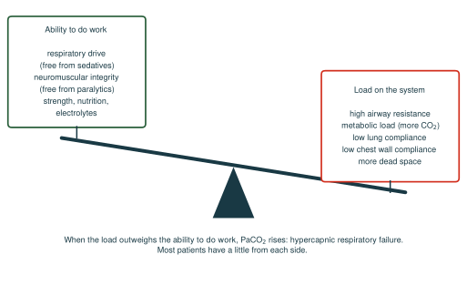

::: {.callout-note title="Goals for this chapter"}
- Sort a breathing problem into oxygenation, ventilation, or both.
- Work up hypoxemia with the alveolar gas equation, the A–a gradient and the response to supplemental O~2~.
- Explain why a normal pulse oximeter does not rule out a problem with O~2~ delivery or with ventilation.
- Use PaCO~2~ ∝ CO~2~ production / [RR × V~T~ × (1 − V~D~/V~T~)] to list the causes of a high PaCO~2~.
- Read a set of pulmonary function tests in percent predicted: big or small lungs, FEV~1~/FVC, DLCO and bronchodilator response, and place the patient on the PFT interpretation flowchart.
- Describe hypercapnic respiratory failure as an imbalance between the ability to do work and the load on the system.
:::

This chapter does not teach new physiology. It puts the block together the way a pulmonologist does when a patient says, "Doc, I'm feeling a little short of breath." Medical school teaches the building blocks from the bottom up; this is a first pass from the top down. Each section points back to the chapter that explains the mechanism, and the chapter is also the book's home for reading pulmonary function tests.

Shortness of breath has a long differential. It can come from the heart, from the blood (anemia), from the nerves and muscles, from anxiety or depression, as well as from the lungs. You can sort it by organ system, by exam findings (what makes a person wheeze?), or by obstruction versus restriction. All of those are correct, and you will use all of them. The lecture starts with a physiologic divide, because it is fast and it narrows the list: **is this a problem of oxygenation or of ventilation?** The lungs exist to get O~2~ into the blood and to get CO~2~ out of it. A pulse oximeter, which takes about ten seconds to put on, tells you right away whether oxygenation is failing.

## Oxygenation

Getting O~2~ to the tissues takes an adequate cardiac output and an adequate amount of saturated hemoglobin. O~2~ delivery is

$$\text{O}_2 \text{ delivery} = \text{CO} \times \left[(1.39 \times \text{Hb} \times \text{SaO}_2) + (0.003 \times \text{PaO}_2)\right]$$

with cardiac output in dL/min (from [Transport of O~2~ and CO~2~](o2-co2-transport.qmd)). Almost all the O~2~ is bound to hemoglobin; the dissolved term is small. Once you have checked the heart and the hemoglobin, a low pulse oximeter reading means the hemoglobin is not being saturated: the patient is hypoxemic (low PaO~2~).

::: {.callout-note title="If you are comparing with the slides"}
Slides 5, 13 and 38 write O~2~ delivery as CO [(Hg)(Sats) + 0.003(PaO~2~)]. The lecture said the 1.39 was left out because "the box was getting a little full." Without it, the bound term is grams of hemoglobin per dL, not mL of O~2~ per dL, and it cannot be added to the dissolved term. The full equation, as on the V/Q slides, has 1.39 × Hb × SaO~2~.
:::

### What has to happen, and what can fail

Two things must happen for arterial blood to be well oxygenated, and each failure has its own list of causes.

1. **O~2~ has to reach the alveoli.** The alveolar gas equation from [Alveolar Ventilation](ventilation.qmd) sets PAO~2~:

    $$\text{PAO}_2 = \text{FiO}_2 (\text{P}_B - \text{P}_{\text{H}_2\text{O}}) - \frac{\text{PaCO}_2}{R}$$

    The equation is its own differential diagnosis. PAO~2~ falls if inspired PO~2~ falls or if PaCO~2~ rises.

2. **O~2~ has to cross from the alveolus into the blood.** If it does, PaO~2~ is close to PAO~2~ and the A–a gradient (PAO~2~ − PaO~2~) is normal, 10 mm Hg or less. If it does not, the gradient widens.

@fig-respiratory-consultant-hypoxemia-flowchart is the sorting tree.

{#fig-respiratory-consultant-hypoxemia-flowchart}

### Low PAO~2~: the A–a gradient is normal

**Low inspired O~2~ tension.** At altitude, barometric pressure is low, so inspired PO~2~ is low (think Mt. Everest). A truly low FiO~2~ is rare in clinic. It happens to people trapped in a confined, unventilated space, as after an earthquake. Where you are usually tells you whether this is a factor, and it adds to any other cause: a patient with lung disease gets worse on an airplane or driving up a mountain.

**Hypoventilation.** If alveolar ventilation falls, PaCO~2~ rises and, by the alveolar gas equation, PAO~2~ falls. Today the commonest cause in patients who arrive acutely with hypoxemia and a very high CO~2~ is an overdose of a drug that suppresses the respiratory drive, most often an opioid such as fentanyl. People stop breathing, CO~2~ rises, O~2~ falls, and eventually the heart stops.

If either of these is the whole story, the A–a gradient is normal, and supplemental O~2~ will raise PaO~2~ by raising FiO~2~. The underlying problem still needs fixing: a patient who is not breathing may need ventilation, by hand or by machine.

### Raised A–a gradient: the lung is the problem

**Diffusion limitation.** In health, O~2~ uptake is perfusion limited: capillary PO~2~ reaches alveolar PO~2~ about a third of the way along the capillary, so the rest of the 0.75 s transit is reserve ([Diffusion](diffusion.qmd)). A thickened barrier, as in interstitial lung disease (ILD), slows diffusion. Mild disease uses up the reserve but still equilibrates at rest. With more severe disease, or when exercise shortens the transit time, blood leaves the capillary before it equilibrates, and the patient becomes hypoxemic. A low alveolar PO~2~ (altitude) lowers the driving gradient and makes all of this worse. That is why patients with ILD often have a normal saturation sitting in clinic and desaturate on a walk down the hallway. Supplemental O~2~ raises the alveolar PO~2~ and the gradient across the barrier, so it helps, though it does not change the barrier itself.

**V/Q mismatch.** Some alveoli are ventilated less than they are perfused. Their blood leaves with a lower PO~2~ and a higher PCO~2~, and mixing with blood from good units lowers PaO~2~ ([Ventilation and Perfusion](ventilation-perfusion.qmd)). It is typical of obstructive disease such as asthma, which narrows airways unevenly. Because the low V/Q units still get some air, supplemental O~2~ corrects the hypoxemia well, and the hypoxemia is usually mild. A wheezing patient with a saturation of 94% is not mainly an oxygenation problem; the lecture would "bump them over" into the ventilation category.

**Shunt.** Blood passes alveoli that get no ventilation at all, or bypasses alveoli entirely. Anatomic shunts include intracardiac shunts and arteriovenous malformations (AVMs). Physiologic shunts come from collapsed alveoli (atelectasis) and alveoli filled with blood, pus or water. Flooding often washes out surfactant, so alveoli that are not filled also collapse. No amount of supplemental O~2~ reaches the shunted blood, so shunt is **refractory** to O~2~.

A low mixed venous saturation, from low cardiac output, fever, sepsis or exercise, makes all three worse, because the blood that escapes gas exchange starts out lower. Small Group 4 lists this as "venous admixture"; it is an amplifier of the three causes, not a cause of its own. If you put desaturated venous blood through normal lungs, they saturate it almost completely. Only the small normal shunt lets it through, which matters in heavy exercise ([Physiology of Exercise](exercise.qmd)).

## "But the pulse oximeter is normal..."

A patient says she is short of breath, and her saturation is 98%. It is tempting to decide nothing is wrong with her breathing and that it must be anxiety. Anxiety can be the answer, but only after everything else is excluded. Two kinds of problem hide behind a normal pulse oximeter.

**O~2~ delivery can fail with a normal saturation.** Look at the delivery equation again. Cardiac output can be low (a low output state). Hemoglobin can be low (anemia). Or the hemoglobin can be broken: in carbon monoxide poisoning, CO occupies the binding sites, and the pulse oximeter can read falsely normal ([Transport of O~2~ and CO~2~](o2-co2-transport.qmd); how the oximeter is fooled is not examined). Sometimes the problem is saturating the hemoglobin; sometimes the hemoglobin itself is the problem.

**Ventilation can fail with normal oxygenation.** A patient can keep a normal saturation and still be clearing CO~2~ poorly, or be clearing it only by working much harder than normal. Extra work of breathing is what people feel as dyspnea. Most of the time we never notice our breathing, because it costs so little. These patients notice it all the time.

## Ventilation

Ventilation is controlled by the brainstem, and minute to minute it is titrated against CO~2~ ([Control of Pulmonary Ventilation](control-of-ventilation.qmd)). PaCO~2~ matters because CO~2~ sets pH through the bicarbonate buffer ([Pulmonary Acid Base](acid-base.qmd)):

$$\text{CO}_2 + \text{H}_2\text{O} \rightleftharpoons \text{H}_2\text{CO}_3 \rightleftharpoons \text{H}^+ + \text{HCO}_3^-$$

The lecture writes the alveolar ventilation equation in a form that lists its own causes:

$$\text{PaCO}_2 \sim \frac{\text{CO}_2 \text{ production}}{\text{RR} \times \text{V}_T \times (1 - \text{V}_D/\text{V}_T)}$$

The denominator is alveolar ventilation: minute ventilation (V̇E = V~T~ × RR) with the dead space fraction taken out. So a high PaCO~2~, or a normal PaCO~2~ kept only by hard work, has to come from one of four things: more CO~2~ production (or more acid that has to be cleared as CO~2~), a low respiratory rate, a low tidal volume, or a high dead space fraction.

Minute ventilation at rest is about 6 L/min (0.5 L × 12/min), and modest changes can triple it. The system is held tight. In the lecture's thought experiment, a person held underwater would do anything, even attack the person holding them down, once PaCO~2~ reached about 45 mm Hg. A patient who is struggling to keep PaCO~2~ at 40 is working against that drive all day.

### Lung volumes and the tools of the trade

Ventilation means moving air in and out of a system with a certain compliance, by generating negative pleural pressure. Anything that disturbs the lung, the chest wall or the muscles changes how well that works and how much it costs. The [Respiratory Statics](statics.qmd) chapter explains what sets each volume: FRC is the balance of lung and chest wall recoil with no muscle effort, TLC is where the inspiratory muscles can pull no further against the system's recoil, and RV is where the expiratory muscles can squeeze no further (or where airways close).

To measure them, the pulmonary function lab uses three tests:

- **Spirometry**, which measures the air that moves: V~T~, IRV, ERV, IC and VC, and in a forced breath the FVC and FEV~1~.
- **Body box plethysmography**, which measures FRC. Then RV = FRC − ERV and TLC = FRC + IC.
- **Diffusing capacity for carbon monoxide (DLCO)**, which measures the gas-exchanging surface ([Diffusion](diffusion.qmd)).

Results are reported against predicted values for a person of the same age, height and sex, and **80 to 120% of predicted is normal**. The lecture noted that some labs once used separate reference values by race, built from narrow study populations; the course's lab has not done that for decades and compares everyone with one standard.

Some reports also show values before and after a bronchodilator (albuterol, a β~2~ agonist). A rise in FEV~1~ or FVC after albuterol means part of the airflow limitation is reversible.

## Reading PFTs: the cases

Read every set the same way:

1. **Picture the patient** from age, height and weight.
2. **Big lungs or small lungs?** Look at TLC, FRC and RV. Can the patient not get air in (small lungs, restriction) or not get it out (big lungs, gas trapping)?
3. **The flows.** Are FVC and FEV~1~ low, and is FEV~1~ low out of proportion to FVC (a low FEV~1~/FVC, obstruction)?
4. **DLCO.** Is the gas-exchanging surface preserved?

Airway resistance at FRC is also on the lecture's reports; normal is below 2 cm H~2~O/L/s.

| Case | TLC | FRC | RV | FVC | FEV~1~ | Raw | DLCO | Reading |
|---|---|---|---|---|---|---|---|---|
| 19-year-old woman | 90 | 87 | 89 | 88 | 93 | 1.4 | 110 | Normal |
| 19-year-old woman | 74 | 90 | 125 | 68 | 75 | 1.3 | 108 | Normal FRC, step-up volumes: muscle weakness |
| 48-year-old woman, 262 lb | 68 | 72 | 71 | 75 | 79 | 0.88 | 94 | Restriction, normal DLCO: chest wall (obesity) |
| 48-year-old woman, 142 lb | 55 | 75 | 68 | 49 | 47 | 0.88 | 40 | Restriction, low DLCO: ILD |
| 54-year-old man | 118 | 122 | 177 | 80 → 95 | 66 → 77 | 2.1 | 105 | Obstruction, normal DLCO, bronchodilator response: asthma |
| 74-year-old man | 122 | 178 | 222 | 40 → 43 | 23 → 25 | 1.9 | 28 | Obstruction, low DLCO, no bronchodilator response: emphysema |

Values are percent predicted, except Raw in cm H~2~O/L/s. Arrows show before and after a bronchodilator. Some reports, like the one in Small Group 4, print FEV~1~/FVC as a percent of the predicted ratio (105 there); the 0.70 cutoff applies to the ratio itself. @fig-respiratory-consultant-lung-volume-patterns plots the lung volumes.

{#fig-respiratory-consultant-lung-volume-patterns}

**Normal.** Every value is between 80 and 120%. Flows normal, resistance normal, DLCO normal.

**Muscle weakness: normal FRC, step-up volumes.** Most students say "small lungs" because the TLC of 74% catches the eye. Start instead with FRC, the respiratory system's resting volume with no effort ("the P~ms~ of the respiratory system"): at 90% it is normal. Weak inspiratory muscles cannot reach a normal TLC, and weak expiratory muscles cannot squeeze down to a normal RV, so TLC is low, FRC normal and RV high. That rising sequence is the **step-up pattern**. Vital capacity, the distance from RV to TLC, has to be low, so FVC and FEV~1~ fall in proportion; resistance and DLCO are normal. On the pressure-volume curves the lung and chest wall do not move; the muscle limits move inward ([Respiratory Statics](statics.qmd)). The respiratory muscles can be tested directly, by the maximal negative inspiratory force and positive expiratory force. In diaphragm weakness, spirometry lying down is worse than sitting: upright, gravity pulls the abdominal contents down and helps the diaphragm descend; lying flat, they push a weak diaphragm up into the chest (Small Group 4).

**Obesity: restriction with a normal DLCO.** All three volumes are small. The flows are low, but in proportion to the volumes. (A rough rule, not a lab standard: if the lungs are 70% of predicted, the flows should be down by about that much. Flows much lower than the volumes suggest obstruction as well.) DLCO is normal, so the lung tissue is fine. The restriction is outside the lung: adipose tissue loads the chest wall and pushes up the diaphragm. In this patient the chest film also showed a very large heart, another space-occupying load on the chest. Ascites, pregnancy, a large upper abdominal mass, pleural effusion or pleural disease, and chest wall disease such as a circumferential burn do the same. The chest wall curve shifts right, and FRC and TLC fall, with ERV falling most. The lung itself is normal.

**ILD: restriction with a low DLCO.** The lungs are small all the way across, and the flows are low, at least as low as the volumes. DLCO is 40%, so most of the gas-exchanging surface is gone. Before reading a low DLCO as lung disease, check the hemoglobin: DLCO measures CO uptake by hemoglobin, so anemia lowers it, and the lab corrects the DLCO for hemoglobin. With a normal hemoglobin, this is lung parenchymal disease, here pulmonary fibrosis. The fibrotic lung recoils harder, its curve shifts right, and FRC and TLC fall. Small lungs with flows reduced even more than the volumes can mean restriction and obstruction together, for example asthma in a patient who then develops drug-induced fibrosis, or sarcoidosis, which can scar both the parenchyma and the airways.

**Asthma: obstruction with a normal DLCO and a bronchodilator response.** The lungs are large, with RV raised most: gas is trapped behind narrowed airways. FEV~1~ is low for lungs this size, and resistance is slightly high. After albuterol, FEV~1~ rises from 66 to 77% of predicted and FVC from 80 to 95%. DLCO is normal, because asthma is an airway disease and spares the alveoli. On spirometry the expiratory flow-volume curve is scooped and the volume-time curve slow (@fig-respiratory-consultant-spirometry-patterns). Asthma is common enough that spirometry in the office, with a bronchodilator, is often all the testing a typical patient needs.

**Emphysema: obstruction with a low DLCO and no bronchodilator response.** The lungs are huge, with FRC almost twice normal and RV over twice normal, and very little volume moving between TLC and RV. Flows are very low and barely change with albuterol. DLCO is 28%: emphysema destroys alveoli and their capillaries together, so the exchanging surface is lost. Because alveoli and capillaries are lost together, V/Q is roughly preserved and hypoxemia is mild early. The enlarged air spaces that remain have lost more capillaries than ventilation, which adds dead space. This is also a step-up pattern, but from gas trapping with a high FRC, not from weakness with a normal FRC.

![Spirometry in normal, obstructive and restrictive patterns. (A) Volume exhaled against time in a forced expiration. Obstruction lowers FEV~1~ more than FVC, so FEV~1~/FVC falls; restriction lowers both, and the ratio is normal or high. (B) Flow-volume loops placed at their absolute lung volumes, which needs plethysmography: the obstructive loop sits at high volumes and its expiratory limb is scooped; the restrictive loop is narrow and sits at low volumes. Schematic. Course figure, after the lecture and PFT lab slides.](figures/respiratory-consultant/spirometry-patterns.svg){#fig-respiratory-consultant-spirometry-patterns}

The shapes come from expiratory flow limitation, which [Respiratory Dynamics II](dynamics-2.qmd) explains. Early in a forced expiration, flow is limited in the central airways; as volume falls, the flow-limiting segment moves to smaller airways. In asthma and emphysema those smaller airways limit flow early and severely, which scoops the curve. A narrowing in the trachea caps the peak instead, flattening the top of the loop. If the narrowing is fixed (its size does not change with breathing, as in tracheal stenosis), it flattens the inspiratory limb too ([Respiratory Dynamics II](dynamics-2.qmd)). The [PFT page of the Respiratory Mechanics Lab](https://beiser-lab.github.io/respiratory-mechanics-lab/pft.html) lets you load each of these patients and read the report yourself.

::: {.callout-note title="If you are comparing with the slides"}
Slide 36 says "TLC >120%: obstructive lung disease," and the notes say "TLC >120% = obstruction." Obstruction is defined by a low FEV~1~/FVC ratio, below about 0.70. Slide 37 and the Small Group 4 flowchart label the arrow into obstruction with both FEV~1~/FVC < 70% and FEV~1~ < 80%, and @fig-respiratory-consultant-pft-flowchart keeps both labels. The ratio is what defines obstruction; FEV~1~ percent predicted then says how severe it is, and a low FEV~1~ with a normal ratio is not obstruction. A TLC above 120% is hyperinflation. It often comes with obstruction, especially emphysema, but obstruction can be present with a normal TLC: the asthma case on slide 29 is clearly obstructed with a TLC of 118%. "Can't get air in, small lungs" for restriction (TLC below 80%) is right as the slide says.

The speaker notes for slides 24, 27 and 34 also say TLC "is determined by the elastic properties of the lung itself." TLC is set by the maximal force of the inspiratory muscles against the inward recoil of the lung and chest wall. A stiff lung lowers TLC and a floppy one raises it, and weak muscles lower it even when the lung is normal, as the weakness case shows.
:::

### Bronchodilator response: points, not percent change

A bronchodilator response is a rise in **FEV~1~ or FVC of more than 10% of predicted**, that is, more than 10 points of percent predicted. The asthma case qualifies: FEV~1~ rose 11 points (66 to 77) and FVC 15 points (80 to 95). The emphysema case does not: FEV~1~ rose only 2 points (23 to 25).

Lab reports often print a different number, the percent change from the pre-drug value. The emphysema report shows 9% for that FEV~1~ change (23 to 25 is a 9% rise on a small base), and the example report in lecture showed an FVC rising from about 90 to about 110% of predicted, a change of about a quarter from the pre-drug value. Use the change in percent predicted for the rule.

### Putting it on the flowchart

@fig-respiratory-consultant-pft-flowchart is the course's PFT interpretation summary.

![The PFT interpretation flowchart. Start with lung volumes. Small lungs (TLC below 80%) are restriction, and DLCO separates extrathoracic causes from lung parenchymal disease. In normal or big lungs, the arrow into obstruction carries the slide's two labels, FEV~1~/FVC below 70% and FEV~1~ below 80%; the ratio is what defines obstruction. DLCO and the bronchodilator response separate emphysema, asthma and chronic bronchitis. Normal spirometry with a history suggesting asthma can go on to bronchoprovocation. Course figure, after the lecture's PFT interpretation summary and the Small Group 4 framework.](figures/respiratory-consultant/pft-flowchart.svg){#fig-respiratory-consultant-pft-flowchart}

- **Small lungs, normal DLCO:** extrathoracic restriction: obesity, chest wall disease, neuromuscular disease (with its step-up pattern).
- **Small lungs, low DLCO:** lung parenchymal disease such as ILD.
- **Obstruction with a low DLCO:** emphysema.
- **Obstruction with a normal DLCO and a bronchodilator response:** asthma. Without a response: chronic bronchitis.
- **Normal spirometry but a convincing story of asthma** (wheezing at a friend's house with a cat, or skating in cold air, but never at the indoor pool): asthma is reversible, and the patient may be well on the day of the test. A **bronchoprovocation test** tries to provoke it: the patient inhales increasing doses of methacholine with spirometry after each, and the test stops when FEV~1~ falls. Enough methacholine causes bronchospasm in anyone, so a positive test does not prove asthma, but a negative test is good evidence against it. Exercise can be the provocation too.

COPD (chronic obstructive pulmonary disease) is the clinical umbrella for obstructive lung disease other than asthma. It runs from chronic bronchitis, which centers on the airways, to emphysema, which destroys the parenchyma. When the DLCO is low and there is no bronchodilator response, "emphysema" is the more specific reading of the pattern. Some patients fall between asthma and COPD, with partial reversibility.

## It is not always the respiratory system

Back to the patient who is short of breath. Even with normal lungs, the oxygenation chain can fail at the heart (a low cardiac output state), at the hemoglobin (anemia) or at the binding site (CO poisoning). And on the ventilation side, the lungs live in a body.

## Ventilation: the ability to do work versus the load

The lecture's model for hypercapnic respiratory failure is a balance (@fig-respiratory-consultant-strength-load). On one side is the ability to do the work of breathing. On the other is the load. Respiratory failure happens when the load outweighs the strength.

{#fig-respiratory-consultant-strength-load}

**The ability to do work:**

- **Respiratory drive**, free from sedatives such as opioids and benzodiazepines.
- **Neuromuscular integrity**, free from paralytics: a neuromuscular blocker can stop breathing as surely as a lack of drive.
- **Strength, nutrition and electrolytes.** Sick, malnourished patients lose muscle strength.

**The load on the system:**

- **High airway resistance** (asthma, COPD).
- **Metabolic load:** more CO~2~ to clear, or more acid to clear as CO~2~.
- **Low lung compliance** (fibrosis, edema).
- **Low chest wall compliance** (obesity, kyphoscoliosis, a distended abdomen).
- **More dead space** (a pulmonary embolism, emphysema).

Exercise is a huge metabolic load. Healthy people tolerate a tenfold rise in CO~2~ output because their ability to do work is so large, and they stop exercising before the load wins ([Physiology of Exercise](exercise.qmd)).

Real patients usually have a little from each side. Small Group 4's patient is a 50-year-old man being worked up for a neuromuscular junction disorder. His blood gas shows a respiratory acidosis, and his PaO~2~ is low but about what the alveolar gas equation predicts for his PaCO~2~: a ventilation problem, not an oxygenation one. On the strength side: weakness, poor food intake, and as-needed opioids for knee pain. On the load side: obesity, a stiff spine after surgery, a recent pulmonary embolism (dead space), and constipation that distends the abdomen. Fixing one item rarely fixes the patient, which is why ventilatory failure is often harder to diagnose and treat than an O~2~ problem. The [Pulmonary Acid Base](acid-base.qmd) chapter uses the same model for respiratory acidosis.

## The consultant's questions

The lecture ends with the questions to ask of every patient who is short of breath:

1. Is it oxygenation, ventilation, or both?
2. Are the lungs big (hyperinflation, gas trapping) or small (restriction)? Is FEV~1~/FVC low (obstruction)?
3. Is the DLCO preserved?
4. Are there extrapulmonary contributors?
5. Does this patient have respiratory failure? Will they?

The last question is the one that matters most on the wards. The job is not to report what went wrong but to see it coming: to understand why a patient is breathing deeply, or 24 times a minute, and to act before respiratory failure arrives.

## Check your understanding

1. Why does the A–a gradient, and not PaO~2~ alone, separate a pump problem (drive, muscles or load) from a lung problem as the cause of hypoxemia?

    

Answer

    PaO~2~ falls in both. In a pump problem, alveolar ventilation falls and PaCO~2~ rises, and by the alveolar gas equation, PAO~2~ = PIO~2~ − PaCO~2~/R, PAO~2~ falls with it. The lung still transfers O~2~ normally, so PaO~2~ stays close to the lower PAO~2~ and the A–a gradient is normal, 10 mm Hg or less. In a lung problem (V/Q mismatch, diffusion limitation or shunt), PAO~2~ can be normal or even high, but O~2~ fails to get from the alveoli into the blood, so PaO~2~ falls below PAO~2~ and the gradient widens. Calculating PAO~2~ takes out the effect of ventilation (and of FiO~2~ and altitude), and the gradient that is left is the lung's own contribution.

    

2. A patient's TLC is 65% of predicted and the DLCO 95%, with a normal hemoglobin. Where is the problem, and what would you expect if the same TLC came from pulmonary fibrosis?

    

Answer

    Restriction with a preserved DLCO points outside the lung: the chest wall, the abdomen pushing on the diaphragm, or weak muscles. Look at FRC and RV to tell them apart (a step-up pattern with a normal FRC suggests weakness). In fibrosis the DLCO would be low, because the gas-exchanging surface is lost.

    

3. A patient's FEV~1~ goes from 1.6 L (40% of predicted) to 2.1 L (52%) after albuterol. Is this a bronchodilator response by the course's rule? What would the "percent change" column on the report show?

    

Answer

    Yes. FEV~1~ rose 12 points of percent predicted (40 to 52), more than 10. The report's percent change from the pre-drug value would be about 31% (0.5 L on a base of 1.6 L). The rule uses the change in percent predicted.

    

4. Patients with neuromuscular weakness and with emphysema can both have a high RV. Which single number from spirometry separates them, and why does it come out differently in the two?

    

Answer

    FEV~1~/FVC. In weakness the airways and lung tissue are normal. The muscles cannot reach a full TLC or squeeze down to a normal RV, so the vital capacity is small, and FEV~1~ and FVC fall in proportion, which leaves the ratio normal. In emphysema the lung has lost its elastic recoil and the alveolar walls that tether the small airways, so the airways collapse early in a forced expiration and flow is limited. FEV~1~ falls much more than FVC, and the ratio falls below 70%, which defines obstruction.

    

5. A woman with myasthenia gravis develops pneumonia with a high fever and her PaCO~2~ starts to rise. Name the factors on each side of the strength-load balance.

    

Answer

    Strength side: neuromuscular weakness from myasthenia, and fatigue and poor intake from being sick. Load side: fever raises CO~2~ production (metabolic load), the pneumonia lowers lung compliance and may add dead space, and secretions raise airway resistance. The load has risen while the ability to do work has fallen.

    

6. A short-of-breath patient has a saturation of 97% on the pulse oximeter. Name three places in the O~2~ delivery chain where the problem could still be, and one problem that would not show up as low oxygenation at all.

    

Answer

    Low cardiac output, anemia (low hemoglobin), and carbon monoxide poisoning (hemoglobin that cannot carry O~2~). A ventilation problem, such as a high work of breathing to keep PaCO~2~ normal, can also cause dyspnea with normal oxygenation.

    

## Key equations

| Equation | Use |
|---|---|
| O~2~ delivery = CO × [(1.39 × Hb × SaO~2~) + (0.003 × PaO~2~)] | Where oxygenation can fail besides the lung |
| PAO~2~ = FiO~2~ (P~B~ − P~H2O~) − PaCO~2~/R | Low PAO~2~: low inspired PO~2~ or hypoventilation |
| A–a gradient = PAO~2~ − PaO~2~ | Normal 10 mm Hg or less; raised in diffusion limitation, V/Q mismatch, shunt |
| PaCO~2~ ~ CO~2~ production / [RR × V~T~ × (1 − V~D~/V~T~)] | Causes of a high PaCO~2~ |
| V̇E = V~T~ × RR | Minute ventilation |
| RV = FRC − ERV; TLC = FRC + IC | Lung volumes from the body box and spirometry |
| Bronchodilator response: FEV~1~ or FVC up more than 10% of predicted | Reversible obstruction |

## Sources

This chapter follows the 2025 Think Like a Respiratory Consultant lecture for MEDC 30504 as delivered, with its recording, and draws on the course's lecture notes, the Small Group 1 and Small Group 4 answer keys and the PFT lab slides, corrected and updated. All figures were drawn for this book.
