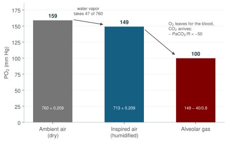
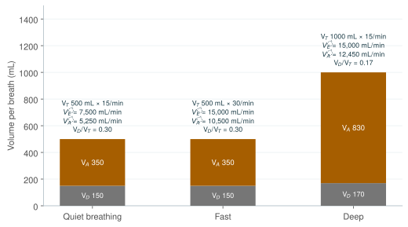

::: {.callout-note title="Goals for this chapter"}
- Calculate PO~2~ in ambient, inspired and alveolar gas, and explain why each step lowers it.
- Use the alveolar gas equation to predict PAO~2~ when barometric pressure, FiO~2~ or PaCO~2~ changes.
- Distinguish minute, alveolar and dead space ventilation, and explain why deep breathing is more efficient than fast breathing.
- Use the alveolar ventilation equation to predict PaCO~2~ from CO~2~ production and alveolar ventilation.
- Explain how a climber can stand on the summit of Everest without supplemental O~2~.
- List the causes of hypoxemia that work by lowering PAO~2~.

Names, dates and the exact values in figure captions are context, not things to memorize. The equations and the round numbers in the text are worth knowing.
:::

The earlier chapters were about moving air: the forces that hold the lung at a volume ([Respiratory Statics](statics.qmd)) and the pressures that drive flow through the airways ([Respiratory Dynamics I](dynamics-1.qmd) and [II](dynamics-2.qmd)). This chapter asks what that air movement does to the gas in the alveoli. Air that reaches the alveoli has less O~2~ in it than the air you breathed in, and how much less depends on three things: barometric pressure, the fraction of O~2~ you breathe, and how fast you breathe out CO~2~. The next two chapters follow the O~2~ across the alveolar wall ([Diffusion](diffusion.qmd)) and into hemoglobin ([Transport of O~2~ and CO~2~](o2-co2-transport.qmd)).

The lecture is built around two questions about Mount Everest. In 2019 a photograph of a long queue of climbers below the summit ridge, at about 8,800 m, went around the world. Nearly everyone in that line was breathing bottled O~2~. Why? And in May 1978, Reinhold Messner and Peter Habeler reached the summit without it, when many physiologists thought that could not be done. How? By the end of the chapter you will be able to answer both with one equation.

## From air to alveolus: the airways

The airways are a tree of branching tubes. Ewald Weibel's simplified model numbers the branches by *generation* [@w10-weibel1963]. The trachea is generation 0. It divides into the two main bronchi (generation 1), then the lobar and segmental bronchi, and so on. At each generation the tubes become narrower, shorter and more numerous.

- **Conducting zone, generations 0 to 16:** trachea, bronchi, bronchioles, and the terminal bronchioles, the smallest airways without alveoli. These airways carry air but do not exchange gas. Together they hold about 150 mL.
- **Respiratory zone, generations 17 to 23:** respiratory bronchioles (with occasional alveoli budding from their walls), alveolar ducts (completely lined with alveoli), and alveolar sacs. The lung beyond one terminal bronchiole is an *acinus*. From a terminal bronchiole to the farthest alveolus is only a few millimeters, about the length of a crayon tip.

Each branch is narrower than its parent, but the number of branches doubles at every generation, so the *total* cross-sectional area rises steeply toward the periphery (@fig-ventilation-airway-area). The trachea is about 2.5 cm^2^. The terminal bronchioles together are about 180 cm^2^, and the alveolar sacs about 10,000 cm^2^, the size of a table 4 feet across. That is cross-sectional area, the area the air moves through, not the surface area for gas exchange that the diffusion chapter uses.

![Total cross-sectional area of the airways by generation (log scale, black), from Weibel's model A [@w10-weibel1963], as plotted in the 2026 lecture. The dashed line is relative air velocity, calculated as the smallest total area divided by the area at each generation. The same total flow passes through every generation, so velocity is highest where total area is smallest (generations 2 to 4) and falls toward zero in the respiratory zone. Course figure.](figures/ventilation/airway-area.svg){#fig-ventilation-airway-area}

The airways are in series, so the same total airflow passes through every generation. Linear velocity is flow divided by area, so it is highest where total area is smallest, in the lobar and segmental bronchi (generations 2 to 4), and falls toward zero past the terminal bronchioles. There, gas moves the last few millimeters by diffusion rather than by bulk flow. Bulk flow (convection) brings fresh air down the conducting airways, and diffusion finishes the job over a distance short enough to be fast. Airway resistance and expiratory flow limitation belong to [Respiratory Dynamics II](dynamics-2.qmd). Most airway resistance sits in the medium-sized bronchi.

::: {.callout-note title="If you are comparing with the notes"}
The airway table in the 2025 Ventilation notes puts gas diffusion at generations "11–23". Generations 11 to 16 are small bronchi and bronchioles that only conduct air. The respiratory zone begins at generation 17, as the slides say. The trachea is generation 0.
:::

## Ambient air: Dalton's law

Dry air is a mixture of gases, and each gas exerts its own *partial pressure*. Dalton's law says the partial pressures add up to the total, the barometric pressure (P~B~, also written P~atm~):

$$P_B = P_{N_2} + P_{O_2} + P_{Ar} + P_{CO_2}$$

The partial pressure of each gas is the total pressure times that gas's fraction of the dry mixture. For O~2~ at sea level, where P~B~ is 760 mm Hg:

$$P_{O_2} = P_B \times F_{IO_2} = 760 \times 0.209 \approx 159\ \text{mm Hg}$$

The slides use 0.209 (more exactly 0.2093) to make 159.1 come out. From here on, as in the course, round FiO~2~ to 0.21. Nitrogen is about 78% of dry air, argon about 0.93%, and CO~2~ only about 0.04%, a partial pressure of about 0.3 mm Hg. For gas exchange you can treat inspired CO~2~ as zero.

## Inspired air: water vapor dilutes the other gases

As air passes through the nose, mouth and upper airways, the moist mucosa warms it to 37 °C and saturates it with water vapor. The *saturated* vapor pressure of water depends only on temperature, not on barometric pressure or on the weather outside. At 37 °C it is 47 mm Hg. That is why you use 47 at sea level, in Chicago and on the summit of Everest, and why breathing cold dry winter air does not change it: by the time the air reaches the lower airways it is at body temperature and 100% humidity.

The total pressure in the airways is still P~B~, so water vapor takes 47 mm Hg of it and every other gas shares what is left. The *inspired* PO~2~ (PIO~2~, written P~iO2~ on the slides) is:

$$P_{IO_2} = (P_B - P_{H_2O}) \times F_{IO_2} = (760 - 47) \times 0.21 \approx 149\ \text{mm Hg}$$

Humidification alone costs about 10 mm Hg of PO~2~. Inspired air, in this course, is that humidified gas sitting in the trachea. No gas exchange happens there.

| Gas | Fraction of dry air | Dry ambient air (mm Hg) | Humidified inspired air (mm Hg) |
|---|---|---|---|
| Nitrogen | 0.7809 | 593.5 | 556.8 |
| Oxygen | 0.2093 | 159.1 | 149.2 |
| Carbon dioxide | 0.0004 | 0.3 | 0.3 |
| Argon | 0.0093 | 7.1 | 6.6 |
| Water vapor | 0 | 0 | 47 |
| Total | 1 | 760 | 760 |

## Alveolar gas: the alveolar gas equation

In the alveolus two things happen that do not happen in the trachea. O~2~ leaves the gas for the blood, and CO~2~ arrives from the blood. Alveolar PO~2~ (PAO~2~) is therefore the inspired PO~2~ minus the O~2~ that has left. You cannot measure the O~2~ that left directly, but you can estimate it from the CO~2~ that came in, because the two are linked by metabolism. That gives the *alveolar gas equation* (also called the alveolar air equation):

$$P_{AO_2} = (P_B - P_{H_2O})\,F_{IO_2} - \frac{P_{aCO_2}}{R}$$

The first term is PIO~2~. The second is the O~2~ the alveolus has given up, estimated from the CO~2~ it has received.

- **PaCO~2~ stands in for PACO~2~.** The equation really needs alveolar PCO~2~ (PACO~2~). CO~2~ equilibrates almost completely between alveolar gas and capillary blood (the diffusion chapter explains why), so PACO~2~ and arterial PCO~2~ (PaCO~2~) are essentially equal. PaCO~2~ is the one you can measure, with an arterial blood gas drawn from the radial artery. At rest it is about 40 mm Hg. Capital A means alveolar; lowercase a means arterial.
- **R converts CO~2~ in to O~2~ out.** R is the *respiratory exchange ratio*: CO~2~ given off divided by O~2~ taken up, V̇CO~2~/V̇O~2~. At steady state it equals the respiratory quotient of the tissues and is set by what fuel they burn. On a mixed Western diet R is about 0.8, so for every 0.8 molecules of CO~2~ that enter the alveolus, 1 molecule of O~2~ leaves. On pure carbohydrate R is 1.0.

{#fig-ventilation-po2-steps}

The slides show the effect of diet with PaCO~2~ held at 40:

- Pure carbohydrate (R = 1.0): PAO~2~ = 149 − 40/1.0 = 109 mm Hg
- Western diet (R = 0.8): PAO~2~ = 149 − 40/0.8 = 149 − 50 = 99 mm Hg

The course rounds the sea-level value to 100 mm Hg (@fig-ventilation-po2-steps). Use R = 0.8 unless you are told otherwise.

::: {.callout-note title="If you are comparing with the slides"}
Slide 14 is headed "Respiratory Quotient (R)", and the speaker notes and Small Group 2 call R the respiratory exchange ratio (RER). This course uses *respiratory exchange ratio (R)* for the term in the alveolar gas equation, as the small groups do. At steady state the two ratios are equal, so the number is the same.
:::

### Why the equation is useful clinically

Every term on the right side is known or measurable: P~B~ (760 at sea level, 747 in Chicago), P~H2O~ (47), FiO~2~ (0.21 on room air, more on supplemental O~2~), PaCO~2~ (from a blood gas) and R (0.8). So you can calculate PAO~2~ at the bedside. Compare it with the measured arterial PO~2~ and you have the *A–a gradient*, PAO~2~ − PaO~2~. The [Ventilation and Perfusion](ventilation-perfusion.qmd) chapter uses the A–a gradient to sort the causes of hypoxemia. One distinction matters already: PAO~2~ is *calculated* and is about 100 mm Hg at sea level in anyone with a normal PaCO~2~ on room air. The normal *arterial* PO~2~ is 80 to 100 mm Hg, a little lower, by the A–a gradient.

### Three places to use it

**Sea level.** PAO~2~ = 0.21 × (760 − 47) − 40/0.8 = 0.21 × 713 − 50 ≈ 100 mm Hg.

**Chicago.** P~B~ is 747 mm Hg, which the small groups use. PAO~2~ = 0.21 × (747 − 47) − 50 = 0.21 × 700 − 50 = 97 mm Hg. (One memory aid: the Boeing 747, and Boeing's headquarters used to be in Chicago.)

**An airplane cabin.** Commercial aircraft are pressurized not to sea level but to about 7,000 ft, where P~B~ is about 586 mm Hg. FiO~2~ is still 0.21; only the total pressure has fallen. PAO~2~ = 0.21 × (586 − 47) − 50 = 113 − 50 = 63 mm Hg. Most healthy people do fine at that.

**The summit of Everest.** P~B~ is 253 mm Hg (measured on West's 1981 American Medical Research Expedition). With room air and a normal PaCO~2~:

$$P_{AO_2} = 0.21 \times (253 - 47) - \frac{40}{0.8} = 43.3 - 50 = -6.7\ \text{mm Hg}$$

A negative partial pressure cannot exist. The equation is telling you that this steady state (room air, PaCO~2~ 40, R 0.8) is impossible in a living climber: on these numbers nobody could stand on the summit breathing air. Something in the equation has to change. P~B~ is fixed on the summit, which leaves two terms. FiO~2~ can go up, or PaCO~2~ can come down.

**The answer to question 1: raise FiO~2~.** With bottled O~2~ at an FiO~2~ of 1.0, PAO~2~ = (253 − 47) × 1.0 − 50 = 206 − 50 = 156 mm Hg, higher than at sea level. That is why nearly everyone in the queue carries a bottle. Climbers' masks do not really deliver 100% O~2~, but the direction is the point.

::: {.callout-warning title="A common mistake"}
Supplemental O~2~ raises FiO~2~, and PAO~2~ rises with it. It does not lower PaCO~2~ or "displace" CO~2~ from the alveolus. PaCO~2~ is set only by how much CO~2~ you make and how much fresh air reaches your alveoli, which is the next section. A patient who is breathing too little can have a normal O~2~ saturation on supplemental O~2~ while PaCO~2~ keeps rising.
:::

::: {.callout-note collapse="true" title="Background: the simplified equation at high FiO2"}
The equation in this course is the simplified form. The full form has a small correction term that depends on FiO~2~ and R. On room air the correction is about 2 mm Hg and is ignored. At FiO~2~ 1.0 the R correction drops out altogether, because no nitrogen is left to be concentrated, and the full equation gives 206 − 40 = 166 mm Hg on the summit rather than 156. The course and the small groups use the simplified equation at every FiO~2~, and no conclusion changes.
:::

Messner and Habeler had no bottle, so their FiO~2~ was 0.21, and nothing changes P~B~ on the summit. The only term left is PaCO~2~. To see how a climber can change it, you need to know what sets PaCO~2~.

## Minute, alveolar and dead space ventilation

Start at the end of a quiet expiration, at functional residual capacity (FRC), about 3,000 mL of gas in the lungs. A quiet breath adds a *tidal volume* (V~T~) of about 500 mL. *Minute ventilation* (V̇~E~) is the volume breathed per minute:

$$\dot{V}_E = V_T \times RR = 500\ \text{mL} \times 15/\text{min} = 7{,}500\ \text{mL/min}$$

Not all of that air reaches the alveoli. The last 150 mL of each breath in stays in the conducting airways, and on the next expiration it is the first to leave, unchanged. That volume is the *anatomic dead space* (V~D~): ventilated, but not taking part in gas exchange. The rest of the breath, V~T~ − V~D~ = 350 mL, is the fresh air that reaches the respiratory zone each breath (the slides write it V~A~; it is the alveolar part of the breath, not the volume of the alveoli). Those 350 mL mix with the 3,000 mL already there, which is why alveolar gas composition barely changes from one breath to the next.

Per minute, with dots marking rates:

$$V_T = V_D + V_A \qquad \dot{V}_E = \dot{V}_D + \dot{V}_A$$

$$\dot{V}_A = \dot{V}_E - \dot{V}_D = (V_T - V_D) \times RR$$

| | Per breath | Per minute (× 15) |
|---|---|---|
| Tidal volume and minute ventilation | V~T~ = 500 mL | V̇~E~ = 7,500 mL/min |
| Dead space | V~D~ = 150 mL | V̇~D~ = 2,250 mL/min |
| Alveolar | V~A~ = 350 mL | V̇~A~ = 5,250 mL/min |

Pulmonary blood flow, the cardiac output, is about 5,000 mL/min, so alveolar ventilation and blood flow are about equal: the whole lung's ventilation-perfusion ratio is about 0.8 to 1. This lecture's numbers give about 1; the V/Q lecture's slides use 0.8, which corresponds to an alveolar ventilation of about 4 L/min. Both are reasonable whole-lung values, and the [Ventilation and Perfusion](ventilation-perfusion.qmd) chapter explains why the ratio varies from apex to base.

The anatomic dead space is only part of the story. Alveoli that are ventilated but not perfused also waste ventilation, and anatomic plus alveolar dead space is the *physiologic* dead space. In healthy people alveolar dead space is very small, so physiologic dead space is about the same as anatomic dead space. Pulmonary embolism is the classic way to add alveolar dead space. The V/Q chapter shows how to measure it with the Bohr equation.

::: {.callout-warning title="A common mistake"}
Dead space is not residual volume. Residual volume is the gas left in the whole lung after a maximal expiration, about 1.5 L, most of it in alveoli. Anatomic dead space is the 150 mL in the conducting airways that never reaches an alveolus on a given breath.
:::

### Fast versus deep breathing

You can double minute ventilation in two ways: double the rate or double the depth. @fig-ventilation-fast-deep compares them.

- **Fast:** 500 mL × 30/min = 15,000 mL/min. Each breath still loses 150 mL to dead space, so V̇~A~ = 350 × 30 = 10,500 mL/min.
- **Deep:** 1,000 mL × 15/min = 15,000 mL/min. Dead space rises a little, to about 170 mL, because the expanding lung pulls the airways open, but the conducting airways are much stiffer than the respiratory zone, so nearly all the extra volume goes to the alveoli. V̇~A~ = 830 × 15 = 12,450 mL/min.

{#fig-ventilation-fast-deep}

Measured at the mouth the two patterns look identical, yet the deep pattern ventilates the alveoli about 20% more. The *dead space fraction*, V~D~/V~T~, shows why: 150/500 = 0.3 for the fast pattern and 170/1,000 = 0.17 for the deep one. Normal V~D~/V~T~ at rest is about 0.3. Think of dead space as an ATM fee: a fixed charge every time you make a withdrawal, whatever the amount, so it is cheaper to take out more money less often. This is one reason people breathe deeper before they breathe faster when they start to exercise. The [Physiology of Exercise](exercise.qmd) chapter picks this up.

## What sets PaCO~2~: the alveolar ventilation equation

Measuring V̇~A~ as V̇~E~ − V̇~D~ is simple on paper, but dead space is hard to measure. The lecture gets at alveolar ventilation another way: follow the CO~2~.

Inspired air has almost no CO~2~, and the dead space adds none, because no gas exchange happens there. So every molecule of CO~2~ you breathe out came from the alveoli. The CO~2~ leaving per minute is alveolar ventilation times the fraction of CO~2~ in alveolar gas:

$$\dot{V}_{CO_2} = \dot{V}_A \times F_{ACO_2}$$

V̇CO~2~ is strictly CO~2~ *output*, the volume of CO~2~ in expired gas per minute. At steady state it equals the body's metabolic CO~2~ production, so the same symbol is used for both. Production rises with exercise, fever and infection. Notice that V̇CO~2~ is a gas exchange rate, not a ventilation.

Two steps you already know turn that fraction into the PaCO~2~ on a blood gas:

1. Fraction to pressure (Dalton's law again): PACO~2~ = FACO~2~ × (P~B~ − 47).
2. Alveolus to artery: CO~2~ equilibrates across the alveolar wall, so PaCO~2~ ≈ PACO~2~.

Substitute and rearrange to get the *alveolar ventilation equation*:

$$P_{aCO_2} = \frac{\dot{V}_{CO_2}}{\dot{V}_A} \times K \qquad \text{so} \qquad P_{aCO_2} \propto \frac{\dot{V}_{CO_2}}{\dot{V}_A}$$

K is a constant that folds in the unit conversions (0.863, with V̇CO~2~ in mL/min and V̇~A~ in L/min). You do not need its value. What you need is the proportionality: PaCO~2~ rises in proportion to CO~2~ production and falls in proportion to alveolar ventilation. Think of it as a clearance equation, with the lungs as the excretory organ for CO~2~.

The lecture's resting numbers are a V̇CO~2~ of 250 mL/min and a V̇~A~ of about 5 L/min, which hold PaCO~2~ at about 40 mm Hg.

- Halve V̇~A~ (2.5 L/min) and PaCO~2~ doubles, to about 80: *hypoventilation*.
- Double V̇~A~ (10 L/min) and PaCO~2~ halves, to about 20: *hyperventilation*.

Other lectures in the course, and the transport and exercise chapters, use 200 mL/min as a typical resting V̇CO~2~ (with a V̇O~2~ of 250, that gives R = 0.8). Only the proportions matter here.

A single arterial blood gas therefore tells you whether alveolar ventilation is keeping up with CO~2~ production. *Hyperventilation* and *hypoventilation* are defined by PaCO~2~, not by how fast or how hard someone is breathing. PaCO~2~ below 40 means V̇~A~ is more than V̇CO~2~ requires; above 40 means it is less.

{#fig-ventilation-paco2-va}

@fig-ventilation-paco2-va shows the relationship as a hyperbola. During exercise the curve moves. Mild exercise triples V̇CO~2~ to about 750 mL/min, so at any V̇~A~ the PaCO~2~ is three times higher. That is the same as saying it takes three times the V̇~A~ to reach any given PaCO~2~, so "three times higher" and "three times farther right" are the same move for this curve. If V̇~A~ stayed at 5 L/min during exercise, PaCO~2~ would climb toward 130. In healthy people it does not, because ventilation rises in step with V̇CO~2~ ([Control of Ventilation](control-of-ventilation.qmd), [Physiology of Exercise](exercise.qmd)).

::: {.callout-warning title="A common mistake"}
The two words are easy to swap, and even experienced clinicians do it out loud. Tie each to the blood gas. An opioid overdose slows breathing, so alveolar ventilation falls and PaCO~2~ rises: that is *hypo*ventilation. A climber on Everest breathes hard, alveolar ventilation rises, and PaCO~2~ falls: that is *hyper*ventilation. Rapid shallow breathing can be fast and still be hypoventilation, because a larger share of each small breath is dead space.
:::

## Alveolar ventilation sets both alveolar gases

Alveolar ventilation appears in the alveolar ventilation equation, which sets PACO~2~, and PACO~2~ appears in the alveolar gas equation, which sets PAO~2~. Put the two together and you can plot both alveolar gases against V̇~A~ (@fig-ventilation-alveolar-gases).

{#fig-ventilation-alveolar-gases}

As V̇~A~ falls, PACO~2~ rises and PAO~2~ falls. As V̇~A~ rises, PACO~2~ falls and PAO~2~ rises. The curves are close to mirror images, but not exact ones. With R = 0.8, each 1 mm Hg fall in PaCO~2~ raises PAO~2~ by 1/R, about 1.25 mm Hg, so a 10 mm Hg fall in PaCO~2~ buys 12.5 mm Hg of PAO~2~.

Both curves flatten at high V̇~A~. Once PACO~2~ is low, more ventilation buys little more O~2~, and PAO~2~ can never exceed PIO~2~, about 149 mm Hg at sea level. The crossing point of the two curves has no meaning. (These curves are not the hemoglobin dissociation curve of the transport chapter, although they have a similar look.)

The same picture explains hypoventilation as a cause of hypoxemia. A patient with an opioid overdose hypoventilates, PaCO~2~ rises, and PAO~2~ falls with it. The lung itself is normal, so the arterial PO~2~ falls in step with PAO~2~ and the A–a gradient stays normal.

## Everest solved: only PaCO~2~ can change

Back to Messner and Habeler. P~B~ and FiO~2~ were fixed. The one term they could change was PaCO~2~, by raising alveolar ventilation. Suppose a climber hyperventilates hard enough to drive PaCO~2~ down to 8 mm Hg:

$$P_{AO_2} = 0.21 \times (253 - 47) - \frac{8}{0.8} = 43.3 - 10 \approx 33\ \text{mm Hg}$$

Not comfortable, but positive, and enough to stay alive (@fig-ventilation-pao2-settings). These are close to real numbers. On West's 1981 expedition, alveolar gas sampled on the summit had a PACO~2~ of about 7.5 mm Hg and a PAO~2~ of about 35 mm Hg.

{#fig-ventilation-pao2-settings}

The hard way has costs. Breathing enough to hold PaCO~2~ at 8 takes a great deal of work, and the respiratory muscles tire. It also causes a severe respiratory alkalosis, only partly offset over days of acclimatization as the kidneys excrete bicarbonate ([Pulmonary Acid Base](acid-base.qmd)). And a PAO~2~ of 33 is a starting point with almost no margin. What it means for the blood comes in the next two chapters: the diffusion chapter asks whether capillary blood can even reach 33, and the transport chapter shows what hemoglobin does at that pressure.

So the two answers are:

1. **The climbers in line (the easy way):** bottled O~2~ raises FiO~2~ and PAO~2~ rises to about 156 mm Hg.
2. **Messner and Habeler (the hard way):** with FiO~2~ and P~B~ fixed, they hyperventilated, lowering PaCO~2~ to about 8 and raising PAO~2~ to about 33 mm Hg.

## Hypoxemia from a low PAO~2~

*Hypoxemia* means a low arterial PO~2~. The alveolar gas equation names the causes that work by lowering PAO~2~ first:

| Cause | Term in the equation | Example |
|---|---|---|
| Low barometric pressure | P~B~ | Altitude, the airplane cabin, Everest |
| Low FiO~2~ | FiO~2~ | A confined space where O~2~ has been used up or displaced by another gas |
| Hypoventilation | PaCO~2~ (high) | Opioids, sedatives |

In all three the lung is normal, so the A–a gradient is normal: PaO~2~ is low because PAO~2~ is low. Raising FiO~2~ corrects the hypoxemia in all three, although in hypoventilation it leaves the high PaCO~2~ untouched. The other causes of hypoxemia (diffusion limitation, V/Q mismatch and shunt) widen the A–a gradient. They come in the [Diffusion](diffusion.qmd), [Ventilation and Perfusion](ventilation-perfusion.qmd) and [Think Like a Respiratory Consultant](respiratory-consultant.qmd) chapters, which assemble the full framework.

## Check your understanding

1. A student in Chicago works the alveolar gas equation for a January day at −20 °C and a humid July day at 32 °C, and wants to use a different P~H2O~ for each. What would you tell her?

    

Answer

    Use 47 mm Hg for both. By the time inspired air reaches the lower airways it has been warmed to 37 °C and fully saturated, and the saturated vapor pressure of water depends only on temperature. Outside temperature and humidity do not matter. Only the barometric pressure (747 in Chicago) and FiO~2~ set PIO~2~.

    

2. A swimmer breathes through a snorkel that adds 150 mL to his dead space, and he keeps the same V~T~ (500 mL) and rate (15/min). What happens to his minute ventilation, alveolar ventilation, PaCO~2~ and PAO~2~ if his CO~2~ production does not change?

    

Answer

    Minute ventilation is unchanged at 7,500 mL/min. Dead space is now 300 mL, so only 200 mL of each breath reaches the alveoli and V̇~A~ falls from 5,250 to 3,000 mL/min. PaCO~2~ rises in proportion, by 5,250/3,000 ≈ 1.75, to about 70 mm Hg. By the alveolar gas equation PAO~2~ falls, to roughly 150 − 70/0.8 ≈ 62 mm Hg. To keep PaCO~2~ normal he has to take deeper breaths, which is why long snorkels do not work.

    

3. Two patients each lose 1 L/min of alveolar ventilation, and CO~2~ production does not change in either. One starts at a normal V̇~A~ of about 5.4 L/min and a PaCO~2~ of 40. The other is already hypoventilating, at a V̇~A~ of about 2.7 L/min and a PaCO~2~ of 80. Whose PaCO~2~ rises more, and why? Use the shape of @fig-ventilation-paco2-va.

    

Answer

    The patient who is already hypoventilating. PaCO~2~ ∝ V̇CO~2~/V̇~A~ is a hyperbola, flat at high V̇~A~ and steep at low V̇~A~. For the first patient, 1 L/min is under a fifth of his V̇~A~, and PaCO~2~ rises from 40 to about 49 (40 × 5.4/4.4). For the second, the same 1 L/min is more than a third of his V̇~A~, and PaCO~2~ rises from 80 to about 127 (80 × 2.7/1.7). A small further fall in breathing, from a sedative for example, is far more dangerous in a patient who is already on the steep part of the curve.

    

4. Hyperventilation raised PAO~2~ from impossible to about 33 mm Hg on Everest. Why can't a healthy person at sea level use the same trick to raise PAO~2~ to 200?

    

Answer

    PAO~2~ = PIO~2~ − PaCO~2~/R, and PIO~2~ at sea level is about 149. Even if hyperventilation drove PaCO~2~ toward zero, PAO~2~ could only approach 149, and the curves in @fig-ventilation-alveolar-gases flatten long before that. On Everest the CO~2~ term (50 mm Hg at a normal PaCO~2~) was larger than the whole PIO~2~ of 43, so shrinking it made all the difference. To go above PIO~2~ you have to raise PIO~2~ itself, with a higher FiO~2~ or a higher P~B~.

    

5. After surgery, a patient on supplemental O~2~ (FiO~2~ 0.40) is getting drowsier from pain medication. Her pulse oximeter reads 99%. Why doesn't that reassure you about her breathing?

    

Answer

    The oximeter reports O~2~, and the extra FiO~2~ keeps PIO~2~ high, so PAO~2~ and her saturation can stay normal even as alveolar ventilation falls. Supplemental O~2~ does nothing to the CO~2~ term: PaCO~2~ ∝ V̇CO~2~/V̇~A~, so if V̇~A~ halves, PaCO~2~ doubles whatever the FiO~2~. Only a measurement of PaCO~2~ (a blood gas) tells you whether her ventilation is keeping up.

    

6. Explain in two sentences why all the CO~2~ in an exhaled breath comes from the alveoli, and why that makes CO~2~ useful for measuring alveolar ventilation.

    

Answer

    Inspired air contains almost no CO~2~, and no gas exchange takes place in the conducting airways, so the dead space adds none. The CO~2~ leaving per minute is therefore V̇~A~ × FACO~2~, which lets you work out alveolar ventilation from CO~2~ output and alveolar (or arterial) PCO~2~ without having to measure the dead space.

    

## Key equations

| Equation | Use |
|---|---|
| P~gas~ = P~B~ × F~gas~ (Dalton) | Partial pressure in dry ambient air; PO~2~ ≈ 159 at sea level |
| PIO~2~ = (P~B~ − P~H2O~) × FiO~2~ | Inspired, humidified air; P~H2O~ = 47; PIO~2~ ≈ 149 at sea level |
| PAO~2~ = (P~B~ − P~H2O~) FiO~2~ − PaCO~2~/R | Alveolar gas equation; R = 0.8; PAO~2~ ≈ 100 at sea level, 97 in Chicago |
| A–a gradient = PAO~2~ − PaO~2~ | Introduced here; used in the V/Q chapter |
| V̇~E~ = V~T~ × RR | Minute ventilation |
| V~T~ = V~D~ + V~A~; V̇~A~ = V̇~E~ − V̇~D~ = (V~T~ − V~D~) × RR | Alveolar ventilation |
| V̇CO~2~ = V̇~A~ × FACO~2~ | All expired CO~2~ comes from the alveoli |
| PaCO~2~ = (V̇CO~2~/V̇~A~) × K, so PaCO~2~ ∝ V̇CO~2~/V̇~A~ | Alveolar ventilation equation; you do not need K |

## Sources

This chapter follows the 2026 Alveolar Ventilation lecture for MEDC 30504 and draws on the Ventilation notes, Small Group 2, and the course's 2018 ventilation notes, corrected and updated. All figures were drawn for this book.

::: {#refs}
:::
